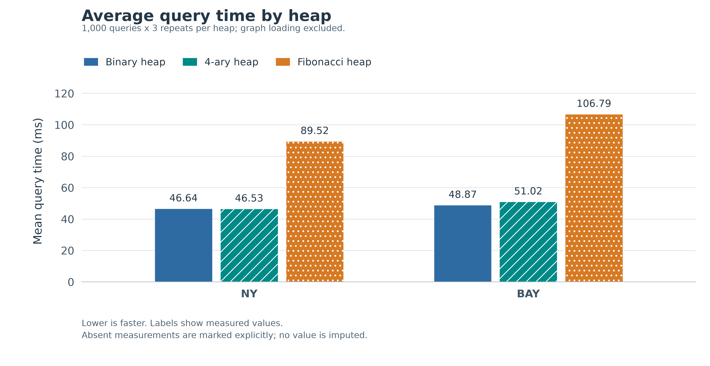

# 三种堆的Dijkstra：中文报告

完整报告以LaTeX编写，正文与图表基于本次新实验。

- [原双堆报告归档](report_two_heap_history.md)

## 1. 问题与范围

在同一套Dijkstra流程中比较BinaryHeap、DaryHeap4和FibonacciHeap。Simple作为小图参考。

## 2. 设计

四叉堆使用外部dist数组和pos映射，降低树高，同时在下滤时比较最多四个孩子。固定d=4后与二叉堆同阶。

## 3. 验证

9套原生测试、55项Python回归检查通过。四叉堆包含30,000次参考模型操作；330个随机图查询另外用Bellman-Ford核对。

## 4. 本次实验

两组路网，各1000对查询、3轮、3种堆，共18,000次调用；算法块顺序逐轮轮换。

| 数据集 | 二叉平均/ms | 四叉平均/ms | 斐波那契平均/ms | 四叉相对二叉用时下降 |
|---|---:|---:|---:|---:|
| NY | 46.64044 | 46.53342 | 89.52210 | 0.23% |
| BAY | 48.86850 | 51.01878 | 106.78841 | -4.40% |

正百分比表示用时下降，负值表示用时增加。

## 5. 讨论

两张稀疏图上的三种理论上界都可化为O(V log V)。运行时间不能单独证明缓存或分配器开销的贡献。两组规模点也不足以证明渐近增长规律。

## 6. 结论与历史记录

结论以同一新批次的三种实现为依据。旧的results顶层与my_run数据保持不变，不与本次四叉堆拼接比较。详情、复现步骤与参考文献见中文PDF。
