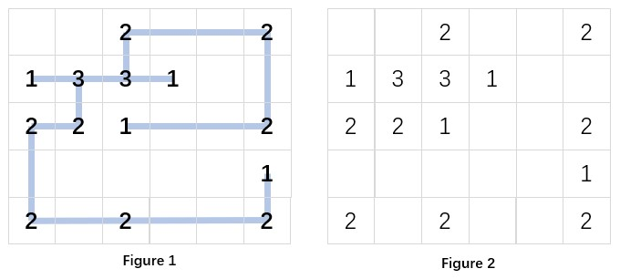
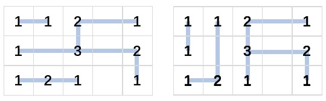

# Project 3: Recover the Design

## 第1章 问题描述

本项目根据园林中各个连接器的位置和度数，恢复一组水平或竖直的围栏。输入给出 n 行 m 列的网格，行列数均在 2 到 50 之间。0 表示该位置没有连接器，1 到 4 表示连接器必须连接的围栏方向数。输出按照行优先顺序列出每个连接器的上、下、左、右状态；不存在合法方案时输出 No Solution。

题目中的几个条件决定了建模方式。围栏不能在空位置转弯，也不能在没有连接器的位置相交。沿某个方向延伸时，围栏遇到的第一个连接器就是该段围栏的终点。若还要继续延伸，必须由这个连接器的另一个方向接出。题目允许多解，输出其中一解即可，没有要求全部连接器构成一个连通分量。尤其是样例3中包含彼此分离的部分，因此程序没有额外加入连通性条件。

本报告依据提供的 question.txt 和两张示意图整理。原题文本中部分数学符号已经乱码，行列范围结合原文明确可读的数字和语义解释为 2≤n,m≤50；度数范围为 1≤k≤4。原始文件保留在提交目录中，不覆盖修改。



## 第2章 数据结构与算法

### 2.1 将几何布局转化为有限约束

把每个非零网格位置看作顶点。依次扫描每一行，将相邻的两个连接器组成水平候选边；依次扫描每一列，以同样方式建立竖直候选边。这里的“相邻”指中间没有其他连接器，允许中间经过多个空格。每个顶点在四个方向上至多各有一条候选边，因此最大候选边数不超过 2nm-n-m，在50×50满网格时为4900。

令每条候选边 e 的二元变量为 x_e。选中围栏时 x_e=1，否则为0。对每个连接器 v，所有关联边必须满足：

$$\sum_{e\ni v}x_e=k_v.$$

仅满足度数还不够。例如十字形四个端点均为1，中间为0时，四个连接器各自都可以满足度数，但横竖围栏会在中心相交。为此，对于每一对在空格处相交的水平边 h 和竖直边 v，加入：

$$x_h+x_v\leq1.$$

实现中用 hcell 和 vcell 记录经过空格的水平、竖直候选边。一格至多对应一条水平候选边和一条竖直候选边，因此交叉约束的数量不超过 nm，而不是需要比较所有边对。

### 2.2 状态与撤销记录

Vertex 保存行列坐标、目标度数、四方向边编号、已选边数 chosen 和未定边数 free。Edge 保存两个端点、状态和交叉冲突链表头。状态取 -1、0、1，分别表示未定、不选和选中。Conflict 保存与当前边冲突的另一条边。

程序只在未定边第一次被赋值时，将其编号压入 trail，并同步更新两个端点的计数。回溯时按照相反顺序恢复边和计数。一个搜索分支记录进入时的栈顶，就能准确撤销该分支内的全部变化；不必复制整张图。单次赋值选择一条边时，会将所有相交候选边设为0。如果其中某条已经为1，立即发现矛盾。

### 2.3 度数传播

对连接器 v，记 remaining=k_v-chosen_v。任何合法补全都必须满足 0≤remaining≤free_v。若这个范围条件失败，当前分支无解。

当 remaining=0 时，其余未定边必须全部不选；当 remaining=free_v 时，其余未定边必须全部选中。选择边可能通过交叉约束排除其他边，进而使新的连接器满足上述条件。因此程序重复扫描所有顶点，直到一轮中没有新增赋值。

传播的作用是提前排除不可能的分支，而不是直接保证求出全部解。例如满网格度数均为2时，内部连接器仍有多个选择，需要继续搜索。

### 2.4 最少选择优先搜索

传播结束后，从仍有未定边的连接器中选择组合数最少的一个。若其有 f 条未定边，还需要选择 r 条，则局部选择数为组合数 C(f,r)。由于 f≤4，最多只有6种局部选择。程序使用小表计算组合数，枚举对应的位掩码，将该连接器的所有未定边同时赋值，再递归搜索。

每次失败后恢复到分支开始的 trail 栈顶，尝试下一个组合；全部失败则恢复到本次递归入口，向上层返回失败。所有边都已确定时，度数传播已检查每个连接器的目标度数，此时可以输出方案。

搜索伪代码如下：

```text
search():
    mark = trail.size
    if propagation finds a contradiction:
        undo(mark); return false
    choose an undecided connector with minimum C(free, remaining)
    if no undecided connector exists: return true
    for every legal local subset:
        branch = trail.size
        assign all undecided incident edges
        if assignments are consistent and search(): return true
        undo(branch)
    undo(mark); return false
```

### 2.5 正确性说明

候选边的完备性：一段合法围栏必须是水平或竖直线段，且不能在空格处转弯。遇到连接器时围栏与它连接，所以每段都可拆分成相邻连接器之间的候选边。反之，每条候选边本身也符合直线和端点条件。

约束的等价性：顶点等式确保每个连接器恰好使用指定数量的方向。交叉不等式排除了空位置的横竖交叉。同一直线上的候选边内部互不重叠，只能在连接器处相接，因此不需要额外的重叠限制。所有约束成立时，选中边组成的布局就是合法方案；任意合法布局也一定满足这些约束。

传播的可靠性：若剩余需求小于0或超过未定边数，任何补全都无法满足度数；若剩余需求为0或等于未定边数，未定边的取值已经唯一。选择一条边后排除与之交叉的边，也来自题目禁止空位置交叉的条件。因此传播不会删除合法解。

搜索的完备性：选定连接器之后，程序枚举恰好满足其剩余度数的所有局部子集。这些子集覆盖当前状态的全部可能补全。每个分支至少确定一条边，递归一定有限。结合可靠传播和完整撤销，搜索若返回失败，所有可能补全均已排除；若返回成功，输出满足全部约束。

### 2.6 复杂度与适用范围

设 V 为连接器数、E 为候选边数、C 为交叉约束数。建图和标记线段内部格子均为 O(nm)，存储为 O(nm+V+E+C)。每条边在一条搜索路径上最多被首次赋值一次；trail 大小最多为E。递归深度最多为E，局部数组大小不超过4。

度数传播最多经过 E+1 轮扫描，每轮扫描 O(V+E) 的关联信息；当前路径上的交叉访问累计有界于 O(C)。以单个搜索结点粗略计，上界可写为 O(EV+E+C)。若总搜索结点数为S，总时间为 O(nm+S(EV+E+C))，最坏情况中 S 仍可能指数增长，不能把“每个连接器最多6个组合”理解为多项式保证。

本实现适合具有较强度数约束或能较早找到解的输入。在任意50×50输入上保证快速完成并不是本算法已证明的性质。后文保留随机可解数据的超时记录，避免仅根据简单样例夸大性能。

## 第3章 测试设计与实测结果

### 3.1 独立验证方法

测试脚本通过标准输入输出调用实际编译的C程序，独立解析输出。对每个连接器检查坐标顺序、四个二元方向、方向数量和相邻连接器的对称方向；沿围栏实际经过的网格逐格检查，发现空位置横竖相交即判错。验证器还用一个度数完全正确但中心相交的伪造输出进行自测，确认它能够拒绝这种常见错误。

对小规模输入另写穷举判定器：枚举所有候选边子集，直接统计端点度数，并记录线段内部经过的空格。它不使用C程序的度数传播、局部组合表、MRV或撤销栈。这样既能发现非法解，也能发现错误输出 No Solution 的情况。

### 3.2 功能测试

三组官方输入原样保存，样例1和样例3要求输出合法布局，样例2要求无解。由于题目允许多解，不强求程序输出与官方示例逐字相同；同时官方给出的两个可解样例输出也经过几何验证器检查。



2×2网格的四个位置分别取0到4，共625种输入，全部与独立穷举判定器比较。这一组覆盖空网格、单独连接器、奇数总度数、角点度数过大、多个解等情况。另用固定种子20261023生成160组3×3、3×4或4×4输入，限制候选边不超过13条，以便完成真正的子集穷举比较。

专项测试包含强制空格交叉、全0的50×50网格、全4的50×50无解网格、全2的50×50可解网格，以及9种非法输入。非法输入涵盖空输入、维数越界、数据不足、度数越界、负数、额外数据、整数溢出和非整数；要求非零退出、标准输出为空且标准错误提供说明。

总计802个实际求解测试全部通过，另有官方输出验证和交叉验证器自测。严格编译使用 -std=c11 -O2 -Wall -Wextra -Wpedantic -Werror，无警告。曾尝试额外使用 UndefinedBehaviorSanitizer，但本机链接器缺少 -lubsan，因此该项没有完成，不能据此声称通过了动态未定义行为检查。

### 3.3 数据集与计时口径

性能数据由 scripts/benchmark.py 自动生成，种子同样固定为20261023。规模为10、20、30、40和50，每种规模包含三类输入。dense2 将所有位置设为2；impossible4 将所有位置设为4，边界连接器使其无解；witness 从随机位置和候选边出发，选择一组不交叉围栏，再用实际度数生成输入，所以每组都已知存在合法解，但不把生成见证传给求解器。

每组运行5次，设置单次2秒超时。主计时使用 Python perf_counter_ns，覆盖启动进程、标准输入输出和求解的总耗时。C程序的 clock_ms 使用 C 标准库 clock()。Windows CRT 的实现可能反映已逝时间，不能据此一概解释为CPU时间，且分辨率可能较粗，所以原始文件保留该字段，但报告不拿可能为0的值计算加速比。测试中超时由外部脚本结束进程，程序本身没有把超时当成 No Solution。

具体数据表和图由本次运行的原始文件生成。遇到超时的组，墙钟时间代表达到测试上限附近，不作为求解完成时间；完成次数与超时次数分别列出。

### 3.4 结果分析

简单的无解数据通常可直接由边界连接器的可用方向不足发现。全2数据虽然含有很多选择，但枚举顺序能较早找到一种合法铺设，所以本次测试不代表同规模所有输入都容易。随机生成的见证只证明输入可解，没有保证求解器容易找到该见证。

初次探索中，40×40的随机见证数据在60秒限制下未完成。最终基准统一改为2秒限制，并逐次记录状态，完整报告全部数据集，避免失败时丢弃整批结果。这个现象说明搜索的结构敏感性明显，连接器数或候选边数并不能单独决定难度。最少选择优先和传播可以减小搜索树，但没有消除指数最坏情况。

为检查启发式是否能改善难例，本次实际比较了两种候选：反转局部位掩码的枚举顺序，以及MRV组合数相同时优先选择关联未定交叉约束最多的连接器。两者都保留完整搜索，作为实验版本保存在results中。对相同的witness_40和witness_50，限制10000个搜索结点，基础版本与两个候选均达到结点上限，没有找到解；反转顺序版本在50×50上产生360054次赋值，基础版本为100519次，交叉优先版本为148683次。本次没有证据表明这两个修改解决了难例，所以默认实现仍使用简单且确定的MRV顺序。完整部分统计见heuristic_node_comparison.json，复现脚本为compare_heuristic.py。

程序另提供 --node-limit 选项用于这类实验。达到上限时返回3、标准输出为空、JSON中的sat为null，表示尚未完成判断；默认不指定上限时保持完整搜索。该接口另有回归测试，不能将预算耗尽当作无解。

如果继续改进，可以按候选边和交叉关系分解互不影响的约束分量，或为不同类型数据设计更强的可行性剪枝。是否有效需要重新生成测量证据，本次不把尚未实现的想法写作已有功能。

## 第4章 实现、使用与总结

### 4.1 程序接口

程序读取一个测试用例，默认只在标准输出产生题目要求的答案。可选 --stats 参数将顶点数、候选边数、交叉数、搜索结点数、赋值次数、回退次数和C时钟计时输出为一行JSON到标准错误，不影响正常答案。输入完全为空或者不符合格式时返回2；格式合法的无解输入输出 No Solution 并返回0。全零网格没有连接器，按逐个连接器输出的规定，合法结果为空输出。

### 4.2 文件组织与复现

src/recover_design.c 是唯一C源文件，使用静态边界明确的数组，主要步骤附有注释。tests/test_solver.py 保存独立穷举判定器和几何验证器；scripts 下提供构建、测试、基准和打包脚本。data 下保存官方数据及固定种子生成数据，results 下保存原始计时、汇总和环境信息。report 同时提供Markdown、LaTeX和已编译PDF。

Windows PowerShell 中运行 scripts/build.ps1 即可构建；scripts/test.ps1 会先严格构建再运行完整功能测试。若gcc或python不在PATH，可通过参数指定可执行文件。基准重跑会更新对应数据和结果；报告生成脚本会从这些结果重新生成表格、图和正文，因此修改实验结果后需要重新构建报告，以保证正文与数据一致。

### 4.3 小结

本项目的关键是把布局恢复转成带交叉排斥的精确度数问题。只检查连接器度数会漏掉空格交叉，只对相邻网格建边又会漏掉长围栏。采用相邻连接器建图后，几何条件和组合选择可以分开处理；通过度数传播和撤销栈，程序能够在保留完备性的同时减少无效搜索。

测试结果支持程序在所覆盖输入上的正确性，也展示了搜索在部分随机大输入上的性能限制。提交保留全部原始材料、源码、独立测试、实际测量和可编辑报告，便于复查与继续改进。

## 参考材料

[1] 课程题目：8-1 Recover the Design，question.txt 及两张随题示意图。

[2] 本项目可复现测试证据：results/test_summary.json、benchmark_raw.csv、benchmark_summary.json、environment.json。

[3] 报告封面校徽和校名字样来自现有 Project_2/report/latex/images，仅复用视觉素材，不沿用其中的成员、组号或旧实验数据。
