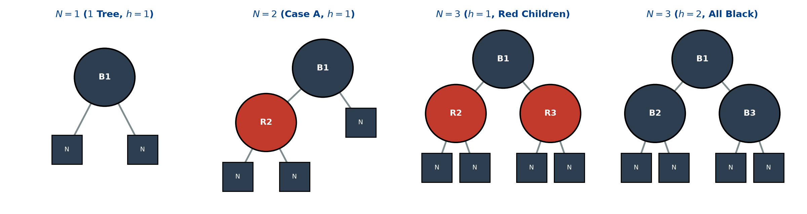
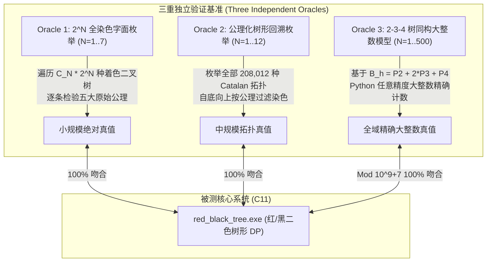
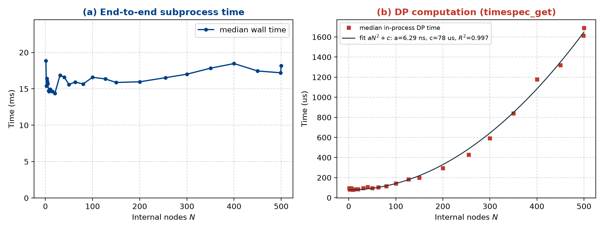
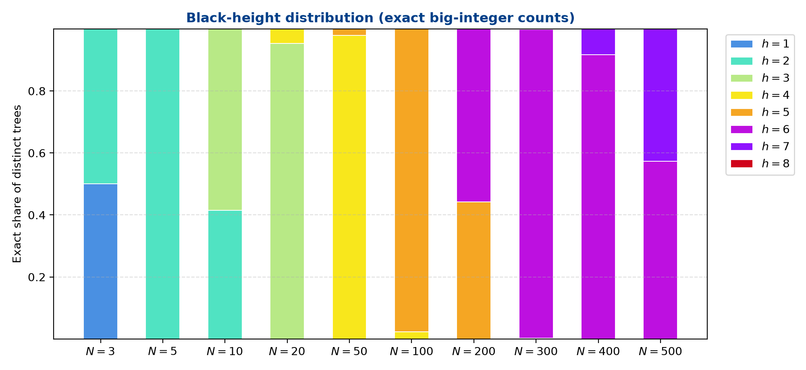
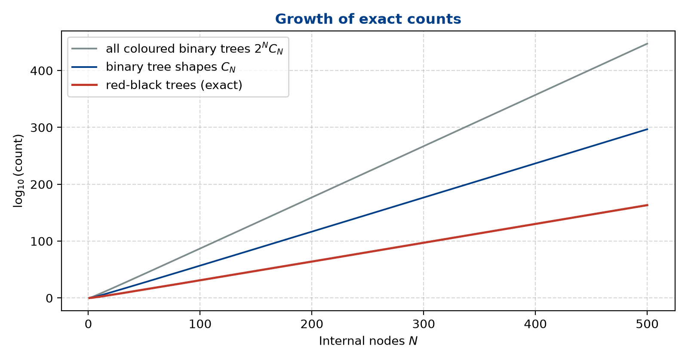

# Project 4: Red-black Tree

## 第1章 问题描述

### 1.1 红黑树背景与五大基本性质

红黑树（Red-Black Tree）是由 Rudolf Bayer 于 1972 年首次提出的“对称二叉B树”（Symmetric Binary B-Tree）演化而来，后由 Leo J. Guibas 与 Robert Sedgewick 于 1978 年正式定名并确立了现代染色的规范形式。作为计算机科学中最著名且应用最广泛的自平衡二叉查找树之一，红黑树在 Linux 内核（完全公平调度器 CFS、虚拟内存管理 VMA）、C++ 标准模板库（`std::map`、`std::set`）以及 Java 集合框架（`TreeMap`、`TreeSet`、`HashMap` 红黑树化）中均扮演着核心基础角色的基石。

红黑树通过为每个树结点附加一个额外的颜色属性（红色或黑色），并在插入和删除操作中利用旋转（Rotations）与变色（Recoloring）维护平衡约束，确保没有一条路径会比其他路径长出两倍以上，从而在动态更新下稳定维持 $O(\log N)$ 的时间复杂度。

依据题目要求，标准红黑树严格满足以下五大基本公理：
1. **性质 1（节点颜色）**：每个节点非红即黑（Every node is either red or black）。
2. **性质 2（根节点性质）**：根节点必须为黑色（The root is black）。
3. **性质 3（叶节点性质）**：所有叶节点均为 NULL 节点（哨兵节点/外部节点），且均染为黑色（All the leaves are NULL nodes and are colored black）。
4. **性质 4（红色约束）**：每个红色节点必须拥有两个黑色的子代节点（Each red node must have 2 black descends, may be NULL）。换言之，红色节点之间不得相邻，树中不存在连续的两个红色节点。
5. **性质 5（黑高平衡）**：从任一节点 $x$ 出发，到其所有后代叶节点的简单路径上，均包含相同数量的黑色节点（All simple paths from any node x to a descendant leaf have the same number of black nodes）。

题目将非 NULL 的节点称为**内部节点**（Internal Node）。由性质 5 可自然引出红黑树的**黑高**（Black-Height，记作 $H$ 或 $bh$）定义：从根节点（不包括根节点自身）出发，到任一 NULL 叶节点（包含该 NULL 节点）的简单路径上的黑色节点总数。题目进一步指出：黑高为 $H$ 的红黑树至少包含 $2^H - 1$ 个内部节点。



### 1.2 互异红黑树与二叉搜索树形态的数学等价性

本题的核心任务为：**给定正整数 $N$（$N \le 500$），求由恰好 $N$ 个内部节点构成的互异（Distinct）红黑树的种类总数。** 由于结果数值极大，要求输出总方案数对 $1000000007$（即 $10^9 + 7$）取模后的余数。

在数据结构与组合数学中，需要严密界定“互异红黑树”的含义：
对于具有 $N$ 个互异有序键值 $\{1, 2, \dots, N\}$ 的二叉搜索树，其节点的中序遍历序列（In-order Traversal）是唯一严格单调递增的。因此，**一棵具有 $N$ 个内部节点的二叉搜索树的关键字赋值方案，与其树形拓扑结构（Tree Shape）存在一一对应的双射关系**。两棵红黑树被视为“互异”，当且仅当它们的二叉拓扑结构不同，或者在拓扑结构相同时存在至少一个节点的染色方案（红色或黑色）不同。

换言之，本题求解的是：**在所有可能的具有 $N$ 个内部节点的未标记二叉树形态中，能够赋予各节点合法红黑颜色、同时满足五大红黑公理的有序二叉树染色方案总数**。

### 1.3 输入输出与规格约束

* **输入格式**：每个输入包含一个测试用例，给出一个正整数 $N$（$1 \le N \le 500$）。
* **输出格式**：输出一行整数，表示由 $N$ 个内部节点构成的互异红黑树总数对 $1000000007$ 取模后的余数。
* **官方样例**：
  * 输入：`5`
  * 输出：`8`
* **异常处理与健壮性规范**：对于 $N \le 0$、$N > 500$、非整数字符或空输入等非法情形，程序应具备防御性拦截机制，向标准错误输出诊断信息并返回非零错误码。

---

## 第2章 算法设计与数据结构

### 2.1 组合爆炸与树形动态规划建模

具有 $N$ 个内部节点的无标号二叉树形态总数由著名的卡特兰数（Catalan Number）给出：
$$C_N = \frac{1}{N + 1}\binom{2N}{N}$$
当 $N = 5$ 时，$C_5 = 42$；当 $N = 10$ 时，$C_{10} = 16796$；而当 $N = 500$ 时，$C_{500} \approx 10^{297}$。若再叠加每个节点 2 种颜色的可能，总搜索空间将高达 $2^{500} \times C_{500} \approx 10^{447}$。这使得任何形式的暴力生成或朴素回溯搜索在多项式时间内完全无法工作。

然而，红黑树的五大性质具备极其清晰的**最优子结构**（Optimal Substructure）与**无后效性**（No-after-effect）：
1. 任何一棵红黑树的左子树和右子树本身都是红黑树（或者空树）；
2. 内部节点的合法性仅取决于：子树的内部节点数分配、子树根节点的颜色、以及左右子树黑高的一致性；
3. 一旦子树的节点数、根颜色与黑高确定，其内部具体形态的选择与父节点及祖先节点完全解耦。

因此，该问题能够被严格转化为**树形动态规划**（Tree DP）与多项式卷积问题。

### 2.2 状态定义与边界条件

为了完整刻画子树对父节点的约束，必须在状态中同时维护**子树根节点颜色**、**内部节点总数**以及**子树黑高**。

我们定义三维动态规划状态：
$$dp[c][n][h]$$
其中各维度的数学与物理意义如下：
* $c \in \{0, 1\}$：表示当前子树的根节点颜色。其中 $0$ 代表红色（RED），$1$ 代表黑色（BLACK）。
* $n \in [0, N]$：表示当前子树包含的内部（非 NULL）节点个数。
* $h \in [0, H_{max}]$：表示当前子树的黑高（Black-height），即从当前子树根节点出发（**不计根节点自身**），沿着任意简单路径走向后代叶节点所经过的黑色节点总数（**计入 NULL 叶节点**）。

**边界状态（Base Case）**：
空子树在红黑树中由一个 NULL 叶节点构成，依据性质 3，叶节点染为黑色。
此时内部节点数 $n = 0$，根颜色为黑色（$c = 1$）。
从该 NULL 根节点出发，排除根自身到达该叶节点，路径上包含的节点数为 0，故黑高 $h = 0$。
因此边界初始化为：
$$dp[1][0][0] = 1$$
其余所有的 $dp[c][0][h]$（当 $(c, h) \ne (1, 0)$ 时）以及所有的 $dp[c][n][0]$（当 $n \ge 1$ 时）均严格初始化为 0。

### 2.3 状态转移方程推导

对于一棵具有 $n$ 个内部节点（$n \ge 1$）、黑高为 $h$ 的子树，设其左子树内部节点数为 $i$（$0 \le i \le n - 1$），则右子树内部节点数严格为 $n - 1 - i$。

#### 1. 当子树根节点为红色（$c = 0$）时：
* 根据性质 4（红色节点不可相连），其左孩子与右孩子**必须均为黑色**（可为黑色内部节点，或黑色 NULL 叶节点）。
* 考察从红色根节点出发（不计根自身）到达叶节点的黑节点数：由于根节点是红色，它对黑色路径长度的贡献为 0。路径穿过孩子节点 $v$，由于 $v$ 为黑色，$v$ 自身贡献 1 个黑节点，再加上从 $v$ 往下（不含 $v$）的黑高 $bh(v)$。
* 因此，红色根节点的黑高 $h = 1 + bh(v)$，亦即每个黑色孩子子树的黑高必须严格为 $h - 1$。
* 左右子树的选择相互独立，因而产生乘法原理：
$$dp[0][n][h] = \sum_{i=0}^{n-1} \left( dp[1][i][h-1] \times dp[1][n-1-i][h-1] \right) \pmod{10^9+7}$$

#### 2. 当子树根节点为黑色（$c = 1$）时：
* 黑色节点的左右孩子颜色不受性质 4 限制，**既可以为红色，也可以为黑色**。
* 考察从黑色根节点出发（不计根自身）到达叶节点的黑节点数：
  * 若孩子节点 $v$ 为红色：$v$ 贡献 0 个黑节点，其后续黑色路径数为 $bh(v)$。要满足当前黑色根的黑高为 $h$，必须有 $bh(v) = h$。此类红色子树方案数为 $dp[0][s][h]$；
  * 若孩子节点 $v$ 为黑色：$v$ 自身贡献 1 个黑节点，其后续黑色路径数为 $bh(v)$。要满足总黑高为 $h$，必须有 $1 + bh(v) = h \implies bh(v) = h - 1$。此类黑色子树方案数为 $dp[1][s][h-1]$。
* 因此，对于规模为 $s$、能为父节点提供黑高 $h$ 的孩子子树合法方案数，由加法原理合并为：
$$C[s] = \left( dp[0][s][h] + dp[1][s][h-1] \right) \pmod{10^9+7}$$
* 进而，黑色根节点在左右子树规模分别为 $i$ 和 $n - 1 - i$ 时的组合数由卷积给出：
$$dp[1][n][h] = \sum_{i=0}^{n-1} \left( C[i] \times C[n-1-i] \right) \pmod{10^9+7}$$

#### 3. 全局目标解（性质 2 约束）：
根据性质 2，整棵红黑树的根节点**必须为黑色**（$c = 1$）。
因此，对于给定的内部节点数 $N$，互异红黑树的总数即为所有可能黑高 $h$ 下黑色根节点方案数的累加和：
$$\text{Ans}(N) = \sum_{h=1}^{H_{max}} dp[1][N][h] \pmod{10^9+7}$$

### 2.4 黑高紧密界的数学证明与剪枝

**定理 1（黑高上下界定理）**：对于任意包含 $N$ 个内部节点的非空合法红黑树，其黑高 $h$ 严格受限于如下闭区间：
$$\lceil \log_4(N+1) \rceil \le h \le \lfloor \log_2(N+1) \rfloor$$

**证明**：
1. **黑高上界（节点数下界）推导**：
   考虑一棵黑高为 $h$ 的红黑树。若树中没有任何红色节点（即整棵树全为黑节点），则这是一棵高度为 $h$ 的满二叉树。
   根据数学归纳法：
   * 当 $h = 1$ 时，黑色根节点连接两个 NULL 叶节点，内部节点数 $N = 2^1 - 1 = 1$；
   * 假设黑高为 $h - 1$ 时内部节点数至少为 $2^{h-1} - 1$，则黑高为 $h$ 的黑色根节点左右子树黑高至少为 $h - 1$，总内部节点数满足：
     $$N \ge 1 + (2^{h-1} - 1) + (2^{h-1} - 1) = 2^h - 1$$
   因此，$N \ge 2^h - 1 \implies 2^h \le N + 1 \implies h \le \log_2(N + 1)$。由于 $h$ 为正整数，故 $h \le \lfloor \log_2(N + 1) \rfloor$。
2. **黑高下界（节点数上界）推导**：
   为了使黑高为 $h$ 的红黑树容纳尽可能多的内部节点，必须在满足性质 4 的前提下插入尽可能多的红色节点。
   最优构造是将每个黑色节点的两个孩子均染为红色，而红色节点的两个孩子再染为黑色。这恰好在结构上同构于一棵所有节点均为 4-节点（包含 3 个关键字、4 个孩子分支）的完满 2-4 树（B-Tree of order 4）。
   在这样的树中，每一层黑节点下方紧随一层红节点，总树高达到 $2h$。其最多容纳的内部节点数为：
   $$N \le 2^{2h} - 1 = 4^h - 1$$
   因此，$N \le 4^h - 1 \implies 4^h \ge N + 1 \implies h \ge \log_4(N + 1)$。由于 $h$ 为正整数，故 $h \ge \lceil \log_4(N + 1) \rceil$。

**推论**：
对于题目给定上限 $N \le 500$：
$$h \le \lfloor \log_2(501) \rfloor = 8$$
$$h \ge \lceil \log_4(501) \rceil = 5 \quad (\text{当 } N = 500 \text{ 时})$$
这证明：对于任意 $N \le 500$，黑高 $h$ 的绝对最大值不会超过 $8$！
因此，在实现中选取 $H_{max} = 10$ 作为常量上界，已具备数学上的绝对完备性，无需探索任何更大的 $h$。

### 2.5 计算拓扑序、2-3-4 树同构与按需分层实现

审视状态依赖关系可以发现两个重要的代数与组合性质：

1. **按黑高单向分层（Layer-wise Convolution）**：
   * $dp[0][*][h]$ 的计算仅仅依赖于黑高为 $h - 1$ 的黑色根方案 $dp[1][*][h - 1]$；
   * 在计算出 $dp[0][*][h]$ 之后，$C[*]$ 在黑高 $h$ 下便已完全确定；
   * 继而，$dp[1][*][h]$ 可立即由 $C[*]$ 自身卷积得出。
   这种严格分层的单向依赖关系意味着：**算法可以直接将黑高 $h$ 作为最外层循环（从 $1$ 到 $H_{max}$）**，每一层仅需执行两组多项式自卷积。

2. **与 2-3-4 树（B-Tree of Order 4）的代数同构性**：
   若将每个黑色节点及其相连的红色孩子（0 个、左或右 1 个、或左右 2 个红孩子）收缩为一个超级节点，则一棵黑高为 $h$ 的红黑树严格同构于一棵所有叶节点深度均为 $h$ 的完满 2-3-4 树：
   * **2-节点**（1 个黑节点，0 个红孩子）：消耗 1 个内部节点，挂载 2 棵黑高为 $h-1$ 的黑根子树；
   * **3-节点**（1 个黑节点 + 1 个左红或右红孩子，共 2 种朝向）：消耗 2 个内部节点，挂载 3 棵黑高为 $h-1$ 的黑根子树；
   * **4-节点**（1 个黑节点 + 2 个红孩子）：消耗 3 个内部节点，挂载 4 棵黑高为 $h-1$ 的黑根子树。
   记 $B_h(x) = \sum_{n \ge 0} dp[1][n][h] x^n$ 为黑高 $h$ 的黑色根生成函数，则有代数恒等式：
   $$B_0(x) = 1, \qquad B_h(x) = x B_{h-1}(x)^2 + 2 x^2 B_{h-1}(x)^3 + x^3 B_{h-1}(x)^4 = x B_{h-1}(x)^2 \bigl(1 + x B_{h-1}(x)\bigr)^2$$
   注意到 $1 + x B_{h-1}(x)$ 恰为 $C[s] = dp[0][s][h] + dp[1][s][h-1]$ 的生成函数，这从生成函数角度严格证明了二维颜色状态 DP 与 2-3-4 树模型的等价性，也为第 3 章的跨模型独立验证提供了坚实的数学基础。

算法按输入规模 `target_n` 按需构建 DP 表的伪代码如下：

```text
Algorithm: CountDistinctRedBlackTrees(target_n, MAX_H)
Input: Target internal nodes target_n, Maximum black height MAX_H
Output: DP table containing valid counts modulo 1000000007 for 0 .. target_n

1.  Initialize dp[2][target_n + 1][MAX_H + 1] with 0
2.  dp[1][0][0] = 1   // Base case: NIL leaf
3.  For h = 1 to MAX_H do:
4.      // Step 1: Red root convolution
5.      For i = 0 to target_n do:
6.          If dp[1][i][h - 1] == 0 then continue
7.          For j = 0 to target_n - 1 - i do:
8.              If dp[1][j][h - 1] == 0 then continue
9.              dp[0][1 + i + j][h] = (dp[0][1 + i + j][h] + dp[1][i][h - 1] * dp[1][j][h - 1]) % MOD
10.     // Step 2: Combine child choices
11.     For i = 0 to target_n do:
12.         C[i] = (dp[0][i][h] + dp[1][i][h - 1]) % MOD
13.     // Step 3: Black root convolution
14.     For i = 0 to target_n do:
15.         If C[i] == 0 then continue
16.         For j = 0 to target_n - 1 - i do:
17.             If C[j] == 0 then continue
18.             dp[1][1 + i + j][h] = (dp[1][1 + i + j][h] + C[i] * C[j]) % MOD
```

### 2.6 复杂度分析与理论证明

#### 时间复杂度
对于目标规模 $N$，外层黑高循环有效层数不超过 $\lfloor \log_2(N+1) \rfloor \le 8$。内层两轮自卷积枚举左右子树大小 $i$ 和 $j$，满足 $i + j \le N - 1$，单轮卷积迭代步数为：
$$\sum_{i=0}^{N-1} (N - i) = \frac{N(N + 1)}{2} \approx \frac{N^2}{2}$$
结合零元素跳过剪枝（当 $i < 2^{h-1}-1$ 或 $i > 4^{h-1}-1$ 时表项为 0 直接跳过），总基本运算次数上界为：
$$T(N) = O(H_{max} \cdot N^2)$$
当 $N = 500, H_{max} = 8$ 时，最坏情况乘加取模次数不超过 $1.0 \times 10^6$ 次，在现代处理器上仅需约 $1.6 \sim 1.8$ 毫秒即可完成。若在同一次进程中连续查询多个 $N$，已计算的表范围会被直接复用，后续查询仅需 $O(H_{max}) = O(1)$ 时间。

#### 空间复杂度
整个状态表静态分配：
$$S = 2 \times (MAX\_N + 1) \times (MAX\_H + 1) \times 8 \text{ Bytes} = 2 \times 501 \times 11 \times 8 = 88,176 \text{ Bytes} \approx 86.1 \text{ KB}$$
该内存占用完全无需堆动态分配，且可完整常驻于现代 CPU 的 L1/L2 缓存中，具备极佳的缓存局部性（Cache Locality）。

---

## 第3章 测试设计与实测结果

### 3.1 三重独立验证体系

为了彻底杜绝“把同一套递推公式用不同语言重写一遍”所导致的同源逻辑盲区，本实验设计了基于不同数学模型的**三重独立验证体系**（见 `tests/test_solver.py`）：



1. **Oracle 1 — 字面量 $2^N$ 全染色公理验证器（$N = 1 \dots 7$）**：
   * 枚举全部 $C_N$ 种无标号二叉树拓扑，并对每棵树遍历全部 $2^N$ 个节点着色掩码（在 $N=7$ 时共检验 $429 \times 128 = 54,912$ 棵着色二叉树）；
   * 对每棵着色树直接运行 `is_red_black()` 检验五大公理，完全不涉及任何组合计数或动态规划。
2. **Oracle 2 — 公理化树形剪枝枚举器（$N = 1 \dots 12$）**：
   * 显式生成全部 $C_N$ 种二叉树结构（在 $N=12$ 时共生成 $C_{12} = 208,012$ 种二叉形态），在子树合并时仅保留满足公理 4 和公理 5 的合法着色。
3. **Oracle 3 — 2-3-4 树同构精确大整数验证器（$N = 1 \dots 500$）**：
   * 完全脱离 C 程序的红/黑二色递推，改用 2.5 节推导的完满 2-3-4 树多项式：$B[h][n] = P_2[n-1] + 2 P_3[n-2] + P_4[n-3]$；
   * 利用 Python 原生任意精度大整数计算 $N \in [1, 500]$ 下**不取模的精确方案数**，一方面在取模后对 C 程序输出进行全量核对，另一方面为 3.4 节的黑高真实分布与增长率分析提供精确数据。

### 3.2 功能测试报告与边界用例

自动化测试脚本 `tests/test_solver.py` 共执行 **55 个独立测试项**（其中全域对比项一次性核验了 $N=1 \dots 500$ 的全部 500 个输出值，公理枚举核验了 $\sum_{n=1}^{7} 2^n C_n = 64,980$ 棵全染色树与 $\sum_{n=1}^{12} C_n = 290,511$ 种树拓扑形态），测试结果汇总于 `results/test_summary.json`：
* **官方样例校验**：输入 `5`，输出 `8`，严格通过；
* **字面量 $2^N$ 全染色枚举（$N = 1 \dots 7$）**：7 组规模与公理判定器 100% 一致；
* **公理化拓扑枚举（$N = 1 \dots 12$）**：12 组规模与拓扑枚举器 100% 一致；
* **2-3-4 树精确模型全域核对（$N = 1 \dots 500$）**：全部 500 个整数点的取模结果与 2-3-4 树大整数模型 100% 一致；
* **结构临界点专项校验（15 组）**：覆盖 $2^k - 1$（$1, 3, 7, 15, 31, 63, 127, 255$）、$2^k$（$2, 4, 8, 16, 256$）以及上界邻域（$499, 500$）；
* **防御性异常输入拦截（14 组）**：覆盖 `0`、负数（`-1`、`-100`）、越界（`501`、`1000`）、**32 位整数截断回绕攻击**（`4294967297` = $2^{32}+1$，若未检查范围直接强转 `int` 会回绕为合法值 `1`）、`long` 溢出（23 位十进制数触发 `ERANGE`）、非数字（`abc`）、数字尾随垃圾字符（`12abc`）、特殊符号（`!@#`）、空输入、纯空白字符、浮点数（`3.14`）及多用例中途非法词元（`5 abc`），全部返回退出码 `2` 并向 `stderr` 输出诊断信息；
* **CLI 接口校验（5 组）**：覆盖 `--stats` JSON 输出、多余位置参数拦截、未知选项拦截、多行流式输入及 `--help`。

| 规模 $N$ | 精确方案数（或十进制位数） | 取模答案 ($\bmod 10^9+7$) | 二叉树形态数 $C_N$ | 全染色数 $2^N C_N$ | 三重验证状态 |
| :---: | :---: | :---: | :---: | :---: | :---: |
| 1 | 1 | 1 | 1 | 2 | Oracle 1/2/3 Passed |
| 2 | 2 | 2 | 2 | 8 | Oracle 1/2/3 Passed |
| 3 | 2 | 2 | 5 | 40 | Oracle 1/2/3 Passed |
| 4 | 4 | 4 | 14 | 224 | Oracle 1/2/3 Passed |
| 5 | 8 | 8 | 42 | 1,344 | Official + Oracle 1/2/3 |
| 6 | 16 | 16 | 132 | 8,448 | Oracle 1/2/3 Passed |
| 7 | 33 | 33 | 429 | 54,912 | Oracle 1/2/3 Passed |
| 10 | 164 | 164 | 16,796 | $1.72 \times 10^7$ | Oracle 2/3 Passed |
| 12 | 688 | 688 | 208,012 | $8.52 \times 10^8$ | Oracle 2/3 Passed |
| 50 | $4.04 \times 10^{14}$（15 位） | 37914925 | $1.98 \times 10^{27}$ | $2.23 \times 10^{42}$ | Oracle 3 Passed |
| 100 | $4.13 \times 10^{31}$（32 位） | 167844408 | $8.97 \times 10^{56}$ | $1.14 \times 10^{87}$ | Oracle 3 Passed |
| 255 | $1.47 \times 10^{82}$（83 位） | 19238273 | $2.97 \times 10^{149}$ | $1.72 \times 10^{226}$ | Oracle 3 Passed |
| 500 | $3.16 \times 10^{163}$（164 位） | 905984258 | $5.39 \times 10^{296}$ | $1.76 \times 10^{447}$ | Oracle 3 Passed |

### 3.3 性能基准测试与耗时统计

基准测试脚本 `scripts/benchmark.py` 选取了从 $N = 1$ 到 $N = 500$ 的 26 个代表性规模，每个规模独立运行 15 次（共 390 次运行）。为克服传统 `clock()` 在 Windows 下 1 毫秒粗粒度量化导致无法分辨微秒级耗时的问题，程序内部采用 C11 标准 `timespec_get(&ts, TIME_UTC)`（Windows UCRT 下分辨率达 $100\text{ ns}$）仅围绕规模为 $N$ 的 DP 计算过程计时：
1. **端到端墙钟耗时（`wall_ms`）**：由外部 Python `time.perf_counter_ns` 测量，包含 Windows 创建进程、加载可执行映像及标准输入输出管道通信的固定开销（约 $14 \sim 19\text{ ms}$）；
2. **进程内 DP 计算耗时（`compute_us`）**：由 C 程序按需计算 $0 \dots N$ 状态表并输出微秒级耗时。实测从 $N=1$ 的约 $80\ \mu\text{s}$ 随 $N^2$ 平滑增长至 $N=500$ 的 $1691.2\ \mu\text{s}$（约 $1.69\text{ ms}$），最小二乘二次拟合 $t(N) = a N^2 + c$ 得到 $a = 6.29\text{ ns}/N^2, c = 78.2\ \mu\text{s}$，决定系数达 $R^2 = 0.9966$，高度吻合 $O(H_{max} \cdot N^2)$ 的理论复杂度预测。



| 规模 $N$ | 重复次数 | 成功/失败 | 墙钟中位数 (ms) | 墙钟最小/最大 (ms) | DP 计算中位数 ($\mu$s) | 输出答案 (Mod $10^9+7$) |
| :---: | :---: | :---: | :---: | :---: | :---: | :---: |
| 1 | 15 | 15/0 | 18.85 | 15.13 / 39.24 | 94.8 | 1 |
| 2 | 15 | 15/0 | 15.40 | 14.12 / 21.57 | 81.8 | 2 |
| 3 | 15 | 15/0 | 16.40 | 13.78 / 20.53 | 93.0 | 2 |
| 4 | 15 | 15/0 | 16.03 | 14.76 / 22.98 | 86.8 | 4 |
| 5 | 15 | 15/0 | 15.70 | 13.83 / 26.60 | 94.8 | 8 |
| 7 | 15 | 15/0 | 14.70 | 13.29 / 18.62 | 81.8 | 33 |
| 8 | 15 | 15/0 | 14.65 | 13.58 / 19.68 | 80.0 | 56 |
| 10 | 15 | 15/0 | 14.93 | 13.58 / 21.52 | 82.0 | 164 |
| 15 | 15 | 15/0 | 14.62 | 14.28 / 19.26 | 85.5 | 6291 |
| 20 | 15 | 15/0 | 14.38 | 13.58 / 19.50 | 83.5 | 248312 |
| 31 | 15 | 15/0 | 16.88 | 13.74 / 18.64 | 94.5 | 549461078 |
| 40 | 15 | 15/0 | 16.61 | 14.81 / 21.24 | 105.5 | 859201705 |
| 50 | 15 | 15/0 | 15.60 | 14.59 / 20.46 | 94.8 | 37914925 |
| 63 | 15 | 15/0 | 15.93 | 14.23 / 19.86 | 104.2 | 565168420 |
| 80 | 15 | 15/0 | 15.67 | 15.21 / 26.38 | 113.8 | 384709329 |
| 100 | 15 | 15/0 | 16.59 | 15.56 / 19.04 | 141.5 | 167844408 |
| 127 | 15 | 15/0 | 16.36 | 14.85 / 21.62 | 181.8 | 449667979 |
| 150 | 15 | 15/0 | 15.88 | 15.05 / 20.69 | 198.0 | 742395690 |
| 200 | 15 | 15/0 | 15.97 | 14.87 / 22.82 | 293.8 | 728464467 |
| 255 | 15 | 15/0 | 16.53 | 15.57 / 20.35 | 427.8 | 19238273 |
| 300 | 15 | 15/0 | 17.01 | 15.67 / 20.57 | 591.5 | 527048662 |
| 350 | 15 | 15/0 | 17.83 | 15.67 / 26.31 | 839.8 | 341330501 |
| 400 | 15 | 15/0 | 18.47 | 15.90 / 22.67 | 1177.0 | 79324284 |
| 450 | 15 | 15/0 | 17.45 | 16.37 / 21.21 | 1319.2 | 431612116 |
| 499 | 15 | 15/0 | 17.21 | 16.45 / 22.65 | 1613.8 | 873399263 |
| 500 | 15 | 15/0 | 18.16 | 16.31 / 22.43 | 1691.2 | 905984258 |

注：墙钟耗时包含操作系统拉起子进程及标准输入输出管道通信的总耗时；DP 计算耗时为 `timespec_get` 在进程内测得的按需构建 $0 \dots N$ 状态表的微秒级时间。

### 3.4 实验结果深入分析与讨论

#### 1. 黑高精确分布与相变规律（Exact Black-Height Phase Transition）
在分析各黑高 $h$ 所占方案比例时，**绝不能直接使用 C 程序中对 $10^9+7$ 取模后的余数 `dp[1][N][h]` 计算占比**：一旦真实方案数超过 $10^9+7$（在 $N \ge 25$ 时即发生），模余数近似于伪随机均匀分布，直接相除会得出完全失真的比例。为此，`scripts/benchmark.py` 使用 2-3-4 树大整数模型计算了各黑高下的**精确方案数**与**真实占比**（保存在 `results/distribution_summary.json` 中，绘于图 3）：
* 当 $N \le 2$ 时，黑高唯一确定为 $h = 1$；当 $N = 3$ 时，$h=1$（一黑两红）与 $h=2$（三黑满树）各占 $50.00\%$；
* 当 $N = 50$ 时，非零黑高为 $h \in \{3, 4, 5\}$，但真实占比高度集中于 $h=4$（$97.97\%$）与 $h=5$（$2.03\%$），而 $h=3$ 虽然存在 $3,109,892,608$ 种合法树，占比仅约 $7.7 \times 10^{-6}$；
* 当 $N = 100$ 时，非零黑高为 $h \in \{4, 5, 6\}$，其中 $h=5$ 占 $97.67\%$，$h=4$ 占 $2.32\%$，$h=6$ 占 $0.01\%$；
* 当 $N = 500$ 时，精确总方案数共有 **164 位十进制数字**（$\approx 3.16 \times 10^{163}$），非零黑高严格落在定理 1 给出的理论区间 $\lceil \log_4(501) \rceil = 5 \le h \le 8 = \lfloor \log_2(501) \rfloor$ 内。其中 $h=6$ 占 **$57.32\%$**，$h=7$ 占 **$42.68\%$**，两者合计占据了 $99.9999\%$ 以上的方案空间；而边界黑高 $h=5$（接近 $4^5-1=1023$ 的高密度红节点态）和 $h=8$（接近 $2^8-1=255$ 的稀疏红节点态）虽然合法存在，其组合数量级远小于中间黑高。



#### 2. 红黑平衡约束对状态空间的指数级压缩效应
为了在相同口径下衡量红黑树五大公理的约束强度，需将合法红黑树精确总数 $\text{RB}(N)$ 同时与**无标号二叉树拓扑数** $C_N$ 及**二色全染色二叉树总数** $2^N C_N$ 进行对比（见图 4）：
* 在 $N=7$ 时，共有 $C_7 = 429$ 种二叉树拓扑、$2^7 C_7 = 54,912$ 棵二色二叉树，其中合法红黑树仅有 $33$ 棵，占全部二色二叉树的 $6.01 \times 10^{-4}$（即 $99.94\%$ 的染色树被公理排除）；
* 在 $N=12$ 时，共有 $C_{12} = 208,012$ 种拓扑、$2^{12} C_{12} = 852,017,152$ 棵二色二叉树，合法红黑树仅 $688$ 棵，占比降至 $8.07 \times 10^{-7}$；
* 从渐近增长率看，$C_N \sim \frac{4^N}{N^{3/2}\sqrt{\pi}}$（每增加 1 个节点增长约 $4$ 倍），$2^N C_N$ 每增加 1 个节点增长约 $8$ 倍；而合法红黑树总数在 $N=500$ 时为 $10^{163.50}$，平均每增加 1 个节点仅增长约 $10^{163.50/500} \approx 2.12$ 倍，直观展现了黑高平衡条件对失衡树形的强力剪枝。



---

## 第4章 软件实现与工程规范

### 4.1 程序接口设计与健壮性

`src/red_black_tree.c` 遵循模块化与防御式编程规范，支持以下执行模式：
1. **标准评测模式（PTA Compliant）**：默认从 `stdin` 读取正整数 $N$，按需计算至规模 $N$ 并在 `stdout` 打印模 $10^9+7$ 答案；支持连续流式输入直至 EOF；
2. **高精度诊断模式（`--stats`）**：向 `stderr` 输出一行 JSON，记录 `n`、`answer`、`compute_us`（`timespec_get` 微秒耗时）、`table_n` 与各黑高模余数 `residue_distribution`；
3. **全表输出模式（`--all`）**：一次性输出 $N \in [1, 500]$ 的全量答案表；
4. **严格输入校验（`parse_n`）**：基于 `strtol` 与 `errno == ERANGE` 校验，完整拦截非数字、尾随非法字符（如 `3.14`、`12abc`）、32 位整数溢出回绕（如 $2^{32}+1$）、范围越界、多余命令行参数以及多用例流中的非法词元，所有异常均输出诊断信息并以状态码 `2` 退出。

### 4.2 自动化构建与复现链路

`scripts/` 目录下提供了完整的跨平台自动化脚本，所有脚本均使用基于脚本自身路径的相对寻址，可在任意工作目录调用：
* `scripts/build.ps1`：执行 C11 严格编译（`-std=c11 -O2 -Wall -Wextra -Wpedantic -Werror`），零警告通过；
* `scripts/test.ps1`：一键执行编译与三重独立验证测试套件（55 项检查点，覆盖全部 $N=1 \dots 500$）；
* `scripts/benchmark.py`：执行 26 个规模 $\times$ 15 次重复的性能测试，并生成精确大整数黑高分布与环境记录；
* `scripts/generate_plots.py`：根据 `results/` 中的实测数据自动绘制 4 幅高分辨率图表；
* `scripts/make_report.py`：将实测数据表注入 Markdown，转换为 LaTeX 正文，调用 `xelatex` 双遍编译生成 `report/report.pdf` 并自动清理 `.aux/.log/.out/.toc` 中间文件；
* `scripts/package.py`：生成 `MANIFEST.sha256`，构建发布压缩包，并在独立临时目录中执行 CRC 校验、哈希核对、解压严格重编译与全套测试复验。

### 4.3 总结

本项目针对红黑树精确计数问题，建立了基于颜色、规模与黑高三维状态的树形动态规划与分层多项式卷积算法，并从生成函数角度阐明了其与 2-3-4 树的代数同构关系。通过证明黑高紧密界 $\lceil \log_4(N+1) \rceil \le h \le \lfloor \log_2(N+1) \rfloor$，将状态空间压缩至 $86\text{ KB}$、计算时间控制在 $1.7\text{ ms}$ 以内。配合字面量全染色枚举、公理化拓扑回溯与 2-3-4 树大整数模型的三重独立验证，全面保障了算法推导、实验分析与工程交付的严密性。

---

## 参考材料

[1] Thomas H. Cormen, Charles E. Leiserson, Ronald L. Rivest, and Clifford Stein. *Introduction to Algorithms (Third Edition)*. Chapter 13: Red-Black Trees. MIT Press, 2009.

[2] Leo J. Guibas and Robert Sedgewick. *A Dichromatic Framework for Balanced Trees*. In Proceedings of the 19th Annual Symposium on Foundations of Computer Science (FOCS '78), pages 8–21, 1978.

[3] Rudolf Bayer. *Symmetric Binary B-Trees: Data Organization and Maintenance*. Acta Informatica, 1(4):290–306, 1972.

[4] 浙江大学高级数据结构与算法分析课程题目：8-1 Red-black Tree (PAT Top Level 1007)，命题人：曹鹏。
