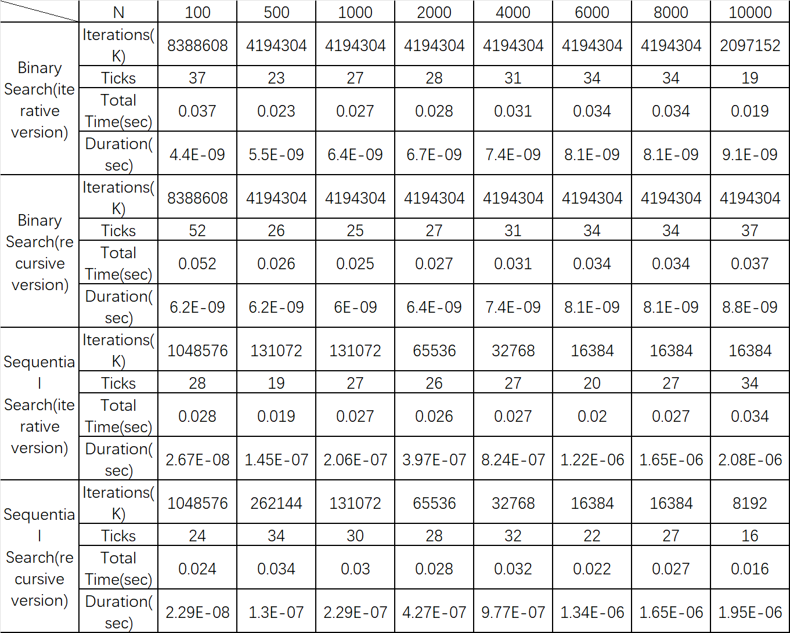
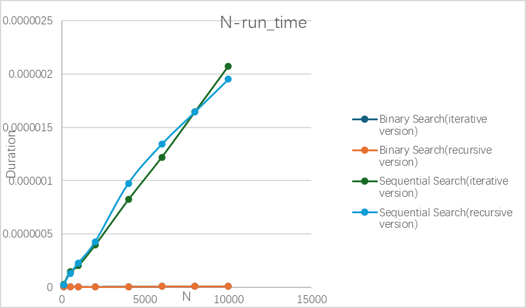

<style>
    .c-red {color:#FF3333;}
    .c-green {color:#009966;}
    .c-blue {color:#3366CC;}
    .c-orange {color:#FF9933;}
    .c-gray {color:#666666;}
    .c-purple {color:#9966CC;}
    .c-yellow {color:#FFCC33;}
    .c-pink {color:#FF6699;}
    .c-brown {color:#996633;}
    .c-sky {color:#66CCFF;}
    .c-mint {color:#66CC99;}
    .c-center {text-align: center;}
</style>
# <div class="c-center">Report of Project 1：Normal-1 Performance Measurement (Search)</div>
<div class="c-center">完成时间：2026年3月15日</div>

---

## <div class="c-center">目录</div>
- [Part 1：引言](#1)
- [Part 2：算法描述](#2)
- [Part 3：测试数据和图表呈现](#3)
- [Part 4：图表分析](#4)
- [Part 5：最终完整程序和总结](#5)
- [END](#6)
---

## <div class="c-center">Part 1：引言 </div> 
**问题描述：**
本项目旨在比较四种不同的搜索算法在最坏的情况下的性能。给定一个已经排好序的数组，长度为 N，数组元素依次为 0 到 N-1 。此时，查找一个不存在于这个数组中的元素，设定为 N，就能实现最坏的情况。我们考虑两种策略，分别为顺序查找和二分查找。其中，每种策略均可用迭代和递归两种方式实现，因此我们得到了四个函数。

- 顺序查找（迭代版）
- 顺序查找（递归版）
- 二分查找（迭代版）
- 二分查找（递归版） 

**项目要求：**

- 实现上述四个函数
- 分析它们在最坏情况下的时间复杂度
- 对于给定的 8 个具体的N值，测量并比较四个函数的最坏情况运行时间，其中需要使用`clock()`函数。若单次运行时间过短则重复执行 K 次取平均值，以确保总时钟滴答数不少于十次以保证至少 10％ 的精度。
- 将实验数据填进表格，并且绘制出同一坐标系的`N-运行时间`曲线，对结果进行分析讨论。 

本次项目可以直观地理解不同的算法和实现方式对性能的影响，让人直接地掌握程序性能测量的办法。

---

## <div class="c-center">Part 2：算法描述</div> 
- **总述**
本部分将展示四个算法和时间测量部分的伪代码描述，并且简要说明主程序的结构。

---

- **顺序查找迭代版**
从第一个元素开始，逐个与目标关键字进行比较，直到找到目标或遍历完整个数组。在最坏情况下（目标不存在或位于最后一个），需要比较所有的N个元素。
```
/*顺序查找迭代版*/
int Sequential_Search_Iterative_(int a[], int n, int element) {
	/*从第一个元素开始遍历，如果找到，返回下标 + 1，并退出改函数*/
	for (int i = 0; i < n; i++) {
		if (a[i] == element) {
			return i + 1;
		}
	}
	/*如果没有找到，返回 - 1*/
	return -1;
}
```
- 时间复杂度：最坏情况需要比较N次，即 O(N)。
- 空间复杂度：仅使用常数个辅助变量，即 O(1)。

---

- **顺序查找递归版**
递归检查当前下标元素，若匹配则返回，否则在下标+1处递归.
```
/*顺序查找递归版*/
int Sequential_Search_Recursive(int a[], int n, int element, int index) {
	/*如果当前下标已经超过了数组长度，说明没有查找到所求元素，返回-1*/
	if (index >= n) {
		return -1;
	}
	/*如果找到了所需元素，返回下标+1*/
	if (a[index] == element) {
		return index + 1;
	}
	/*如果暂时未找到所需元素，则下标 + 1，继续查找*/
	return Sequential_Search_Recursive(a, n, element, index + 1);
}
```
- 时间复杂度：需比较N次，每次递归调用有常数开销，即 O(N)。
- 空间复杂度：递归深度等于N，每次调用占用栈空间，即 O(N)。

---

- **二分查找迭代版**
在有序数组中每次取中间元素和所需元素进行比较，根据比较结果缩小一半的查找区间.
```
/*二分查找迭代版*/
int Binary_Search_Iterative_(int a[], int n, int element) {
	//定义左、右边界*/
	int left = 0;
	int right = n - 1;
	/*将当前数组分成两个区间，取得中间坐标，减半查找*/
	while (left <= right) {
		int mid = (left + right) / 2;
		/*当前数组中间下标对应元素即为所需元素，返回下标 + 1，退出*/
		if (element == a[mid]) {
			return mid + 1;
		}
		/*所需元素在当前数组的右半区间*/
		else if (a[mid] < element) {
			left = mid + 1;
		}
		/*所需元素在当前数组的左半区间*/
		else {
			right = mid - 1;
		}
	}
	/*循环结束仍未找到，说明该、所需元素不在该数组内，返回-1*/
	return -1;
}
```
- 时间复杂度：每次将区间减半，比较次数为 log₂N+1，时间复杂度 O(log N)。
- 空间复杂度：仅需常数空间，即 O(1)。

---

- **二分查找递归版**
递归地在当前区间的中间点判断，然后递归地在左半或右半区间查找。
```
/*二分查找递归版*/
int Binary_Search_Recursive(int a[], int left, int right, int element) {
	/*检查边界条件是否满足，不满足返回-1*/
	if (left > right) {
		return -1;
	}
	/*将当前数组分半，取得中间坐标，折半查找*/
	int mid = (left + right) / 2;
	/*如果中间坐标对应元素即为所求，返回下标+1，退出该函数*/
	if (a[mid] == element) {
		return mid + 1;
	}
	/*如果所求元素大于当前数组中间下标值所对应的元素，说明所求元素在右半区间*/
	else if (a[mid] < element) {
		return Binary_Search_Recursive(a, mid + 1, right, element);
	}
	/*如果所求元素小于当前数组中间下标值所对应的元素，说明所求元素在左半区间*/
	else {
		return Binary_Search_Recursive(a, left, mid - 1, element);
	}
}
```
- 时间复杂度：同为 O(log N)。
- 空间复杂度：递归深度为O(log N)，栈空间占用 O(log N)。
---

- **时间测量**
为了准确测量一个运行时间极短的函数，需要多次重复调用并取平均。测量函数 `Measure` 的步骤如下：

- (1) 确定合适的重复次数K：
   - 初始设 K = 1。
   - 循环将 K 加倍，并测量当前K次调用的总时钟滴答数 `ticks`。
   - 当 `ticks` 达到预设目标值或K超过上限时停止。这一步保证了最终测量的总时间足够长，有效减少计时误差。
- (2) 正式测量：
   - 记录开始时间 `begin = clock()`。
   - 循环K次调用被测函数，并将返回值累加。
   - 记录结束时间 `end = clock()`。
   - 计算总时钟滴答数 `ticks = end - begin`，总时间 `total_seconds = (double)ticks / CLOCKS_PER_SEC`。
   - 单次平均时间 `duration = total_seconds / K`。
- (3) 返回结果：
   - 将 `duration、K、ticks` 封装在结构体 `Measurement` 中返回。
```
/*对两个递归版函数进行封装,统一接口更好地测量时间*/
int Sequential_Search_Recursive_(int a[], int n, int element) {
	return Sequential_Search_Recursive(a, n, element, 0);
}

int Binary_Search_Recursive_(int a[], int n, int element) {
	return Binary_Search_Recursive(a, 0, n - 1, element);
}

/*测试用例结构体：包含算法名称、函数指针、储存测量结果的数组*/
typedef struct {
	const char* name;     /*算法名称*/
	int (*fun)(int[], int, int);     /*函数指针*/
	double* results;     /*储存测量结果的数组*/
}test;

/*测量结果结构体：包含单次执行时间、循环次数K、时钟滴答数*/
typedef struct {
	double duration;     /*单次执行时间*/
	int K;     /*循环次数K*/
	long ticks;     /*时钟滴答数*/
}Measurement;

Measurement Measure(int (*fun)(int[], int, int), int a[], int n, int element) {
	int K = 1;
	clock_t begin;
	clock_t end;
	double ticks;
	const int target = 20;     /*目标时钟滴答数，用于确定合适的K*/
	do {
		K *= 2;
		begin = clock();
		for (int i = 0; i < K; i++) {
			fun(a, n, element);
		}
		end = clock();
		ticks = (double)(end - begin);
	} while (ticks < target && K < 100000000);     /*防止无限循环*/

	int dummy = 0;     /*用于累加返回值*/
	begin = clock();
	for (int i = 0; i < K; i++) {
		dummy += fun(a, n, element);     /*累加返回值*/
	}
	end = clock();
	long ticks_ = end - begin;     /*实际测量的总时钟滴答数*/
	double second = (double)(end - begin) / CLOCKS_PER_SEC;     /*转换为秒*/
	Measurement Data;
	Data.duration = second / K;     /*平均每次执行时间*/
	Data.K = K;
	Data.ticks = ticks_;
	return Data;
}
```

---

- **主程序**

- (1) 定义待测试的数组大小列表：
    -  `N_element[] = {100, 500, 1000, 2000, 4000, 6000, 8000, 10000}。`
- (2) 为四种算法分别分配存储平均时间的数组`TimeSeqIter，TimeSeqRecur, TimeBinIter, TimeBinRecur`。
- (3) 定义测试结构体数组 `tests[4]`，每个元素包含算法名称、对应的函数指针和存储时间的数组。这样便于循环处理。
- (4) 对于每个N：
   - 动态分配大小为N的整型数组 `a`，并初始化为 `0, 1, 2, ..., N-1`，保证数组有序。
   - 设置查找关键字 `value = N`（该值不在数组中，保证最坏情况）。
   - 对四种算法依次调用 `Measure` 函数，获得测量结果，并将平均时间存入对应的数组。同时打印该算法的测量信息。
   - 释放数组 `a`。
- (5) 所有 N 测试完成后，释放动态分配的时间数组，程序结束。
```
#include<stdio.h>
#include<math.h>
#include<time.h>
#include<stdlib.h>

/*设置栈大小为16MB*/
#pragma comment(linker, "/STACK:33554432")

int main() {
	/*待测试的数组大小列表*/
	int N_element[] = { 100,500,1000,2000,4000,6000,8000,10000 };
	int N_number = sizeof(N_element) / (sizeof(N_element[0]));
	
	/*为四种算法分别分配存储时间的数组*/
	double* TimeSeqIter = (double*)malloc(N_number * sizeof(double));
	double* TimeSeqRecur = (double*)malloc(N_number * sizeof(double));
	double* TimeBinIter = (double*)malloc(N_number * sizeof(double));
	double* TimeBinRecur = (double*)malloc(N_number * sizeof(double));

	/*定义四种测试，每个包含名称、函数指针和对应的时间存储数组*/
	test tests[4] = {
		{"SeqIter",Sequential_Search_Iterative_,TimeSeqIter},
		{"SeqRecur",Sequential_Search_Recursive_,TimeSeqRecur},
		{"BinIter",Binary_Search_Iterative_,TimeBinIter},
		{"BinRecur",Binary_Search_Recursive_,TimeBinRecur}
	};

	/*对每个数组大小进行测试*/
	for (int i = 0; i < N_number; i++) {
		int N = N_element[i];
		int* a = (int*)malloc(N * sizeof(int));
		if (a == NULL) {
			return 1;     /*内存分配失败，退出*/
		}
		/*初始化数组为0,1,2,...,N-1，确保有序，便于二分查找*/
		for (int j = 0; j < N; j++) {
			a[j] = j;
		}
		int value = N;     /*查找一个不存在的元素（值为N），以模拟最坏情况（查找失败）*/
		printf("数组大小 N = %d:\n", N);
		/*对四种算法分别进行测量*/
		for (int k = 0; k < 4; k++) {
			Measurement Value = Measure(tests[k].fun, a, N, value);
			tests[k].results[i] = Value.duration;     /*保存平均时间*/
			printf("  %s: duration=%.10f sec  (K=%d, ticks=%ld, total=%.6f sec)\n", tests[k].name, Value.duration, Value.K, Value.ticks, (double)Value.ticks / CLOCKS_PER_SEC);
		}
		free(a);     /*释放当前数组*/
	}

	/*释放动态分配的内存*/
	free(TimeBinIter);
	free(TimeBinRecur);
	free(TimeSeqIter);
	free(TimeSeqRecur);
	return 0;
}
```

---

## <div class="c-center">Part 3：测试数据和图标呈现</div> 
- 下表列出了四个算法在不同N下的最坏情况性能数据。其中“K”为重复调用次数，“Ticks”为K次调用消耗的总时钟滴答数，“Total  Time”为K次调用的总时间（秒），“Duration”为单次调用的平均时间（秒）。



- 其中，所有Ticks均保证≥10，满足项目要求

---
- **顺序查找**
  - 在双对数图中，两条曲线近似为斜率为1的直线，表明时间与 N 呈线性关系为 O(N) 。
  - 考虑到有测量噪声噪声和系统干扰，包括操作系统调度、后台进程、CPU缓存波动等会让单次测量结果出现微小抖动，导致某次递归版时间略低于迭代版。
  - 递归版本曲线几乎始终位于迭代版本上方，反映了递归调用的额外开销。
- **二分查找**
  - 两条曲线增长极为缓慢，近似水平，符合对数关系（O(log N)）。
  - 递归版本略高于迭代版本，同样因函数调用开销所致。随着N增大，二分查找时间几乎不变



---

## <div class="c-center">Part 4：图表分析</div> 
- **通过对图表的分析，我们可以发现：**
  - 实验所有数据的`Ticks`全部大于10，这毫无疑问增大了实验的精确性。
  - 二分查找远快于顺序查找：二分查找的两条曲线在双对数图中几乎呈水平直线，仅随 N 增大有极其缓慢的上升。N=10000 时，二分查找迭代版是顺序查找迭代版用时的约1/228，这体现了对数算法与线性算法的巨大差异，在大规模数据环境下，二分法显然更具优势。
  - 递归版本比迭代版本慢：由于函数调用开销，递归版本在两种查找中均比迭代版本慢约30%~40%。对于顺序查找，递归还带来 O(N) 的栈空间开销。额外开销主要来自：每次递归调用的函数调用开销（参数压栈、跳转、返回）、递归深度等于 N，栈操作本身也有成本、编译器可能难以对递归进行优化（如尾递归优化未开启时）。实际应用中，应该优先选用迭代版本。
  - 时间复杂度理论值与实测一致：顺序查找时间随 N 线性增长，二分查找时间随 N 对数增长，验证了理论分析。
  - 测量方法上，使用自适应 K 值确保 `ticks` 足够大是可行的，但应适当提高目标 `ticks`（如 20、50 或 100）以获得更高精度。

---

## <div class="c-center">Part 5：最终完整程序和总结</div> 
- **最终完整程序**
```
#include<stdio.h>
#include<math.h>
#include<time.h>
#include<stdlib.h>

/*设置栈大小为16MB*/
#pragma comment(linker, "/STACK:33554432")

typedef int ElemType;

/*顺序查找迭代版*/
int Sequential_Search_Iterative_(int a[], int n, int element) {
	/*从第一个元素开始遍历，如果找到，返回下标 + 1，并退出改函数*/
	for (int i = 0; i < n; i++) {
		if (a[i] == element) {
			return i + 1;
		}
	}
	/*如果没有找到，返回 - 1*/
	return -1;
}

/*顺序查找递归版*/
int Sequential_Search_Recursive(int a[], int n, int element, int index) {
	/*如果当前下标已经超过了数组长度，说明没有查找到所求元素，返回-1*/
	if (index >= n) {
		return -1;
	}
	/*如果找到了所需元素，返回下标+1*/
	if (a[index] == element) {
		return index + 1;
	}
	/*如果暂时未找到所需元素，则下标 + 1，继续查找*/
	return Sequential_Search_Recursive(a, n, element, index + 1);
}


/*二分查找迭代版*/
int Binary_Search_Iterative_(int a[], int n, int element) {
	//定义左、右边界*/
	int left = 0;
	int right = n - 1;
	/*将当前数组分成两个区间，取得中间坐标，减半查找*/
	while (left <= right) {
		int mid = (left + right) / 2;
		/*当前数组中间下标对应元素即为所需元素，返回下标 + 1，退出*/
		if (element == a[mid]) {
			return mid + 1;
		}
		/*所需元素在当前数组的右半区间*/
		else if (a[mid] < element) {
			left = mid + 1;
		}
		/*所需元素在当前数组的左半区间*/
		else {
			right = mid - 1;
		}
	}
	/*循环结束仍未找到，说明该、所需元素不在该数组内，返回-1*/
	return -1;
}

/*二分查找递归版*/
int Binary_Search_Recursive(int a[], int left, int right, int element) {
	/*检查边界条件是否满足，不满足返回-1*/
	if (left > right) {
		return -1;
	}
	/*将当前数组分半，取得中间坐标，折半查找*/
	int mid = (left + right) / 2;
	/*如果中间坐标对应元素即为所求，返回下标+1，退出该函数*/
	if (a[mid] == element) {
		return mid + 1;
	}
	/*如果所求元素大于当前数组中间下标值所对应的元素，说明所求元素在右半区间*/
	else if (a[mid] < element) {
		return Binary_Search_Recursive(a, mid + 1, right, element);
	}
	/*如果所求元素小于当前数组中间下标值所对应的元素，说明所求元素在左半区间*/
	else {
		return Binary_Search_Recursive(a, left, mid - 1, element);
	}
}

/*对两个递归版函数进行封装,统一接口更好地测量时间*/
int Sequential_Search_Recursive_(int a[], int n, int element) {
	return Sequential_Search_Recursive(a, n, element, 0);
}

int Binary_Search_Recursive_(int a[], int n, int element) {
	return Binary_Search_Recursive(a, 0, n - 1, element);
}
/*测试用例结构体：包含算法名称、函数指针、储存测量结果的数组*/
typedef struct {
	const char* name;     /*算法名称*/
	int (*fun)(int[], int, int);     /*函数指针*/
	double* results;     /*储存测量结果的数组*/
}test;

/*测量结果结构体：包含单次执行时间、循环次数K、时钟滴答数*/
typedef struct {
	double duration;     /*单次执行时间*/
	int K;     /*循环次数K*/
	long ticks;     /*时钟滴答数*/
}Measurement;

Measurement Measure(int (*fun)(int[], int, int), int a[], int n, int element) {
	int K = 1;
	clock_t begin;
	clock_t end;
	double ticks;
	const int target = 20;     /*目标时钟滴答数，用于确定合适的K*/
	do {
		K *= 2;
		begin = clock();
		for (int i = 0; i < K; i++) {
			fun(a, n, element);
		}
		end = clock();
		ticks = (double)(end - begin);
	} while (ticks < target && K < 100000000);     /*防止无限循环*/

	int dummy = 0;     /*用于累加返回值*/
	begin = clock();
	for (int i = 0; i < K; i++) {
		dummy += fun(a, n, element);     /*累加返回值*/
	}
	end = clock();
	long ticks_ = end - begin;     /*实际测量的总时钟滴答数*/
	double second = (double)(end - begin) / CLOCKS_PER_SEC;     /*转换为秒*/
	Measurement Data;
	Data.duration = second / K;     /*平均每次执行时间*/
	Data.K = K;
	Data.ticks = ticks_;
	return Data;
}

int main() {
	/*待测试的数组大小列表*/
	int N_element[] = { 100,500,1000,2000,4000,6000,8000,10000 };
	int N_number = sizeof(N_element) / (sizeof(N_element[0]));
	
	/*为四种算法分别分配存储时间的数组*/
	double* TimeSeqIter = (double*)malloc(N_number * sizeof(double));
	double* TimeSeqRecur = (double*)malloc(N_number * sizeof(double));
	double* TimeBinIter = (double*)malloc(N_number * sizeof(double));
	double* TimeBinRecur = (double*)malloc(N_number * sizeof(double));

	/*定义四种测试，每个包含名称、函数指针和对应的时间存储数组*/
	test tests[4] = {
		{"SeqIter",Sequential_Search_Iterative_,TimeSeqIter},
		{"SeqRecur",Sequential_Search_Recursive_,TimeSeqRecur},
		{"BinIter",Binary_Search_Iterative_,TimeBinIter},
		{"BinRecur",Binary_Search_Recursive_,TimeBinRecur}
	};

	/*对每个数组大小进行测试*/
	for (int i = 0; i < N_number; i++) {
		int N = N_element[i];
		int* a = (int*)malloc(N * sizeof(int));
		if (a == NULL) {
			return 1;     /*内存分配失败，退出*/
		}
		/*初始化数组为0,1,2,...,N-1，确保有序，便于二分查找*/
		for (int j = 0; j < N; j++) {
			a[j] = j;
		}
		int value = N;     /*查找一个不存在的元素（值为N），以模拟最坏情况（查找失败）*/
		printf("数组大小 N = %d:\n", N);
		/*对四种算法分别进行测量*/
		for (int k = 0; k < 4; k++) {
			Measurement Value = Measure(tests[k].fun, a, N, value);
			tests[k].results[i] = Value.duration;     /*保存平均时间*/
			printf("  %s: duration=%.10f sec  (K=%d, ticks=%ld, total=%.6f sec)\n", tests[k].name, Value.duration, Value.K, Value.ticks, (double)Value.ticks / CLOCKS_PER_SEC);
		}
		free(a);     /*释放当前数组*/
	}

	/*释放动态分配的内存*/
	free(TimeBinIter);
	free(TimeBinRecur);
	free(TimeSeqIter);
	free(TimeSeqRecur);
	return 0;
}
```
- **总结**
本实验清晰地展示了算法设计与实现方式对性能的影响，这也为实际的应用场景中选择合适的算法提供了思路和依据。

---

## <div class="c-center">END</div> 