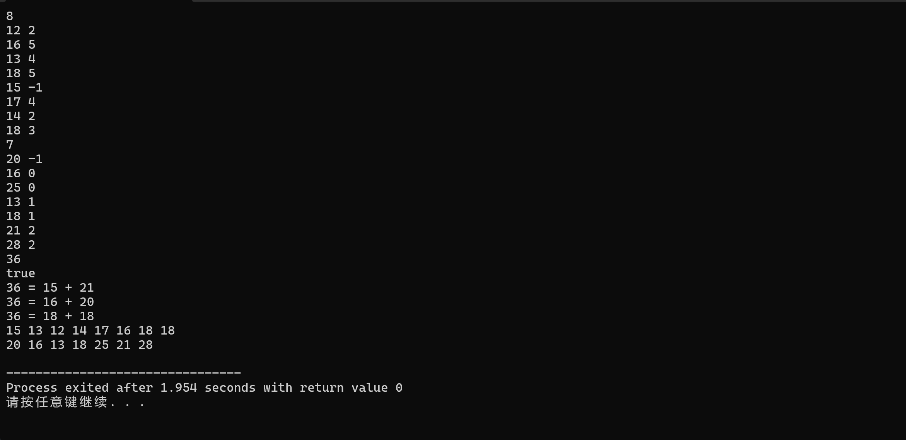
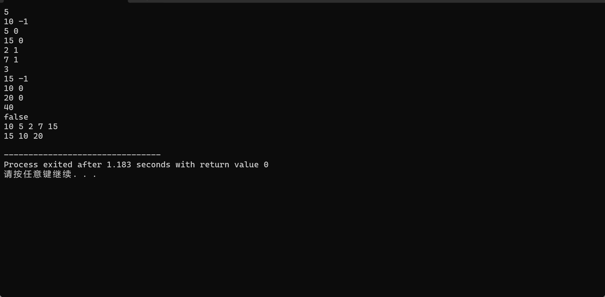
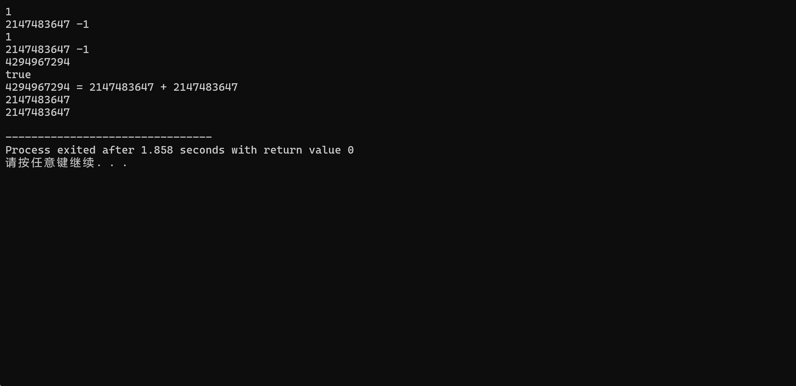
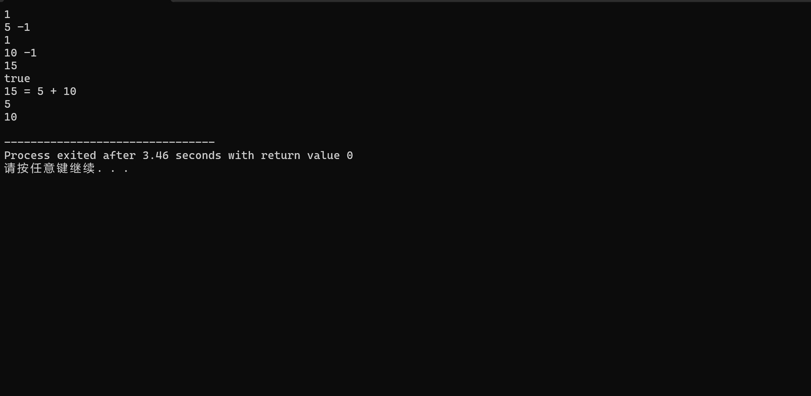
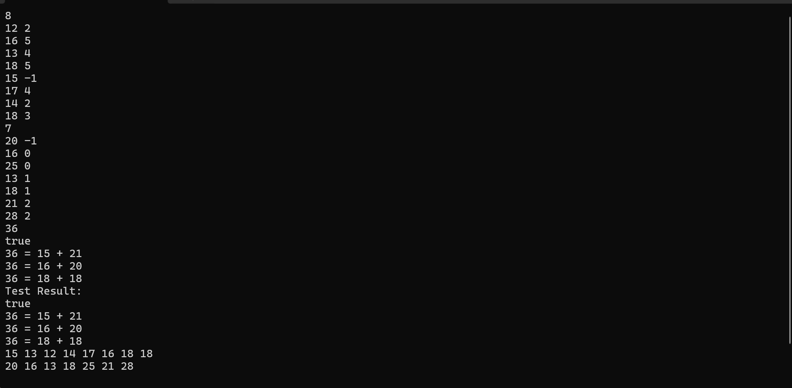

# <center>Report of Project 2</center>
<center>完成时间：2026年4月3日</center>


---


## <center>目录</center>

- [Chapter 1：引言](#)
- [Chapter 2：算法描述](#)
- [Chapter 3：测试数据和结果](#)
- [Chapter 4：复杂度分析](#)
- [Chapter 5：A+B 函数正确性的验证](#)
- [Chapter 6：最终完整程序和总结反思](#)
- [END](#)

---

## <center>Chapter 1：引言</center>

### 1.1 背景和简介

- 二叉搜索树（Binary Search Tree, BST）是一种重要的非线性数据结构，它支持快速的查找、插入和删除操作。
- 本题将 BST 与经典的“两数之和”问题相结合：给定两棵二叉搜索树 $T_1$、$T_2$ 以及一个目标整数 $N$，要求从 $T_1$ 中选取一个节点值 $A$，从 $T_2$ 中选取一个节点值 $B$，使得 $A + B = N$。同时需要输出所有满足条件的数对（按 $A$ 升序，且去重），以及两棵树的前序遍历序列。

---

### 1.2 目标和要求

- 设计一个高效的算法实现题目要求，且能够在合理的时间和空间里处理多达 $2\times 10^5$ 个节点的输入。

- 提供完整的测试方案，验证算法的正确性、边界处理能力和性能。

---

## <center>Chapter 2：算法描述</center>

### 2.1 结构设计

- 包含节点值与左右孩子的索引，为符合题目的节点值要求，`data` 使用 `ElemType` 类型；
- 最大节点数已知（$2\times 10^5$），静态数组安全可靠，不必动态分配内存，可提高性能且减少内存碎片。

```c
#define MAXN 200050   // 定义最大节点数（ 2e5 + 50） 

// 节点值及目标 N 的范围是 [-2×10^9, 2×10^9]，可能溢出 int，故使用 long long
typedef long long ElemType;   // 将 long long 自定义为 ElemType，可以方便地更改 data 的类型 

// 树节点结构 
typedef struct TreeNode {
    ElemType data;   // 节点值，类型为 long long，自定义为 ElemType 
    int lchild;   // 左孩子索引，-1 表示为空 
    int rchild;   // 右孩子索引，-1 表示为空 
} TreeNode;

// 静态分配全局存储两棵树节点的数组，其大小固定为 MAXN
TreeNode tree1[MAXN];
TreeNode tree2[MAXN];

// 通过中序遍历得到的升序序列，用于后续双指针查找和配对 
ElemType seq1[MAXN];
ElemType seq2[MAXN];
int len1, len2;   // 序列实际长度，即为节点数

// 用于存储所有配对的 A 和 B，其中 A 来自 tree1，B 来自 tree2，满足 A + B = N 
ElemType pair_A[MAXN], pair_B[MAXN];
int num_pair;   // 配对的数量

int stack[MAXN];   // 存储节点索引的栈，使用全局栈
```

---

### 2.2 建树算法

- 根据输入的父节点索引构建 BST 结构，由于输入并未给出直接具体的左右孩子关系，因此我们需要根据 BST 的性质（左节点键值 < 父节点键值 < 右节点键值）自行构建。
- 先读取所有节点，将键值和父索引存入 `tree[i]` 和 `parent[i]`，同时初始化左右孩子为`-1`。
- 再遍历所有节点，对每个非根节点 `father != -1`，将其插入到父节点的左或右子树中。
- 比较当前节点的键值与父节点的键值：若小，则成为左孩子；否则成为右孩子。

```c
// 构建树，返回根节点索引
int Build_Trees(int n, TreeNode tree[]) {
    // 临时存储每个节点的父索引，该数组大小为 n，用完立即释放
    int *parent = (int*)malloc(n * sizeof(int));
    if (parent == NULL) {
        exit(1);   // 若内存分配失败，直接退出程序
    }
    
    // 读取所有节点数据 
    for (int i = 0; i < n; ++i) {
        ElemType key;
        int father;
        scanf("%lld %d", &key, &father);   // 读取节点值、父索引
        tree[i].data = key;   // 存储节点值 
        parent[i] = father;   // 存储父索引 
        tree[i].lchild = -1;   // 初始化左孩子为空 
        tree[i].rchild = -1;   // 初始化右孩子为空 
    }
    
    // 建立父子关系 
    int root = -1;   // 根节点索引，初始化为 -1 
    for (int i = 0; i < n; ++i) {
        int father = parent[i];
        if (father == -1) {
            root = i;   // 依据题意，父索引为 -1 的节点是根 
        } else {
            if (tree[i].data < tree[father].data) {
                tree[father].lchild = i;   // 若小于父节点，则为左孩子 
            } else {
                tree[father].rchild = i;   // 若大于等于父节点，则为右孩子 
            }
        }
    }
    free(parent);   // 释放临时内存，防止内存泄漏 
    return root;
}
```

---

### 2.3 中序遍历

- 中序遍历可以得到升序序列，为后续寻找配对的任务创造了先决条件。
- 同时，使用迭代版而非递归版的中序遍历，是为了防止使用递归时因递归深度过大导致栈溢出。
- 外层循环控制遍历过程，栈非空或 `cur` 非空可保证所有节点都被访问。
- 内层循环将当前节点的所有左子节点压栈，模拟递归的“一直向左走”。
- 弹出栈顶节点，存入 `seq1` 或 `seq2` 数组，然后转向右子树继续循环。
- 最终数组 `seq1` 和 `seq2` 分别是存储两棵树升序排列的节点值数组。

```c
// 迭代中序遍历（升序）
void inorder(int root, TreeNode tree[], ElemType a[], int *len) {
    int top = -1;      // 栈顶指针 
    int cur = root;      // 当前遍历节点 
    
    while (top >= 0 || cur != -1) {
        // 一直向左走，并将经过的节点压栈 
        while (cur != -1) {
            stack[++top] = cur;
            cur = tree[cur].lchild;
        }
        // 弹出栈顶节点，访问，并将其存入结果数组 
        cur = stack[top--];
        a[(*len)++] = tree[cur].data; 
        // 转向右子树，继续循环 
        cur = tree[cur].rchild;
    }
}
```

---

### 2.4 双指针查找配对

- `seq1` 和 `seq2` 都已升序排列，我们可以利用 **双指针** 技术在线性时间内找到所有和为 `target` 的数对。
- 初始化 `i` 指向 `seq1` 的第一个元素（该数组的最小值），`j` 指向 `seq2` 的最后一个元素（该数组的最大值）。
- 计算当前 `sum = seq1[i] + seq2[j]`：
  - 若 `sum == target`：找到一个解，存入答案数组。但相同的等式只输出一次，需要跳过所有与当前 `a` 和 `b` 相等的元素。`seq1` 和 `seq2` 中可能有重复值，我们通过两个 `while` 循环将 `i` 和 `j` 移动到下一个不同值的位置。然后 `i++` 和 `j--` 继续寻找其他组合；
  - 若 `sum < target`：说明当前 `a` 太小，需要增大 `a`，故 `i++`；
  - 若 `sum > target`：说明当前 `b` 太大，需要减小 `b`，故 `j--`；
- 如此可以避免使用循环套循环的办法，有效降低时间复杂度，避免了超时情况的发生。

```c
// 双指针查找配对
void findPairs(ElemType target) {
    num_pair = 0;   // 初始化符合要求的对数为 0 
    int i = 0, j = len2 - 1;   // 双指针，i 在 seq1 头部，j 在 seq2 尾部
    
    while (i < len1 && j >= 0) {
        ElemType a = seq1[i];
        ElemType b = seq2[j];
        ElemType sum = a + b;
        
        if (sum == target) {
            // 找到一组有效解 
            pair_A[num_pair] = a;
            pair_B[num_pair] = b;
            num_pair++;
            
            // 跳过 seq1 中与当前 a 相等的所有值，避免重复输出 
            while (i + 1 < len1 && seq1[i + 1] == a) {
                i++;
            }
            // 跳过 seq2 中与当前 b 相等的所有值，避免重复输出
            while (j - 1 >= 0 && seq2[j - 1] == b) {
                j--;
            }
            
            // 继续移动指针至下一个不同的值 
            i++;
            j--;
        } else if (sum < target) {
            i++;   // 总和太小，增大 A 
        } else {
            j--;   // 总和太大，减小 B 
        }
    }
}
```

---

### 2.5 前序遍历

- 依据题目要求进行前序遍历，但为了避免递归深度过大导致栈溢出，因此采用迭代版的前序遍历。
- 前序遍历的顺序是：`root` → `lchild` → `rchild`。迭代版的前序遍历需要使用栈：先将根压栈，然后循环弹出栈顶节点并输出，再将其右孩子和左孩子依次压栈。
- 由于前序遍历需要在输出 `root` 后先输出 `lchild`，再输出 `rchild`，根据栈先进后出的性质，先压 `rchild` 是合理的。
- `first` 标志用于控制输出格式：第一个节点前不输出空格，后续节点前输出一个空格。

```c
// 迭代前序遍历输出
void preorderPrint(int root, TreeNode tree[]) {
    if (root == -1) {
        printf("\n");   // 空树输出空行
        return;
    } 
    int top = -1;
    stack[++top] = root;
    int first = 1;   // 控制空格的标志 
    
    while (top >= 0) {
        int node = stack[top--];
        if (!first) {
            printf(" ");   // 若不是第一个节点，输出空格 
        } else {
            first = 0;
        }
        printf("%lld", tree[node].data);
        // 注意：先压右孩子，再压左孩子，保证左孩子先弹出（前序）
        if (tree[node].rchild != -1) {
            stack[++top] = tree[node].rchild;
        }
        if (tree[node].lchild != -1) {
            stack[++top] = tree[node].lchild;
        }
    }
    printf("\n");
}
```

---

### 2.6 主程序

- 调用上述函数，依次实现题目的所有要求。

```c
int main() {
    int n1, n2;   // 两棵树的节点个数
    ElemType N;   // 目标值 

    // 读入第一棵树 
    scanf("%d", &n1);
    int rt1 = Build_Trees(n1, tree1);   

    // 读入第二棵树 
    scanf("%d", &n2);
    int rt2 = Build_Trees(n2, tree2);

    // 读入目标值 
    scanf("%lld", &N);

    // 中序遍历获取升序的序列 
    len1 = 0;
    inorder(rt1, tree1, seq1, &len1);
    len2 = 0;
    inorder(rt2, tree2, seq2, &len2);

    // 寻找所有符合要求的配对 
    findPairs(N);

    // 输出配对结果 
    if (num_pair == 0) {
        printf("false\n");
    } else {
        printf("true\n");
        for (int i = 0; i < num_pair; ++i) {
            printf("%lld = %lld + %lld\n", N, pair_A[i], pair_B[i]);
        }
    }

    // 依次输出两棵树的前序遍历的序列 
    preorderPrint(rt1, tree1);
    preorderPrint(rt2, tree2);

    return 0;
}
```

---

## <center>Chapter 3：测试数据和结果</center>

### 3.1 测试用例 1（Sample Input 1）

- 输入：
```c
8
12 2
16 5
13 4
18 5
15 -1
17 4
14 2
18 3
7
20 -1
16 0
25 0
13 1
18 1
21 2
28 2
36
```

- 输出：
```c
true
36 = 15 + 21
36 = 16 + 20
36 = 18 + 18
15 13 12 14 17 16 18 18
20 16 13 18 25 21 28
```

- 控制台输出图片：



- 分析：
   - 存在 $3$ 组解，其中已经略去第一棵树中两个节点同为 $18$ 的重复情况；
   - 三组解均正确且无重复；
   - 前序遍历输出正确，符合实际情况。

---

### 3.2 测试用例 2（Sample Input 2）

- 输入：
```c
5
10 -1
5 0
15 0
2 1
7 1
3
15 -1
10 0
20 0
40
```

- 输出：
```c
false
10 5 2 7 15
15 10 20
```

- 控制台输出图片：



- 分析：
   - 无解，输出 `false`，符合题意；
   - 前序遍历输出正确，符合实际情况。

---

### 3.3 测试用例 3（极端值测试）

- 输入：

```c
1
2147483647 -1
1
2147483647 -1
4294967294
```

- 输出：

```c
true
4294967294 = 2147483647 + 2147483647
2147483647
2147483647
```

- 控制台输出图片：



- 分析：
   - 在 `long long` 范围内正确，符合题意；
   - 前序遍历输出正确，符合实际情况。

---

### 3.4 测试用例 4（单节点树）

- 输入：

```c
1
5 -1
1
10 -1
15
```

- 输出：

```c
true
15 = 5 + 10
5
10
```

- 控制台输出图片：



- 分析：
   - 有解，输出 `ture` 是合理的；
   - 前序遍历输出正确，符合实际情况。

---

### 3.5 测试用例 5（大规模数据 $2 \times 10^{5}$）

- 输入和输出：由于规模过大，给出测试的完整程序，对于原程序中的键盘输入替换为随机生成输入，保证每棵树拥有 $20$ 万个节点，输出结果，以证明原程序在大规模数据下的正确性。

```c
#include <stdio.h>
#include <stdlib.h>
#include <time.h>

#define MAXN 200050                     // 最大节点数（200000 + 50，留有余量）
#define data_MIN -1000000000LL          // 节点键值的最小值
#define data_MAX 1000000000LL           // 节点键值的最大值
#define N_MIN   -2000000000LL           // 目标值 N 的最小值
#define N_MAX   2000000000LL            // 目标值 N 的最大值

// 节点值及目标 N 的范围是 [-2×10^9, 2×10^9]，可能溢出 int，故使用 long long
typedef long long ElemType;             // 元素类型，保证 64 位

// 树节点结构
typedef struct TreeNode {
    ElemType data;      // 节点存储的键值
    int lchild;         // 左孩子索引，-1 表示空
    int rchild;         // 右孩子索引，-1 表示空
} TreeNode;

// 静态分配全局存储两棵树节点的数组，大小固定为 MAXN
TreeNode tree1[MAXN];
TreeNode tree2[MAXN];

// 中序遍历得到的升序序列，用于双指针查找
ElemType seq1[MAXN];
ElemType seq2[MAXN];
int len1, len2;          // 序列实际长度，等于节点数

// 存储所有解 (A, B)，其中 A 来自 tree1，B 来自 tree2，满足 A + B = N
ElemType pair_A[MAXN], pair_B[MAXN];
int num_pair;            // 解的个数

int stack[MAXN];         // 全局栈，用于非递归遍历（避免局部大数组导致栈溢出）

typedef unsigned long long unElemType;   // 无符号 64 位整数，用于随机数生成

// 生成 [min, max] 范围内的随机整数（均匀分布）
ElemType rand_range(ElemType min, ElemType max) {
    // 使用三次 rand() 组合成 60 位随机数，覆盖整个 64 位范围
    unElemType random = (unElemType)rand();
    random = (random << 30) ^ ((unElemType)rand() << 15) ^ (unElemType)rand();
    // 映射到指定区间
    return min + (ElemType)(random % (unElemType)(max - min + 1));
}

// 生成一棵具有 n 个节点的 BST，返回 keys 和 parents 数组（不输出，直接存入内存）
void generate_bst_data(int n, ElemType keys[], int parents[]) {
    // left 和 right 临时记录每个节点的左右孩子索引，用于建树过程
    int *left = (int*)malloc(n * sizeof(int));
    int *right = (int*)malloc(n * sizeof(int));
    if (!left || !right) {
        exit(1);   // 内存分配失败则退出
    }
    
    // 根节点（索引 0）
    keys[0] = rand_range(data_MIN, data_MAX);
    parents[0] = -1;        // 根节点没有父节点
    left[0] = right[0] = -1;
    
    // 依次插入节点 1..n-1
    for (int i = 1; i < n; ++i) {
        ElemType key_new = rand_range(data_MIN, data_MAX);
        int cur = 0, parent_node = -1, is_left = 0;
        // 寻找插入位置
        while (cur != -1) {
            parent_node = cur;
            if (key_new < keys[cur]) {
                cur = left[cur];
                is_left = 1;
            } else {
                cur = right[cur];
                is_left = 0;
            }
        }
        // 插入新节点
        keys[i] = key_new;
        parents[i] = parent_node;
        left[i] = right[i] = -1;
        if (is_left) {
        	left[parent_node] = i;
		}  
        else {
        	right[parent_node] = i;
		} 
    }
    // 释放动态分配的内存 
    free(left);
    free(right);
}

// 根据给定的 keys 和 parents 数组构建树
int Build_Trees(int n, TreeNode tree[], ElemType keys[], int parents[]) {
    // 初始化所有节点的左右孩子为 -1
    for (int i = 0; i < n; ++i) {
        tree[i].data = keys[i];
        tree[i].lchild = -1;
        tree[i].rchild = -1;
    }
    int root = -1;
    // 根据父索引建立左右孩子关系
    for (int i = 0; i < n; ++i) {
        int father = parents[i];
        if (father == -1) {
            root = i;                     // 父索引为 -1 的是根
        } else {
            if (tree[i].data < tree[father].data) {
            	tree[father].lchild = i;       // 小于父节点，成为左孩子
			}
            else {
            	tree[father].rchild = i;       // 大于等于父节点，成为右孩子
			}
        }
    }
    return root;
}

// 非递归中序遍历（升序），结果存入 a 数组，长度由 len 返回
void inorder(int root, TreeNode tree[], ElemType a[], int *len) {
    int top = -1, cur = root;
    while (top >= 0 || cur != -1) {
        // 一直向左走，并将经过的节点压栈
        while (cur != -1) {
            stack[++top] = cur;
            cur = tree[cur].lchild;
        }
        // 弹出栈顶节点，访问并将其值存入数组
        cur = stack[top--];
        a[(*len)++] = tree[cur].data;
        // 转向右子树，继续循环
        cur = tree[cur].rchild;
    }
}

// 双指针查找所有满足 A + B = target 的数对（去重），结果存入全局 pair_A / pair_B
void findPairs(ElemType target) {
    num_pair = 0;
    int i = 0, j = len2 - 1;          // i 指向 seq1 头部，j 指向 seq2 尾部
    while (i < len1 && j >= 0) {
        ElemType a = seq1[i], b = seq2[j], sum = a + b;
        if (sum == target) {
            // 找到一组解
            pair_A[num_pair] = a;
            pair_B[num_pair] = b;
            num_pair++;
            // 跳过 seq1 中所有等于 a 的值（避免重复输出）
            while (i + 1 < len1 && seq1[i + 1] == a) {
            	i++;
			} 
            // 跳过 seq2 中所有等于 b 的值
            while (j - 1 >= 0 && seq2[j - 1] == b) {
            	j--;
			}
            i++; 
			j--;
        } else if (sum < target) {
            i++;        // 总和太小，增大 A
        } else {
            j--;        // 总和太大，减小 B
        }
    }
}

// 非递归前序遍历，结果写入文件流 out
void preorderPrint(FILE *out, int root, TreeNode tree[]) {
    if (root == -1) {
        fprintf(out, "\n");   // 空树输出空行
        return;
    }
    int top = -1;
    stack[++top] = root;
    int first = 1;   // 控制空格输出，避免行首多余空格
    while (top >= 0) {
        int node = stack[top--];
        if (!first) {
        	fprintf(out, " ");
        	first = 0;
		}
        else {
            fprintf(out, "%lld", tree[node].data);
		}
        // 注意：先压右孩子，再压左孩子，保证左孩子先弹出，以满足前序遍历的要求
        if (tree[node].rchild != -1) {
        	stack[++top] = tree[node].rchild;
		}
        if (tree[node].lchild != -1) {
        	stack[++top] = tree[node].lchild;
		}
    }
    fprintf(out, "\n");
}

int main() {
    // 设置随机种子（使用当前时间，确保每次运行结果不同）
    srand((unsigned)time(NULL));
    const int n1 = 200000, n2 = 200000;   // 两棵树各 20 万个节点

    // 分配临时数组存储 keys 和 parents
    ElemType *keys1 = (ElemType*)malloc(n1 * sizeof(ElemType));
    int *parents1 = (int*)malloc(n1 * sizeof(int));
    ElemType *keys2 = (ElemType*)malloc(n2 * sizeof(ElemType));
    int *parents2 = (int*)malloc(n2 * sizeof(int));
    if (!keys1 || !parents1 || !keys2 || !parents2) {
    	return 1;
	}

    // 生成两棵随机 BST
    generate_bst_data(n1, keys1, parents1);
    generate_bst_data(n2, keys2, parents2);
    // 随机生成目标 N
    ElemType N = rand_range(N_MIN, N_MAX);

    // 原始输入写入 input.txt 文件 
    FILE *fin = fopen("input.txt", "w");
    if (!fin) {
    	return 1;
	}
    fprintf(fin, "%d\n", n1);
    for (int i = 0; i < n1; ++i) {
    	fprintf(fin, "%lld %d\n", keys1[i], parents1[i]);
	}
    fprintf(fin, "%d\n", n2);
    for (int i = 0; i < n2; ++i) {
    	fprintf(fin, "%lld %d\n", keys2[i], parents2[i]);
	}
    fprintf(fin, "%lld\n", N);
    fclose(fin);

    // 构建树并求解
    int rt1 = Build_Trees(n1, tree1, keys1, parents1);
    int rt2 = Build_Trees(n2, tree2, keys2, parents2);
    len1 = 0; inorder(rt1, tree1, seq1, &len1);
    len2 = 0; inorder(rt2, tree2, seq2, &len2);
    findPairs(N);

    // 结果写入 output.txt 文件 
    FILE *fout = fopen("output.txt", "w");
    if (!fout) return 1;
    if (num_pair == 0) {
        fprintf(fout, "false\n");
    } else {
        fprintf(fout, "true\n");
        for (int i = 0; i < num_pair; ++i)
            fprintf(fout, "%lld = %lld + %lld\n", N, pair_A[i], pair_B[i]);
    }
    preorderPrint(fout, rt1, tree1);
    preorderPrint(fout, rt2, tree2);
    fclose(fout);

    // 释放动态分配的内存
    free(keys1); 
	free(parents1);
    free(keys2); 
	free(parents2);
    return 0;
}
```

- 多次运行程序几乎总是输出 `true`，这是**完全符合数学预期的**，并不是程序错误。原因如下：
   - 两棵树的节点值范围都是 $[-1e9, 1e9]$，因此两数之和的范围是 $[-2e9, 2e9]$，总共有 **约 40 亿** 个可能的整数值。
   - 两棵树各有 $2 \times 10^5$ 个节点，总共可以组成 $200000 × 200000 = 4×10^{10}$ 个有序数对（包括重复值）。
   - 平均每个可能的和值会被覆盖大约 $4e10 / 4e9 = 10$ 次。也就是说，**几乎每一个在 $[-2e9, 2e9]$ 内的整数和都有极高的概率出现**。
   - 因此，当你随机生成 `N` 时，它落在有解范围内的概率接近 **1**（大约 $1 - e^{-10} ≈ 0.99995$），出现 `false` 的概率仅为约 **0.005%**（十万分之五）。

- 所以，多次测试几乎总是出现 `true` 的现象是正常的，并非程序错误。
- 对于 $2 \times 10^5$ 个节点的输入和输出，请见文件 `input.txt` 和 `output.txt`。
- 本程序已经经过验证，若把节点数改为 $20$，输出 `false` 的概率将大幅增加：
   - 节点数为 $20$ 时：
>输入：

```c
20
622098842 -1
684207764 0
-110146523 0
-683344547 2
188260386 2
-623291491 3
618378648 4
8217821 4
426352048 6
-383705611 5
-248830312 9
303940799 8
959423382 1
-73956349 7
-377315728 10
642497342 1
356881980 11
-577075879 9
-561409966 17
-866599150 3
20
109697590 -1
-466706828 0
868665416 0
52868419 1
-388667981 3
-839742422 1
805678545 2
-432797099 4
971363342 2
-999395598 5
-160134566 4
-967619699 9
253907297 6
957725482 8
580190655 12
134154069 12
-311883512 10
937589913 13
357840919 14
-69050236 10
1824703460
```

>输出：

```c
false
622098842 -110146523 -683344547 -866599150 -623291491 -383705611 -577075879 -561409966 -248830312 -377315728 188260386 8217821 -73956349 618378648 426352048 303940799 356881980 684207764 642497342 959423382
109697590 -466706828 -839742422 -999395598 -967619699 52868419 -388667981 -432797099 -160134566 -311883512 -69050236 868665416 805678545 253907297 134154069 580190655 357840919 971363342 957725482 937589913
```

---

### 3.6 测试用例 6（多次测试）

- 输入和输出：已经经历多次输入均能正确输出解（若有解）以及前序遍历的序列，但多次测试的用例过于繁多，在此不一一展示。
- 程序实现：在不同节点数的验证过程中，我们可以将 **3.5** 中的测试程序中 `main` 函数的 `n1` 和 `n2` 从 `200000` 改成自己需要的节点数，多次测试即可。
- 结果证明，该程序确实是正确的。

---

## <center>Chapter 4：复杂度分析</center>

### 4.1 时间复杂度

#### 4.1.1 建树算法

```c
// 构建树，返回根节点索引
int Build_Trees(int n, TreeNode tree[]) {
    // 临时存储每个节点的父索引，该数组大小为 n，用完立即释放
    int *parent = (int*)malloc(n * sizeof(int));
    if (parent == NULL) {
        exit(1);   // 若内存分配失败，直接退出程序
    }
    
    // 读取所有节点数据 
    for (int i = 0; i < n; ++i) {
        ElemType key;
        int father;
        scanf("%lld %d", &key, &father);   // 读取节点值、父索引
        tree[i].data = key;   // 存储节点值 
        parent[i] = father;   // 存储父索引 
        tree[i].lchild = -1;   // 初始化左孩子为空 
        tree[i].rchild = -1;   // 初始化右孩子为空 
    }
    
    // 建立父子关系 
    int root = -1;   // 根节点索引，初始化为 -1 
    for (int i = 0; i < n; ++i) {
        int father = parent[i];
        if (father == -1) {
            root = i;   // 依据题意，父索引为 -1 的节点是根 
        } else {
            if (tree[i].data < tree[father].data) {
                tree[father].lchild = i;   // 若小于父节点，则为左孩子 
            } else {
                tree[father].rchild = i;   // 若大于等于父节点，则为右孩子 
            }
        }
    }
    free(parent);   // 释放临时内存，防止内存泄漏 
    return root;
}
```

- 该建树函数 `Build_Trees` 执行两个循环：
   - 第一个循环读取 $n$ 个节点的键值和父索引，复杂度 $O(n)$。
   - 第二个循环遍历每个节点，根据父索引和 BST 性质（左 < 根 < 右）确定左右孩子，每个节点只处理一次（比较和赋值，均为 $O(1)$，共 $n$ 次），复杂度 $O(n)$。
- 总时间复杂度为 **$O(n)$**。

---

#### 4.1.2 中序遍历

```c
// 迭代中序遍历（升序）
void inorder(int root, TreeNode tree[], ElemType a[], int *len) {
    int top = -1;      // 栈顶指针 
    int cur = root;      // 当前遍历节点 
    
    while (top >= 0 || cur != -1) {
        // 一直向左走，并将经过的节点压栈 
        while (cur != -1) {
            stack[++top] = cur;
            cur = tree[cur].lchild;
        }
        // 弹出栈顶节点，访问，并将其存入结果数组 
        cur = stack[top--];
        a[(*len)++] = tree[cur].data; 
        // 转向右子树，继续循环 
        cur = tree[cur].rchild;
    }
}
```

- 每个节点恰好被压栈一次、出栈一次，每次栈操作 $O(1)$。

- 每个节点被访问一次（存入序列数组），也是 $O(1)$。
- 每个节点进栈和出栈各一次，循环总次数为 $2n$。
- 加上 $n$ 次访问，总操作数约 $3n$。

- 因此总时间复杂度为 **$O(n)$**。

---

#### 4.1.3 双指针查找

```c
// 双指针查找配对
void findPairs(ElemType target) {
    num_pair = 0;   // 初始化符合要求的对数为 0 
    int i = 0, j = len2 - 1;   // 双指针，i 在 seq1 头部，j 在 seq2 尾部
    
    while (i < len1 && j >= 0) {
        ElemType a = seq1[i];
        ElemType b = seq2[j];
        ElemType sum = a + b;
        
        if (sum == target) {
            // 找到一组有效解 
            pair_A[num_pair] = a;
            pair_B[num_pair] = b;
            num_pair++;
            
            // 跳过 seq1 中与当前 a 相等的所有值，避免重复输出 
            while (i + 1 < len1 && seq1[i + 1] == a) {
                i++;
            }
            // 跳过 seq2 中与当前 b 相等的所有值，避免重复输出
            while (j - 1 >= 0 && seq2[j - 1] == b) {
                j--;
            }
            
            // 继续移动指针至下一个不同的值 
            i++;
            j--;
        } else if (sum < target) {
            i++;   // 总和太小，增大 A 
        } else {
            j--;   // 总和太大，减小 B 
        }
    }
}
```

- 指针 `i` 从 `0` 单调递增到最多 `len1-1`，最多移动 `len1` 次。
- 指针 `j` 从 `len2-1` 单调递减到 `0`，最多移动 `len2` 次。
- 每次循环至少移动 `i` 或 `j` 中的一个，因此循环总次数 $≤$ `len1 + len2`。
- 去重内部的 `while` 循环累计跳过的元素总数也 $≤$ `len1 + len2`。
- 因此总比较和移动次数为 $O(len_1 + len_2) = O(n_1 + n_2)$。

---

#### 4.1.4 前序遍历输出

```c
// 迭代前序遍历输出
void preorderPrint(int root, TreeNode tree[]) {
    if (root == -1) {
        printf("\n");   // 空树输出空行
        return;
    } 
    int top = -1;
    stack[++top] = root;
    int first = 1;   // 控制空格的标志 
    
    while (top >= 0) {
        int node = stack[top--];
        if (!first) {
            printf(" ");   // 若不是第一个节点，输出空格 
        } else {
            first = 0;
        }
        printf("%lld", tree[node].data);
        // 注意：先压右孩子，再压左孩子，保证左孩子先弹出（前序）
        if (tree[node].rchild != -1) {
            stack[++top] = tree[node].rchild;
        }
        if (tree[node].lchild != -1) {
            stack[++top] = tree[node].lchild;
        }
    }
    printf("\n");
}
```

- 每个节点入栈一次、出栈一次，栈操作 $O(1)$。
- 每个节点被输出一次。
- 循环总次数为 $2n$（入栈 $n$ 次，出栈 $n$ 次），加上 $n$ 次输出，总操作数约 $3n$。

- 故时间复杂度为 **$O(n)$**

---

#### 4.1.5 总体时间复杂度

- 算法各步骤串行执行，总时间复杂度为：

$
T(n_1,n_2)=O(n_1)+O(n_1)+O(n_1+n_2)+O(n_1)+O(n_2)=O(n_1+n_2)
$

---

### 4.2 空间复杂度

#### 4.2.1 主要数据结构空间占用

|数据结构	|类型	|数量|	单个大小(字节)|	总大小(MB)|
|:---:|:---:|:---:|:---:|:---:|
|`tree1` , `tree2`| `TreeNode` | $2×200000$ |	$16$	|$6.4$|
|`seq1` , `seq2`| `long long` | $2×200000$ | $8$ | $3.2$ |
|`pair_A` , `pair_B`| `long long` | $2×200000$ | $8$ | $3.2$ |

|数据结构|类型|数量|单个大小(字节)|总大小(MB)|
|:---:|:---:|:---:|:---:|:---:|
|`stack`|	`int`	|$200050$|	$4$	|$0.8$|
|`parents` 临时数组	|`int`|	$200000$	|$4$| $0.8$ |
|其他（变量等）	|-|	-|	-| $<0.1$ |

- 合计约 $14.4$ MB。实际运行时由于内存对齐和动态分配开销，通常占用 $20 \sim3 0$ MB。

- 所有主要数据结构的大小均与节点总数 `n1 + n2` 成线性关系，因此空间复杂度为 **$O(n_1 + n_2)$**。

---

#### 4.2.2 最坏情况分析

- 若树退化为链表，中序遍历将达到 $n$ 的栈深度。全局数组 `stack[MAXN]` 作为栈，固定大小为 $200050$，只要 $n≤200000$ 即可安全运行，不会发生栈溢出。前序遍历同理。

- 因此，最大深度 $≤ n$，由于数组大小足够，安全。

---

## <center>Chapter 5：A+B 函数正确性的验证</center>

- 为了验证查找 `A + B = N` 的解是否正确，我们使用绝对简单粗暴的办法，即暴力双重循环，其在真正的程序中是不合理的，因为时间复杂度为 **$O(n_1 × n_2)$**，一定会超时。
- 但用于验证答案的正确性是合理的，因为我们很清晰地知道这种暴力循环一定是正确的算法，尽管用时很长，但一定可以算出答案。
- 以下是给出的测试程序，经过验证，发现我们的 `A + B = N` 的解输出完全正确。尽管已经证明了双指针算法的正确性，我们还是附上一个测试用例以供参考。

```c
#include <stdio.h>
#include <stdlib.h>

#define MAXN 200050   // 定义最大节点数（ 2e5 + 50） 

// 节点值及目标 N 的范围是 [-2×10^9, 2×10^9]，可能溢出 int，故使用 long long
typedef long long ElemType;   // 将 long long 自定义为 ElemType，可以方便地更改 data 的类型 

// 树节点结构 
typedef struct TreeNode {
    ElemType data;   // 节点值，类型为 long long，自定义为 ElemType 
    int lchild;   // 左孩子索引，-1 表示为空 
    int rchild;   // 右孩子索引，-1 表示为空 
} TreeNode;

// 静态分配全局存储两棵树节点的数组，其大小固定为 MAXN
TreeNode tree1[MAXN];
TreeNode tree2[MAXN];

// 通过中序遍历得到的升序序列，用于后续双指针查找和配对 
ElemType seq1[MAXN];
ElemType seq2[MAXN];

// 通过中序遍历得到的升序序列，用于后续查找配对的测试程序 
ElemType seq1_test[MAXN];
ElemType seq2_test[MAXN];

int len1, len2;   // 序列实际长度，即为节点数

// 用于存储所有配对的 A 和 B，其中 A 来自 tree1，B 来自 tree2，满足 A + B = N 
ElemType pair_A[MAXN];
ElemType pair_B[MAXN];

// 用于存储所有配对的 A 和 B，其中 A 来自 tree1，B 来自 tree2，满足 A + B = N，用于测试 
ElemType pair_A_test[MAXN];
ElemType pair_B_test[MAXN];

int num_pair;   // 配对的数量

int num_test;   // 测试配对的数量 

int stack[MAXN];   // 存储节点索引的栈，使用全局栈

// 构建树，返回根节点索引
int Build_Trees(int n, TreeNode tree[]) {
    // 临时存储每个节点的父索引，该数组大小为 n，用完立即释放
    int *parent = (int*)malloc(n * sizeof(int));
    if (parent == NULL) {
        exit(1);   // 若内存分配失败，直接退出程序
    }
    
    // 读取所有节点数据 
    for (int i = 0; i < n; ++i) {
        ElemType key;
        int father;
        scanf("%lld %d", &key, &father);   // 读取节点值、父索引
        tree[i].data = key;   // 存储节点值 
        parent[i] = father;   // 存储父索引 
        tree[i].lchild = -1;   // 初始化左孩子为空 
        tree[i].rchild = -1;   // 初始化右孩子为空 
    }
    
    // 建立父子关系 
    int root = -1;   // 根节点索引，初始化为 -1 
    for (int i = 0; i < n; ++i) {
        int father = parent[i];
        if (father == -1) {
            root = i;   // 依据题意，父索引为 -1 的节点是根 
        } else {
            if (tree[i].data < tree[father].data) {
                tree[father].lchild = i;   // 若小于父节点，则为左孩子 
            } else {
                tree[father].rchild = i;   // 若大于等于父节点，则为右孩子 
            }
        }
    }
    free(parent);   // 释放临时内存，防止内存泄漏 
    return root;
}

// 迭代中序遍历（升序）
void inorder(int root, TreeNode tree[], ElemType a[], int *len) {
    int top = -1;      // 栈顶指针 
    int cur = root;      // 当前遍历节点 
    
    while (top >= 0 || cur != -1) {
        // 一直向左走，并将经过的节点压栈 
        while (cur != -1) {
            stack[++top] = cur;
            cur = tree[cur].lchild;
        }
        // 弹出栈顶节点，访问，并将其存入结果数组 
        cur = stack[top--];
        a[(*len)++] = tree[cur].data; 
        // 转向右子树，继续循环 
        cur = tree[cur].rchild;
    }
}

// 双指针查找配对
void findPairs(ElemType target) {
    num_pair = 0;   // 初始化符合要求的对数为 0 
    int i = 0, j = len2 - 1;   // 双指针，i 在 seq1 头部，j 在 seq2 尾部
    
    while (i < len1 && j >= 0) {
        ElemType a = seq1[i];
        ElemType b = seq2[j];
        ElemType sum = a + b;
        
        if (sum == target) {
            // 找到一组有效解 
            pair_A[num_pair] = a;
            pair_B[num_pair] = b;
            num_pair++;
            
            // 跳过 seq1 中与当前 a 相等的所有值，避免重复输出 
            while (i + 1 < len1 && seq1[i + 1] == a) {
                i++;
            }
            // 跳过 seq2 中与当前 b 相等的所有值，避免重复输出
            while (j - 1 >= 0 && seq2[j - 1] == b) {
                j--;
            }
            
            // 继续移动指针至下一个不同的值 
            i++;
            j--;
        } else if (sum < target) {
            i++;   // 总和太小，增大 A 
        } else {
            j--;   // 总和太大，减小 B 
        }
    }
}

// 暴力查找，双重循环，用于测试 
void Test_findPairs(ElemType goal) {
	num_test = 0;   // 初始化符合条件的对数为 0 
    for (int i = 0; i < len1; i++) {
        seq1_test[i] = seq1[i];   // 复制数组 
    }
    for (int i = 0; i < len2; i++) {
        seq2_test[i] = seq2[i];   // 复制数组 
    }
    for (int i = 0; i < len1; i++) {
        if (i >= 1 && seq1_test[i] == seq1_test[i-1]) {
            continue;   // 重复，往下一个 
        }
        for (int j = 0; j < len2; j++) {
            if (j >= 1 && seq2_test[j] == seq2_test[j - 1]) {
                continue;   // 重复，往下一个 
            }
            if (seq1_test[i] + seq2_test[j] == goal) {
                pair_A_test[num_test] = seq1_test[i];
                pair_B_test[num_test] = seq2_test[j];
                num_test++;   // 找到一组解 
            }
        }
    }
}

// 迭代前序遍历输出
void preorderPrint(int root, TreeNode tree[]) {
    if (root == -1) {
        printf("\n");   // 空树输出空行
        return;
    } 
    int top = -1;
    stack[++top] = root;
    int first = 1;   // 控制空格的标志 
    
    while (top >= 0) {
        int node = stack[top--];
        if (!first) {
            printf(" ");   // 若不是第一个节点，输出空格 
        } else {
            first = 0;
        }
        printf("%lld", tree[node].data);
        // 注意：先压右孩子，再压左孩子，保证左孩子先弹出（前序）
        if (tree[node].rchild != -1) {
            stack[++top] = tree[node].rchild;
        }
        if (tree[node].lchild != -1) {
            stack[++top] = tree[node].lchild;
        }
    }
    printf("\n");
}

int main() {
    int n1, n2;   // 两棵树的节点个数
    ElemType N;   // 目标值 

    // 读入第一棵树 
    scanf("%d", &n1);
    int rt1 = Build_Trees(n1, tree1);   

    // 读入第二棵树 
    scanf("%d", &n2);
    int rt2 = Build_Trees(n2, tree2);

    // 读入目标值 
    scanf("%lld", &N);

    // 中序遍历获取升序的序列 
    len1 = 0;
    inorder(rt1, tree1, seq1, &len1);
    len2 = 0;
    inorder(rt2, tree2, seq2, &len2);

    // 寻找所有符合要求的配对 
    findPairs(N);

    // 输出配对结果 
    if (num_pair == 0) {
        printf("false\n");
    } else {
        printf("true\n");
        for (int i = 0; i < num_pair; ++i) {
            printf("%lld = %lld + %lld\n", N, pair_A[i], pair_B[i]);
        }
    }

    // 寻找所有符合要求的配对，用于测试 
    Test_findPairs(N);

    // 输出测试结果
    printf("Test Result:\n");
	if (num_test == 0) {
        printf("false\n");
    } else {
        printf("true\n");
        for (int i = 0; i < num_test; ++i) {
            printf("%lld = %lld + %lld\n", N, pair_A_test[i], pair_B_test[i]);
        }
    }

    // 依次输出两棵树的前序遍历的序列 
    preorderPrint(rt1, tree1);
    preorderPrint(rt2, tree2);

    return 0;
}
```

- 以 **Sample 1** 为例，输入如下：

```c
8
12 2
16 5
13 4
18 5
15 -1
17 4
14 2
18 3
7
20 -1
16 0
25 0
13 1
18 1
21 2
28 2
36
```

- 输出如下：

```c
true
36 = 15 + 21
36 = 16 + 20
36 = 18 + 18
Test Result:
true
36 = 15 + 21
36 = 16 + 20
36 = 18 + 18
15 13 12 14 17 16 18 18
20 16 13 18 25 21 28
```

- 控制台输出图片：



- 综上，我们使用的双指针查找方法是正确的，完全可以放心使用。

---

## <center>Chapter 6：最终完整程序和总结反思</center>

### 6.1 最终完整程序

- 完整程序实现：

```c
#include <stdio.h>
#include <stdlib.h>

#define MAXN 200050   // 定义最大节点数（ 2e5 + 50） 

// 节点值及目标 N 的范围是 [-2×10^9, 2×10^9]，可能溢出 int，故使用 long long
typedef long long ElemType;   // 将 long long 自定义为 ElemType，可以方便地更改 data 的类型 

// 树节点结构 
typedef struct TreeNode {
    ElemType data;   // 节点值，类型为 long long，自定义为 ElemType 
    int lchild;   // 左孩子索引，-1 表示为空 
    int rchild;   // 右孩子索引，-1 表示为空 
} TreeNode;

// 静态分配全局存储两棵树节点的数组，其大小固定为 MAXN
TreeNode tree1[MAXN];
TreeNode tree2[MAXN];

// 通过中序遍历得到的升序序列，用于后续双指针查找和配对 
ElemType seq1[MAXN];
ElemType seq2[MAXN];
int len1, len2;   // 序列实际长度，即为节点数

// 用于存储所有配对的 A 和 B，其中 A 来自 tree1，B 来自 tree2，满足 A + B = N 
ElemType pair_A[MAXN], pair_B[MAXN];
int num_pair;   // 配对的数量

int stack[MAXN];   // 存储节点索引的栈，使用全局栈

// 构建树，返回根节点索引
int Build_Trees(int n, TreeNode tree[]) {
    // 临时存储每个节点的父索引，该数组大小为 n，用完立即释放
    int *parent = (int*)malloc(n * sizeof(int));
    if (parent == NULL) {
        exit(1);   // 若内存分配失败，直接退出程序
    }
    
    // 读取所有节点数据 
    for (int i = 0; i < n; ++i) {
        ElemType key;
        int father;
        scanf("%lld %d", &key, &father);   // 读取节点值、父索引
        tree[i].data = key;   // 存储节点值 
        parent[i] = father;   // 存储父索引 
        tree[i].lchild = -1;   // 初始化左孩子为空 
        tree[i].rchild = -1;   // 初始化右孩子为空 
    }
    
    // 建立父子关系 
    int root = -1;   // 根节点索引，初始化为 -1 
    for (int i = 0; i < n; ++i) {
        int father = parent[i];
        if (father == -1) {
            root = i;   // 依据题意，父索引为 -1 的节点是根 
        } else {
            if (tree[i].data < tree[father].data) {
                tree[father].lchild = i;   // 若小于父节点，则为左孩子 
            } else {
                tree[father].rchild = i;   // 若大于等于父节点，则为右孩子 
            }
        }
    }
    free(parent);   // 释放临时内存，防止内存泄漏 
    return root;
}

// 迭代中序遍历（升序）
void inorder(int root, TreeNode tree[], ElemType a[], int *len) {
    int top = -1;      // 栈顶指针 
    int cur = root;      // 当前遍历节点 
    
    while (top >= 0 || cur != -1) {
        // 一直向左走，并将经过的节点压栈 
        while (cur != -1) {
            stack[++top] = cur;
            cur = tree[cur].lchild;
        }
        // 弹出栈顶节点，访问，并将其存入结果数组 
        cur = stack[top--];
        a[(*len)++] = tree[cur].data; 
        // 转向右子树，继续循环 
        cur = tree[cur].rchild;
    }
}

// 双指针查找配对
void findPairs(ElemType target) {
    num_pair = 0;   // 初始化符合要求的对数为 0 
    int i = 0, j = len2 - 1;   // 双指针，i 在 seq1 头部，j 在 seq2 尾部
    
    while (i < len1 && j >= 0) {
        ElemType a = seq1[i];
        ElemType b = seq2[j];
        ElemType sum = a + b;
        
        if (sum == target) {
            // 找到一组有效解 
            pair_A[num_pair] = a;
            pair_B[num_pair] = b;
            num_pair++;
            
            // 跳过 seq1 中与当前 a 相等的所有值，避免重复输出 
            while (i + 1 < len1 && seq1[i + 1] == a) {
                i++;
            }
            // 跳过 seq2 中与当前 b 相等的所有值，避免重复输出
            while (j - 1 >= 0 && seq2[j - 1] == b) {
                j--;
            }
            
            // 继续移动指针至下一个不同的值 
            i++;
            j--;
        } else if (sum < target) {
            i++;   // 总和太小，增大 A 
        } else {
            j--;   // 总和太大，减小 B 
        }
    }
}

// 迭代前序遍历输出
void preorderPrint(int root, TreeNode tree[]) {
    if (root == -1) {
        printf("\n");   // 空树输出空行
        return;
    } 
    int top = -1;
    stack[++top] = root;
    int first = 1;   // 控制空格的标志 
    
    while (top >= 0) {
        int node = stack[top--];
        if (!first) {
            printf(" ");   // 若不是第一个节点，输出空格 
        } else {
            first = 0;
        }
        printf("%lld", tree[node].data);
        // 注意：先压右孩子，再压左孩子，保证左孩子先弹出（前序）
        if (tree[node].rchild != -1) {
            stack[++top] = tree[node].rchild;
        }
        if (tree[node].lchild != -1) {
            stack[++top] = tree[node].lchild;
        }
    }
    printf("\n");
}

int main() {
    int n1, n2;   // 两棵树的节点个数
    ElemType N;   // 目标值 

    // 读入第一棵树 
    scanf("%d", &n1);
    int rt1 = Build_Trees(n1, tree1);   

    // 读入第二棵树 
    scanf("%d", &n2);
    int rt2 = Build_Trees(n2, tree2);

    // 读入目标值 
    scanf("%lld", &N);

    // 中序遍历获取升序的序列 
    len1 = 0;
    inorder(rt1, tree1, seq1, &len1);
    len2 = 0;
    inorder(rt2, tree2, seq2, &len2);

    // 寻找所有符合要求的配对 
    findPairs(N);

    // 输出配对结果 
    if (num_pair == 0) {
        printf("false\n");
    } else {
        printf("true\n");
        for (int i = 0; i < num_pair; ++i) {
            printf("%lld = %lld + %lld\n", N, pair_A[i], pair_B[i]);
        }
    }

    // 依次输出两棵树的前序遍历的序列 
    preorderPrint(rt1, tree1);
    preorderPrint(rt2, tree2);

    return 0;
}
```

---

### 6.2 总结反思

- **优势**：
   - 时间复杂度最优：$O(n_1+n_2)$，比任何需要排序的方法（$O(n log n)$）更优，更远优于暴力法；
   - 空间效率高：仅需 $O(n)$ 额外空间，且使用静态数组，无动态分配碎片；
   - 非递归遍历：避免递归栈溢出风险，适用于深度极大的退化树，同时满足 $2 \times 10^5$ 的超大规模数据；
   - 代码可读性好：采用经典的栈模拟遍历和双指针算法，易于理解和维护；
   - 普适性强：采用 `typedef long long ElemType;` 以及 `typedef unsigned long long unElemType;` 的自定义方法，使得在变量类型需要替换时能快速实现替换，而无需一个一个地进行修改。
- **不足**：
   - 随机数质量：本测试程序使用 `rand()` 组合，在严格科学计算中可能不够随机。

---

## <center>END</center>

**诚信守则声明：**

==我在此声明，本项目完全由我独立完成。==

---

