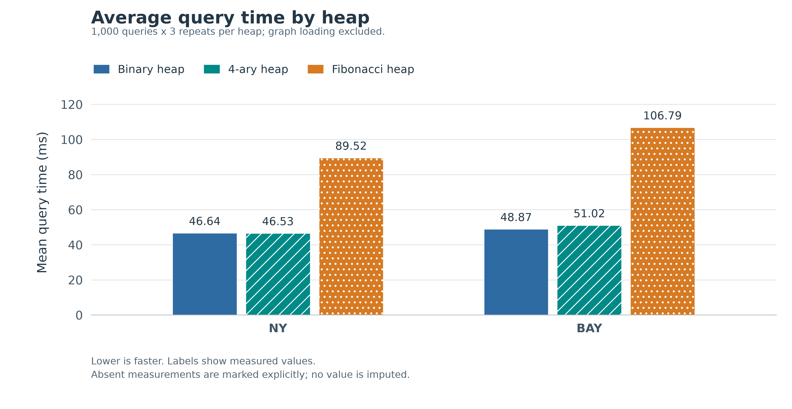
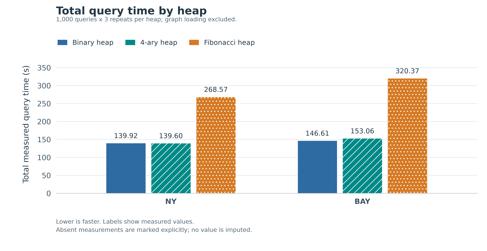
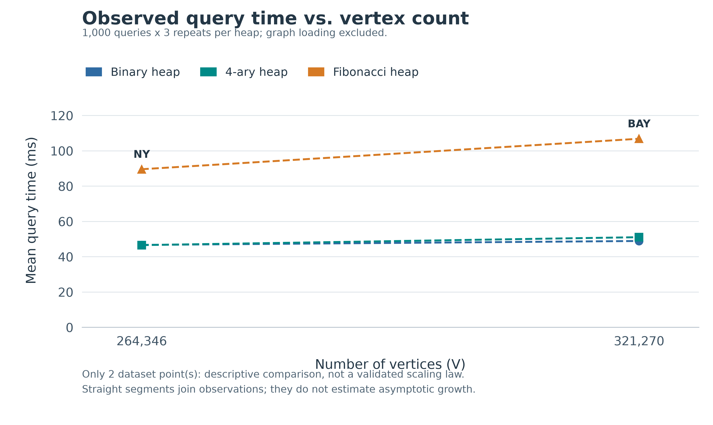
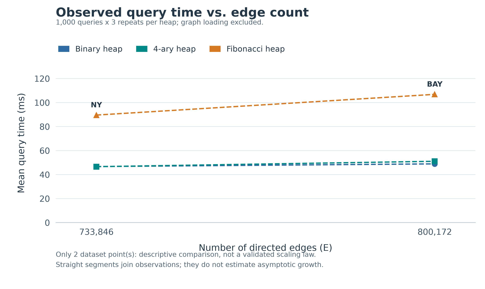

# Comparative Performance Analysis of Dijkstra's Shortest Path Algorithm: Binary Min-Heap versus Fibonacci Heap on USA Road Networks

**Author:** Zhejiang University  
**Course:** Advanced Data Structures and Algorithm Analysis  
**Project:** 8-1 Shortest Path Algorithm with Heaps  
**Date:** October 2026  

---

## Abstract

This project compares C11 implementations of Dijkstra's algorithm using an indexed binary min-heap and a Fibonacci heap with consolidation and cascading cuts. The theoretical running-time bounds are $O((V+E)\log V)$ and $O(E+V\log V)$, respectively. Experiments use the New York (NY) and San Francisco Bay Area (BAY) road networks from the 9th DIMACS Implementation Challenge. Each dataset has 1,000 fixed source-target query pairs, executed three times per implementation. In these three-repeat experiments, Fibonacci-heap average query time is 2.38 times the binary-heap time on NY and 2.57 times on BAY. All paired distances in the saved three-repeat records agree. We discuss allocation overhead, pointer access, and graph sparsity as possible explanations, and document preliminary timing variation and limits of the evaluation.

---

## Chapter 1: Introduction

### 1.1 Problem Definition

Given a directed graph $G = (V, E)$ with a non-negative edge weight function $w: E \to \mathbb{R}_{\ge 0}$, a source vertex $s \in V$, and a destination vertex $t \in V$, the Shortest Path Problem seeks to find a directed path $p = \langle v_0, v_1, \dots, v_k \rangle$ where $v_0 = s$, $v_k = t$, and $(v_{i-1}, v_i) \in E$ for $1 \le i \le k$, such that the total path weight:
$$w(p) = \sum_{i=1}^k w(v_{i-1}, v_i)$$
is minimized. The minimum weight among all paths from $s$ to $t$ is defined as the shortest path distance $\delta(s, t)$, with $\delta(s, t) = \infty$ if no such path exists.

### 1.2 Algorithmic Background and Priority Queues

In 1959, Edsger W. Dijkstra published the canonical greedy algorithm for solving the SSSP problem with non-negative edge weights. Dijkstra's algorithm maintains a tentative distance estimate $\text{dist}[v]$ for each vertex $v \in V$, iteratively extracting the unsettled vertex $u$ with the minimal distance label, marking it settled, and relaxing all outgoing edges $(u, v) \in E$.

The overall computational efficiency of Dijkstra's algorithm is fundamentally governed by the underlying **Priority Queue (PQ)** data structure used to maintain unsettled vertices:
1. **$V$ executions of `Extract-Min`**: Removing the minimum distance vertex to expand the shortest path tree.
2. **At most $V$ executions of `Insert`**: Adding newly discovered vertices to the frontier.
3. **At most $E$ executions of `Decrease-Key`**: Updating distance estimates when an edge relaxation yields a strictly shorter path.

| Priority Queue Structure | `Insert` | `Find-Min` | `Extract-Min` | `Decrease-Key` | Dijkstra Overall Complexity |
|---|---|---|---|---|---|
| Unsorted Array / Simple | $O(1)$ | $O(V)$ | $O(V)$ | $O(1)$ | $O(V^2)$ |
| **Binary Min-Heap** | $O(\log V)$ | $O(1)$ | $O(\log V)$ | $O(\log V)$ | **$O((V + E) \log V)$** |
| $d$-ary Heap ($d = \lceil E/V \rceil$) | $O(\frac{d \log V}{\log d})$ | $O(1)$ | $O(\frac{d \log V}{\log d})$ | $O(\frac{\log V}{\log d})$ | $O(E \frac{\log V}{\log(E/V)})$ |
| **Fibonacci Heap** (Amortized) | **$O(1)$** | **$O(1)$** | **$O(\log V)$** | **$O(1)$** | **$O(E + V \log V)$** |

### 1.3 Research Motivation and Objectives

In theoretical computer science, the Fibonacci Heap (introduced by Fredman and Tarjan in 1987) is widely celebrated because it achieves the theoretical lower bound for comparison-based Dijkstra implementations on general graphs. By lowering the amortized cost of `Decrease-Key` from $O(\log V)$ to $O(1)$, the total time bound is reduced to $O(E + V \log V)$, which becomes linear $O(E)$ on sufficiently dense graphs ($E \ge V \log V$).

However, modern computer architectures diverge from the idealized Random Access Machine (RAM) model. Hierarchical memory caches (L1, L2, L3 caches), Translation Lookaside Buffers (TLB), memory bus bandwidth, and speculative execution heavily penalize pointer chasing and fragmented heap allocations. 

This project aims to address the following core research questions:
1. Does the asymptotic superiority of the Fibonacci Heap translate into measurable real-world speedups on large-scale geographic road networks?
2. How do structural characteristics of continental road graphs—specifically planar sparsity ($E/V \approx 2.5 \sim 3.0$)—influence the ratio of `Decrease-Key` to `Extract-Min` operations?
3. How do CPU cache locality and dynamic memory allocation overhead determine the break-even threshold between array-based and node-pointer-based priority queues?

---

## Chapter 2: Algorithm Design and Complexity Analysis

### 2.1 Graph Representation

Road networks from the DIMACS Challenge comprise hundreds of thousands of vertices and edges. Storing such networks using an adjacency matrix would require $O(V^2) \approx (264{,}000)^2 \times 8 \text{ bytes} \approx 557 \text{ GB}$ of memory, which is completely infeasible.

Instead, we employ the **Forward Star (Chain Forward Star)** adjacency list representation:
- `head[u]`: An integer array storing the index of the first outgoing edge from vertex $u$ in the `edges` array (initialized to $-1$).
- `edges[i]`: A contiguous array of `Edge` structures containing:
  - `to`: Target vertex index ($1 \le \text{to} \le n$).
  - `weight`: Non-negative distance metric ($w \ge 0$).
  - `next`: Index of the next edge in the adjacency list originating from the same vertex (or $-1$ if terminating).

This structure guarantees compact $O(V + E)$ spatial complexity and maximizes CPU memory cache locality when scanning the incident edges of vertex $u$.

```c
typedef struct Edge {
    int to;
    long long weight;
    int next;
} Edge;

typedef struct Graph {
    int n;          /* Vertex count (1..n) */
    int m;          /* Directed edge count */
    int *head;      /* Size n + 1 */
    Edge *edges;    /* Capacity m */
} Graph;
```

### 2.2 Dijkstra's Algorithm and Relaxation Invariants

The algorithm maintains a tentative distance label $\text{dist}[v] \in [0, \infty]$ and a settlement boolean array $\text{settled}[v]$.

#### Initialization
$$\text{dist}[s] = 0, \quad \forall v \ne s: \text{dist}[v] = \infty$$

#### Main Invariant
At the start of each iteration, for every settled vertex $u$ ($\text{settled}[u] = 1$), $\text{dist}[u] = \delta(s, u)$. Furthermore, for every unsettled vertex $v$, $\text{dist}[v]$ is the length of the shortest path from $s$ to $v$ whose intermediate vertices are all settled.

#### Relaxation Step
When the unsettled vertex $u$ with the minimal $\text{dist}[u]$ is extracted, for each outgoing edge $(u, v) \in E$:
$$\text{candidate} = \text{dist}[u] + w(u, v)$$
If $\text{candidate} < \text{dist}[v]$:
1. $\text{dist}[v] \leftarrow \text{candidate}$.
2. If $v$ is already in the priority queue, execute `Decrease-Key(PQ, v, candidate)`.
3. If $v$ is not yet in the priority queue and not settled, execute `Insert(PQ, v, candidate)`.

#### Necessity of Non-Negative Weights
Dijkstra's greedy choice property relies on the condition that extending a path cannot decrease its total length. If an edge had $w(u, v) < 0$, a settled vertex $u$ could subsequently have its distance reduced via a path traversing the negative edge, violating the invariant and causing incorrect results.

### 2.3 Binary Min-Heap with Position Tracking

A Binary Min-Heap is a complete binary tree stored in a 1-based array `heap[1..size]`. For node $i$:
$$\text{parent}(i) = \lfloor i/2 \rfloor, \quad \text{left}(i) = 2i, \quad \text{right}(i) = 2i + 1$$

To achieve sub-linear `Decrease-Key`, we maintain a reverse index array `pos[vertex]`:
- `pos[v] == -1`: Vertex $v$ is currently not in the heap.
- `pos[v] >= 1`: Vertex $v$ is stored at `heap[pos[v]]`.

Whenever elements at positions $i$ and $j$ are swapped in `heap[]`:
```c
static void heap_swap(BinaryHeap *h, int i, int j) {
    int u = h->heap[i];
    int v = h->heap[j];
    h->heap[i] = v;
    h->heap[j] = u;
    h->pos[u] = j;
    h->pos[v] = i;
}
```

#### Complexity Analysis
- `Insert`: Appends vertex to index `size + 1` and calls `sift_up`. Takes $O(\log V)$ worst-case.
- `Extract-Min`: Replaces root `heap[1]` with `heap[size]` and calls `sift_down`. Takes $O(\log V)$ worst-case.
- `Decrease-Key`: Looks up index $i = \text{pos}[v]$ in $O(1)$ and executes `sift_up`. Takes $O(\log V)$ worst-case.
- Total Dijkstra runtime:
  $$T_{\text{binary}} = O(V \cdot T_{\text{insert}} + V \cdot T_{\text{extract-min}} + E \cdot T_{\text{decrease-key}}) = O((V + E) \log V)$$

### 2.4 Fibonacci Heap Design and Amortized Analysis

A Fibonacci Heap is a collection of min-heap-ordered trees stored as circular doubly linked lists. Trees are not restricted to rigid shapes, enabling lazy, delayed structural restructuring.

#### Potential Function and Amortization
Following CLRS Chapter 19, we define the potential function $\Phi(H)$ for a Fibonacci Heap $H$ as:
$$\Phi(H) = t(H) + 2 \cdot m(H)$$
where:
- $t(H)$: Number of trees in the root list.
- $m(H)$: Number of marked nodes (non-root nodes that have lost exactly one child since becoming a child of another node).

The amortized cost $\hat{c}_i$ of operation $i$ with actual cost $c_i$ is:
$$\hat{c}_i = c_i + \Phi(H_i) - \Phi(H_{i-1})$$

#### Key Operations and Potential Shifts

1. **`Insert(H, x)`**:
   - Creates node $x$ and adds it to the root list.
   - Actual cost: $c = O(1)$.
   - Change in potential: $t(H)$ increases by 1; $m(H)$ unchanged. $\Delta \Phi = +1$.
   - Amortized cost: $\hat{c} = O(1) + 1 = O(1)$.

2. **`Find-Min(H)`**:
   - Accesses `min_node` pointer directly. Takes $O(1)$ worst-case.

3. **`Extract-Min(H)`**:
   - Removes root `min_node` and splices all its children into the root list.
   - Consolidates roots using degree table `A[0..D(N)]` by linking roots of equal degrees until all roots have pairwise distinct degrees.
   - Actual cost: $c \le O(D(N) + t(H))$.
   - Let $t(H)$ be the number of roots prior to consolidation. After consolidation, at most $D(N) + 1$ roots remain.
   - $\Delta \Phi \le (D(N) + 1) - t(H)$.
   - Amortized cost: $\hat{c} \le O(D(N) + t(H)) + (D(N) + 1) - t(H) = O(D(N))$.
   - Since maximum degree $D(N) \le \lfloor \log_\phi N \rfloor = O(\log V)$, amortized cost is $O(\log V)$.

4. **`Decrease-Key(H, x, k)`**:
   - Sets $x.\text{key} \leftarrow k$.
   - If min-heap order is violated ($x.\text{key} < x.\text{parent}.\text{key}$), cuts $x$ from parent $y$ and adds $x$ to the root list.
   - Executes cascading cuts: If $y$ was already marked, cuts $y$ and recurses upward; otherwise marks $y$.
   - Suppose $c$ cascading cuts occur.
   - Actual cost: $O(c)$.
   - Number of trees increases by $c$.
   - $c - 1$ marked nodes become unmarked roots, and at most 1 node becomes marked. Thus $\Delta m \le -(c - 1) + 1 = -c + 2$.
   - $\Delta \Phi = \Delta t + 2 \Delta m \le c + 2(-c + 2) = 4 - c$.
   - Amortized cost: $\hat{c} = O(c) + (4 - c) = O(1)$.

5. Total Dijkstra runtime with Fibonacci Heap:
   $$T_{\text{fib}} = O(V \cdot 1 + V \cdot \log V + E \cdot 1) = O(E + V \log V)$$

### 2.5 Algorithm Pseudocode

The following pseudocode describes the normal successful execution of the implemented algorithms. Allocation and input errors are handled separately in the C interfaces. `INF` denotes `LLONG_MAX`; addition is checked before relaxation to avoid signed overflow.

#### Dijkstra with Either Heap

```text
DIJKSTRA(G, source, target, heap_type)
    if source = target: return 0
    dist[1..V] <- INF; settled[1..V] <- false
    Q <- empty heap of heap_type
    dist[source] <- 0; INSERT(Q, source, 0)
    while Q is not empty:
        u <- EXTRACT_MIN(Q)
        if settled[u]: continue
        settled[u] <- true
        if u = target: break
        for each outgoing edge (u, v, w):
            if settled[v]: continue
            if dist[u] > INF - w: continue
            candidate <- dist[u] + w
            if candidate < dist[v]:
                dist[v] <- candidate
                if CONTAINS(Q, v): DECREASE_KEY(Q, v, candidate)
                else: INSERT(Q, v, candidate)
    answer <- dist[target]
    release Q and working arrays
    return answer
```

The binary heap reads keys from the shared `dist` array, so its decrease-key interface only needs a vertex ID. The Fibonacci heap stores a separate key in each node, so its interface receives the new key. For path output, the separate path-producing binary implementation records `parent[v] = u` on a successful relaxation and reverses the target-to-source predecessor chain.

#### Binary Min-Heap Operations

```text
SWAP_ENTRIES(H, i, j)
    swap H.heap[i] and H.heap[j]
    H.pos[H.heap[i]] <- i; H.pos[H.heap[j]] <- j

SIFT_UP(H, i)
    while i > 1 and dist[H.heap[i]] < dist[H.heap[floor(i/2)]]:
        p <- floor(i/2)
        SWAP_ENTRIES(H, i, p); i <- p

INSERT(H, vertex, key)
    append vertex to H.heap; set its position
    SIFT_UP(H, H.size)

DECREASE_KEY(H, vertex, new_key)
    // Caller has already changed dist[vertex].
    SIFT_UP(H, H.pos[vertex])

EXTRACT_MIN(H)
    result <- H.heap[1]
    move last entry to root; decrease size; update position map
    H.pos[result] <- -1
    i <- 1
    while i has a child:
        j <- child of i with smallest distance
        if dist[H.heap[i]] <= dist[H.heap[j]]: break
        SWAP_ENTRIES(H, i, j); i <- j
    return result
```

#### Fibonacci Heap Operations

```text
INSERT(H, vertex, key)
    create unmarked node x with no parent or children
    add x to circular root list; update H.min
    H.node_by_vertex[vertex] <- x; H.size <- H.size + 1

CUT(H, x, y)
    detach x from y's child list; decrease y.degree
    add x to root list; x.parent <- NIL; x.mark <- false

CASCADING_CUT(H, y)
    z <- y.parent
    if z != NIL:
        if y.mark = false: y.mark <- true
        else: CUT(H, y, z); CASCADING_CUT(H, z)

DECREASE_KEY(H, vertex, new_key)
    x <- H.node_by_vertex[vertex]; x.key <- new_key
    y <- x.parent
    if y != NIL and x.key < y.key:
        CUT(H, x, y); CASCADING_CUT(H, y)
    if x.key < H.min.key: H.min <- x

EXTRACT_MIN(H)
    z <- H.min; save z.vertex and z.key
    move all z's children to root list and clear their parent pointers
    remove z; clear its vertex mapping; decrease H.size; free z
    if root list is empty: H.min <- NIL
    else: CONSOLIDATE(H)
    return saved vertex and key

CONSOLIDATE(H)
    roots <- snapshot of current root pointers
    A <- empty degree table
    for each root x in roots:
        d <- x.degree
        while A[d] != NIL:
            y <- A[d]
            if x.key > y.key: swap x and y
            remove y from roots and link it as an unmarked child of x
            A[d] <- NIL; d <- d + 1
        A[d] <- x
    rebuild root list from nonempty entries of A and recompute H.min
```

The source uses a fixed degree table of 64 entries. The normal-case description assumes the degree fits that implementation limit. Root snapshots prevent traversal from depending on sibling links being modified during consolidation.

#### Simple Reference and Benchmark Driver

The simple reference replaces the heap extraction with a scan of all unsettled vertices for the smallest finite distance; relaxation and target termination follow the same rules. It is used for small-graph verification, not for road-network timing.

```text
BENCHMARK(graph_file, query_file, repeats)
    load graph and queries once
    for algorithm in [binary_heap, fibonacci_heap]:
        for repeat from 1 to repeats:
            for each fixed pair (s, t):
                start <- clock()
                success, distance <- DIJKSTRA(G, s, t, algorithm)
                elapsed <- clock() - start
                save algorithm, pair, repeat, distance, success, elapsed
                on repeat 1: store or compare distances for built-in verification
    compute total, mean, and median per algorithm
    write summary
```

### 2.6 Time and Space Complexity Derivation

For one query, initializing the distance, status, and index arrays costs $O(V)$. Each vertex enters the heap at most once and is extracted at most once; at most $E$ outgoing edges are examined and at most $E$ successful relaxations can require priority updates. Early target termination may reduce work, but the worst-case bounds remain:

$$T_{binary}=O(V)+O(E)+O(V\log V)+O(E\log V)=O((V+E)\log V).$$

For the Fibonacci heap, insertions and decreases cost $O(1)$ amortized, while extractions cost $O(\log V)$ amortized:

$$T_{Fibonacci}=O(V)+O(E)+O(V)+O(E)+O(V\log V)=O(E+V\log V).$$

The simple reference scans $V$ entries at most $V$ times and examines at most $E$ edges, giving $O(V^2+E)$, conventionally $O(V^2)$ for simple graphs. The formulas assume standard constant-cost arithmetic and successful allocation; allocator and memory-system costs influence measured time.

| Storage component | Binary heap implementation | Fibonacci heap implementation |
|---|---|---|
| Graph heads and edge records | $O(V+E)$ | $O(V+E)$ |
| Distances and settled flags | $O(V)$ | $O(V)$ |
| Heap storage and vertex lookup | $O(V)$ array entries and positions | At most $V$ nodes and $V$ lookup pointers: $O(V)$ |
| Consolidation workspace | Not used | Root snapshot: at most $O(V)$; fixed 64-entry degree table |
| Recursive cascading cuts | Not used | At most $O(V)$ stack space as a conservative upper bound |
| Optional predecessor/path arrays | $O(V)$ in path-output mode | Not used by timed Fibonacci queries |

Thus auxiliary space excluding the graph is $O(V)$ for each shortest-path implementation, and total space including graph storage is

$$S_{query}=O(V+E)+O(V)=O(V+E).$$

The equal asymptotic bounds do not imply equal byte counts: a Fibonacci node stores a key, degree, mark, and several pointers, whereas the binary heap principally stores vertex IDs and position indices. No peak-memory measurement was collected.

The benchmark itself additionally retains $Q$ query pairs and distance results plus $QR$ timing samples per algorithm, where $Q$ is query count and $R$ is repeat count. Calls are sequential, so query workspaces are not multiplied by $QR$. Its total retained space is $O(V+E+QR)$ for $R\ge1$. Sorting timings for median computation also adds aggregation work after query timing; the standard C library does not require a particular `qsort` implementation, so no specific sorting complexity is assumed here.

---

## Chapter 3: Implementation

### 3.1 Architecture Overview

The codebase is organized into cleanly decoupled modules following modern C11 software engineering practices:

```text
include/
  graph.h           <- Forward-star graph definitions & DIMACS parser declarations
  binary_heap.h     <- Binary min-heap interface & validity checks
  fibonacci_heap.h  <- Complete CLRS Fibonacci heap definitions
  dijkstra.h        <- Dijkstra engines (Simple, Binary Heap, Fibonacci Heap)
  benchmark.h       <- Query parser, high-res timing, and CSV export
src/
  graph.c           <- Robust .gr file loader with syntax error handling
  binary_heap.c     <- Array-based heap with synchronized pos tracking
  fibonacci_heap.c  <- Full pointer-based Fibonacci heap implementation
  dijkstra.c        <- Symmetric shortest path solvers & path reconstruction
  benchmark.c       <- Microsecond-precision benchmark execution engine
  main.c            <- Unified CLI for single queries and multi-run benchmarks
```

### 3.2 Circular Doubly Linked List Management

Every node in the Fibonacci Heap maintains `left` and `right` sibling pointers forming a circular doubly linked list. This allows $O(1)$ removal and splicing without allocating auxiliary sentinel nodes.

```c
typedef struct FibNode {
    int vertex;
    long long key;
    int degree;
    int mark;
    struct FibNode *parent;
    struct FibNode *child;
    struct FibNode *left;
    struct FibNode *right;
} FibNode;
```

When isolating a root or splicing a child list, pointer assignments must strictly preserve bidirectional integrity:
```c
/* Splice circular child list into root list next to z */
FibNode *z_right = z->right;
FibNode *child_left = z->child->left;

z->right = z->child;
z->child->left = z;
child_left->right = z_right;
z_right->left = child_left;
```

### 3.3 Consolidate Pointer Safety

A notorious hazard in Fibonacci Heap implementations is pointer corruption during consolidation. When two trees of equal degree are linked, one tree is removed from the root list. If the consolidation loop directly iterates over the active `right` pointers of the root list, modifying the list invalidates the iterator pointer, leading to infinite loops or undefined memory dereferences.

To eliminate this vulnerability, our implementation collects all existing root pointers into an auxiliary buffer `roots[]` before merging:
```c
/* Collect root pointers to decouple traversal from list mutation */
int root_count = 0;
FibNode *curr = fh->min_node;
do {
    root_count++;
    curr = curr->right;
} while (curr != fh->min_node);

FibNode **roots = (FibNode **)malloc((size_t)root_count * sizeof(FibNode *));
curr = fh->min_node;
for (int i = 0; i < root_count; i++) {
    roots[i] = curr;
    curr = curr->right;
}
```
After consolidating pairwise via `A[0..63]`, the root list is completely reconstructed afresh from the non-null entries of `A[]`.

### 3.4 Defensive Invariants Checking

To guarantee correctness beyond end-to-end Dijkstra distance matching, both heap implementations provide built-in validation functions (`binary_heap_is_valid` and `fib_heap_is_valid`). The Fibonacci heap validator recursively verifies:
1. Every node satisfies `node->right->left == node` and `node->left->right == node`.
2. Every child node has `child->parent == parent` and `child->key >= parent->key`.
3. The number of children matches `parent->degree`.
4. Total reachable nodes across all trees equals `fh->num_nodes`.
5. Direct mapping `fh->node_by_vertex[v] == node` holds for every vertex.

---

## Chapter 4: Experimental Setup and Results

### 4.1 Hardware and Software Environment

The final experiments were run on the same local Windows computer, using the executable compiled from the submitted source:

- **Processor**: Intel Core i7-14650HX.
- **Operating system**: Windows, version 10.0.26200.0.
- **Compiler**: GCC 16.2.0 (MSYS2 UCRT64, Rev4).
- **Build**: Release build using `build/build.ps1`, with C11 and `-O2` optimization (`-DNDEBUG`).
- **Timing**: Windows `QueryPerformanceCounter`; the program converts elapsed counter values to milliseconds.
- **Supporting tools**: PowerShell and Python 3.14.6 with matplotlib and NumPy.

Installed memory was not independently verified for this report. No fixed CPU-frequency, power-policy, or background-load measurements were recorded.

### 4.2 Road Network Datasets

The datasets use the physical-distance weights (`USA-road-d`) from the 9th DIMACS Implementation Challenge. The loader treats records as directed edges.

| Dataset | Region | Vertices | Directed edges | Edges / vertices |
|---|---|---:|---:|---:|
| NY | New York | 264,346 | 733,846 | 2.78 |
| BAY | San Francisco Bay Area | 321,270 | 800,172 | 2.49 |

Official download links:

- [NY road network](https://www.diag.uniroma1.it/~challenge9/data/USA-road-d/USA-road-d.NY.gr.gz)
- [BAY road network](https://www.diag.uniroma1.it/~challenge9/data/USA-road-d/USA-road-d.BAY.gr.gz)

Large road-network files are local experiment inputs and must be excluded from the final submission package. The small synthetic graph in `data/sample` is retained for correctness tests, not for the final road-network performance comparison.

### 4.3 Query Protocol and Timing Scope

For each dataset, `scripts/generate_queries.py` generated 1,000 source-target pairs using seed 42. Vertex IDs are sampled uniformly from the valid range, with source equal to target rejected. The same fixed pairs are reused for both implementations and all three repeats: this is 1,000 pairs and 3,000 executions per implementation per dataset, not 3,000 independently generated pairs.

The graph and query file are loaded once before timing. Each timed call includes distance-array initialization, heap allocation, shortest-path computation, and cleanup. Both implementations stop when the target is extracted or the queue becomes empty. CSV output and graph loading are outside the timed call. The program runs all binary-heap repeats before all Fibonacci-heap repeats; execution order is not randomized, and no explicit warm-up phase is used.

Commands below are run from `my_run` (the output files are appended to, so use fresh names for a new experiment):

```powershell
..\shortest_path.exe benchmark ..\data\road\USA-road-d.BAY.gr ..\data\queries\BAY_random.p2p results/BAY_repeat3_raw.csv 3
..\shortest_path.exe benchmark ..\data\road\USA-road-d.NY.gr ..\data\queries\NY_random.p2p results/NY_repeat3_raw.csv 3
```

### 4.4 Correctness Checks

All five supplied test suites passed after local compilation. They cover graph loading, both heaps, shortest-path cases, and cross-comparison with the simple implementation.

The benchmark's built-in `VERIFIED_MATCH` status compares the two implementations only on the first repeat. Separately, the saved final raw files were checked across all three repeats: each dataset contains 6,000 records (two algorithms times 1,000 pairs times three repeats), every success flag equals 1, and all 3,000 paired distances agree per dataset. This confirms agreement on the tested inputs; it is not a proof of correctness for every possible graph.

### 4.4.1 Correctness Test Cases and Outcomes

The table maps the supplied tests to their actual inputs and assertions. Outcomes refer to the completed local execution of all five suites (`Passed: 5`, `Failed: 0`); no additional test run is claimed here. Temporary graph files are generated and removed by the test programs, so their input definitions remain reproducible in `tests/`.

| Test source / case | Input or operation | Purpose and expected result | Recorded outcome |
|---|---|---|---|
| `test_graph.c`: normal graph | `data/sample/small.gr` | Read 5 vertices and 7 arcs; vertex 1 has 2 outgoing arcs; freeing resets graph state | Passed |
| `test_graph.c`: invalid files | Missing file, empty file, arc before header, `p sp 3 1` with arc `1 -> 4`, negative weight -5, declared 2 arcs but supplied 1 | Reject each invalid input with return value 0 | Passed |
| `test_graph.c`: boundary inputs | `p sp 1 0`; separately, a two-vertex graph with arc weight 0 | Accept a single-vertex graph and accept nonnegative zero-weight arcs | Passed |
| `test_dijkstra.c`: known distances | Small graph, queries `1 -> 5`, `1 -> 2` | Simple, binary, and Fibonacci implementations return 10 and 3, respectively | Passed |
| `test_dijkstra.c`: unreachable | Small graph, query `5 -> 1` | All three return `LLONG_MAX`, with successful execution status | Passed |
| `test_dijkstra.c`: same endpoint | Small graph, query `1 -> 1` | All three return distance 0 | Passed |
| `test_dijkstra.c`: path output | Binary path mode, `1 -> 5` | Distance 10; five vertices in order `1, 3, 2, 4, 5` | Passed |
| `test_dijkstra.c`: invalid parameters | Out-of-range IDs; null graph or answer pointer | Reject tested invalid arguments with return value 0 | Passed |
| `test_dijkstra.c`: zero-weight route | Arcs `(1,2,0)`, `(2,3,5)`, `(1,3,10)`, `(3,4,0)`, `(1,4,20)` | All three return 5 for `1 -> 4` | Passed |
| `test_binary_heap.c`: ordered extraction | Keys for vertices 1..5: 50, 20, 80, 10, 30 | Extract vertices `4,2,5,1,3`; maintain position map and heap validity; reject duplicate/invalid insertion and empty extraction | Passed |
| `test_binary_heap.c`: decrease-key | Keys 100,200,300,400; reduce vertex 4 to 50 | Vertex 4 becomes minimum; decreasing an extracted vertex is rejected | Passed |
| `test_binary_heap.c`: random operations | 200 vertices; 50 attempted random key reductions, then drain heap | Nondecreasing extracted keys and valid heap after operations | Passed |
| `test_fibonacci_heap.c`: initialization and order | Empty heap; then ten keys 45,12,89,3,23,7,56,1,90,34 | Empty operations rejected; initial minimum is vertex 8 with key 1; extracted keys nondecreasing; invariants preserved | Passed |
| `test_fibonacci_heap.c`: consolidation and cuts | Insert keys 10..80; extract minimum; reduce vertices 8,7,6 to 5,4,2 | Minimum and remaining extraction order correct; parent, degree, list and lookup invariants preserved | Passed |
| `test_fibonacci_heap.c`: repeated cuts | Insert 16 nodes; extract minimum; decrease vertices 16 down to 10 to key 5 | Valid heap after each update; exercises multi-level cutting scenarios | Passed; test does not assert a cascading-cut count |
| `test_fibonacci_heap.c`: reference stress | 2,000 attempted random actions over 300 vertex IDs | Extracted key matches linear-scan reference minimum; periodic structural validation succeeds | Passed |
| `test_heap_comparison.c` | Seed 42; `(V,E,Q)` = `(20,40,50)`, `(50,300,100)`, `(100,600,100)`, `(80,50,80)`; weights 0..500 | All three implementations succeed and agree for 330 generated queries; random arc generation permits self-loops and parallel arcs | Passed |
| Final road-network raw-record validation | NY and BAY, each 1,000 pairs times 3 repeats times 2 algorithms | Per dataset: 6,000 successful records; 3,000 matched algorithm-pair distances; totals agree with summary within rounding tolerance | Passed |

The zero-weight route test has no parallel arcs despite its function name mentioning a multigraph. Likewise, the repeated-cut test checks invariants without instrumenting cascade counts. These distinctions avoid claiming coverage stronger than the assertions provide. Overflow guards exist in the solver, but the supplied suites do not contain a dedicated near-`LLONG_MAX` distance test.

### 4.5 Final Performance Results

The following results come from `my_run/results/benchmark_final.csv` and were checked against the raw files. Total time sums 3,000 calls; mean and median use those 3,000 calls. Values below are rounded for display.

| Dataset | Algorithm | Query pairs | Repeats | Total time (ms) | Mean (ms/query) | Median (ms/query) |
|---|---|---:|---:|---:|---:|---:|
| NY | Binary min-heap | 1,000 | 3 | 37,913.20 | 12.63773 | 12.72045 |
| NY | Fibonacci heap | 1,000 | 3 | 90,325.33 | 30.10844 | 30.19220 |
| BAY | Binary min-heap | 1,000 | 3 | 42,320.77 | 14.10692 | 13.92160 |
| BAY | Fibonacci heap | 1,000 | 3 | 108,658.27 | 36.21942 | 34.07720 |

Fibonacci / binary mean-time ratios are **2.38 on NY** and **2.57 on BAY**. Thus, the binary heap is faster in both final three-repeat experiments.

### 4.6 Figures



Figure 1. Mean query execution time for the final three-repeat workloads.



Figure 2. Total time for 3,000 calls per implementation per dataset. Both datasets use equal query and repeat counts.



Figure 3. Mean query time versus vertex count for the two road networks.



Figure 4. Mean query time versus directed-edge count. Figures 3 and 4 contain only two dataset points; connecting them does not establish an asymptotic growth law or isolate size from graph topology and query reach.

### 4.7 Preliminary Runs and Timing Variation

The preliminary one-repeat runs are retained in `my_run/results/benchmark_raw.csv`. NY means were 12.5570 ms (binary) and 29.3214 ms (Fibonacci). BAY means were 46.6558 ms (binary) and 34.8374 ms (Fibonacci); the binary median was 23.1739 ms. The preliminary BAY ranking therefore differed from the later three-repeat experiment.

Both datasets were subsequently measured with the same three-repeat protocol, and those experiments form the main table above. Preliminary results are disclosed rather than pooled with the final runs. The cause of the BAY variation was not measured; background activity, CPU state, and other environment effects remain possible explanations, not established causes.

---

## Chapter 5: Discussion

### 5.1 Interpreting the Observed Performance

On these two sparse road networks, both theoretical bounds simplify to $O(V\log V)$ when $E=O(V)$. The Fibonacci heap's cheaper amortized decrease-key operation therefore does not imply a lower asymptotic order on this graph family. Actual runtime also depends on constants and the number of operations performed before reaching the target.

The binary heap stores vertex IDs in arrays and uses an index map to locate entries. The Fibonacci implementation allocates individual nodes, traverses circular linked lists, and allocates a temporary root buffer during consolidation. These implementation differences may contribute to the observed timing gap. Cache misses, allocator time, and heap-operation counts were not profiled, so their individual contributions cannot be quantified from these timings.

The measured edge-to-vertex ratios (2.78 and 2.49) demonstrate sparsity, but do not by themselves establish the number of successful decrease-key operations. We do not assume that the directed road networks are simple planar graphs or apply the undirected planar-edge bound directly to their arc counts.

### 5.2 Limitations

The final comparison covers two networks and one fixed set of 1,000 pairs per network. Three repeats reuse those pairs; they do not add new independent query pairs. Aggregate means and medians do not establish run-to-run stability without examining repeat-level statistics. Fixed algorithm order and the absence of explicit warm-up or monitored power settings can introduce bias. The preliminary BAY reversal further shows that a single timing run is insufficient for a broad claim about which heap is always faster.

More datasets, additional seeds, alternating or randomized execution order, and operation or hardware profiling would strengthen the evaluation. The reported conclusion applies to these implementations, workloads, and final measured runs.

---

## Chapter 6: Conclusion

We implemented Dijkstra's algorithm with an indexed binary min-heap and a Fibonacci heap, together with a simple reference implementation, five test suites, a benchmark driver, and plotting scripts. The local test suites passed, and all paired distances in the final raw records agree.

Each of the NY and BAY road networks was evaluated with 1,000 source-target pairs repeated three times. The Fibonacci heap took 2.38 times the binary-heap mean time on NY and 2.57 times on BAY in those final experiments. This supports choosing the binary heap for the tested workloads, while preserving the Fibonacci heap's theoretical advantages for other operation mixes. Preliminary timing variation and the limited dataset count prevent generalizing this result to all graphs or machines.

---

## References

1. **Dijkstra, E. W.** (1959). *A note on two problems in connexion with graphs*. Numerische Mathematik, 1(1), 269–271.
2. **Fredman, M. L., & Tarjan, R. E.** (1987). *Fibonacci heaps and their uses in improved network optimization algorithms*. Journal of the ACM (JACM), 34(3), 596–615.
3. **Cormen, T. H., Leiserson, C. E., Rivest, R. L., & Stein, C.** (2022). *Introduction to Algorithms* (4th ed., Chapter 19: Fibonacci Heaps). MIT Press.
4. **Cherkassky, B. V., Goldberg, A. V., & Radzik, T.** (1996). *Shortest paths algorithms: Theory and experimental evaluation*. Mathematical Programming, 73(2), 129–174.
5. **Demetrescu, C., Goldberg, A. V., & Johnson, D. S.** (Eds.). (2009). *The Shortest Path Problem: Ninth DIMACS Implementation Challenge*. American Mathematical Society, DIMACS Series in Discrete Mathematics and Theoretical Computer Science, Vol. 74.
6. **DIMACS 9th Challenge Official Repository**. *USA Road Networks Benchmark Data*. Università di Roma "La Sapienza". URL: <https://www.diag.uniroma1.it/~challenge9/download.shtml>.
