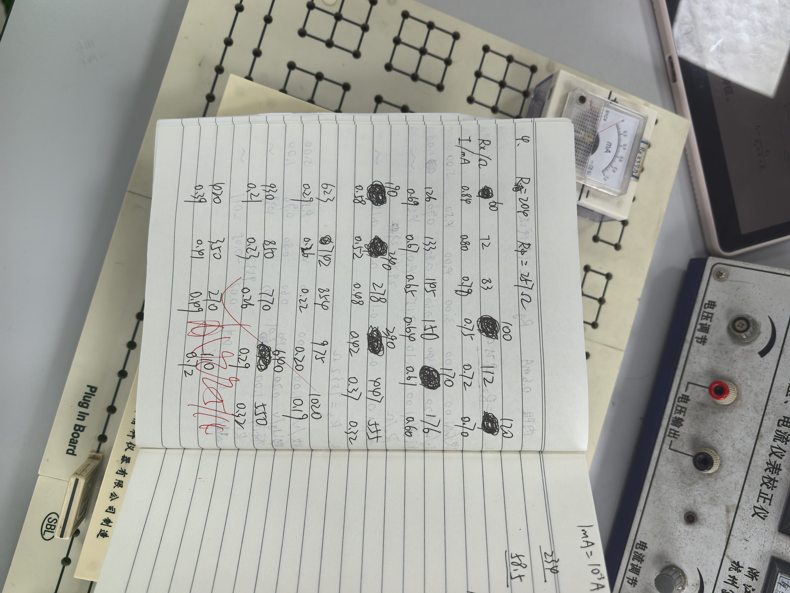
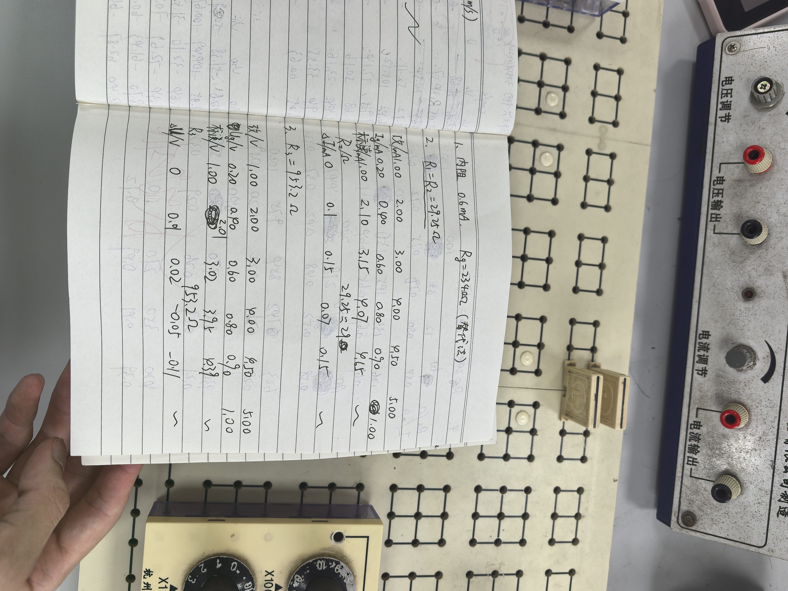
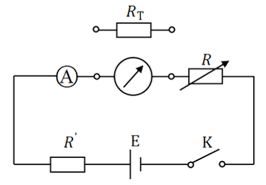
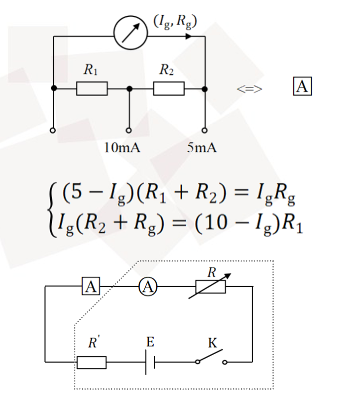
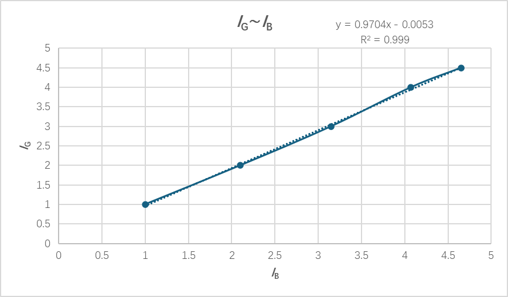
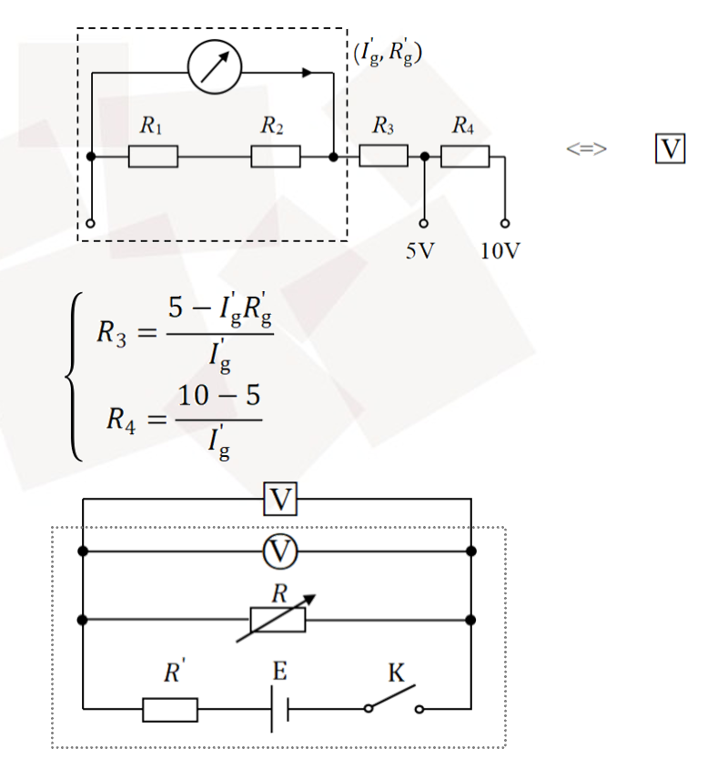
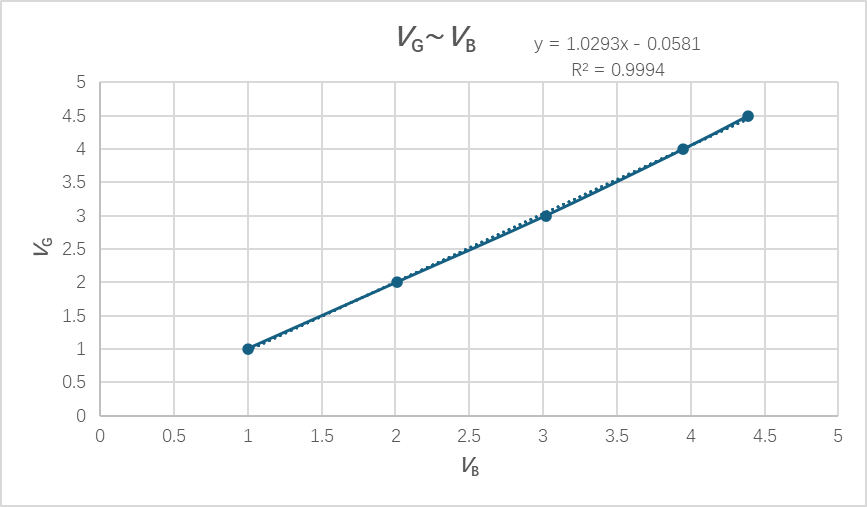
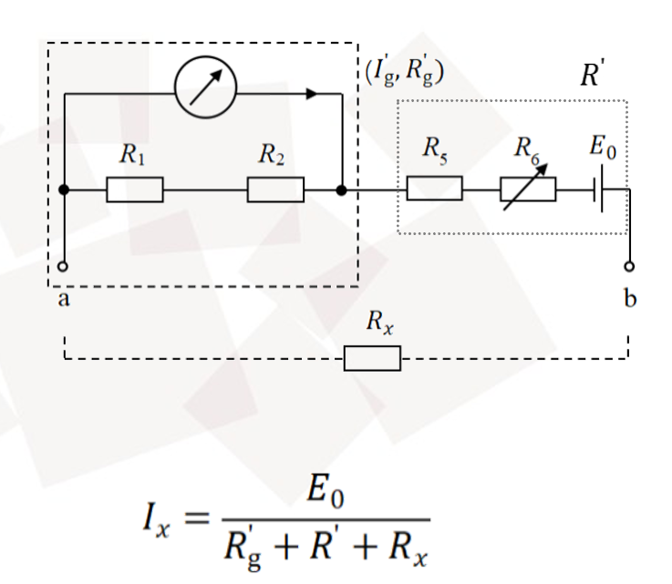
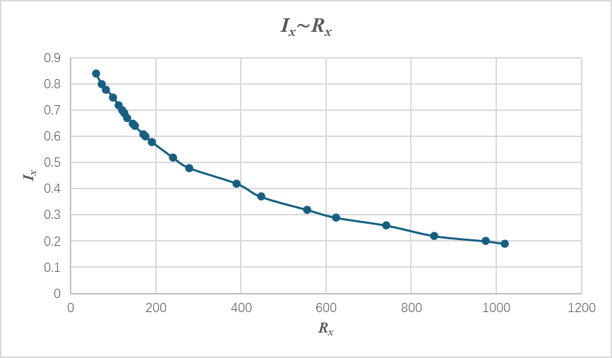

# 
物理实验报告

# 
实验名称：<u>万用表的设计</u>

## 
指导老师：<u>姚星星</u>

### 
周次：<u>十一</u>

### 
姓名：<u>邓欢桐</u>

### 
实验日期：<u>2026</u>年<u>5</u>月<u>14</u>日 星期<u>四</u> 上午

### 
浙江大学物理实验教学中心

### 一、预习报告

#### 1. 实验综述

（自述实验现象、实验原理和实验方法，不超过300字，5分）

本实验以磁电式电流计为核心，依据电流磁效应与安培力原理，先通过**替代法、中值法**测量电流计内阻，再分别采用**并联分流**改装多量程电流表、**串联分压**改装多量程电压表、结合限流与调零电阻改装欧姆表，最终组装成简易万用表。实验包含电路设计、电阻计算、组装、校验与校准全流程，还可拓展开展伏安法测电阻、直流电源输出功率特性探究，掌握指针式与数字万用表的工作原理及使用方法，理解电表改装的核心逻辑。

---

#### 2.实验重点

（简述本实验的学习重点，不超过100字，3分）

掌握电流计内阻测量方法；学会电流表、电压表、欧姆表的改装原理与计算；完成电表组装、校验与校准；熟悉万用表使用与拓展实验设计。

---

#### 3.实验难点

（简述本实验的实现难点，不超过100字，2分）

准确测量电流计内阻；精准计算分流、分压电阻值；电表校验与校准的精细调节；多量程电路组装与误差控制。

---

### 二、原始数据

（将有学生和老师签名的“自备数据记录草稿纸”的扫描或手机拍摄图粘贴在下方，20分）

---

### 三、结果与分析

#### 1. 数据处理与结果

（列出数据表格、选择数据处理方法、给定测量或计算结果，30分）

---

##### 电流计内阻阻值测量

使用替代法测得电流计内阻为 $234.0Ω$，与原有标注的 $239.0Ω$ 相差在可接受范围内

---

##### 改装多量程电流表

> 参数：$R_1=R_2=29.25Ω$

| 实验序号                     | 1     | 2     | 3     | 4     | 5           |6|
|:---:|:---:|:---:|: ---:|: ---:|:---:|:---:|
| 改装电流表读数$I_\text{G}$(mA) | 1.00  | 2.00  | 3.00  | 4.00  | 4.50 | 5.00 |
| 理论电流计读数$I_{g_{理论}}$(mA) | 0.20 | 0.40 | 0.60 | 0.80 | 0.90 |1.00|
| 标准安培表读数$I_\text{B}$(mA) | 1.00 | 2.10 | 3.15 | 4.07 | 4.65 |~|
| 校准后的并联电阻$R_2$(Ω)     | 29.25（取 29） | 29.25（取 29） | 29.25（取 29） | 29.25（取 29） | 29.25（取 29） |29.25（取 29）|
|$ΔI$(mA)        | 0.00 | 0.10 | 0.15 | 0.07 | 0.15 |~|

> $I_G \sim I_B$ 曲线图如下：

> 改装电流表等级计算：

电表精度等级由**最大引用误差**判定，引用误差定义为最大绝对误差与电表满量程的比值：
$\gamma_m = \frac{\Delta I_{\text{max}}}{I_{\text{量程}}} \times 100\%$

本实验改装电流表量程为 $5\ \text{mA}$，各校准点电流偏差分别为：
$0.00\ \text{mA}$、$0.10\ \text{mA}$、$0.15\ \text{mA}$、$0.07\ \text{mA}$、$0.15\ \text{mA}$。

取最大绝对误差：
$\Delta I_{\text{max}} = 0.15\ \text{mA}$

代入计算最大引用误差：
$\gamma_m = \frac{0.15}{5} \times 100\% = 3.00\%$

按照电工仪表标准精度等级：0.5级、1.0级、1.5级、2.5级、5.0级。
由于 $2.5\% < 3.00\% < 5.0\%$，因此**改装电流表精度等级为 5.0 级**。

---

##### 改装电压表

> 参数：$R_3=953.2Ω$

| 实验序号                     | 1     | 2     | 3     | 4     | 5           |6|
|:---:|:---:|:---:|: ---:|: ---:|:---:|:---:|
| 改装电压表读数$V_\text{G}$(V) | 1.00  | 2.00  | 3.00  | 4.00  | 4.50 | 5.00 |
| 理论电流计读数 $I_{g_{理论}}$(mA) | 0.20 | 0.40 | 0.60 | 0.80 | 0.90 |1.00|
| 标准伏特表读数$V_\text{B}$(V) | 1.00 | 2.01 | 3.02 | 3.95 | 4.39 |~|
| 校准后的串联电阻$R_3$(Ω) | 953.2 | 953.2 | 953.2 | 953.2 | 953.2 |953.2|
|$ΔV$(V)        | 0.00 | 0.01 | 0.02 | -0.05 | -0.11 |~|

>$V_G \sim V_B$ 曲线图如下：

> 改装电压表等级计算：

电压表精度等级同样采用最大引用误差评定：
$\gamma_m = \frac{\Delta U_{\text{max}}}{U_{\text{量程}}} \times 100\%$

本实验改装电压表量程为 $5\ \text{V}$，各校准点电压偏差分别为：
$0.00\ \text{V}$、$0.01\ \text{V}$、$0.02\ \text{V}$、$-0.05\ \text{V}$、$-0.11\ \text{V}$。

取绝对值最大绝对误差：
$\Delta U_{\text{max}} = 0.11\ \text{V}$

代入计算最大引用误差：
$\gamma_m = \frac{0.11}{5} \times 100\% = 2.20\%$

对照标准仪表精度等级，$2.20\%$ 接近并小于 $2.5\%$，因此**改装电压表精度等级为 2.5 级**。

---

##### 改装欧姆表

>具体参数无，只需在一开始将电流计调成满偏等操作中调节阻值，其具体值对结果没有直接影响。

|实验序号|1|2|3|4|5|6|7|8|9|10|11|12|13|14|15|16|17|18|19|20|21|22|23|24|25|26|27|28|29|30|31|32|
|:---:|:---:|:---:|:---:|:---:|:---:|:---:|:---:|:---:|:---:|:---:|:---:|:---:|:---:|:---:|:---:|:---:|:---:|:---:|:---:|:---:|:---:|:---:|:---:|:---:|:---:|:---:|:---:|:---:|:---:|:---:|:---:|:---:|
|$R_x$(Ω)|60|72|83|100|112|120|126|133|145|150|170|176|190|240|278|390|447|555|623|742|854|975|1020|930|850|770|640|550|420|350|270|110|
|$I_x$(mA)|0.84|0.80|0.78|0.75|0.72|0.70|0.69|0.67|0.65|0.64|0.61|0.60|0.58|0.52|0.48|0.42|0.37|0.32|0.29|0.26|0.22|0.20|0.19|0.21|0.23|0.26|0,29|0.32|0.39|0.41|0.49|0.72|

> $I_x \sim R_x$ 曲线图如下，其中使用的是结果更加准确的点进行拟合：

> 欧姆表电阻分布特征：

由欧姆表原理公式
$I_{x}=\frac{E_{0}}{R_{\text{内}}+R_{x}}$
以及 $I_x \sim R_x$ 曲线可得分布特征：

1. 欧姆表刻度**非线性**，呈现**左密右疏**的分布特点；
2. 待测电阻 $R_x$ 越小，回路电流 $I_x$ 越大，短接时电流达到满偏；
3. 随着 $R_x$ 增大，电流单调递减，曲线逐渐趋于平缓；
4. 欧姆表**中间刻度线性度最好、测量精度最高**，高阻区和低阻区刻度稀疏、读数误差偏大；
5. 欧姆表内部电源电动势存在微小衰减，也会造成刻度与测量零点产生轻微偏移。

---

#### 2. 误差分析

（运用测量误差、相对误差、不确定度等分析实验结果，20分）

---

##### 设计并改装 $5mA$ 电流表实验

> 求并联电阻相对误差：

电流表改装时，并联分流电阻的理论值为：
$R_s = \frac{I_g R_g}{I - I_g}$
其中：

- $I_g = 1\ \text{mA}$（表头满偏电流）
- $R_g = 234\ \Omega$（表头内阻）
- $I = 5\ \text{mA}$（改装后量程）

理论值计算：
$R_s = \frac{1 \times 234}{5 - 1} = 58.5\ \Omega$

由于 $R_1=R_2=\frac{R_s}{2}$，且取 $R_1=R_2=29Ω$

实验中实际采用校准后的并联电阻值 $R_s' = 58\ \Omega$。

并联电阻的相对误差定义为：
$\delta_{R_s} = \left| \frac{R_s' - R_s}{R_s} \right| \times 100\%
$
代入数据：
$\delta_{R_s} = \left| \frac{58 - 58.5}{58.5} \right| \times 100\% = 0.8547\%$

> 说明：该误差主要由实验中对分流电路的结构设计、量程分配（如多档共用分流）与理论单档公式的差异导致，属于改装电路的系统误差，在实验可接受范围内。

---

##### 设计并改装 $5V$ 电压表实验

> 求串联电阻相对误差：

将改装后 5mA 电流表作为等效表头，先求其等效内阻（由于器材精度限制，等效电阻在实际的前一部分实验只能取 58 Ω，但是在本部分实验中，我取了 58.5 Ω作为更精确的值来计算实际使用的值，即 $R_{3实}$）：
$R'_g = \frac{R_g \cdot R_{\text{并理}}}{R_g + R_{\text{并理}}}
= \frac{234\times 58}{234+58}
= 46.5\ \Omega$

采用实验给定公式计算 5V 档串联分压电阻理论值：
$R_3 = \frac{5 - I'_g R'_g}{I'_g}$
其中等效表头满偏电流 $I'_g=5\ \text{mA}=0.005\ \text{A}$，代入得：
$R_{3\text{理}} = \frac{5 - 0.005\times 46.5}{0.005} = 953.5\ \Omega$

实验使用实际串联电阻 $R_{3\text{实}}=953.2\ \Omega$，相对误差：
$\delta_{R3} = \left| \frac{R_{3\text{实}}-R_{3\text{理}}}{R_{3\text{理}}} \right|\times 100\%
=\left|\frac{953.2-953.5}{953.5}\right|\times100\%
\approx 0.031\%$

> 说明：该误差主要由实验中表头内阻测量偏差、等效内阻计算过程中的小数舍入误差，以及电阻箱标称精度、接线接触电阻等因素导致，属于改装电路的系统误差，在实验可接受范围内。

---

##### 整体误差来源分析 

1. 电流计内阻由替代法测得，存在人为读数视差与调节误差；
2. 电阻箱标称存在固有公差，接线柱、导线存在微小接触电阻；
3. 电表校准过程指针估读存在偶然误差；
4. 欧姆档受干电池电动势轻微衰减、调零电阻调节精度影响，高低阻端读数误差略大； 
5. 本次电流表、电压表电阻相对误差很小，改装匹配精度高，实验数据可靠。

---

#### 3. 实验探讨

（对实验内容、现象和过程的小结，不超过100字，10分）

本实验完成电流计内阻测量及万用表电流、电压、欧姆档改装与校准。掌握并联分流、串联分压改装原理，欧姆表刻度呈非线性分布。实验误差源于读数、器件及接触电阻，经校准后精度符合实验要求。

---

### 四、思考题

（解答教材或讲义或老师指定的思考题，10分）

1.  **影响实验精度的因素有哪些？**
    ① 电流计内阻、分流/分压电阻的标称误差与接触电阻；
    ② 电路导线电阻、接线柱接触不良引入的附加误差；
    ③ 实验者读数视差、指针估读误差；
    ④ 电源电压波动、干电池电动势衰减；
    ⑤ 电阻箱档位调节精度与舍入误差。

2.  **调研数字万用表与指针式万用表的差异（不少于3点）**
    ① **原理不同**：数字万用表通过A/D转换将模拟信号转为数字信号，直接显示数值；指针式万用表基于磁电式表头，通过电流驱动指针偏转读数。
    ② **精度与分辨率**：数字万用表精度高（可达0.01%级）、分辨率高，可直接显示多位小数；指针式万用表精度较低（通常0.5~2.5级），估读误差大。
    ③ **内阻影响**：数字万用表电压档内阻极高（通常10MΩ以上），对被测电路影响极小；指针式万用表内阻较低，测量时易改变电路工作状态，引入系统误差。
    ④ **读数方式**：数字万用表读数直观，无视差；指针式万用表需估读，存在视差，且刻度非线性（如欧姆档）。

3.  **为什么不能用电阻表测试电源电阻？**
    电阻表（欧姆档）工作时会由内部电池向被测电路注入电流，而电源本身存在电动势。两者叠加会产生反向电流，不仅无法准确测量电源内阻，还可能损坏欧姆表内部电路，甚至烧毁表头。因此严禁直接用欧姆档测量带电设备或电源。

4.  **欧姆表中干电池内阻变了对其有什么影响？**
    欧姆表的中心阻值等于其总内阻 $R_{\text{内}}=R_g'+R_0+r$（$r$为电池内阻）。当电池内阻 $r$ 增大时，总内阻增大，中心阻值发生偏移，导致刻度零点不准，且测量时回路电流减小，读数整体偏小，低阻区误差尤为明显。因此每次换量程都需要重新调零，电池老化严重时需更换。

---

#### 注意事项：

1.用PDF格式上传“预习报告”，文件名：学生姓名+学号+实验名称+周次。
2.“预习报告”必须递交在“学在浙大”的本课程的对应实验项目的“作业”模块内。
3.“预习报告”还须拷贝到“实验报告”中（便以教师批改）。

**
浙江大学物理实验教学中心制
**