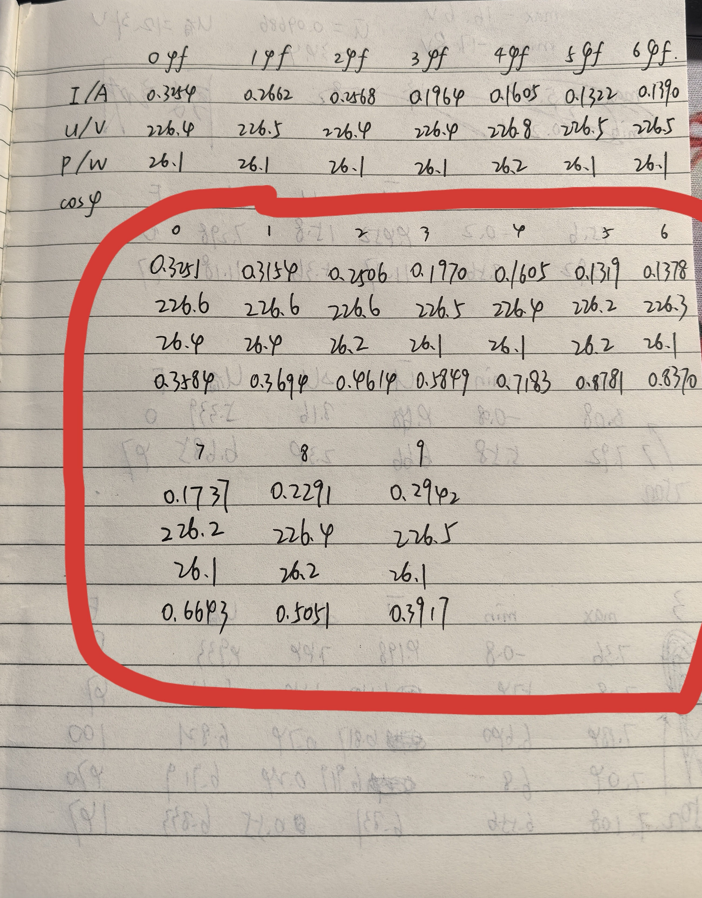
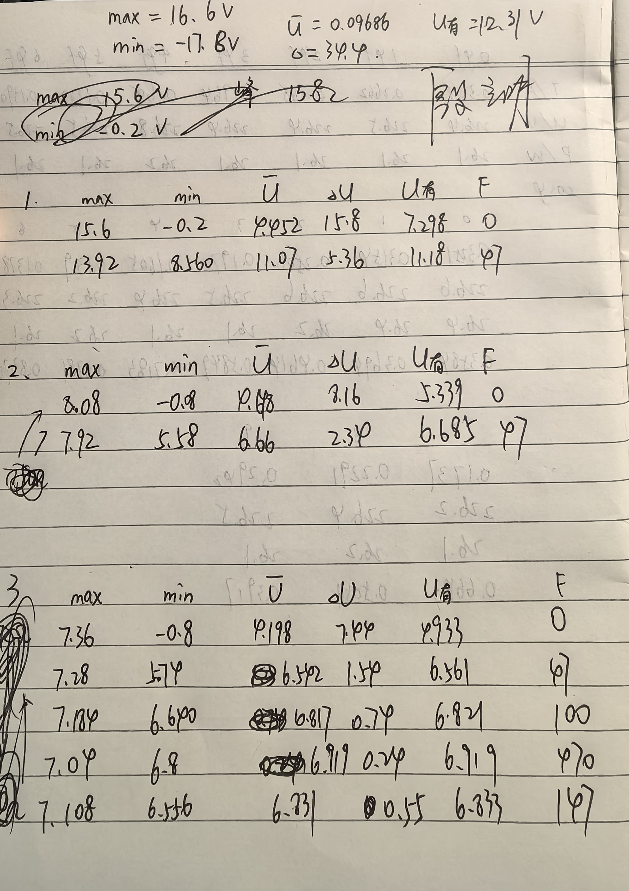
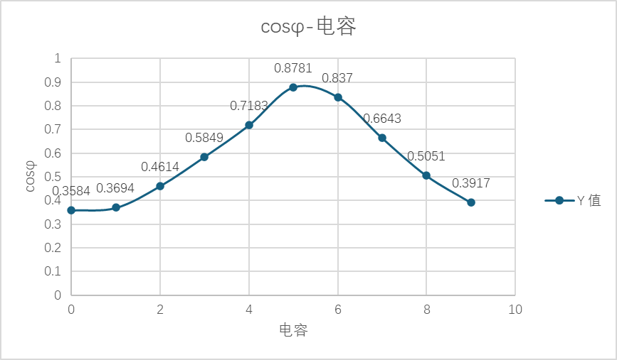
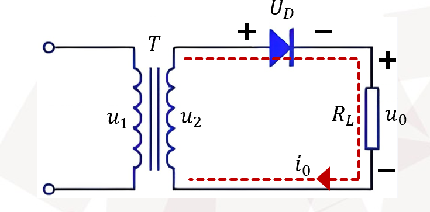
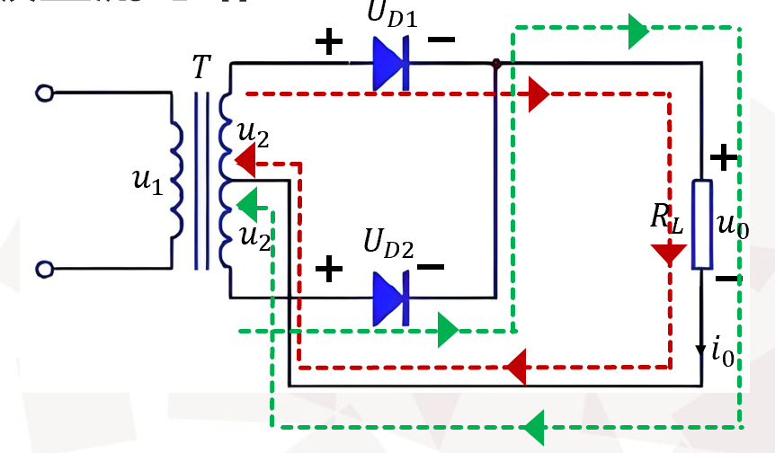
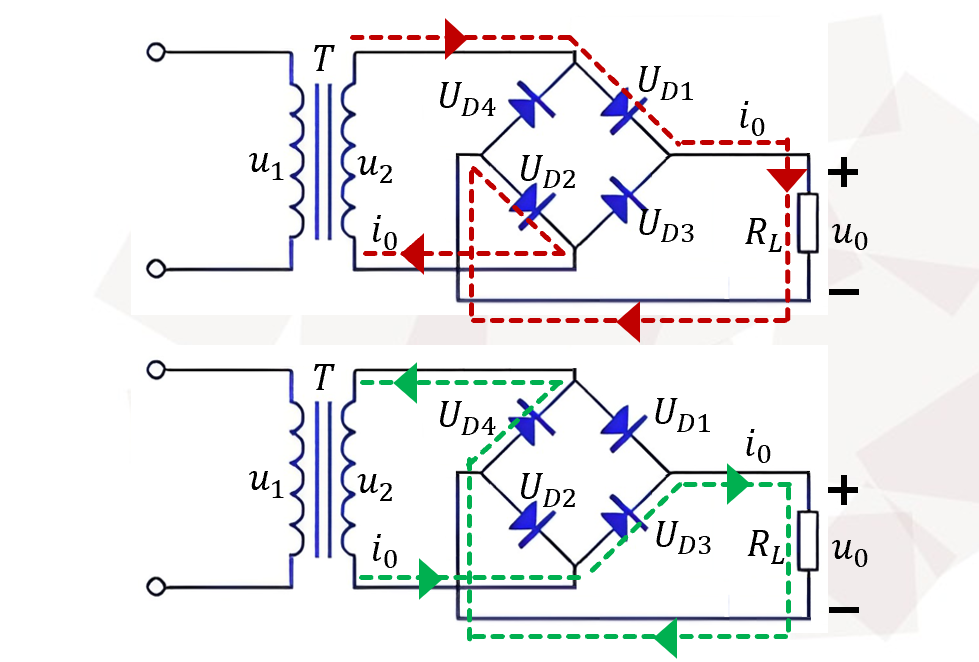

# 
物理实验报告

## 
实验名称：<u>交流电路功率因数实验、组装整流器</u>

## 
指导老师：<u>殷立明</u>

### 
周次：<u>八</u>

### 
姓名：<u>邓欢桐</u>

### 
实验日期：<u>2026</u>年<u>4</u>月<u>23</u>日 星期<u>四</u> 上午

### 
浙江大学物理实验教学中心

### 一、预习报告

#### 1. 实验综述

（自述实验现象、实验原理和实验方法，不超过300字，5分）

本实验包含交流电路功率因数测量与整流器组装两项内容。

- 通过日光灯感性负载电路，测量电压、电流与功率，计算功率因数，并通过并联电容改善功率因数，理解提高功率因数的意义；

- 同时利用晶体二极管单向导电性，搭建半波、全波、桥式整流电路，借助示波器观察波形，对比不同整流方式的输出特点；
- 再通过 **RC** 电容滤波，观察滤波效果，掌握交流电转换为平滑直流电的基本原理与方法。

实验可加深对交流电路相位、功率因数、二极管整流及滤波等的理解，提升仪器使用与电路搭建能力。

---

#### 2.实验重点

（简述本实验的学习重点，不超过100字，3分）

理解功率因数物理意义，掌握提高感性负载功率因数的方法；熟悉日光灯工作原理；掌握二极管单向导电性与三种整流电路结构，学会用示波器观测波形，理解整流与滤波的作用。

---

#### 3.实验难点

（简述本实验的实现难点，不超过100字，2分）

准确完成强电电路接线与安全操作；精准测量功率、电流与电压；正确搭建整流滤波电路，稳定观测输出波形；合理选择电容以获得最佳功率因数与滤波效果。

---

### 二、原始数据

（将有学生和老师签名的“自备数据记录草稿纸”的扫描或手机拍摄图粘贴在下方，20分）

---

### 三、结果与分析

#### 1. 数据处理与结果

（列出数据表格、选择数据处理方法、给定测量或计算结果，30分）

##### 交流电功率因数实验

||$0μf$|$1μf$|$2μf$|$3μf$|$4μf$|==$5μf$==|$6μf$|$7μf$|$8μf$|$9μf$|
|:---:|:---:|:---:|:---:|:---:|:---:|:---:|:---:|:---:|:---:|:---:|
|I/A|0.3251|0.3154|0.2506|0.1970|0.1605|==0.1319==|0.1378|0.1737|0.2291|0.2942|
|U/V|226.6|226.6|226.6|226.5|226.4|==226.2==|226.3|226.2|226.4|226.5|
|P/W|26.4|26.4|26.2|26.1|26.1|==26.2==|26.1|26.1|26.2|26.1|
|cosφ|0.3584|0.3694|0.4614|0.5849|0.7183|==0.8781==|0.8370|0.6643|0.5051|0.3917|

> 根据数据表格以及 $cosφ – C$ 图，可以发现 $cosφ$ 和电容的关系实际上是两边低中间高，呈现出一个类似于正态分布的图像。

---

##### 组装整流器实验

###### 输入电压（半波）

|波峰/V|波谷/V|平均值/V|峰谷值/V|有效值/V|
|:---:|:---:|:---:|:---:|:---:|
|16.600|-17.800|0.09686|34.400|12.310|

###### 输入电压（全波，桥式）

|波峰/V|波谷/V|平均值/V|峰谷值/V|有效值/V|
|:---:|:---:|:---:|:---:|:---:|
|8.300|-8.900|0.04843|17.200|6.155|

---

###### 输出（半波）

|波峰/V|波谷/V|平均值/V|峰谷值/V|有效值/V|所加电容 (μf)|
|:---:|:---:|:---:|:---:|:---:|:---:|
|15.600|-0.200|4.452|15.800|7.298|0|
|13.920|8.560|11.070|5.360|11.180|47|

- 输出电压平均值：

$$
\overline{U_0} = \frac{1}{2\pi} \int_{0}^{\pi} \left( \sqrt{2} U_2 \right) \sin(\omega t) \, d(\omega t) = \frac{\sqrt{2}}{\pi} U_2 = 0.45 U_2
$$

- 二极管承受最大反向电压：$\sqrt{2}U_2$

> 对于此时没有加电容的部分，平均值是 4.452V，而输入电压 $U_2$ 的有效值是 12.310V，理论值应该是 5.5395V，实际与理论存在误差，但是是可以接受的，具体在误差分析部分进行进一步解析。

> 二极管可承受的最大反向电压是 16.600V，理论值计算得 17.409V，存在误差但并不大，完全在可以接受的范围内。

---

###### 输出（全波）

|波峰/V|波谷/V|平均值/V|峰谷值/V|有效值/V|所加电容 (μf)|
|:---:|:---:|:---:|:---:|:---:|:---:|
|8.080|-0.080|4.648|8.160|5.339|0|
|7.920|5.580|6.660|2.340|6.685|47|

- 输出电压平均值：

$$
\overline{U_0} = \frac{1}{\pi} \int_{0}^{\pi} \left( \sqrt{2} U_2 \right) \sin(\omega t) \, d(\omega t) = \frac{2\sqrt{2}}{\pi} U_2 = 0.9 U_2
$$

- 二极管承受最大反向电压：$2\sqrt{2}U_2$

>对于此时没有加电容的部分，平均值是 4.648V，而输入电压 $U_2$ 的有效值是 6.155V，理论值应该是 5.5395V，实际与理论存在误差，但是是可以接受的。

>二极管可承受的最大反向电压是 8.300V，理论值计算得 8.704V，存在误差但并不大，完全在可以接受的范围内。

---

###### 输出（桥式）

|波峰/V|波谷/V|平均值/V|峰谷值/V|有效值/V|所加电容 (μf)|
|:---:|:---:|:---:|:---:|:---:|:---:|
|7.360|-0.800|4.198|7.440|4.933|0|
|7.28|5.47|6.542|1.540|6.561|47|
|7.184|6.640|6.817|0.740|6.821|100|
|7.108|6.556|6.831|0.550|6.833|147|
|7.040|6.800|6.919|0.240|6.919|470|

- 输出电压平均值：
  $$
  \overline{U_0} = \frac{1}{\pi} \int_{0}^{\pi} \left( \sqrt{2} U_2 \right) \sin(\omega t) \, d(\omega t) = \frac{2\sqrt{2}}{\pi} U_2 = 0.9 U_2
  $$

- 二极管承受最大反向电压：$\sqrt{2}U_2$

>对于此时没有加电容的部分，平均值是 4.198V，而输入电压 $U_2$ 的有效值是 6.155V，理论值应该是 5.5395V，实际与理论存在误差，但是是可以接受的。

>二极管可承受的最大反向电压是 8.300V，理论值计算得 8.704V，存在误差但并不大，完全在可以接受的范围内。

---

#### 2. 误差分析

（运用测量误差、相对误差、不确定度等分析实验结果，20分）

##### （1）输入交流信号误差
- 输入理论峰值：$ U_{2\text{m理}}=\sqrt{2}U_2=\sqrt{2} \times 12.31 \approx 17.41\ \text{V} $

- 实测峰值：$U_{2\text{m实}}=16.6\ \text{V} 
    $
    
- 相对误差：$\gamma_1=\left| \frac{16.6-17.41}{17.41} \right| \times 100\% \approx 4.65\% 
    $
    
- 误差来源：

    - 实验室电网电压本身存在小幅波动，不是恒定标准值；

    - 变压器带负载后输出电压会自然下降，并非理想空载电压；

    - 示波器探头存在固定衰减比例与内部系统误差；

>这些都会让输入信号的实测峰值略低于理论计算值。

---

##### （2）半波整流输出平均值误差

- 理论平均值：$ \overline{U_{0\text{理}}}=0.45U_2=0.45 \times 12.31 \approx 5.54\ \text{V} $

- 实测平均值：$ \overline{U_{0\text{实}}}=4.452\ \text{V} $

- 相对误差：$ \gamma_2=\left| \frac{4.452-5.54}{5.54} \right| \times 100\% \approx 19.6\% $

- 误差来源：

  - 二极管不是理想开关，正向导通时有约 $0.6 \sim 0.7V$ 的固定压降，直接降低输出电压；

  - 面包板插孔使用次数多、接触不够紧密，存在接触电阻；
  - 导线本身有电阻，电流流过时产生额外压降，共同导致实测平均值明显偏低。

---

##### （3）全波整流输出平均值误差

- 理论平均值：$ \overline{U_{0\text{理}}}=0.9U_2=0.9 \times 6.155 \approx 5.54\ \text{V} $
- 实测平均值：$ \overline{U_{0\text{实}}}=4.648\ \text{V} $
- 相对误差：$ \gamma_2=\left| \frac{4.648-5.54}{5.54} \right| \times 100\% \approx 16.1\% $
- 误差来源：
  - 全波整流依赖变压器中心抽头，实际抽头位置并非完全对称，导致正负半周输入电压不一致；
  - 两只二极管的正向压降不完全相同，使整流输出波形不对称；
  - 线路较长、接触点多，额外压降更明显。

---

##### （4）桥式整流输出平均值误差

- 理论平均值：$ \overline{U_{0\text{理}}}=0.9U_2=0.9 \times 6.155 \approx 5.5395\ \text{V} $
- 实测无滤波平均值：$ \overline{U_{0\text{实}}}=4.198\ \text{V} $
- 相对误差：$ \gamma_3=\left| \frac{4.198-5.54}{5.54} \right| \times 100\% \approx 24.2\% $
- 误差来源：
  - 桥式整流在导通时会同时经过两只二极管，总正向压降接近 $1.4V$，对输出影响很大；
  - 四根二极管连线长短不一，回路电阻不对称；
  - 负载电流流过时，线路压降与二极管压降叠加，让输出电压被明显拉低。

---

##### （5）二极管反向电压峰值误差

- 理论反向峰值：$ U_{R\text{理}}=\sqrt{2}U_2\approx17.41\ \text{V} $
- 实测反向峰值：$ U_{R\text{实}}=16.6\ \text{V} $
- 相对误差：$ \gamma_4=\left| \frac{16.6-17.41}{17.41} \right| \times 100\% \approx 4.65\% $
- 误差来源：
  - 输入信号本身峰值就偏低；
  - 二极管存在微弱反向漏电流，不是完全截止，会让反向电压略有下降；
  - 示波器测量高频脉动信号时，内部滤波会带来小幅衰减。

---

##### （6）滤波电路误差

实验用的电解电容标称值有 $±10\%$ 左右误差，实际容量和标注不一致；电容存在漏电流和等效串联电阻ESR，充放电速度与理想情况不同；负载电阻大小会改变放电快慢，电容越大、负载越轻，输出电压抬升越明显，导致滤波后数据偏离理论计算。

---

#### 3. 实验探讨

（对实验内容、现象和过程的小结，不超过100字，10分）

本次实验完成了交流电路功率因数测量与整流器组装两项内容。

- 通过并联电容可有效提高感性负载功率因数
- 并联电容并不是越多越好，在日光灯功率因数实验里，并联电容存在一个合适范围，超过这个范围反而会出现问题。
- 基于二极管的单向导电性，搭建了半波、全波与桥式三种典型整流电路，并配合电容滤波电路，完整验证了交流到直流的变换过程。
  - 实验中，二极管仅在正向偏置时导通、反向偏置时截止的特性，使半波整流仅保留输入交流的正半周波形；
  - 全波与桥式整流则利用二极管的组合导通逻辑，在正负半周均实现同向电流输出，将双向交流信号转换为单向脉动直流信号，实现了整流的核心功能；
  - 在此基础上，通过并联电容滤波电路，利用电容 “整流高电平时充电、整流低电平时向负载放电” 的充放电特性，有效填补了脉动波形的电压低谷，显著降低了输出电压的纹波，使波形的平滑度大幅提升；
  - 同时输出电压平均值也明显升高，直观验证了电容滤波的稳压效果。

> 实验操作规范，数据合理，验证了相关理论规律。

---

### 四、思考题

（解答教材或讲义或老师指定的思考题，10分）

- **不同整流电路与滤波电路利弊**
  - 半波整流结构简单但脉动大、效率低；
  - 全波整流输出平稳，但需中心抽头变压器；
  - 桥式整流效率高、无需抽头，应用最广，电容滤波效果好，但容量越大成本与体积越高，开机冲击电流更大。

- **整流与滤波的目的**
  - 整流是将交流电变为单向脉动直流电；滤波是滤除交流分量，得到平滑稳定的直流电压，满足负载供电要求。

- **如何选择整流电路**
  - 小功率、低成本场合选半波整流；
  - 有中心抽头变压器且追求平稳输出选全波整流；
  - 通用电子设备优先选桥式整流，综合性能最优。

---

#### 注意事项：

1.用PDF格式上传“预习报告”，文件名：学生姓名+学号+实验名称+周次。
2.“预习报告”必须递交在“学在浙大”的本课程的对应实验项目的“作业”模块内。
3.“预习报告”还须拷贝到“实验报告”中（便以教师批改）。

**
浙江大学物理实验教学中心制
**