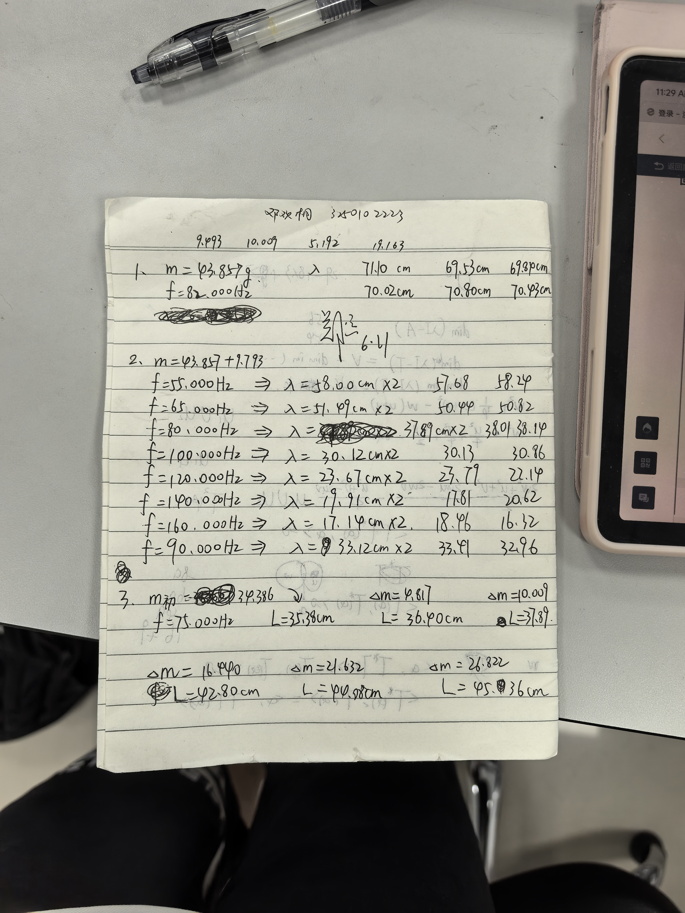
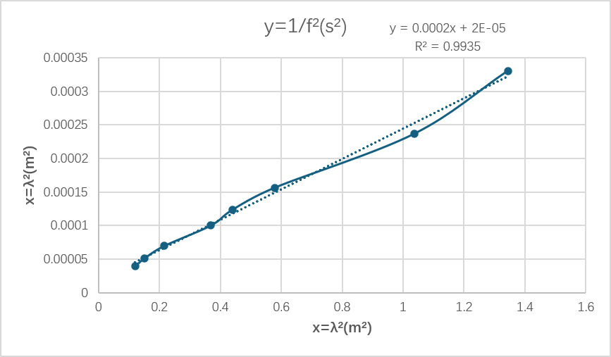
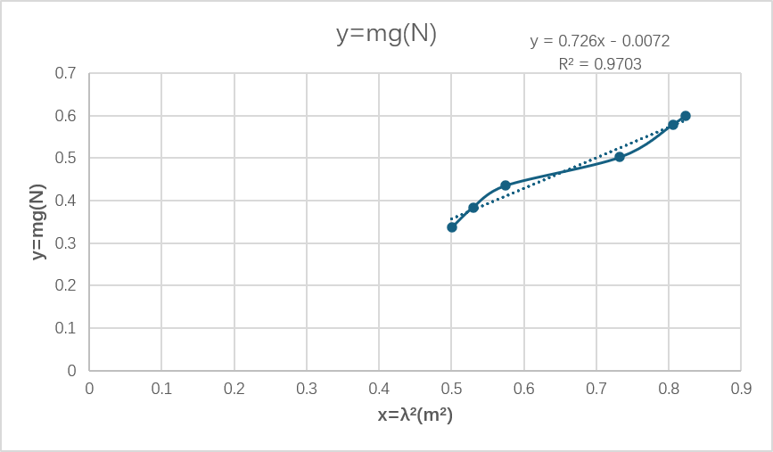

# 
物理实验预习报告

## 
实验名称：<u>固定均匀弦振动实验</u> 

## 
指导老师：<u>郑远</u> 

### 
周次：<u>十四</u> 

### 
姓名：<u>邓欢桐</u> 

### 
实验日期：<u>2026</u>年<u>6</u>月<u>11</u>日 星期<u>四</u> 上午

### 
浙江大学物理实验教学中心

#### 1. 实验综述

（自述实验现象、实验原理和实验方法，不超过300字，5分）

固定均匀弦振动实验通过激振器驱动张紧的均匀弦振动，观察弦上传播的横波及其形成的驻波现象。当入射波与反射波叠加时，弦上会形成波节和波腹构成的稳定驻波图样。实验依据弦振动理论，利用驻波条件测量波长，并结合波速关系 $v=f\lambda$ 以及弦波传播公式 $v=\sqrt{T/\mu}$（其中 $T$ 为张力，$\mu$ 为线密度），测定弦线上横波的传播速度和线密度。实验过程中分别采用固定张力改变频率、固定频率改变张力以及固定频率和张力重复测量波长等方法，通过线性拟合分析频率、波长和张力之间的关系，验证弦振动理论规律，并学习驻波现象的观察与数据处理方法。

---

#### 2.实验重点

（简述本实验的学习重点，不超过100字，3分）

观察并形成稳定驻波，准确测量波节间距和波长；掌握弦波传播速度与频率、波长、张力及线密度之间的关系，并利用实验数据求取弦线线密度。

---

#### 3.实验难点

（简述本实验的实现难点，不超过100字，2分）

实验中需精确调节振源位置、频率和张力，使驻波达到最佳稳定状态；同时准确判断波节位置并减小波长测量误差，保证线性拟合和线密度计算结果的可靠性。

---

### 二、原始数据
（将有学生和老师签名的“自备数据记录草稿纸”的扫描或手机拍摄图粘贴在下方，20分）

### 三、结果与分析

#### 1. 数据处理与结果
（列出数据表格、选择数据处理方法、给定测量或计算结果，30分）

##### 固定频率、固定张力测定棉线线密度

实验条件：

\- 砝码质量：

$$
m=(43.857+9.793)\,\mathrm{g}=53.650\,\mathrm{g}
$$

\- 振动频率：

$$
f=82.000\,\mathrm{Hz}
$$

\- 重力加速度：

$$
g=9.80\,\mathrm{m/s^2}
$$

**表 1：固定频率、固定张力下波长测量数据**

| 次数 | 波节距离L(cm) | 半波个数n | 半波长λ/2(cm) | 波长λ(cm) |
|--------|--------|--------|--------|--------|
| 1 | 71.10 | 2 | 35.55 | 71.10 |
| 2 | 69.53 | 2 | 34.77 | 69.53 |
| 3 | 69.89 | 2 | 34.92 | 69.84 |
| 4 | 70.02 | 2 | 35.01 | 70.02 |
| 5 | 70.80 | 2 | 35.40 | 70.80 |
| 6 | 70.42 | 2 | 35.22 | 70.43 |
| 平均值 | 70.29 | 2 | 35.15 | 70.29 |

平均波长：

$$
\bar{\lambda}=70.29\,\mathrm{cm}
$$

即

$$
\bar{\lambda}=0.7029\,\mathrm{m}
$$

**棉线线密度计算：**

根据波速公式：

$$
v=f\lambda
$$

可得

$$
v=82\times0.7029
$$

$$
v=57.64\,\mathrm{m/s}
$$

张力：

$$
T=mg
$$

$$
T=0.05365\times9.80
$$

$$
T=0.5258\,\mathrm{N}
$$

根据

$$
v=\sqrt{\frac{T}{\rho}}
$$

可得

$$
\rho=\frac{T}{v^2}
$$

代入实验数据：

$$
\rho=
\frac{0.5258}{57.64^2}
$$

$$
\rho=1.58\times10^{-4}\,\mathrm{kg/m}
$$

即

$$
\rho=158\,\mathrm{mg/m}
$$

**不确定度计算：**

已知：

$$
\frac{u_m}{m}=1\%
$$

$$
\frac{u_f}{f}=1\%
$$

波长测量标准差：

$$
s=0.60\,\mathrm{cm}
$$

A 类不确定度：

$$
u_\lambda=\frac{s}{\sqrt6}
$$

$$
u_\lambda=0.245\,\mathrm{cm}
$$

相对不确定度：

$$
\frac{u_\lambda}{\lambda}
=
0.35\%
$$

根据实验讲义给出的误差传播公式：

$$
\frac{u_\rho}{\rho}
=
\sqrt{
\left(\frac{u_m}{m}\right)^2
+
\left(\frac{2u_f}{f}\right)^2
+
\left(\frac{2u_\lambda}{\lambda}\right)^2
}
$$

代入：

$$
\frac{u_\rho}{\rho}
=
\sqrt{
0.01^2
+
0.02^2
+
0.007^2
}
$$

$$
=2.34\%
$$

因此：

$$
u_\rho
=
0.0234\times158
$$

$$
=3.7\,\mathrm{mg/m}
$$

最终结果：

$$
\rho=(158\pm4)\,\mathrm{mg/m}
$$

---

##### 固定张力，改变频率测量波长

固定质量：

$$
m=53.650\mathrm{g}
$$

对应张力：

$$
T=mg=0.053650\times9.80
=0.5258\mathrm{N}
$$

**表2 不同频率下波长测量数据**

| 频率f(Hz) | λ₁/2 (cm) | λ₂/2 (cm) | λ₃/2 (cm) | λ/2 平均(cm) |
| --------- | --------- | --------- | --------- | ------------ |
| 55.000    | 58.00     | 57.68     | 58.24     | 57.97        |
| 65.000    | 51.49     | 50.44     | 50.82     | 50.92        |
| 80.000    | 37.89     | 38.01     | 38.14     | 38.01        |
| 90.000    | 33.12     | 33.41     | 32.96     | 33.16        |
| 100.000   | 30.12     | 30.13     | 30.86     | 30.37        |
| 120.000   | 23.67     | 23.79     | 22.14     | 23.20        |
| 140.000   | 19.91     | 17.81     | 20.62     | 19.45        |
| 160.000   | 17.14     | 18.46     | 16.32     | 17.31        |

**理论分析：**

弦线上横波传播速度满足：

$$
v=f\lambda
$$

同时根据弦振动理论：

$$
v=\sqrt{\frac{T}{\rho}}
$$

其中：

* $T$ 为弦线张力；
* $\rho$ 为弦线线密度。

由于实验过程中张力保持不变，因此波速 $v$ 保持恒定。

由上式可得：

$$
f\lambda=\sqrt{\frac{T}{\rho}}
$$

两边平方：

$$
f^2\lambda^2=\frac{T}{\rho}
$$

整理得：

$$
\frac1{f^2}
=
\frac{\rho}{T}\lambda^2
$$

又因为

$$
T=mg
$$

故：

$$
\frac1{f^2}
=
\frac{\rho}{mg}\lambda^2
$$

令

$$
y=\frac1{f^2}
$$

$$
x=\lambda^2
$$

则有线性关系：

$$
y=kx
$$

其中斜率

$$
k=\frac{\rho}{mg}
$$

因此：

$$
\rho=kmg
$$

**线性拟合数据表**

| f(Hz)   | λ/2  平均(cm) | λ/2 (m) | λ²/2 (m²) | 1/f²(s²)   |
| ------- | ------------- | ------- | --------- | ---------- |
| 55.000  | 57.97         | 0.5797  | 0.3361    | 3.306×10⁻⁴ |
| 65.000  | 50.92         | 0.5092  | 0.2593    | 2.367×10⁻⁴ |
| 80.000  | 38.01         | 0.3801  | 0.1445    | 1.563×10⁻⁴ |
| 90.000  | 33.16         | 0.3316  | 0.1100    | 1.235×10⁻⁴ |
| 100.000 | 30.37         | 0.3037  | 0.0922    | 1.000×10⁻⁴ |
| 120.000 | 23.20         | 0.2320  | 0.0538    | 6.944×10⁻⁵ |
| 140.000 | 19.45         | 0.1945  | 0.0378    | 5.102×10⁻⁵ |
| 160.000 | 17.31         | 0.1731  | 0.0300    | 3.906×10⁻⁵ |

以 $\lambda^2$ 为横坐标，$\frac1{f^2}$ 为纵坐标进行线性拟合，可得到一条近似过原点的直线。拟合斜率可用于计算棉线线密度：

$$
\rho=kmg
$$

**线性拟合结果：**

需要注意的是，表2中记录的数据为驻波半波长，即

$$
\frac{\lambda}{2}
$$

以

$$
x=\lambda^2
$$

为横坐标，

$$
y=\frac1{f^2}
$$

为纵坐标，利用最小二乘法进行线性拟合，得到拟合方程：

$$
\frac1{f^2}(2.269\times10^{-4})\lambda^2+1.763\times10^{-5}
$$

拟合优度为：

$$
R^2=0.9934
$$

表明实验数据具有良好的线性关系。

根据理论关系：

$$
\frac1{f^2}\frac{\rho}{mg}\lambda^2
$$

可知拟合直线斜率满足：

$$
k=\frac{\rho}{mg}
$$

因此：

$$
\rho=kmg
$$

代入

$$
k=2.269\times10^{-4}
$$

$$
m=0.053650,\mathrm{kg}
$$

$$
g=9.80,\mathrm{m/s^2}
$$

得到：

$$
\rho=2.269\times10^{-4}
\times0.053650
\times9.80
$$

$$
=1.19\times10^{-4}\mathrm{kg/m}
$$

即：

$$
\rho=119\mathrm{mg/m}
$$

由此可见，在固定张力条件下，

$$
\frac1{f^2}
$$

与

$$
\lambda^2
$$

近似呈线性关系，验证了均匀弦振动理论。利用拟合斜率得到的棉线线密度为

$$
\rho=119\mathrm{mg/m}
$$

与第一部分测量结果基本一致。

**结果分析：**

从实验结果可以看出，随着驱动频率的增加，驻波波长逐渐减小。绘制 $\frac1{f^2}$ 与 $\lambda^2$ 的关系图后，各数据点基本分布在同一直线附近，表明两者具有良好的线性关系。

实验结果验证了固定张力条件下均匀弦振动满足：

$$
v=f\lambda
$$

以及

$$
v=\sqrt{\frac{T}{\rho}}
$$

所描述的理论规律。

拟合直线存在一定偏差，主要来源于波节位置判断误差、频率调节误差以及弦振动稳定性不足等因素。总体而言，实验数据与理论预测符合较好，说明驻波法能够较准确地测定弦线的线密度。

---

##### 固定频率，改变张力测量波长

固定频率：

$$
f=75.000\mathrm{Hz}
$$

**表3 不同张力下波长测量数据**

| 增加质量Δm(g) | 总质量m(g) | 波长λ/2 (cm) |
| ------------- | ---------- | ------------ |
| 0.000         | 34.386     | 35.38        |
| 4.817         | 39.203     | 36.40        |
| 10.009        | 44.395     | 37.89        |
| 16.840        | 51.226     | 42.80        |
| 24.632        | 59.018     | 44.88        |
| 26.802        | 61.188     | 45.36        |

对应张力为：

$$
T=mg
$$

实验中通过改变砝码质量来改变弦线张力，并测量相应的驻波波长。

**理论分析：**

弦线上横波传播速度满足：

$$
v=f\lambda
$$

同时有：

$$
v=\sqrt{\frac{T}{\rho}}
$$

其中：

* $T$ 为弦线张力；
* $\rho$ 为弦线线密度；
* $f$ 为振动频率；
* $\lambda$ 为波长。

由于实验过程中频率保持不变，因此有：

$$
f\lambda=\sqrt{\frac{T}{\rho}}
$$

两边平方可得：

$$
f^2\lambda^2=\frac{T}{\rho}
$$

又因为：

$$
T=mg
$$

因此：

$$
mg=\rho f^2\lambda^2
$$

令

$$
y=mg
$$

$$
x=\lambda^2
$$

则可写为：

$$
y=kx
$$

其中：

$$
k=\rho f^2
$$

因此：

$$
\rho=\frac{k}{f^2}
$$

理论上，$mg$ 与 $\lambda^2$ 应呈线性关系，其拟合直线斜率即可用于计算棉线线密度。

**线性拟合数据表**

| 总质量m(g) | 张力T=mg(N) | 半波长λ/2 (cm) | λ/2 (m) | λ²/4 (m²) |
| ---------- | ----------- | -------------- | ------- | --------- |
| 34.386     | 0.3370      | 35.38          | 0.3538  | 0.1252    |
| 39.203     | 0.3842      | 36.40          | 0.3640  | 0.1325    |
| 44.395     | 0.4351      | 37.89          | 0.3789  | 0.1436    |
| 51.226     | 0.5020      | 42.80          | 0.4280  | 0.1832    |
| 59.018     | 0.5784      | 44.88          | 0.4488  | 0.2014    |
| 61.188     | 0.5996      | 45.36          | 0.4536  | 0.2058    |

以 $\lambda^2$ 为横坐标、$mg$ 为纵坐标作图，可得到近似线性关系。利用最小二乘法进行线性拟合，得到拟合直线斜率 $k$，进而根据

$$
\rho=\frac{k}{f^2}
$$

计算棉线的线密度。

**线性拟合结果：**

表3中记录的数据同样为驻波半波长，即

$$
\frac{\lambda}{2}
$$

以

$$
x=\lambda^2
$$

为横坐标，

$$
y=mg
$$

为纵坐标，利用最小二乘法进行线性拟合，得到拟合方程：

$$
mg=0.726\lambda^2-0.00725
$$

拟合优度为：

$$
R^2=0.9702
$$

说明张力与波长平方之间具有较好的线性关系。

根据理论关系：

$$
mg=\rho f^2\lambda^2
$$

可知拟合斜率满足：

$$
k=\rho f^2
$$

因此：

$$
\rho=\frac{k}{f^2}
$$

代入

$$
k=0.726
$$

$$
f=75.000\mathrm{Hz}
$$

得到：

$$
\rho=\frac{0.726}{75^2}
$$

$$
=1.29\times10^{-4},\mathrm{kg/m}
$$

即：

$$
\rho=129\mathrm{mg/m}
$$
实验结果表明，在频率保持不变时，弦线张力与波长平方之间近似满足线性关系，验证了理论公式
$$
T=\rho f^2\lambda^2
$$
利用拟合斜率求得棉线线密度约为
$$
\rho=129\mathrm{mg/m}
$$
与前两种方法得到的结果较为接近，说明实验结果具有较好的可靠性。

**结果分析：**

从实验数据可以看出，随着砝码质量增加，弦线张力逐渐增大，相应的驻波波长也随之增大。当频率保持不变时，波长平方与张力之间基本满足线性关系。

绘制 $mg-\lambda^2$ 关系图后，各实验点总体分布在同一直线附近，验证了理论关系：
$$
T=\rho f^2\lambda^2
$$

实验结果表明，弦线张力越大，横波传播速度越快，在固定频率条件下表现为波长增大。拟合结果与理论预测基本一致，说明实验测量具有较好的可靠性。

实验误差主要来源于波节位置判断误差、砝码质量测量误差、弦线张力微小波动以及驻波稳定性不足等因素。尽管存在一定随机误差，但实验结果能够较好地验证固定均匀弦振动的理论规律。

---

#### 2. 误差分析
（运用测量误差、相对误差、不确定度等分析实验结果，20分）

本实验分别采用固定频率固定张力法、固定张力变频率法以及固定频率变张力法测量棉线线密度。实验结果分别为：
$$
\rho_1=158\,\mathrm{mg/m}
$$

$$
\rho_2=119\,\mathrm{mg/m}
$$

$$
\rho_3=129\,\mathrm{mg/m}
$$

三种方法测得的线密度均处于同一数量级，其中第二、三种拟合法结果较为接近，说明实验具有较好的重复性。

实验误差主要来源于以下几个方面：

1. **波节位置判断误差**。实验中需要通过观察驻波形状确定波节位置，由于驻波并非完全静止，且振幅有限，因此波节位置存在一定判断误差，从而影响波长测量结果。

2. **频率调节误差**。信号发生器虽然能够较准确输出设定频率，但仍存在一定仪器误差，同时共振状态附近频率变化较快，可能导致测得频率与真实共振频率存在偏差。

3. **张力误差**。砝码质量存在测量误差，滑轮摩擦及细线自身重量也会使实际张力与理论值存在差异。

4. **读数误差**。测量驻波长度时受到刻度尺分辨率和视差影响，导致测量结果存在随机误差。

5. **系统误差**。实验理论推导中忽略了弦线刚度、空气阻力以及滑轮摩擦等因素，而实际实验中这些因素均会对结果产生一定影响。

综合以上因素，实验测得结果与理论值存在一定偏差，但总体符合固定均匀弦振动理论规律。

---

#### 3. 实验探讨
（对实验内容、现象和过程的小结，不超过100字，10分）

本实验利用驻波法研究了弦线振动规律，验证了横波传播速度与张力、频率及波长之间的关系。实验结果表明，在固定张力条件下，波长与频率满足反比关系；在固定频率条件下，波长平方与张力近似成正比。通过三种不同方法测得棉线线密度，结果处于同一数量级，验证了实验方法的可行性和理论公式的正确性。

---

### 四、思考题
（解答教材或讲义或老师指定的思考题，10分）

1. **在实验过程中将会发现有假共振信号的出现，应该如何判别？**

实验中除真正的共振外，还可能出现假共振现象。判别方法如下：

（1）观察驻波形状。真正共振时驻波波形稳定，波节和波腹位置清晰，振幅明显增大；假共振时波形不稳定，波节位置模糊。

（2）微调频率。若在共振点附近稍微改变频率，振幅迅速减小，则说明是真共振；若频率变化后振幅变化不明显，则可能是假共振。

（3）检查波长关系。真正共振应满足：
$$
L=n\frac{\lambda}{2}
\qquad(n=1,2,3,\cdots)
$$
若测得波长与弦长不满足上述关系，则说明并非真正共振。

因此可以通过观察波形稳定性、频率敏感性以及驻波条件是否满足来区分真假共振。

---

2. **如果实验样线不满足 $d\ll L$ 条件，则对测量结果如何修正？**

在理论推导中通常假设弦线直径远小于弦长，即满足：
$$
d\ll L
$$
此时可认为弦线振动部分长度近似等于两固定端之间的距离。

若不满足该条件，则弦线在两端的弯曲部分不能忽略，实际振动长度大于测量长度。此时应对弦长进行端部修正：
$$
L'=L+\Delta L
$$
其中
$$
\Delta L
$$
为两端修正长度。

计算波长时应采用修正后的有效长度：
$$
\lambda=\frac{2L'}{n}
$$
从而重新计算波速及线密度：
$$
v=f\lambda
$$

$$
\rho=\frac{T}{v^2}
$$

若忽略该修正，将导致波长被低估，进而使计算得到的线密度偏大。因此在弦线较粗或弦长较短时，应考虑端部修正对实验结果的影响。

---

#### 注意事项：
1.用PDF格式上传“预习报告”，文件名：学生姓名+学号+实验名称+周次。
2.“预习报告”必须递交在“学在浙大”的本课程的对应实验项目的“作业”模块内。
3.“预习报告”还须拷贝到“实验报告”中（便以教师批改）。

**
浙江大学物理实验教学中心制
**
