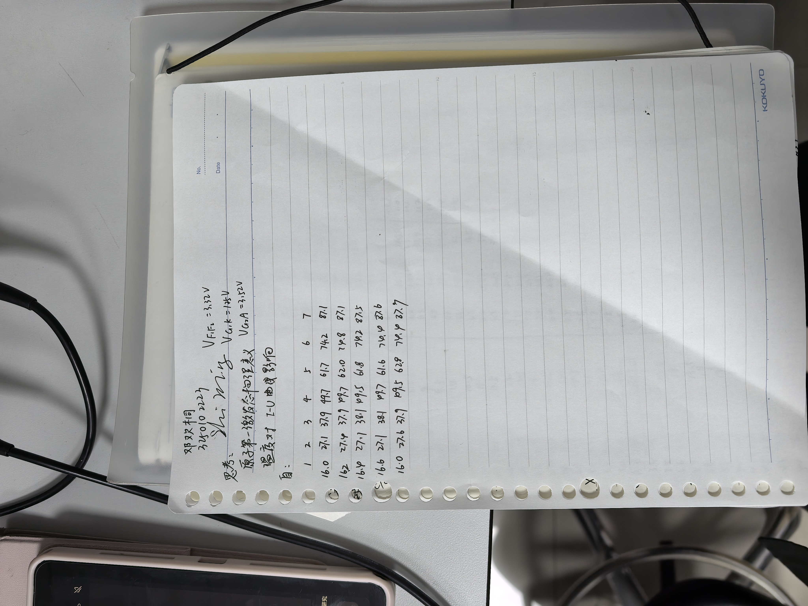
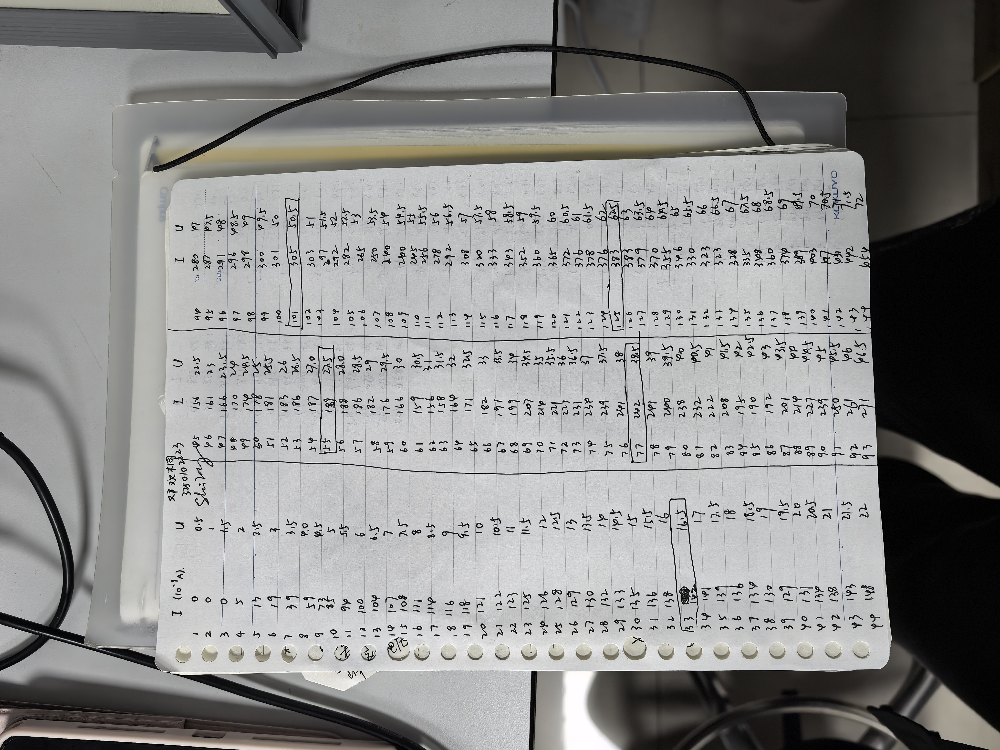
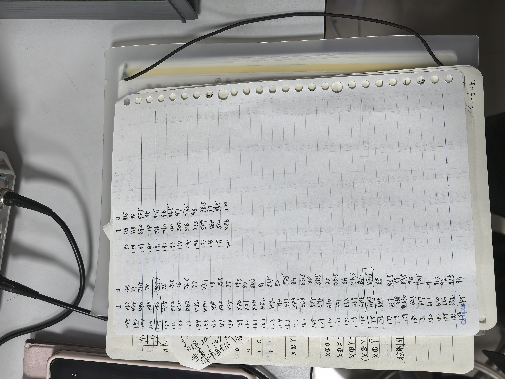
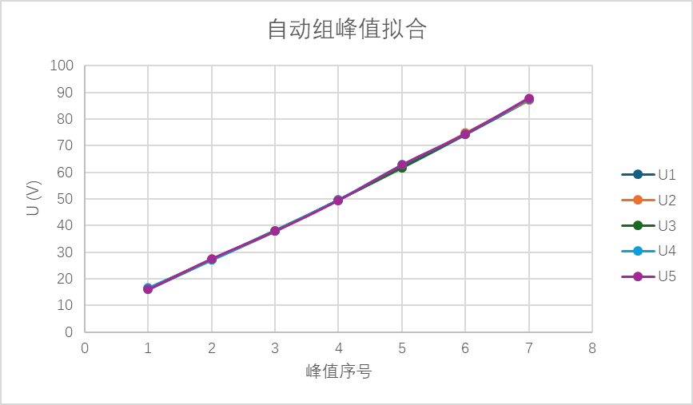
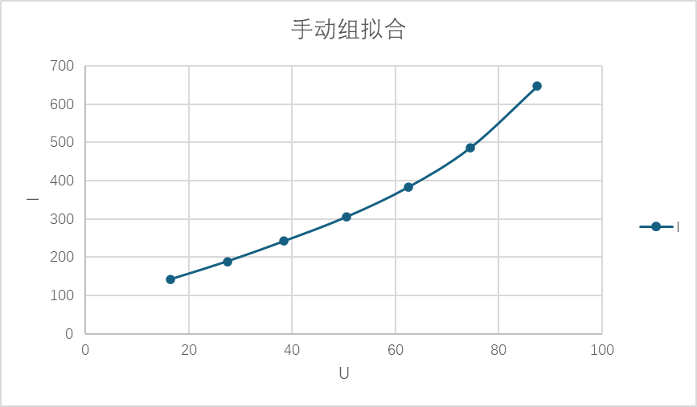

# 
物理实验报告

## 
实验名称：<u>弗兰克赫兹实验</u>
## 
指导老师：<u>史明</u>

### 
周次：<u>三</u>
### 
姓名：<u>邓欢桐</u>

### 
实验日期：<u>2026</u>年<u>3</u>月<u>19</u>日 星期<u>四</u>上午

### 
浙江大学物理实验教学中心

### 一、预习报告
#### 1. 实验综述
（自述实验现象、实验原理和实验方法，不超过300字，5分）

本实验基于波尔的原子模型，通过弗兰克-赫兹管验证原子内部能量是量子化的。

该实验中，电子在氩气中被加速，与氩原子发生碰撞。当电子能量达到氩原子的第一激发电位时，电子会失去能量激发原子，导致阳极电流下降。

通过测量阳极电流随加速电压的变化曲线，可以观察到周期性下降的峰值，从而验证原子能级的存在并测量其激发电位。

本实验采用双栅结构的充氩四极电子管，通过调节灯丝电压、第一栅极电压、加速电压和拒斥电压，控制电子的运动和碰撞过程。

#### 2.实验重点
（简述本实验的学习重点，不超过100字，3分）

需要掌握弗兰克-赫兹实验的基本原理，理解电子与原子碰撞过程中的能量转移机制。

通过测量阳极电流随加速电压的变化曲线，观察电流的周期性下降，验证原子能级的量子化特征。

#### 3.实验难点
（简述本实验的实现难点，不超过100字，2分）

实验中对电压的调节要求较高，尤其是加速电压和拒斥电压的设置直接影响曲线的清晰度。

同时，电子与氩原子的碰撞过程受温度、气压等因素影响，容易产生干扰，导致曲线不规律，影响激发电位的准确测量。

### 二、原始数据
（将有学生和老师签名的“自备数据记录草稿纸”的扫描或手机拍摄图粘贴在下方，20分）
**自动：**

**手动：**

### 三、结果与分析

#### 1. 数据处理与结果
（列出数据表格、选择数据处理方法、给定测量或计算结果，30分）

**自动：**
参数：
- $V_{F_1 F_2} = 3.32$ V
- $V_{G_1 K} = 1.25$ V
- $V_{G_2 K} = 3.52$ V

|峰值序号|$1$|$2$|$3$|$4$|$5$|$6$|$7$|
|:---:|:---:|:---:|:---:|:---:|:---:|:---:|:---:|
|$U_{G_2 K}$|$16.0$|$27.1$|$37.9$|$49.7$|$61.7$|$74.2$|$87.1$|
|$U_{G_2 K}$|$16.2$|$27.4$|$37.9$|$49.7$|$62.0$|$74.8$|$87.1$|
|$U_{G_2 K}$|$16.4$|$27.1$|$38.1$|$49.5$|$61.8$|$74.2$|$87.5$|
|$U_{G_2 K}$|$16.6$|$27.1$|$38.1$|$49.7$|$61.6$|$74.4$|$87.6$|
|$U_{G_2 K}$|$16.0$|$27.6$|$37.9$|$49.5$|$62.8$|$74.4$|$87.9$|
| **平均值 $\overline{U}_n$ (V)** | **16.24** | **27.26** | **38.00** | **49.62** | **61.98** | **74.40** | **87.44** |

拟合效果：

- 逐差法计算第一激发电势
  - 逐差计算：
    $
    \begin{align*}
    \Delta U_1 &= \overline{U}_5 - \overline{U}_1 = 61.98 - 16.24 = 45.74\ \text{V} \\
    \Delta U_2 &= \overline{U}_6 - \overline{U}_2 = 74.40 - 27.26 = 47.14\ \text{V} \\
    \Delta U_3 &= \overline{U}_7 - \overline{U}_3 = 87.44 - 38.00 = 49.44\ \text{V}
    \end{align*}
    $

  - 平均间隔：
  $
  \overline{\Delta U} = \frac{45.74 + 47.14 + 49.44}{3} = 47.44\ \text{V}
  $

  - 第一激发电势：
  $
  U_0 = \frac{\overline{\Delta U}}{4} = \frac{47.44}{4} = 11.86\ \text{V}
  $

- 不确定度计算：
  - A类不确定度：
    $
    s = \sqrt{\frac{(45.74-47.44)^2 + (47.14-47.44)^2 + (49.44-47.44)^2}{3-1}} \approx 1.92\ \text{V}
    $
    $
    u_A = \frac{s}{\sqrt{3}} \approx 1.11\ \text{V}
    $

  - B类不确定度（仪器最小分度0.1V）：
  $
  u_B = \frac{0.1}{\sqrt{3}} \approx 0.06\ \text{V}
  $

  - 合成不确定度：
  $
  u = \sqrt{u_A^2 + u_B^2} \approx \sqrt{1.11^2 + 0.06^2} \approx 1.11\ \text{V}
  $

- 最终结果：
  -  氩原子第一激发电势：
  $
  \boldsymbol{U_0 = 11.86 \pm 1.11\ \text{V}}
  $

**手动：**
参数：

- $V_{F_1 F_2} = 3.32$ V
- $V_{G_1 K} = 1.25$ V
- $V_{G_2 K} = 3.52$ V
- $I (10^{-9}A)$

|$I_A (nA)$|$U_{G_2 K} (V)$|
|:---:|:---:|
|$0$|$0.0$|
|$0$|$0.5$|
|$0$|$1.0$|
|$0$|$1.5$|
|$5$|$2.0$|
|$13$|$2.5$|
|$19$|$3.0$|
|$39$|$3.5$|
|$59$|$4.0$|
|$73$|$4.5$|
|$85$|$5.0$|
|$94$|$5.5$|
|$100$|$6.0$|
|$104$|$6.5$|
|$107$|$7.0$|
|$108$|$7.5$|
|$111$|$8.0$|
|$114$|$8.5$|
|$116$|$9.0$|
|$118$|$9.5$|
|$121$|$10.0$|
|$122$|$10.5$|
|$123$|$11.0$|
|$125$|$11.5$|
|$126$|$12.0$|
|$128$|$12.5$|
|$129$|$13.0$|
|$130$|$13.5$|
|$132$|$14.0$|
|$133$|$14.5$|
|$135$|$15.0$|
|$136$|$15.5$|
|$138$|$16.0$|
|==$142$==|==$16.5$==|
|$141$|$17.0$|
|$139$|$17.5$|
|$136$|$18.0$|
|$134$|$18.5$|
|$130$|$19.0$|
|$129$|$19.5$|
|$131$|$20.0$|
|$134$|$20.5$|
|$138$|$21.0$|
|$143$|$21.5$|
|$148$|$22.0$|
|$156$|$22.5$|
|$161$|$23.0$|
|$166$|$23.5$|
|$170$|$24.0$|
|$174$|$24.5$|
|$178$|$25.0$|
|$181$|$25.5$|
|$183$|$26.0$|
|$186$|$26.5$|
|$187$|$27.0$|
|==$189$==|==$27.5$==|
|$188$|$28.0$|
|$186$|$28.5$|
|$182$|$29.0$|
|$176$|$29.5$|
|$166$|$30.0$|
|$159$|$30.5$|
|$156$|$31.0$|
|$158$|$31.5$|
|$164$|$32.0$|
|$171$|$32.5$|
|$182$|$33.0$|
|$191$|$33.5$|
|$199$|$34.0$|
|$207$|$34.5$|
|$214$|$35.0$|
|$221$|$35.5$|
|$227$|$36.0$|
|$231$|$36.5$|
|$234$|$37.0$|
|$239$|$37.5$|
|$241$|$38.0$|
|==$242$==|==$38.5$==|
|$241$|$39.0$|
|$240$|$39.5$|
|$238$|$40.0$|
|$232$|$40.5$|
|$222$|$41.0$|
|$208$|$41.5$|
|$195$|$42.0$|
|$190$|$42.5$|
|$192$|$43.0$|
|$201$|$43.5$|
|$214$|$44.0$|
|$227$|$44.5$|
|$239$|$45.0$|
|$250$|$45.5$|
|$261$|$46.0$|
|$271$|$46.5$|
|$280$|$47.0$|
|$287$|$47.5$|
|$291$|$48.0$|
|$296$|$48.5$|
|$298$|$49.0$|
|$300$|$49.5$|
|$301$|$50.0$|
|==$305$==|==$50.5$==|
|$303$|$51.0$|
|$297$|$51.5$|
|$292$|$52.0$|
|$282$|$52.5$|
|$265$|$53.0$|
|$250$|$53.5$|
|$240$|$54.0$|
|$240$|$54.5$|
|$245$|$55.0$|
|$256$|$55.5$|
|$278$|$56.0$|
|$292$|$56.5$|
|$308$|$57.0$|
|$320$|$57.5$|
|$333$|$58.0$|
|$343$|$58.5$|
|$352$|$59.0$|
|$360$|$59.5$|
|$365$|$60.0$|
|$372$|$60.5$|
|$376$|$61.0$|
|$378$|$61.5$|
|$376$|$62.0$|
|==$383$==|==$62.5$==|
|$383$|$63.0$|
|$379$|$63.5$|
|$370$|$64.0$|
|$355$|$64.5$|
|$346$|$65.0$|
|$330$|$65.5$|
|$323$|$66.0$|
|$323$|$66.5$|
|$328$|$67.0$|
|$335$|$67.5$|
|$348$|$68.0$|
|$360$|$68.5$|
|$374$|$69.0$|
|$389$|$69.5$|
|$403$|$70.0$|
|$417$|$70.5$|
|$431$|$71.0$|
|$442$|$71.5$|
|$454$|$72.0$|
|$467$|$72.5$|
|$475$|$73.0$|
|$480$|$73.5$|
|$484$|$74.0$|
|==$486$==|==$74.5$==|
|$485$|$75.0$|
|$482$|$75.5$|
|$475$|$76.0$|
|$462$|$76.5$|
|$452$|$77.0$|
|$440$|$77.5$|
|$438$|$78.0$|
|$434$|$78.5$|
|$435$|$79.0$|
|$440$|$79.5$|
|$451$|$80.0$|
|$464$|$80.5$|
|$482$|$81.0$|
|$496$|$81.5$|
|$514$|$82.0$|
|$533$|$82.5$|
|$549$|$83.0$|
|$568$|$83.5$|
|$584$|$84.0$|
|$595$|$84.5$|
|$610$|$85.0$|
|$621$|$85.5$|
|$632$|$86.0$|
|$639$|$86.5$|
|$646$|$87.0$|
|==$647$==|==$87.5$==|
|$645$|$88.0$|
|$639$|$88.5$|
|$638$|$89.0$|
|$630$|$89.5$|
|$623$|$90.0$|
|$617$|$90.5$|
|$617$|$91.0$|
|$620$|$91.5$|
|$626$|$92.0$|
|$632$|$92.5$|
|$645$|$93.0$|
|$658$|$93.5$|
|$678$|$94.0$|
|$694$|$94.5$|
|$714$|$95.0$|
|$736$|$95.5$|
|$760$|$96.0$|
|$780$|$96.5$|
|$802$|$97.0$|
|$818$|$97.5$|
|$835$|$98.0$|
|$849$|$98.5$|
|$864$|$99.0$|
|$874$|$99.5$|
|$886$|$100.0$|

拟合效果：

其中 $I$ 的单位是$10^{-9}$A , $U$ 的单位是 V

- 选择峰值 $4$ 和峰值 $5$ 进行图像斜率的计算，这段图像的线性最好。
$k=\frac{ΔI}{ΔU}=\frac{383-305}{62.5-50.5}=\frac{78}{12}=6.5$ nA/V
- 点斜式方程：
$I-305=6.5(U-50.5)$
- 令$I=0$，解出$U$：
$0-305=6.5(U-50.5)$
$|U|≈3.58$ V

**结论：**接触电势差约为$3.58$ V。

#### 2. 误差分析
（运用测量误差、相对误差、不确定度等分析实验结果，20分）

- **系统误差**
  - 接触电势差：阴极与栅极之间存在接触电势差，会导致峰值电压偏移，使测量的激发电势与理论值存在固定偏差。
  - 仪器误差：电源电压稳定性不足、电流表与电压表的精度限制，会让测量的电压和电流存在固定偏差。
  - 温度影响：弗兰克-赫兹管虽已经充分预热，但温度波动会改变管内氩原子的密度与运动状态，影响电子与原子的碰撞概率。

- **随机误差**
  - 读数抖动：测量过程中仪器示数出现抖动，导致每次读取的峰值电压存在微小差异，属于随机误差。
  - 环境干扰：实验环境中的电磁干扰、振动等因素，会使电流信号产生噪声，可能影响峰值位置的判断。

- 误差减小方法
  - 提前预热弗兰克-赫兹管20分钟，保证管内温度稳定。
  - 对每个峰值进行多次测量并取平均值，减小随机误差的影响。
  - 采用逐差法处理数据，有效利用实验数据，降低系统误差的影响。
  - 实验前对仪器进行调零，减少仪器零点误差。

#### 3. 实验探讨
（对实验内容、现象和过程的小结，不超过100字，10分）
该实验过程中，出现了手动组调节旋钮后电压和电流的波动，导致读数可能出现偏差，这是随机误差，难以避免。利用逐差法可十分有效地减少误差带来的影响。从实验数据以及数据地拟合效果看，该实验相当成功。

### 四、思考题
（解答教材或讲义或老师指定的思考题，10分）

- 原子第一激发态的物理意义：
  - 原子的第一激发态是原子基态之外能量最低的量子化能级。
  - 当原子吸收最小一份能量时，电子从基态跃迁到该能级，即到达第一激发态。
  - 第一激发态与基态之间的能量差恒定，对应第一激发电势。
  - 第一激发态的存在直接证明了原子能量量子化、能级不连续，是玻尔原子理论的重要实验验证。
- 温度对 $I-U$ 曲线的影响：
  - 温度升高，氩原子密度增大，电子碰撞频繁，峰谷差减小，曲线趋于平缓；
  - 温度过低，碰撞少，峰谷不明显。

#### 注意事项：
1.用PDF格式上传“预习报告”，文件名：学生姓名+学号+实验名称+周次。
2.“预习报告”必须递交在“学在浙大”的本课程的对应实验项目的“作业”模块内。
3.“预习报告”还须拷贝到“实验报告”中（便以教师批改）。

**
浙江大学物理实验教学中心制
**