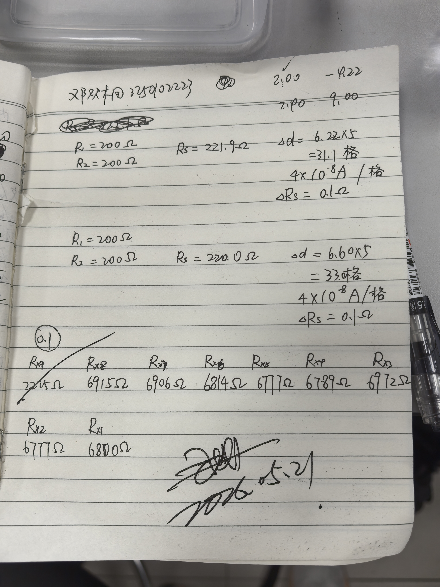

# 
物理实验报告

## 
实验名称：<u>惠斯登电桥</u> 

## 
指导老师：<u>王业伍</u> 

### 
周次：<u> 十二</u> 

### 
姓名：<u>邓欢桐</u> 

### 
实验日期：<u>2026</u>年<u>5</u>月<u>21</u>日 星期<u>四</u> 上午

### 
浙江大学物理实验教学中心

### 一、预习报告

#### 1. 实验综述

（自述实验现象、实验原理和实验方法，不超过300字，5分）

本实验基于惠斯登电桥平衡原理，当电桥检流计示零时，对臂电阻乘积相等，采用**平衡比较法**精确测量中值电阻。实验自主搭建惠斯登电桥，利用交换法消除比率臂电阻不对称误差；使用QJ23型盒式电桥测量电阻离散度，并测定电桥灵敏度。掌握电桥工作特性、倍率选取规则与有效数字保留方法，学会检流计、电阻箱及盒式电桥规范操作。

---

#### 2.实验重点

（简述本实验的学习重点，不超过100字，3分）

掌握惠斯登电桥平衡条件与测量原理；学会自组电桥、盒式电桥的正确使用；掌握交换法消除系统误差、电桥灵敏度测算方法；规范选取倍率保证测量结果四位有效数字。

---

#### 3.实验难点

（简述本实验的实现难点，不超过100字，2分）

合理选择电桥比率臂与检流计灵敏度；调节电桥精细平衡、准确判断检流计零点；理解电桥灵敏度物理意义及误差、离散度的计算分析方法。

---

### 二、原始数据

（将有学生和老师签名的“自备数据记录草稿纸”的扫描或手机拍摄图粘贴在下方，20分）

---

### 三、结果与分析

#### 1. 数据处理与结果

（列出数据表格、选择数据处理方法、给定测量或计算结果，30分）

##### 自组电桥测未知电阻

(1) 列出数据表格

|      | $R_1$ | $R_2$ | $R_s$ | $R'_s$ | $\Delta d$ | $\Delta R_s$ |
| :--- | :---: | :---: | :---: | :---: | :---: | :---: |
| 交换前 | 200Ω | 200Ω | 221.9Ω | $\times$ | 31.1 格 | 0.1Ω |
| 交换后 | 200Ω | 200Ω | $\times$ | 220.0Ω | 33.0 格 | 0.1Ω |

> 检流计灵敏度档位：$4\times 10^{-8}\mathrm{A}/$格

(2) 计算待测电阻最佳期望值

根据交换法公式：$R_x = \sqrt{R_s \cdot R'_s}$

代入数据：$R_s = 221.9\,\Omega$，$R'_s = 220.0\,\Omega$

得到：$R_x = \sqrt{221.9 \times 220.0} = \sqrt{48818} \approx 220.95\,\Omega$

---

(3) 计算电桥灵敏度 $S$ 和待测电阻不确定度 $\Delta R_x$

1. **电桥灵敏度**

   定义式：$S = \dfrac{\Delta d}{\Delta R_s / R_s}$

   取两次测量的平均偏转格数：$\overline{\Delta d} = \dfrac{31.1 + 33.0}{2} = 32.05\,\text{格}$

   代入：$S = \dfrac{32.05}{0.1 / 220.95} \approx 70813.8\,\text{格/相对变化}$

2. **由灵敏度引入的不确定度**

   人眼可分辨的最小偏转格数取 $\Delta d_{\text{min}} = 0.2\,\text{格}$，对应的电阻变化：$\Delta R_{x(S)} = \dfrac{\Delta d_{\text{min}}}{S} \cdot R_x
   = \dfrac{0.2}{70813.8} \times 220.95 \approx 0.000624\,\Omega$

3. **电阻箱仪器误差**

   取电阻箱等级为0.1级，仪器允差：
   $\Delta R_{\text{仪}} = 0.1\% \times 221.9 \approx 0.222\,\Omega$

4. **合成不确定度**

   $\Delta R_x = \sqrt{\Delta R_{x(S)}^2 + \Delta R_{\text{仪}}^2}
   \approx \sqrt{0.000624^2 + 0.222^2} \approx 0.222\,\Omega$

   按有效数字修约，取 $\Delta R_x = 0.3\,\Omega$

(4) 最终结果表达式：$R_x = (221.0 \pm 0.3)\,\Omega$

---

##### 用 QJ-23 型盒式惠斯登电桥测电阻离散度

|      | $R_{x1}$ | $R_{x2}$ | $R_{x3}$ | $R_{x4}$ | $R_{x5}$ | $R_{x6}$ | $R_{x7}$ | $R_{x8}$ |
| :--- | :---: | :---: | :---: | :---: | :---: | :---: | :---: | :---: |
| 阻值 (Ω) | 6800 | 6777 | 6972 | 6789 | 6777 | 6814 | 6906 | 6915 |

> 倍率：0.1

---

#### 2. 误差分析

（运用测量误差、相对误差、不确定度等分析实验结果，20分）

##### 自组电桥测未知电阻

(1) 计算待测电阻最佳期望值

交换法公式：$R_x = \sqrt{R_s \cdot R'_s}$

代入数据：$R_s = 221.9\,\Omega$，$R'_s = 220.0\,\Omega$

得到：$R_x = \sqrt{221.9 \times 220.0} = \sqrt{48818} \approx 220.95\,\Omega$

(2) 计算电桥灵敏度：$S = \frac{\Delta d}{\Delta R_s / R_s}$

- 交换前：$S_1 = \frac{31.1}{0.1/221.9} = 69010.9\,\text{格/相对变化}$
- 交换后：$S_2 = \frac{33.0}{0.1/220.0} = 72600.0\,\text{格/相对变化}$

取平均灵敏度：$\overline{S} = \frac{S_1 + S_2}{2} = \frac{69010.9 + 72600.0}{2} = 70805.45\,\text{格/相对变化}$

(3) 计算不确定度

① 仪器不确定度（电阻箱）：$\frac{\Delta R_s}{R_s} = \pm\left(a + b\frac{m}{R_s}\right)\%$

取电阻箱等级 $a=0.1\%$，旋钮数 $m=4$，则 $b=0.2\%$：$\frac{\Delta R_s}{R_s} = 0.001 + 0.002 \times \frac{4}{220.95} \approx 0.001036$

② 灵敏度不确定度 $\Delta S = \frac{0.2 R_s}{\overline{S}}$

取平均灵敏度 $\overline{S}=70805.45$，$R_s=220.95\,\Omega$：$\Delta S = \frac{0.2 \times 220.95}{70805.45} \approx 0.0062\,\Omega$

对应的相对不确定度：$\frac{\Delta S}{R_s} = \frac{0.2}{\overline{S}} = \frac{0.2}{70805.45} \approx 2.82 \times 10^{-6}$

③ 合成相对不确定度：$E = \frac{\Delta R_x}{R_x} = \sqrt{\left(\frac{\Delta R_s}{R_s}\right)^2 + \left(\frac{\Delta S}{R_s}\right)^2}$，即 $E = \sqrt{0.001036^2 + (2.82 \times 10^{-6})^2} \approx 0.001036$

④ 合成不确定度：$\Delta R_x = E \times R_x = 0.001036 \times 220.95 \approx 0.23\,\Omega$

按有效数字修约，取 $\Delta R_x = 0.3\,\Omega$。

(4) 最终结果表达式：$R_x = (221.0 \pm 0.3)\,\Omega$

---

##### 用 QJ-23 型盒式惠斯登电桥测电阻离散度

(1) 计算 8 个电阻的平均值 $\overline{R_x}$

$\overline{R_x} = \frac{1}{8}\sum_{i=1}^{8}R_{xi} = \frac{6800+6777+6972+6789+6777+6814+6906+6915}{8} = 6843.75\,\Omega$

(2) 利用贝塞尔公式计算标准偏差 $S$

$S = \sqrt{\frac{1}{n-1}\sum_{i=1}^{n}(R_{xi}-\overline{R_x})^2}$
$S = \sqrt{\frac{1}{7}\left[(6800-6843.75)^2+(6777-6843.75)^2+\dots+(6915-6843.75)^2\right]} \approx 77.32\,\Omega$

(3) 求电阻离散度

离散度定义为相对标准偏差：$\frac{S}{\overline{R_x}} \times 100\%$

代入数据：$\frac{77.32}{6843.75} \times 100\% \approx 1.13\%$

---

#### 3. 实验探讨

（对实验内容、现象和过程的小结，不超过100字，10分）

本实验利用惠斯登电桥平衡比较法测量中值电阻，通过交换法有效消除了比率臂不对称带来的系统误差，测量精度高于常规伏安法。电桥灵敏度越大，检流计微小偏转越易分辨，平衡判定越准确。盒式电桥测得同批次电阻存在一定离散度，源于元件制造公差与仪器接触电阻。实验操作需先接通电源再按下检流计按钮，避免指针过载损坏，合理选择倍率可保证测量结果四位有效数字。

---

### 四、思考题

（解答教材或讲义或老师指定的思考题，10分）

1. **为什么用惠斯登电桥测电阻比伏安法测量的准确度高？用电桥法测电阻产生误差的主要因素是什么？**

  答：惠斯登电桥采用**平衡比较法**，通过与标准电阻直接比对测量，不依赖电表读数精度，也避免了伏安法中电流表内接/外接带来的系统误差，因此准确度更高。电桥法的主要误差因素包括：① 标准电阻箱本身的仪器误差；② 电桥灵敏度不足导致的平衡判读误差；③ 比率臂电阻的不对称误差（可通过交换法消除）；④ 接触电阻和导线电阻的影响。

2. **为了提高电桥测量灵敏度，应采取哪些措施？为什么？**

  答：① 适当提高工作电源电压，电桥的灵敏度与电源电压成正比，电压越高，同样的电阻不平衡引起的检流计偏转越大；② 选用高灵敏度的检流计，能分辨更小的电流变化；③ 选择合适的比率臂，使比较臂的读数尽可能多，保证四位有效数字；④ 减少接触电阻和导线电阻的影响，提高桥路稳定性。

3. **用电桥测电阻时，若线路接通后检流计指针总是往一个方向偏转或总不偏转，试分析是什么原因？**

  答：总是往一个方向偏转，说明电桥始终无法平衡，可能原因有：① 桥臂电阻接线错误或有断路；② 电源电压未加上；③ 某个桥臂电阻严重偏离正常值。检流计总不偏转，说明检流计支路无电流，可能原因有：① 检流计未调零或“短路”按钮未解锁；② 检流计支路断路；③ 电源未接通或桥路存在多处断路。

4. **惠斯登电桥比率臂选取的原则是什么？为什么要这样选取？**

  答：原则是使比较臂（标准电阻箱）的四个旋钮都用上，保证测量结果有四位有效数字。这样选取可以充分利用标准电阻箱的精度，减小相对误差，使测量结果的有效数字位数最多，精度最高。

5. **如何使用自组电桥测量电表内阻（注意电表所能允许通过的最大电流）？根据电桥平衡的特点，可否将桥路中的检流计去掉，换成待测电表判别电桥的平衡？**

  答：测量电表内阻时，需在电路中串联限流电阻，使通过电表的电流不超过其满偏电流，防止损坏电表。
  根据电桥平衡的特点，平衡时桥路对角两点电位相等、无电流通过，因此可以将检流计换成待测电表，当电表读数为零时，电桥达到平衡，此时可通过电桥平衡公式计算出电表内阻。

---

#### 注意事项：

1.用PDF格式上传“预习报告”，文件名：学生姓名+学号+实验名称+周次。
2.“预习报告”必须递交在“学在浙大”的本课程的对应实验项目的“作业”模块内。
3.“预习报告”还须拷贝到“实验报告”中（便以教师批改）。

**
浙江大学物理实验教学中心制
**