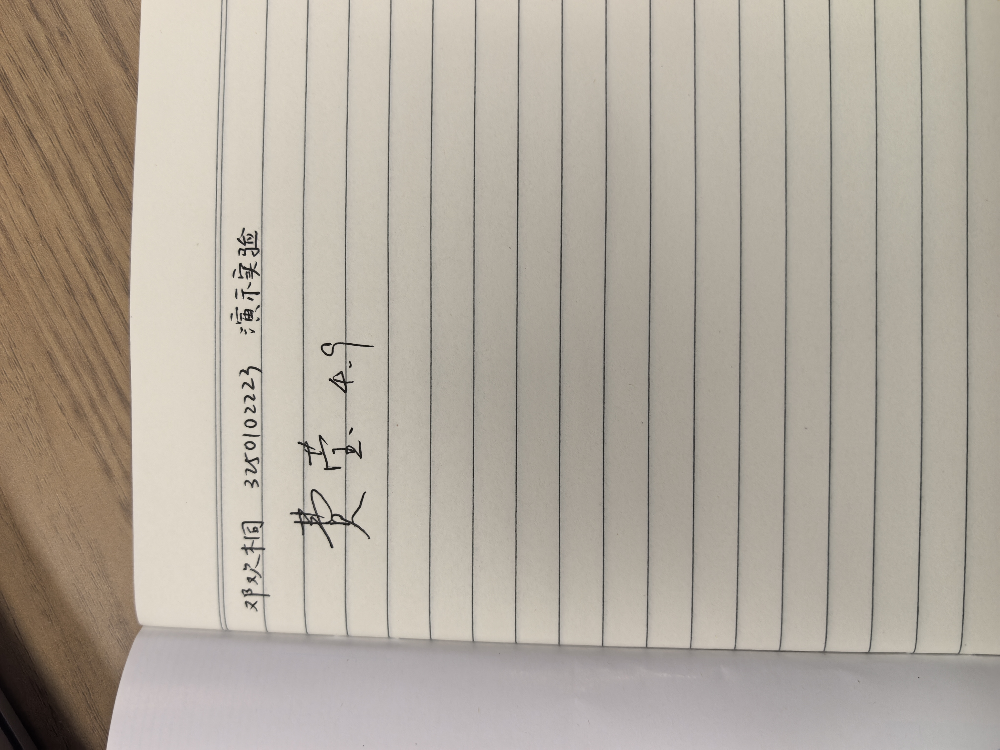
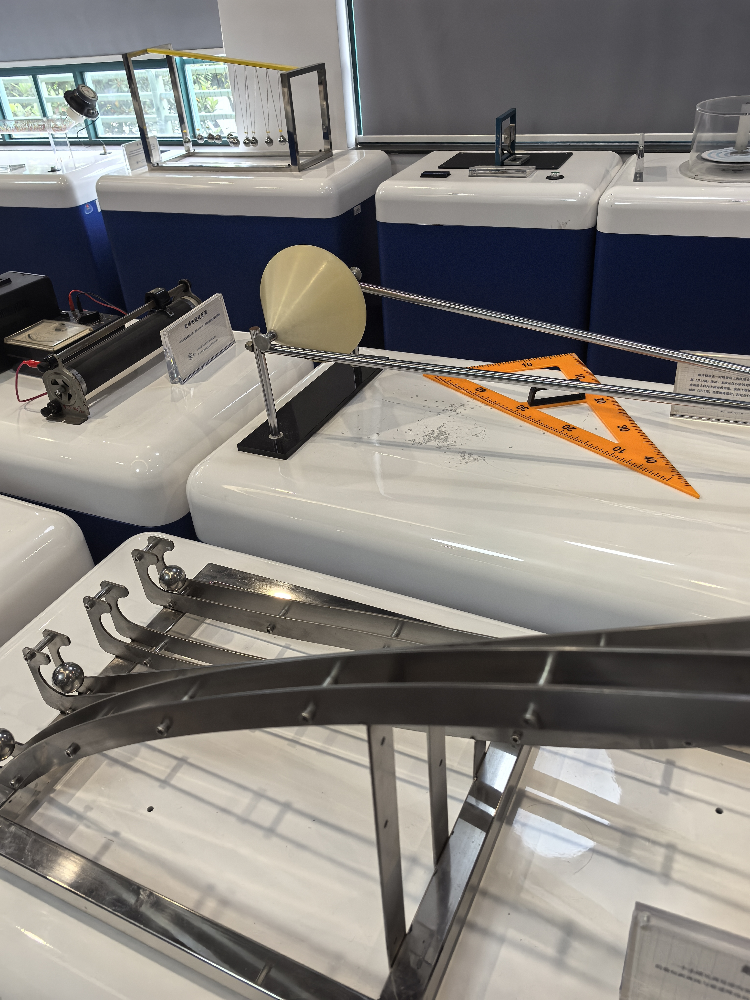
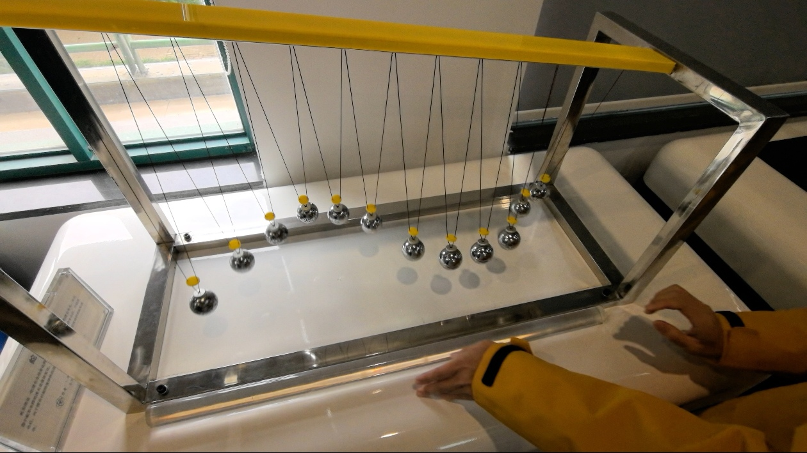
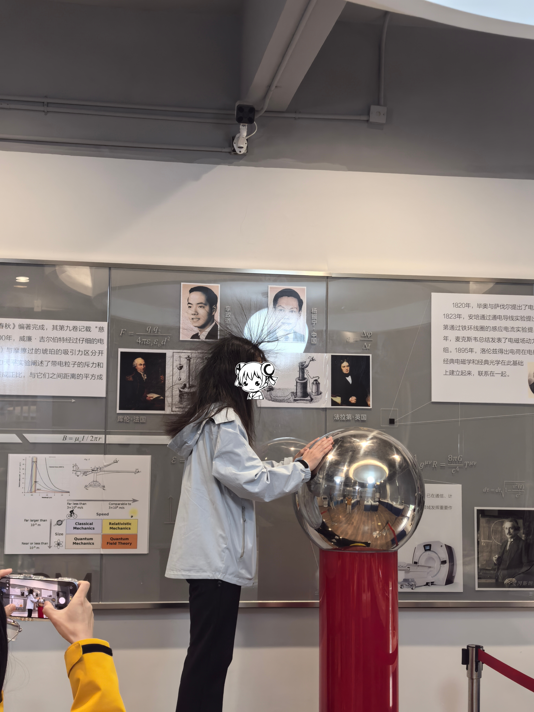

# 
物理实验报告

## 
实验名称：<u>演示实验</u> 

## 
指导老师：<u>费莹</u> 

### 
周次：<u>五</u> 

### 
姓名：<u>邓欢桐</u> 

### 
实验日期：<u>2026</u>年<u>4</u>月<u>9</u>日 星期<u>四</u>上午 

### 
浙江大学物理实验教学中心

### 一、预习报告

#### 一、实验目的

1. 直观验证角动量守恒定律：当系统所受合外力矩为零时，角动量为定值。
2. 观察转动惯量变化对旋转角速度的影响。
3. 亲身了解和体验离心力、向心力及内力做功的物理过程。

---

#### 二、实验原理

##### 2.1 物理公式原理

对于一个绕固定轴转动的系统，其角动量 $\vec{L}$ 定义为：

$\vec{L} = I \vec{\omega}$

其中 $I$ 为转动惯量，$\omega$ 为角速度。若系统所受合外力矩为零，则角动量守恒：

$I_1 \omega_1 = I_2 \omega_2 = \text{常量}$

---

##### 2.2 实际演示原理

- 人坐在可自由旋转的椅子上，双手持重物。
  - 当手臂伸展时，质量分布远离转轴，转动惯量 $I$ 较大；
  - 当手臂收回时，质量分布靠近转轴，转动惯量减小。
- 由于轴摩擦力矩很小，可近似认为合外力矩为零，因此角动量保持不变。根据守恒式，转动惯量减小时角速度必然增大，反之亦然。

>此外，收缩手臂过程中，人体肌肉做正功，将生物化学能转化为转动动能，会使得旋转速度增加。

---

#### 三、实验内容与装置

##### 3.1 实验器材

- 旋转椅：底座需要可灵活转动，且转轴垂直且稳定，可选用办公椅。
- 重物：两个质量相等的哑铃（推荐 $2 \sim 5$ kg），或装满水且捆扎牢固的矿泉水瓶。
- 防滑垫：铺于椅子周围地面。
- 辅助人员：$1 \sim 2$ 名，提供旋转动力，同时保护实验者。

### 3.2 实验装置文字描述

转椅置于空旷平坦地面，周围 $1.5$ 米内无尖锐或固定障碍物。实验者坐于椅上，双脚离地，双手侧平举，各握一重物。辅助人员站在侧面，准备轻推椅背给予初始角速度。

---

#### 四、实验步骤

1. **准备与检查**  
   - 检查转椅旋转是否顺畅，底座无松动。  
   - 将防滑垫铺于椅子周围，清除地面杂物，防止妨碍实验进行。  
   - 实验者握紧重物，坐稳后双脚离地，保持身体直立。

2. **获得初始旋转**  
   - 辅助人员用手轻推转椅靠背，使实验者获得一个缓慢、稳定的初始角速度（约 $0.5 \sim 1$ 圈/秒）。  
   - 实验者不允许主动蹬地，避免施加额外力矩。

3. **伸展状态观察**  
   - 实验者双臂向两侧水平伸展，持重物保持稳定。  
   - 感受当前旋转速度，可让辅助人员用秒表记录转一圈所需时间（周期）。

4. **收缩手臂**  
   - 实验者快速将双臂收回胸前，同时将重物紧贴胸口。  
   - 观察旋转速度的瞬时变化：转速明显加快，可能感到轻微眩晕。

5. **再次伸展**  
   - 实验者再将双臂向两侧快速伸出，旋转速度立即减慢。  
   - 可重复“伸展→收缩→伸展”多次，体验角速度随转动惯量变化而实时改变。

6. **结束实验**  
   - 待转速降至很慢时，实验者用脚轻触地面停止旋转，站稳后放下重物。

---

#### 五、预期现象与结果

- 当实验者收回手臂时，旋转速度**显著加快**；当重新伸展手臂时，速度**显著减慢**。  
- 速度变化的幅度与重物质量及手臂伸缩范围有关：重物越重、伸缩范围越大，效果越明显。  
- 实验者能清晰感受到离心力：手臂伸展时有被向外“甩”的感觉，收回手臂时需克服惯性做功。  
- 在理想情况下（忽略摩擦），若保持手臂固定不动，转速会因摩擦而逐渐衰减，但在短时间内守恒特征依然清晰。

---

#### 六、注意事项

1. **安全第一**  
   - 旋转速度不宜过快（建议不超过 $1.5$ 圈/秒），避免实验者眩晕摔倒或重物甩出。  
   - 助手应始终站在实验者身旁，随时准备扶稳或减速。  
   - 地面必须铺设防滑软垫，周围不得有桌角、硬物。
2. **器材要求**  
   - 重物必须握持牢固，最好带有手柄或防滑套。严禁使用易碎、尖锐物品。  
   - 转椅需检查轴承，确保旋转灵活且不晃动。
3. **操作规范**  
   - 实验过程中双脚始终离地，不可主动蹬地干扰角动量守恒。  
   - 初次体验者应先低速适应，再逐步加大伸缩幅度。  
   - 实验后若有眩晕感，应静坐片刻，不要立即站立行走。

---

### 二、原始数据

（将有学生和老师签名的“自备数据记录草稿纸”的扫描或手机拍摄图粘贴在下方，20分）

---

### 三、结果与分析

#### 最速降线

##### 一、实验内容

###### 1. 实验装置

- 轨道：至少两条轨道（常见为直线 vs 摆线，或多条不同曲线对比）。
- 起点与终点：所有轨道起点高度相同，终点水平对齐。
- 小球：使用质量、大小完全相同的光滑小球，确保摩擦、转动惯量一致。
- 释放器：挡板或开关，保证同时释放所有小球。
###### 2. 实验步骤

1. 将所有小球置于各自轨道起点。
2. 同时释放小球。
3. 观察并记录哪个小球最先到达终点。
3. 实验现象
路径更长的摆线（曲线）轨道上的小球，总是比直线轨道的小球更快到达终点。

---

##### 二、实验原理

###### 1. 核心物理：能量守恒（势能→动能）
- 小球下滑速度由下落高度决定：
   - $mgh = \frac{1}{2}mv^2 \implies v = \sqrt{2gh}$
- 速度 $v$ 只与下落高度 $h$ 有关，与路径形状无关。

###### 2. 关键原因：速度分配策略

- 直线轨道：坡度均匀、平缓。小球全程加速慢、平均速度低。
- 摆线轨道：
   - 前段极陡：快速下落，瞬间获得高速。
   - 后段平缓：利用已有的高速滑行，平均速度远超直线。
- 结论：摆线是“速度与路程”的最优解，平均速度优势抵消了路程更长的劣势。

###### 3. 数学本质：摆线（旋轮线）
- 最速降线的数学形状是摆线：一个圆沿直线滚动时，圆周上某一点的轨迹。

##### 三、实验即时图

---

#### 蛇形摆实验

##### 一、实验内容

###### 1. 实验装置

由多个完全相同的金属小球组成，每个小球都用细线悬挂在同一根横梁上，但每根细线的长度依次规律变化（从左到右/从右到左摆长逐渐缩短/变长），所有小球初始时在同一水平位置对齐。

###### 2. 操作与现象

- 将所有小球同时拉到同一高度、同一侧，保证初始摆角一致。
- 同时释放所有小球，观察它们的运动：- 初始阶段：小球几乎同步摆动，保持整齐的一排。
   - 摆动一段时间后：小球逐渐错位，形成像蛇一样蜿蜒起伏的波浪形。
   - 继续摆动：会交替出现整齐排列、蛇形、双列交错等多种规律形态，最终又会短暂回到初始的整齐状态，循环往复。

---

##### 二、实验原理

###### 1. 核心基础：单摆周期公式

>在小角度摆动（摆角<5°）的近似下，单摆的周期公式为：

$T = 2\pi\sqrt{\frac{L}{g}}$

- $T$：单摆的摆动周期（完成一次完整来回的时间）
- $L$：摆长（悬挂点到小球球心的距离）
- $g$：重力加速度（定值）

> 关键结论：单摆的摆动周期只和摆长有关，和小球质量、初始摆角无关；摆长越长，周期越长，摆动越慢；摆长越短，周期越短，摆动越快。

###### 2. 蛇形摆动的成因

- 实验中所有小球同时释放、初始状态完全一致，但摆长依次变化，因此每个小球的摆动周期、频率都不同。
- 摆长短的小球（周期小）摆动快，摆长长的小球（周期大）摆动慢，快慢差异让小球的相位逐渐错开。
- 当不同周期的摆动叠加时，就会形成肉眼可见的、类似蛇形的动态波形；当所有小球的摆动相位再次重合时，就会回到初始的整齐状态，完成一个周期循环。

##### 三、实验即时图

---

#### 范式起电机演示实验

##### 一、实验内容

###### 1. 实验装置

>核心是范德格拉夫起电机：由一个巨大的金属空心球、绝缘支柱、内部的传送带与电机组成，可将电荷持续输送到金属球表面，使球带上数万伏的高压静电。

###### 2. 操作与现象

1. 实验者赤脚站在绝缘台上，用手平稳接触金属球。
2. 启动起电机，金属球持续积累高压静电，电荷通过人体传导到全身。
3. 现象：人体头发因带上同种电荷，相互排斥而一根根竖立起来，呈现“怒发冲冠”的效果；人体虽处于高压，但因无电流回路，不会触电。
4. 实验结束后，先关闭电源，用放电棒对金属球放电，实验者再离开。

##### 二、实验原理

###### 1. 核心原理：静电感应与同种电荷相斥

- 起电机通过传送带将电荷不断输送到金属球，使金属球表面积累大量同种电荷（通常为正电荷）。
- 实验者手触金属球后，人体成为导体，电荷会均匀分布到全身（包括头发），使每根头发都带上同种电荷。
- 根据库仑定律，同种电荷相互排斥，头发之间的斥力会克服重力，使头发竖立起来。

###### 2. 安全原理：等电位与绝缘

- 实验者站在绝缘台上，与大地完全隔离，人体与金属球形成等电位体，没有电势差，因此不会有电流通过人体，不会触电。
- 金属球的电荷仅分布在外表面（导体静电平衡特性），内部无电场，保证了实验安全。

###### 3. 补充原理：导体静电平衡

- 处于静电平衡的导体，电荷仅分布在表面，内部电场强度为零，这是范德格拉夫起电机能安全积累高压的核心物理基础。

##### 三、实验即时图

---

#### 注意事项：

1.用PDF格式上传“预习报告”，文件名：学生姓名+学号+实验名称+周次。
2.“预习报告”必须递交在“学在浙大”的本课程的对应实验项目的“作业”模块内。
3.“预习报告”还须拷贝到“实验报告”中（便以教师批改）。

**
浙江大学物理实验教学中心制
**