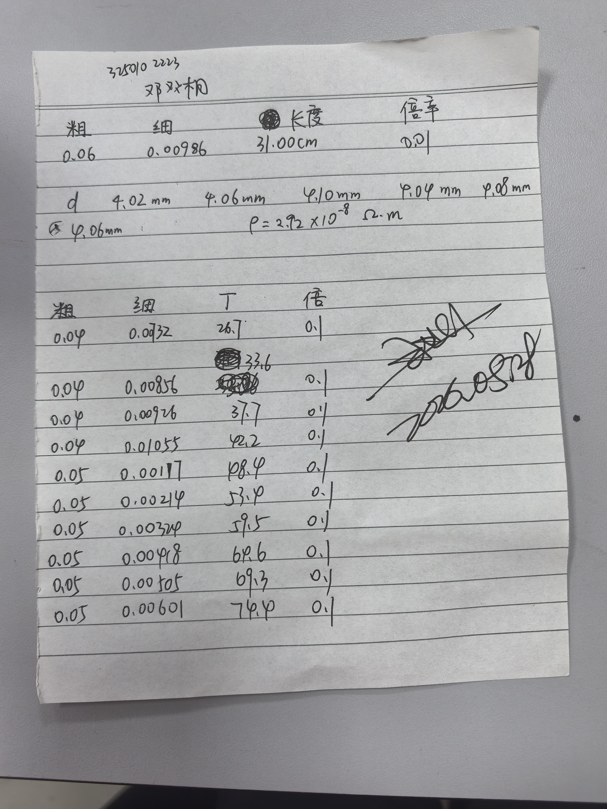
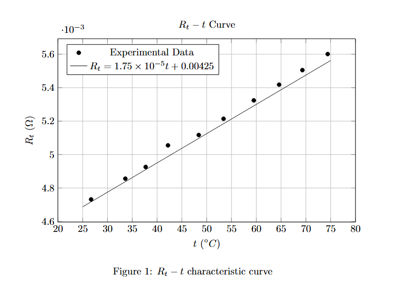

# 
物理实验报告

# 
实验名称：<u>用双臂电桥测低电阻</u>

## 
指导老师：<u>王业伍</u>

### 
周次：<u>十三</u>
### 
姓名：<u>邓欢桐</u>

### 
实验日期：<u>2026</u>年<u>5</u>月<u>28</u>日 星期<u>四</u> 上午

### 
浙江大学物理实验教学中心

### 一、预习报告
#### 1. 实验综述

（自述实验现象、实验原理和实验方法，不超过300字，5分）

单臂电桥测量低电阻时，引线与接触电阻会带来很大误差。直流双臂电桥也称开尔文电桥，采用**四端接入法**，区分电流接头和电位接头，消除附加电阻影响；通过保持比率臂比值相等，利用基尔霍夫定律实现低电阻精确测量。本实验使用 QJ44 型直流双臂电桥，先熟悉仪器按键与倍率档位，接入金属导体，调节电桥平衡测量低电阻；同时测量金属丝长度、直径计算电阻率，改变温度测量对应电阻，研究金属电阻温度特性与温度系数。

---

#### 2.实验重点

（简述本实验的学习重点，不超过100字，3分）

掌握直流双臂电桥测量低电阻的工作原理与四端接法；熟悉 QJ44 型电桥的倍率选择、调零、灵敏度调节及平衡操作方法；学会利用测量数据计算金属电阻率与电阻温度系数。

---

#### 3.实验难点

（简述本实验的实现难点，不超过100字，2分）

理解四端接入法消除接触电阻、导线电阻误差的物理本质；掌握电桥先低灵敏度调平衡再逐步调高灵敏度的操作技巧；控制温控装置稳定测温，保证多组温阻数据测量精度。

---

### 二、原始数据
（将有学生和老师签名的“自备数据记录草稿纸”的扫描或手机拍摄图粘贴在下方，20分）

---

### 三、结果与分析

#### 1. 数据处理与结果
（列出数据表格、选择数据处理方法、给定测量或计算结果，30分）

### 任务一：铜丝电阻率测量数据处理

#### （1）铜丝平均直径计算

> **铜丝基本几何参数及电阻测量表**
> 注：实际测量电阻公式 $R_x = \text{倍率} \times (\text{粗调电阻} + \text{细调电阻})$

| 粗调电阻 $(\Omega)$ | 细调电阻 $(\Omega)$ | 倍率 | 测量电阻 $R_x$ $(\Omega)$ | 长度 $L$ $(\text{cm})$ |
| :---: | :---: | :---: | :---: | :---: |
| 0.06 | 0.0986 | 0.01 | **0.001586** | 31.00 |

> **铜丝直径 $d$ 多次测量数据表**
> 注：千分尺读取单位应为 $\text{mm}$ 

| 编号 | 1 | 2 | 3 | 4 | 5 | 6 | 平均值 $\bar{d}$ |
| :---: | :---: | :---: | :---: | :---: | :---: | :---: | :---: |
| **$d$ $(\text{mm})$** | 4.02 | 4.06 | 4.10 | 4.04 | 4.08 | 4.06 | **4.06** |

对铜丝直径进行 6 次测量：

$$
\bar d=\frac{4.02+4.06+4.10+4.04+4.08+4.06}{6}=4.06\ \text{mm}
$$

换算为国际单位制：

$$
\bar d =4.06\times10^{-3}\ \text{m}
$$

---

#### （2）电阻率计算

铜丝电阻率计算公式：

$$
\rho=\frac{R\pi d^2}{4L}
$$

代入实验数据：

- 电阻：

$$
R=0.001586\ \Omega
$$

- 直径：

$$
d=4.06\times10^{-3}\ \text{m}
$$

- 长度：

$$
L=31.00\ \text{cm}=0.3100\ \text{m}
$$

则：

$$
\rho
=
\frac{0.001586\times\pi\times(4.06\times10^{-3})^2}{4\times0.3100}
$$

计算得：

$$
\rho=6.65\times10^{-8}\ \Omega\cdot\text{m}
$$

---

#### （3）不确定度计算

##### ① 电阻的不确定度

双臂电桥最小分度取：

$$
\Delta_R=0.00001\ \Omega
$$

则 B 类不确定度：

$$
U(R)=\frac{\Delta_R}{\sqrt3}
=\frac{0.00001}{\sqrt3}
=5.77\times10^{-6}\ \Omega
$$

---

##### ② 直径的不确定度

千分尺最小分度：

$$
\Delta_d=0.02\ \text{mm}
$$

则：

$$
U(d)=\frac{0.02}{\sqrt3}
=0.01154\ \text{mm}
$$

换算为 SI 单位：

$$
U(d)=1.15\times10^{-5}\ \text{m}
$$

---

##### ③ 长度的不确定度

钢尺最小分度：

$$
\Delta_L=0.1\ \text{cm}
$$

则：

$$
U(L)=\frac{0.1}{\sqrt3}
=0.0577\ \text{cm}
$$

换算：

$$
U(L)=5.77\times10^{-4}\ \text{m}
$$

---

#### （4）电阻率合成不确定度

由间接测量不确定度传播公式：

$$
\frac{U(\rho)}{\rho}
=
\sqrt{
\left(\frac{U(R)}{R}\right)^2
+
\left(2\frac{U(d)}{d}\right)^2
+
\left(\frac{U(L)}{L}\right)^2
}
$$

代入数据：

$$
\frac{U(\rho)}{\rho}
=
\sqrt{
\left(\frac{5.77\times10^{-6}}{0.001586}\right)^2
+
\left(2\times\frac{1.15\times10^{-5}}{4.06\times10^{-3}}\right)^2
+
\left(\frac{5.77\times10^{-4}}{0.3100}\right)^2
}
$$

计算得：

$$
\frac{U(\rho)}{\rho}
\approx0.00664
$$

因此：

$$
U(\rho)
=
0.00664\times6.65\times10^{-8}
$$

得：

$$
U(\rho)
=
4.42\times10^{-10}\ \Omega\cdot\text{m}
$$

---

#### （5）电阻率最终结果表达式

因此铜丝电阻率测量结果为：

$$
\rho=(6.65\pm0.04)\times10^{-8}\ \Omega\cdot\text{m}
$$

---

#### （6）一些分析

查阅资料可知，标准铜在室温下的电阻率约为：

$$
\rho_0=1.75\times10^{-8}\ \Omega\cdot\text{m}
$$

而实验测得铜丝电阻率为：

$$
\rho=(6.65\pm0.04)\times10^{-8}\ \Omega\cdot\text{m}
$$

实验结果明显大于标准值，其原因可能包括：

1. 实验所用导体并非高纯度铜导线，材料内部杂质会增大电阻率；

2. 铜丝直径测量存在误差，而电阻率与直径平方成正比，因此会放大测量误差；

3. 导线接触电阻与引线电阻未能完全消除；

4. 测量过程中导体温度可能高于室温，而金属电阻率会随温度升高而增大；

5. 双臂电桥平衡调节存在一定系统误差。

尽管实验结果与标准值存在一定偏差，但整体数量级一致，实验结果仍具有合理性。

---

### 任务二：金属导体电阻温度系数测量

> **变温电阻测量数据与计算表**

| 测量序号 | 温度 $t$ $(\text{}^\circ\text{C})$ | 倍率 | 粗调电阻 $(\Omega)$ | 细调电阻 $(\Omega)$ | 实际电阻 $R_x$ $(\Omega)$ |
| :---: | :---: | :---: | :---: | :---: | :---: |
| **1** | 26.7 | 0.1 | 0.04 | 0.00732 | **0.004732** |
| **2** | 33.6 | 0.1 | 0.04 | 0.00856 | **0.004856** |
| **3** | 37.7 | 0.1 | 0.04 | 0.00926 | **0.004926** |
| **4** | 42.2 | 0.1 | 0.04 | 0.01055 | **0.005055** |
| **5** | 48.4 | 0.1 | 0.05 | 0.00117 | **0.005117** |
| **6** | 53.4 | 0.1 | 0.05 | 0.00214 | **0.005214** |
| **7** | 59.5 | 0.1 | 0.05 | 0.00324 | **0.005324** |
| **8** | 64.6 | 0.1 | 0.05 | 0.00418 | **0.005418** |
| **9** | 69.3 | 0.1 | 0.05 | 0.00505 | **0.005505** |
| **10** | 74.4 | 0.1 | 0.05 | 0.00601 | **0.005601** |

---

金属电阻温度关系满足：

$$
R_t=R_0(1+\alpha t)
$$

整理得：

$$
\alpha=\frac{R_{x2}-R_{x1}}{R_{x1}t_2-R_{x2}t_1}
$$

实验采用逐差法处理数据：

- 第6组减第1组
- 第7组减第2组
- 第8组减第3组
- 第9组减第4组
- 第10组减第5组

以减小随机误差影响。

---

#### （1）逐差法计算温度系数

| 组号 | $t_1(^\circ C)$ | $t_2(^\circ C)$ | $R_{x1}(\Omega)$ | $R_{x2}(\Omega)$ | $\alpha(10^{-3}/^\circ C)$ |
| :---: | :---: | :---: | :---: | :---: | :---: |
| 1 | 26.7 | 53.4 | 0.004732 | 0.005214 | 4.60 |
| 2 | 33.6 | 59.5 | 0.004856 | 0.005324 | 4.48 |
| 3 | 37.7 | 64.6 | 0.004926 | 0.005418 | 4.45 |
| 4 | 42.2 | 69.3 | 0.005055 | 0.005505 | 3.82 |
| 5 | 48.4 | 74.4 | 0.005117 | 0.005601 | 4.21 |

---

#### （2）平均温度系数

$$
\bar\alpha
=
\frac{4.60+4.48+4.45+3.82+4.21}{5}
\times10^{-3}
$$

计算得：

$$
\bar\alpha
=
4.31\times10^{-3}\ ^\circ\text{C}^{-1}
$$

---

#### （3）与理论值比较

理论值：

$$
\alpha_0=4.33\times10^{-3}\ ^\circ\text{C}^{-1}
$$

相对误差：

$$
\eta
=
\frac{|\bar\alpha-\alpha_0|}{\alpha_0}\times100\%
$$

代入数据：

$$
\eta
=
\frac{|4.31-4.33|}{4.33}\times100\%
$$

得：

$$
\eta=0.46\%
$$

---

#### （4）Rt-t 特性曲线分析

根据实验数据绘制得到金属导体的 $R_t-t$ 特性曲线，并对实验数据进行线性拟合，可得拟合方程：

$$
R_t=1.75\times10^{-5}t+0.00425
$$

由金属导体电阻温度关系：

$$
R_t=R_0(1+\alpha t)
$$

展开得：

$$
R_t=R_0\alpha t+R_0
$$

与线性拟合方程比较可知：

$$
k=R_0\alpha
$$

因此温度系数可由曲线斜率求得：

$$
\alpha=\frac{k}{R_0}
$$

代入拟合结果：

$$
k=1.75\times10^{-5}
$$

$$
R_0=0.00425\ \Omega
$$

则：

$$
\alpha
=
\frac{1.75\times10^{-5}}{0.00425}
=
4.12\times10^{-3}\ ^\circ\text{C}^{-1}
$$

铜的理论温度系数为：

$$
\alpha_0=4.33\times10^{-3}\ ^\circ\text{C}^{-1}
$$

因此相对误差为：

$$
\eta
=
\frac{|\alpha-\alpha_0|}{\alpha_0}\times100\%
$$

代入数据：

$$
\eta
=
\frac{|4.12-4.33|}{4.33}\times100\%
$$

计算得：

$$
\eta=4.85\%
$$

由实验结果可知，金属导体电阻随温度升高而增大，并在实验温度范围内近似满足线性关系。Rt-t 曲线整体接近直线，符合金属导体线性温阻规律。

由曲线拟合得到的温度系数与理论值较为接近，相对误差约为 $4.85\%$，说明实验测量结果较准确。

---

### 2. 误差分析

本实验误差主要来源于以下几个方面：

1. 双臂电桥调节时未达到完全平衡，导致电阻测量存在误差；

2. 温控装置存在温度波动，导致实际导体温度与显示温度存在差异；

3. 千分尺读数存在人为读数误差；

4. 导线在加热过程中温度分布不均匀，导致导体实际温度与温度计示数不完全一致；

5. 接触电阻与导线电阻无法完全消除，会对低电阻测量产生一定影响；

6. 在绘制 $R_t-t$ 特性曲线时，实验数据点存在一定离散性，线性拟合过程中会引入拟合误差；

7. 实验过程中电源电流可能存在微小波动，从而影响电桥平衡状态与测量稳定性。

其中，铜丝直径测量误差对电阻率影响较大，因为：

$$
\rho\propto d^2
$$

因此直径误差会被平方放大，从而对最终电阻率结果产生较明显影响。

此外，在温度系数测量中，由于金属导体升温与散热过程并非完全稳定，导体内部可能存在温度梯度，使得测量得到的电阻值与理论值之间存在一定偏差。

实验测得温度系数与理论值存在约 $0.46\%$ 和 $4.85\%$ 的相对误差，说明实验结果与理论值较为接近，实验测量结果总体较准确。

---

### 3. 实验探讨

（对实验内容、现象和过程的小结，不超过100字，10分）

本实验利用直流双臂电桥测量低电阻，通过四端接入法有效减小了导线电阻和接触电阻的影响，提高了测量精度。实验进一步研究了金属导体电阻随温度变化的规律，加深了对金属温阻特性的理解，同时掌握了逐差法处理实验数据的方法。

---

## 四、思考题

（解答教材或讲义或老师指定的思考题，10分）

### 1. 双臂电桥与惠斯登电桥有哪些异同？

双臂电桥与惠斯登电桥都属于直流电桥，均利用电桥平衡原理进行电阻测量，即当桥路平衡时，检流计中无电流，通过桥臂比例关系求出未知电阻。

两者的主要区别在于：

1. 惠斯登电桥主要用于测量中、高值电阻，而双臂电桥主要用于测量低电阻；

2. 双臂电桥采用四端接法，引入辅助比例臂，可以减小导线电阻和接触电阻的影响，而惠斯登电桥一般采用两端接法；

3. 双臂电桥结构比惠斯登电桥更复杂，但测量低电阻时精度更高。

因此，在测量毫欧级低电阻时，双臂电桥比惠斯登电桥更适合。

---

### 2. 为什么双臂电桥测量低电阻时能够消除（或减小）附加电阻对测量结果的影响？

测量低电阻时，导线电阻和接触电阻与待测电阻处于同一数量级，会对测量结果产生较大影响。

双臂电桥采用四端接法，将电流回路与电位测量回路分离：

- 电流端负责提供工作电流；
- 电位端仅用于测量电压，不通过较大电流。

由于电位端电流极小，因此导线和接触部分上的附加压降可以忽略，从而减小了附加电阻对测量结果的影响。

同时，双臂电桥设置了辅助比例臂，使附加电阻产生的影响能够相互抵消，因此能够较准确地测量低电阻。

---

### 3. 如果四端电阻的电流端和电位端接反了，对测量结果有什么影响？

若将四端电阻的电流端与电位端接反，则电位测量回路中会流过较大电流，导致导线电阻和接触电阻上的压降进入测量结果。

这样会使测得的电阻值包含附加电阻，从而增大测量误差，失去四端接法减小附加电阻影响的作用。

因此，实验中必须严格区分：

- 电流端（C端）
- 电位端（P端）

并按规定正确接线，才能保证低电阻测量精度。

---

#### 注意事项：
1.用PDF格式上传“预习报告”，文件名：学生姓名+学号+实验名称+周次。
2.“预习报告”必须递交在“学在浙大”的本课程的对应实验项目的“作业”模块内。
3.“预习报告”还须拷贝到“实验报告”中（便以教师批改）。

**
浙江大学物理实验教学中心制
**
