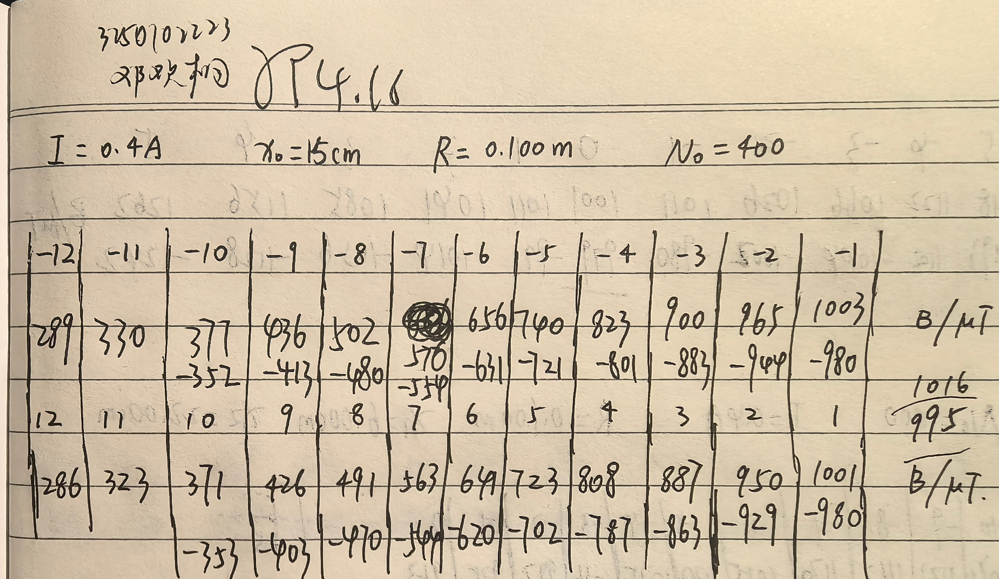
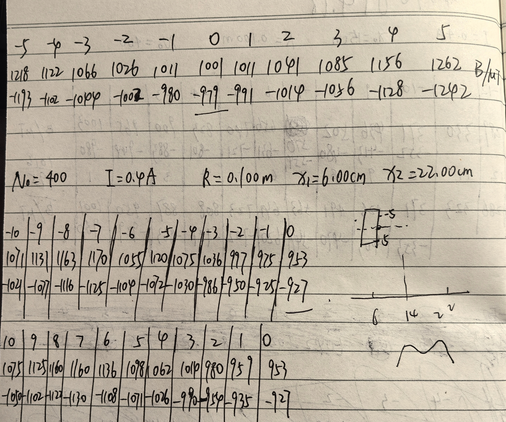
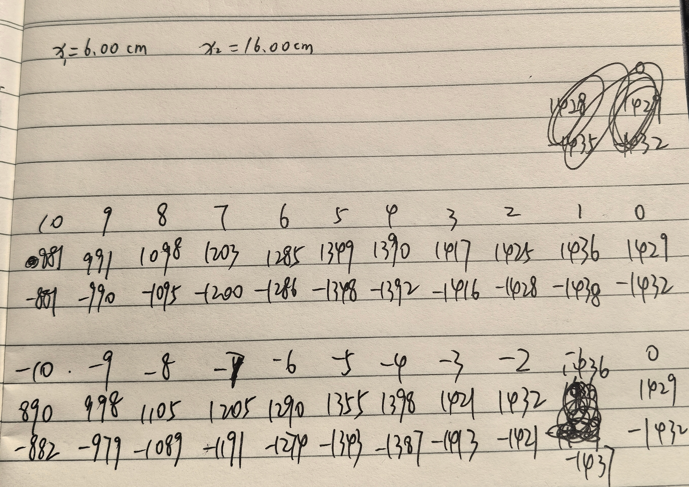
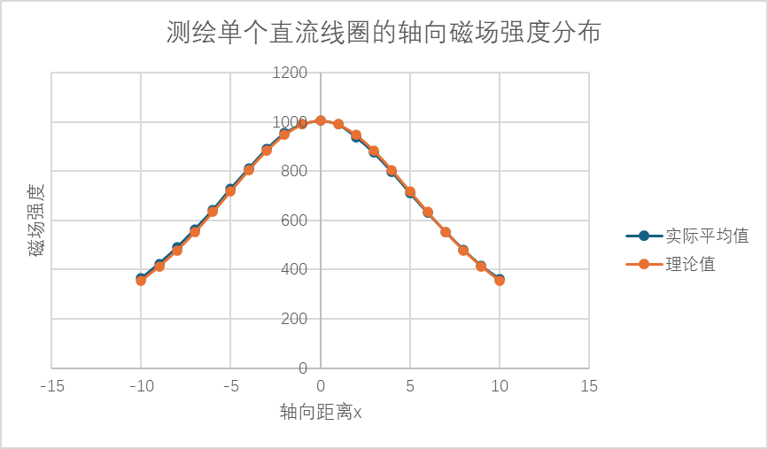
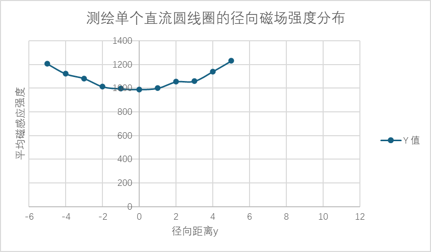
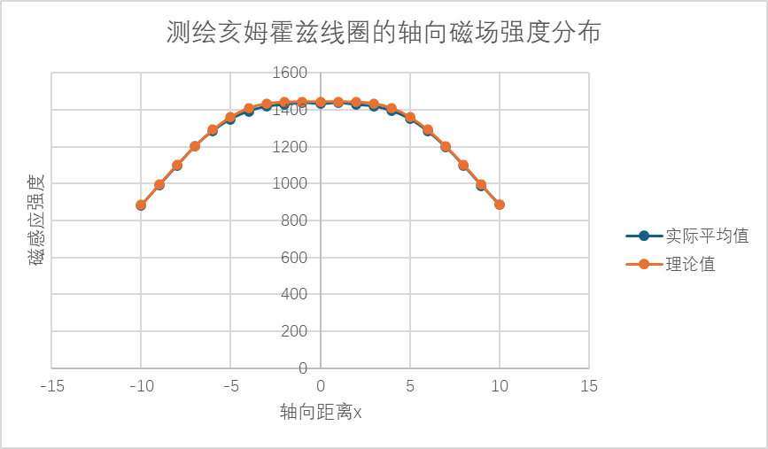
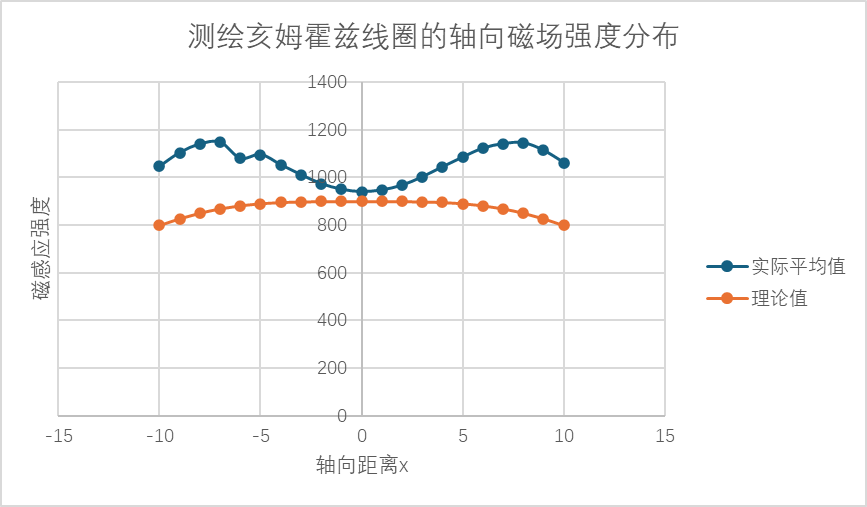

# 
物理实验报告

## 
实验名称：<u>用霍尔法测直流圆线圈与亥姆霍兹线圈磁场</u>

## 
指导老师：<u>郭虹丽</u>

### 
周次：<u>7</u>

### 
姓名：<u>邓欢桐</u>

### 
实验日期：<u>2026</u>年<u>4</u>月<u>16</u>日 星期<u>四</u> 上午

### 
浙江大学物理实验教学中心

### 一、预习报告

#### 1. 实验综述

（自述实验现象、实验原理和实验方法，不超过300字，5分）

- 本实验借助霍尔效应，采用霍尔传感器测定单个圆线圈与亥姆霍兹线圈轴线上的磁场分布，从而掌握磁场测量方法。
- 实验先用指南针完成地磁场补偿与仪器调零，分别对单线圈、亥姆霍线圈通入励磁电流。
- 移动霍尔传感器读取不同位置的磁感应强度。
- 记录数据并绘制 $B-x$ 分布曲线，对比分析两种线圈的磁场特点，从而加深对霍尔效应与载流线圈磁场分布的理解。

---

#### 2.实验重点

（简述本实验的学习重点，不超过100字，3分）

理解霍尔效应测磁场的基本原理，完成地磁场调零，测绘并分析单线圈与亥姆霍兹线圈轴线磁场分布。

---

#### 3.实验难点

（简述本实验的实现难点，不超过100字，2分）

准确完成调零与地磁场补偿，精准定位传感器，减小测量与读数带来的误差。

---

### 二、原始数据

（将有学生和老师签名的“自备数据记录草稿纸”的扫描或手机拍摄图粘贴在下方，20分）

---

### 三、结果与分析

#### 1. 数据处理与结果

（列出数据表格、选择数据处理方法、给定测量或计算结果，30分）

##### (1) 测绘单个直流线圈的轴向磁场强度分布

| **传感器位置 (cm)** |  **5.00**  | **6.00**  | **7.00**  | **8.00**  | **9.00**  | **10.00** | **11.00** | **12.00** | **13.00** | **14.00** | **15.00**  | **16.00** | **17.00** | **18.00** | **19.00** | **20.00** | **21.00** | **22.00** | **23.00** | **24.00** | **25.00** |
| :-----------------: | :--------: | :-------: | --------- | --------- | --------- | --------- | --------- | --------- | --------- | --------- | ---------- | --------- | --------- | --------- | --------- | --------- | --------- | --------- | --------- | --------- | :-------: |
| **轴向距离 x (cm)** | **−10.00** | **−9.00** | **−8.00** | **−7.00** | **−6.00** | **−5.00** | **−4.00** | **−3.00** | **−2.00** | **−1.00** | **0.00**   | **1.00**  | **2.00**  | **3.00**  | **4.00**  | **5.00**  | **6.00**  | **7.00**  | **8.00**  | **9.00**  | **10.00** |
|    **正向 (μT)**    |  **377**   |  **436**  | **502**   | **576**   | **656**   | **740**   | **823**   | **900**   | **965**   | **1003**  | **1016**   | **1001**  | **950**   | **887**   | **808**   | **723**   | **641**   | **563**   | **491**   | **426**   |  **371**  |
|    **反向 (μT)**    |  **−352**  | **−413**  | **−480**  | **−554**  | **−631**  | **−721**  | **−801**  | **−883**  | **−944**  | **−980**  | **−995**   | **−980**  | **−929**  | **−863**  | **−787**  | **−702**  | **−620**  | **−544**  | **−470**  | **−403**  | **−353**  |
|   **平均 B (μT)**   | **364.5**  | **424.5** | **491.0** | **565.0** | **643.5** | **730.5** | **812.0** | **891.5** | **954.5** | **991.5** | **1005.5** | **990.5** | **939.5** | **875.0** | **797.5** | **712.5** | **630.5** | **553.5** | **480.5** | **414.5** | **362.0** |
|  **理论 Bx (μT)**   | **355.4**  | **412.8** | **478.7** | **552.7** | **633.9** | **719.3** | **804.7** | **883.4** | **947.9** | **990.4** | **1005.3** | **990.4** | **947.9** | **883.4** | **804.7** | **719.3** | **633.9** | **552.7** | **478.7** | **412.8** | **355.4** |
|  **相对误差 (%)**   |  **2.56**  | **2.83**  | **2.57**  | **2.23**  | **1.51**  | **1.56**  | **0.91**  | **0.92**  | **0.70**  | **0.11**  | **0.02**   | **0.01**  | **0.89**  | **0.95**  | **0.89**  | **0.95**  | **0.54**  | **0.14**  | **0.38**  | **0.41**  | **1.86**  |

- 真空磁导率：

   - 匝数：$N=400$

   - 电流：$I=400 mA=0.4 A$

   - 线圈半径：$R=0.1 m$

   - 轴向距离：$x$（单位先换成 $m$ 再计算）

   - 圆线圈轴线上磁场公式：$B(x)=\frac{\mu_0 N I R^2}{2(R^2+x^2)^{\frac{3}{2}}}$

- 平均值计算：
  
   - $B_{平均}=\frac{|B_{正向}|+|B_{反向}|}{2}$

- 相对误差计算：
   - $相对误差=\frac{|B_{平均}−B_{理论}|}{|B_{理论}|}×100\%$

> - 由 $B-x$ 曲线可见：单载流圆线圈轴线上磁感应强度在线圈中心（$x=0$）处最大，向两侧对称衰减，呈单峰、中间高、两端低的典型分布，与理论计算曲线趋势高度吻合；
> - 实验测量值与理论值整体接近，边缘位置误差略大于中心区域。

---

##### (2) 测绘单个直流圆线圈的径向磁场强度分布

|     **径向距离 y (cm)**     | **-5.00**  | **-4.00**  | **-3.00**  | **-2.00**  | **-1.00** | **0.00**  | **+1.00**  | **+2.00**  | **+3.00**  | **+4.00**  | **+5.00**  |
| :-------------------------: | :--------: | :--------: | :--------: | :--------: | :-------: | :-------: | :--------: | :--------: | :--------: | :--------: | :--------: |
| **正向磁感应强度 B正 (μT)** |  **1218**  |  **1122**  |  **1066**  |  **1026**  | **1011**  | **1001**  |  **1011**  |  **1041**  |  **1085**  |  **1156**  |  **1262**  |
| **反向磁感应强度 B反 (μT)** | **-1193**  | **-1102**  | **-1044**  | **-1002**  | **-980**  | **-979**  |  **-991**  | **-1014**  | **-1056**  | **-1128**  | **-1242**  |
|  **平均磁感应强度 B (μT)**  | **1205.5** | **1122.0** | **1082.5** | **1014.0** | **995.5** | **990.0** | **1001.0** | **1055.0** | **1060.5** | **1142.0** | **1232.0** |

- 平均值计算：
  
   - $B_{平均}=\frac{|B_{正向}|+|B_{反向}|}{2}$

> - 由 $B-y$ 曲线可见：在固定轴向位置，径向磁感应强度中心最小，随径向距离增大而单调上升，呈中间低、两侧高分布；
> - 说明单线圈磁场仅在轴线附近较为集中，径向发散明显，均匀性差。

---

##### (3) 测绘亥姆霍兹线圈的轴向磁场强度分布

###### R = 10 cm（原本实验）

| **传感器位置 (cm)** | **21.00**  | **20.00** | **19.00**  | **18.00**  | **17.00**  | **16.00**  | **15.00**  | **14.00**  | **13.00**  | **12.00**  | **11.00**  | **10.00**  | **9.00**   | **8.00**   | **7.00**   | **6.00**   | **5.00**   | **4.00**   | **3.00**   | **2.00**  | **1.00**   |
| ------------------- | ---------- | --------- | ---------- | ---------- | ---------- | ---------- | ---------- | ---------- | ---------- | ---------- | ---------- | ---------- | ---------- | ---------- | ---------- | ---------- | ---------- | ---------- | ---------- | --------- | ---------- |
| **轴向距离 x (cm)** | **+10.00** | **+9.00** | **+8.00**  | **+7.00**  | **+6.00**  | **+5.00**  | **+4.00**  | **+3.00**  | **+2.00**  | **+1.00**  | **0.00**   | **-1.00**  | **-2.00**  | **-3.00**  | **-4.00**  | **-5.00**  | **-6.00**  | **-7.00**  | **-8.00**  | **-9.00** | **-10.00** |
| **正向 正 (μT)**    | **881**    | **991**   | **1098**   | **1203**   | **1285**   | **1349**   | **1390**   | **1417**   | **1425**   | **1436**   | **1429**   | **1436**   | **1432**   | **1421**   | **1398**   | **1355**   | **1290**   | **1205**   | **1105**   | **998**   | **890**    |
| **反向 反 (μT)**    | **-881**   | **-990**  | **-1095**  | **-1200**  | **-1286**  | **-1348**  | **-1392**  | **-1416**  | **-1428**  | **-1438**  | **-1432**  | **-1437**  | **-1421**  | **-1413**  | **-1387**  | **-1343**  | **-1274**  | **-1191**  | **-1089**  | **-979**  | **-882**   |
| **平均 B (μT)**     | **881.0**  | **990.5** | **1096.5** | **1201.5** | **1285.5** | **1348.5** | **1391.0** | **1416.5** | **1426.5** | **1437.0** | **1430.5** | **1436.5** | **1426.5** | **1417.0** | **1392.5** | **1349.0** | **1282.0** | **1198.0** | **1097.0** | **988.5** | **886.0**  |
| **理论 Bx (μT)**    | **885.3**  | **995.7** | **1103.0** | **1203.3** | **1291.3** | **1361.4** | **1407.7** | **1433.2** | **1441.0** | **1443.0** | **1443.4** | **1443.0** | **1441.0** | **1433.2** | **1407.7** | **1361.4** | **1291.3** | **1203.3** | **1103.0** | **995.7** | **885.3**  |
| **相对误差 (%)**    | **0.49**   | **0.52**  | **0.59**   | **0.15**   | **0.45**   | **0.95**   | **1.19**   | **1.17**   | **1.01**   | **0.42**   | **0.89**   | **0.45**   | **1.01**   | **1.13**   | **1.08**   | **0.91**   | **0.72**   | **0.44**   | **0.54**   | **0.72**  | **0.08**   |

- 平均值计算：

   - $B_{平均}=\frac{|B_{正向}|+|B_{反向}|}{2}$

- 理论值计算：

   - $B_x = \frac{\mu_0 N I R^2}{2} \left[ \frac{1}{\left(R^2+\left(\frac{R}{2}+x\right)^2\right)^{\frac{3}{2}}} + \frac{1}{\left(R^2+\left(\frac{R}{2}-x\right)^2\right)^{\frac{3}{2}}} \right]$

> - $R=10cm$（标准实验）：$B-x$ 曲线在中心区域（$x=-4 \sim +4 cm$）近乎水平，磁场均匀性好，向两侧逐渐下降，与理论一致；
> - 测量值与理论值偏差小，相对误差均 $<2\%$，数据可靠。

---

###### R = 16 cm（拓展实验）

| **传感器位置 (cm)** | **4.00**   | **5.00**   | **6.00**   | **7.00**   | **8.00**   | **9.00**   | **10.00**  | **11.00**  | **12.00** | **13.00** | **14.00** | **15.00** | **16.00** | **17.00**  | **18.00**  | **19.00**  | **20.00**  | **21.00**  | **22.00**  | **23.00**  | **24.00**  |
| ------------------- | ---------- | ---------- | ---------- | ---------- | ---------- | ---------- | ---------- | ---------- | --------- | --------- | --------- | --------- | --------- | ---------- | ---------- | ---------- | ---------- | ---------- | ---------- | ---------- | ---------- |
| **x (cm)**          | **-10.00** | **-9.00**  | **-8.00**  | **-7.00**  | **-6.00**  | **-5.00**  | **-4.00**  | **-3.00**  | **-2.00** | **-1.00** | **0.00**  | **+1.00** | **+2.00** | **+3.00**  | **+4.00**  | **+5.00**  | **+6.00**  | **+7.00**  | **+8.00**  | **+9.00**  | **+10.00** |
| **B 正 (μT)**       | **1071**   | **1131**   | **1163**   | **1170**   | **1055**   | **1120**   | **1075**   | **1036**   | **997**   | **975**   | **953**   | **959**   | **980**   | **1014**   | **1062**   | **1098**   | **1136**   | **1160**   | **1160**   | **1125**   | **1075**   |
| **B 反 (μT)**       | **-1021**  | **-1077**  | **-1116**  | **-1125**  | **-1104**  | **-1072**  | **-1030**  | **-986**   | **-950**  | **-925**  | **-927**  | **-935**  | **-954**  | **-990**   | **-1026**  | **-1071**  | **-1108**  | **-1122**  | **-1130**  | **-1102**  | **-1050**  |
| **平均 B (μT)**     | **1046.0** | **1104.0** | **1139.5** | **1147.5** | **1079.5** | **1096.0** | **1052.5** | **1011.0** | **973.5** | **950.0** | **940.0** | **947.0** | **967.0** | **1002.0** | **1044.0** | **1084.5** | **1122.0** | **1141.0** | **1145.0** | **1113.5** | **1062.5** |
| **理论 Bx (μT)**    | **798.1**  | **826.9**  | **850.5**  | **868.6**  | **881.7**  | **890.3**  | **895.4**  | **897.9**  | **898.9** | **899.2** | **899.2** | **899.2** | **898.9** | **897.9**  | **895.4**  | **890.3**  | **881.7**  | **868.6**  | **850.5**  | **826.9**  | **798.1**  |
| **相对误差 (%)**    | **31.06**  | **33.51**  | **33.99**  | **32.11**  | **22.44**  | **23.10**  | **17.55**  | **12.59**  | **8.30**  | **5.65**  | **4.54**  | **5.32**  | **7.57**  | **11.59**  | **16.60**  | **21.81**  | **27.26**  | **31.36**  | **34.63**  | **34.65**  | **33.13**  |

- 平均值计算：

   - $B_{平均}=\frac{|B_{正向}|+|B_{反向}|}{2}$

- 理论值计算：

   - $B_x = \frac{\mu_0 N I R^2}{2} \left[ \frac{1}{\left(R^2+\left(\frac{R}{2}+x\right)^2\right)^{\frac{3}{2}}} + \frac{1}{\left(R^2+\left(\frac{R}{2}-x\right)^2\right)^{\frac{3}{2}}} \right]$

> -  $R=16cm$（拓展实验）：曲线趋势与理论一致，但测量值显著大于理论值、相对误差偏大（普遍 $>10\%$）；
> - 主要原因为传感器定位偏差、地磁场补偿不完全、拓展装置装配误差更大。

---

#### 2. 误差分析

（运用测量误差、相对误差、不确定度等分析实验结果，20分）

- **系统误差**
   - 霍尔元件存在零点残余电压，即使不加磁场也会输出微小电压，即使调零但仍有存在可能，造成测量基线偏移。
   - 地磁场与环境杂散磁场未完全补偿，对低磁场区与边缘位置影响尤为显著。
   - 励磁电流示数漂移、电源输出不稳，示数延迟或有跳动，导致实际磁场与理论计算值不一致。
   - 线圈匝数、半径、间距与理论标称值存在微小差异，使理论值与真实磁场不完全匹配。
   - 霍尔传感器灵敏度与方向响应并非理想的各向同性，引入固定偏差。
   
- **随机误差**
   - 传感器轴向与径向定位不准，刻度读数存在视差与移动回差。
   - 数据读取时仪表示数跳动，人工读数存在响应延迟与估读误差。
   - 实验台轻微振动、导线晃动、周围可能的铁磁物体靠近（比如平板手写笔），引入瞬时干扰。
   - 温度变化导致霍尔元件输出与线圈电阻轻微改变，影响测量稳定性。
   
- **过失与装置误差**
- 调零与地磁场补偿操作不够精细，未达到完全补偿状态。
   - 其中一个线圈缺少标准线，导致读数不准。
   - 拓展实验（$R=16 cm$）中，两线圈未严格同轴、间距不等、平面不平行，造成磁场畸变，误差显著增大。
   - 传感器探头未严格沿轴线中心移动，出现偏轴测量，导致数据偏高。

- **数据处理误差**
   - 理论公式基于理想无限小电流元，实际线圈有导线直径，边缘场与理想模型略有偏离。
   - 取平均时仅消除了部分外磁场影响，无法消除元件非线性与装置安装误差。

---

#### 3. 实验探讨

（对实验内容、现象和过程的小结，不超过100字，10分）

本实验利用霍尔效应成功测量单圆线圈与亥姆霍兹线圈的磁场分布，掌握了霍尔法测磁场与数据处理方法。实验表明：

- 单线圈轴向中间强、径向发散；

- 亥姆霍兹线圈中心区磁场均匀性好。

标准实验误差较小，拓展实验误差偏大，主要源于定位与装配精度不足，后续若有机会，操作需更加精细。

---

### 四、思考题

（解答教材或讲义或老师指定的思考题，10分）

**（1）为什么在测量直流磁场时，必须考虑地球磁场对被测磁场的影响？**

地球本身存在约 $0.5 \times 10^{-4}\ \text{T}$ 的恒定磁场，在测量较弱的直流磁场（如实验中几十到几千微特斯拉的线圈磁场）时，地磁场的大小与被测磁场处于同一数量级，会直接叠加到测量结果中，造成固定的系统误差。

- 当被测磁场方向与地磁场同向时，测量值会偏大；反向时则偏小。
- 若不考虑并补偿地磁场的影响，实验数据会出现整体偏移，影响后续的误差分析与结论判断。

因此，实验中通常采用正反向励磁测量取平均的方法，消除地磁场的影响。

---

**（2）亥姆霍兹线圈是怎样组成的？其基本条件有哪些？它的磁场分布特点又怎样？改变两圆线圈间距后，线圈轴线上的磁场分布情况如何？**

1. 组成：由两个半径 $R$、匝数 $N$ 完全相同的同轴圆线圈组成，通以同方向、同大小的电流。
2. 基本条件：两线圈的间距等于线圈半径 $R$。
3. 磁场分布特点：

- 在两线圈中心区域，轴线上的磁场叠加后近似均匀，磁感应强度随位置变化很小。
- 中心磁场值为：$B_0 = \left(\frac{4}{5}\right)^{3/2} \cdot \frac{\mu_0 N I}{R}$

4. 改变线圈间距后的变化：

- 当间距 $d < R$：两线圈中心磁场会出现一个“凹陷”，中心处磁场反而比两侧低，均匀性变差。
- 当间距 $d > R$：中心磁场平坦区消失，中间磁场下降，曲线呈“马鞍形”分布，均匀性被破坏。
- 只有当 $d=R$ 时，轴线上磁场的二阶导数为零，才能获得最佳均匀区。

---

**（3）霍尔元件放入磁场时，不同方向上特斯拉计指示值不同，哪个方向最大？**

特斯拉计的指示值与霍尔元件表面的法线方向和磁场方向的夹角有关。

- 当磁场方向与霍尔元件表面垂直（即磁场与霍尔片法线平行）时，穿过元件的磁通量最大，霍尔电压也最大，特斯拉计的指示值达到峰值。

- 当磁场方向与元件表面平行时，磁通量为零，霍尔电压为零，指示值为零。

因此，磁场方向与霍尔元件表面垂直时，特斯拉计指示值最大。

---

**（4）自主设计测量地磁场的实验方案**

这里给你一个简单可行的方案，用你现有的亥姆霍兹线圈装置就能做：

方案一：亥姆霍兹线圈补偿法

1. 装置准备：调整亥姆霍兹线圈轴线方向，使其与地磁场方向平行（可先用指南针大致定位）。
2. 测量步骤：

- 给线圈通以与地磁场反向的电流，逐渐增大电流，直到特斯拉计读数为零。
- 此时线圈产生的磁场与地磁场大小相等、方向相反，实现完全抵消。
3. 数据处理：根据线圈电流 I，用亥姆霍兹线圈中心磁场公式计算其磁场强度，即为地磁场的磁感应强度：
$B_{\text{地}} = B_{\text{线圈}} = \left(\frac{4}{5}\right)^{3/2} \cdot \frac{\mu_0 N I}{R}$

方案二：霍尔探头正反向测量法

1. 将霍尔探头固定，分别测量其沿东西、南北、竖直方向的磁场。
2. 对每个方向，翻转探头正反两次测量取平均，消除探头零点误差。
3. 合成三个方向的磁场分量，计算地磁场的矢量大小与方向。

---

#### 注意事项：

1.用PDF格式上传“预习报告”，文件名：学生姓名+学号+实验名称+周次。
2.“预习报告”必须递交在“学在浙大”的本课程的对应实验项目的“作业”模块内。
3.“预习报告”还须拷贝到“实验报告”中（便以教师批改）。

**
浙江大学物理实验教学中心制
**