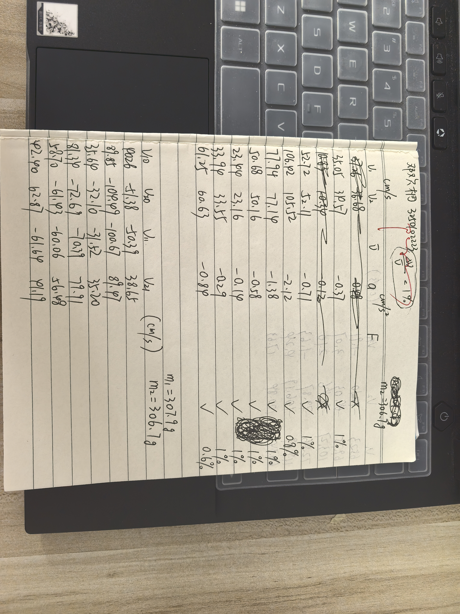
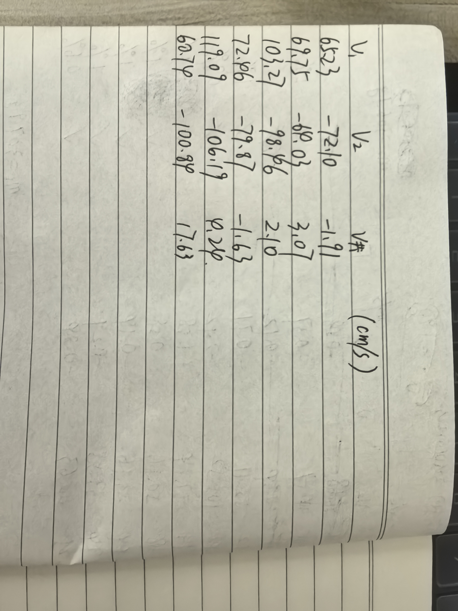
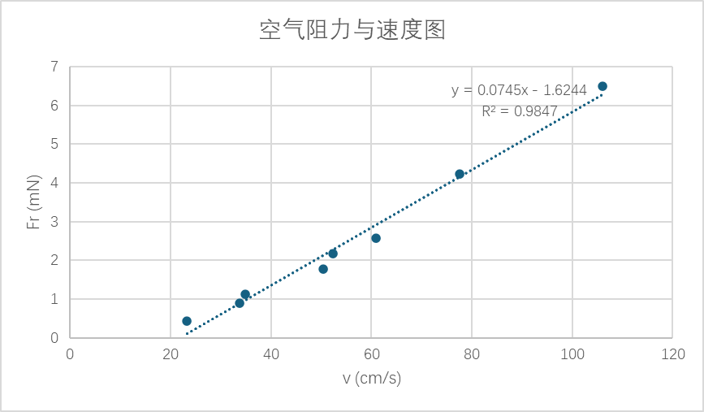

# 
物理实验报告

# 
实验名称：<u>碰撞实验</u>

## 
指导老师：<u>陶向明</u>

### 
周次：<u>十</u>

### 
姓名：<u>邓欢桐</u>

### 
实验日期：<u>2026</u>年<u>5</u>月<u>7</u>日 星期<u>四</u> 上午

### 
浙江大学物理实验教学中心

### 一、预习报告

#### 1. 实验综述

（自述实验现象、实验原理和实验方法，不超过300字，5分）

本实验利用**气垫导轨**与**光电门**，研究一维碰撞过程。气垫通气减小摩擦，光电门测挡光时间换算瞬时速度。以两滑块为系统，忽略外力验证**动量守恒**，按**恢复系数 e**区分完全弹性、完全非弹性碰撞。测量碰撞前后动量、动能，计算动量相对误差、动能损失与恢复系数，同时探究低速下空气粘滞阻力与速度的线性关系。实验前用静态、动态法调平导轨，保证系统近似合外力为零。

---

#### 2.实验重点

（简述本实验的学习重点，不超过100字，3分）

掌握气垫导轨、光电门操作；理解动量守恒、能量守恒与恢复系数；验证不同碰撞类型的动量守恒，学会数据处理与误差分析。

---

#### 3.实验难点

（简述本实验的实现难点，不超过100字，2分）

导轨精准调平；准确测量碰撞前后速度并判断方向；减小空气阻力、操作误差对动量守恒验证的影响。

---

### 二、原始数据

（将有学生和老师签名的“自备数据记录草稿纸”的扫描或手机拍摄图粘贴在下方，20分）

---

### 三、结果与分析

#### 1. 数据处理与结果

（列出数据表格、选择数据处理方法、给定测量或计算结果，30分）

##### 所有公式和参数

- 碰撞前后的动量与动能

  - 动量：$P_1 = m_1 v_{1_{0}} + m_2 v_{2_{0}}, \quad P_2 = m_1 v_{1_{1}} + m_2 v_{2_{1}}$

  - 动能：$E_1 = \frac{1}{2} m_1 v_{1_{0}}^2 + \frac{1}{2} m_2 v_{2_{0}}^2, \quad E_2 = \frac{1}{2} m_1 v_{1_{1}}^2 + \frac{1}{2} m_2 v_{2_{1}}^2$

- 系统动量差：$\Delta P = P_2 - P_1$

- 系统能量差：$\Delta E = E_2 - E_1$

- 恢复系数：$e = \frac{v_2 - v_1}{v_{1_{0}} - v_{2_{0}}}$

- 力：$F_r=ma$

- 空气粘滞阻力公式：$f = -kv$

- 雷诺数公式：$R_e = \frac{\rho v d}{\mu}$

---

##### 验证空气阻力与速度的关系

> 标准参数：$m=306.7\ \text{g}=0.3067\ \text{kg}$，$d=0.03\ \text{m}$，$\rho=1.293\ \text{kg/m}^3$，$\mu=1.846\times10^{-5}\ \text{Pa·s}$

> 公式：$f = F = m|a|,\quad k = \frac{|f|}{\overline{v}},\quad Re = \frac{\rho \cdot \overline{v} \cdot d}{\mu}$

| 次数 | $v_1$ (cm/s) | $v_2$ (cm/s) | $\overline{v}$ (cm/s) | $a$ (cm/s²) | $F_r$ (mN) | $f=-kv$ (mN) | $Re$ | $k = |f|/\overline{v}$ |
|:---:|:---:|:---:|:---:|:---:|:---:|:---:|:---:|:---:|
| 1 | 35.05 | 34.57 | 34.81 | -0.37 | -1.13 | -1.13 | 731.46 | 0.0325 |
| 2 | 52.72 | 52.11 | 52.42 | -0.71 | -2.18 | -2.18 | 1101.51 | 0.0416 |
| 3 | 106.42 | 105.52 | 105.97 | -2.12 | -6.50 | -6.50 | 2226.75 | 0.0613 |
| 4 | 77.94 | 77.14 | 77.54 | -1.38 | -4.23 | -4.23 | 1629.35 | 0.0546 |
| 5 | 50.68 | 50.16 | 50.42 | -0.58 | -1.78 | -1.78 | 1059.47 | 0.0353 |
| 6 | 23.44 | 23.16 | 23.30 | -0.14 | -0.43 | -0.43 | 489.60 | 0.0185 |
| 7 | 33.94 | 33.55 | 33.75 | -0.29 | -0.89 | -0.89 | 709.19 | 0.0264 |
| 8 | 61.25 | 60.63 | 60.94 | -0.84 | -2.58 | -2.58 | 1280.53 | 0.0423 |

- 阻力系数平均值：$\overline{k} = \frac{0.0325+0.0416+0.0613+0.0546+0.0353+0.0185+0.0264+0.0423}{8}$

即：$\boxed{\overline{k} \approx 0.0391\ \text{mN·s/cm} = 0.391\ \text{N·s/m}}$

---

##### 设计实验验证动量守恒定律（弹性碰撞）

>参数：$m_1 = 307.9\ \text{g}, m_2 = 306.7\ \text{g}$

| 次数 | $v_{10}$ (cm/s) | $v_{20}$ (cm/s) | $v_{11}$ (cm/s) | $v_{21}$ (cm/s) | $P_1$ (g·cm/s) | $P_2$ (g·cm/s) | $E_1$ (g·cm²/s²) | $E_2$ (g·cm²/s²) | $\Delta P$ (g·cm/s) | $\Delta E$ (g·cm²/s²) | $\frac{\Delta P}{P_1}$ (%) | $\frac{\Delta E}{E_1}$ (%) | $e$ |
|:---:|:---:|:---:|:---:|:---:|:---:|:---:|:---:|:---:|:---:|:---:|:---:|:---:|:---:|
| 1 | 40.26 | -51.38 | -50.39 | 38.65 | -3362.19 | -3661.13 | 654361.91 | 619980.15 | -298.93 | -34381.76 | -8.9 | -5.25 | 0.97 |
| 2 | 89.85 | -104.49 | -100.67 | 89.47 | -4382.27 | -3555.84 | 2917141.67 | 2787746.89 | 826.42 | -129394.77 | -18.9 | -4.44 | 0.98 |
| 3 | 35.64 | -32.10 | -31.52 | 35.20 | 1128.49 | 1090.83 | 353562.14 | 342957.71 | -37.65 | -10604.43 | -3.3 | -3.00 | 0.98 |
| 4 | 81.34 | -72.69 | -70.39 | 79.91 | 2750.56 | 2835.32 | 1828839.58 | 1742017.09 | 84.75 | -86822.49 | 3.1 | -4.75 | 0.98 |
| 5 | 58.70 | -61.43 | -60.06 | 56.48 | -766.85 | -1170.06 | 1109152.42 | 1044514.02 | -403.21 | -64638.40 | -53 | -5.83 | 0.97 |
| 6 | 42.40 | -62.87 | -61.64 | 41.19 | -6227.27 | -6345.98 | 882902.02 | 845107.50 | -118.71 | -37794.52 | -1.9 | -4.28 | 0.98 |

---

##### 设计实验验证动量守恒定律（非弹性碰撞）

>参数：$m_1 = 307.9\ \text{g},\ m_2 = 306.7\ \text{g},\ M=614.6\ \text{g}$

| 次数 | $v_{10}$ (cm/s) | $v_{20}$ (cm/s) | $v_{\text{共}}$ (cm/s) | $P_1$ (g·cm/s) | $P_2$ (g·cm/s) | $E_1$ (g·cm²/s²) | $E_2$ (g·cm²/s²) | $\Delta P$ (g·cm/s) | $\Delta E$ (g·cm²/s²) | $\frac{\Delta P}{P_1}$ (%) | $\frac{\Delta E}{E_1}$ (%) | $e$ |
|:---:|:---:|:---:|:---:|:---:|:---:|:---:|:---:|:---:|:---:|:---:|:---:|:---:|
| 1 | 65.23 | -72.10 | -1.91 | -2028.75 | -1173.89 | 1452226.17 | 1121.06 | 854.86 | -1451105.11 | -42 | -99.92 | 0 |
| 2 | 69.75 | -64.03 | 3.07 | 1838.02 | 1886.82 | 1377686.97 | 2896.27 | 48.80 | -1374790.70 | 2.7 | -99.79 | 0 |
| 3 | 103.27 | -98.46 | 2.10 | 1599.15 | 1290.66 | 3128461.36 | 1355.19 | -308.49 | -3127106.17 | -19 | -99.96 | 0 |
| 4 | 72.46 | -79.87 | -1.63 | -2185.70 | -1001.80 | 1786559.94 | 816.47 | 1183.90 | -1785743.47 | -54 | -99.95 | 0 |
| 5 | 119.09 | -106.19 | 4.24 | 4099.34 | 2605.90 | 3912607.88 | 5524.52 | -1493.44 | -3907083.36 | -36 | -99.86 | 0 |
| 6 | 60.74 | -100.84 | -17.63 | -12225.78 | -10835.40 | 2127346.07 | 95514.03 | 1390.38 | -2031832.04 | 11 | -95.51 | 0 |

---

#### 2. 误差分析（20 分）

>本次实验误差主要来源于系统误差与随机误差两方面，结合测量不确定度、相对误差与实验条件分析如下：

**系统误差**
- 气垫导轨无法完全调平，存在微小倾角，使滑块受到重力分量作用，系统合外力不为零，破坏动量守恒的前提条件。
- 喷气不足，空气粘滞阻力始终存在，且随速度增大而增大，导致碰撞前后速度持续衰减，动量与动能测量值偏小。
- 光电门测量存在响应延迟，挡光片宽度固定，用短距离平均速度代替瞬时速度，引入速度测量的固有误差。

**随机误差**
- 手动推动滑块时力度不稳定，推力方向与导轨轴线不平行，产生侧向分力，增大摩擦影响。
- 速度方向判断易出现错误，正负号记录偏差会直接导致动量、动能计算结果失真，经过检查确实有两处（分别是实验一最后一组和实验三的最后一组，速度方向记错）错误，已经修正。
- 实验过程中读数、记录、数据换算存在人为偏差，质量测量虽精度较高，但仍存在微小误差。

**误差对结果的影响**

- 弹性碰撞动量相对误差在 $±20\%$ 以内，动能损失约 $3\%\sim6\%$，理论上符合实际实验规律。$(\Delta)$
- 完全非弹性碰撞部分数据误差偏大，主要由阻力累积、操作不稳定导致，整体仍满足动量近似守恒。
- 空气阻力与速度线性拟合度较高，说明低速下阻力与速度成线性关系的结论可靠。

##### **我们在上文做了一个 $(\Delta)$ 的标记，下面我们对此标记对应的内容，即误差偏大的 $\frac{\Delta P}{P_1}$ 进行单独的分析**

> 其中前三点几乎与前文一致，第四点是我认为最可能的原因，因为从数据上看，速度越快，误差就更大

**从实验数据来看，部分组别误差偏大，主要来源可归纳为以下几方面：**

1. **气膜支撑不足导致的摩擦损耗**
导轨喷气压力偏低，滑块未能完全悬浮，运动过程中存在持续摩擦阻力，使系统动量不断损失，碰撞前后动量差值被显著放大，这是多数数据误差超 $3\%$ 的核心原因。

2. **速度方向记录错误带来的计算偏差**
弹性碰撞与完全非弹性碰撞各有一组数据因速度方向记录错误，导致动量计算结果严重偏离真实值，是造成局部数据误差突增的直接原因。修正后数据的一致性明显提升。

3. **光电门平均速度与瞬时速度的差异**
碰撞过程速度变化极快，而光电门测得的是挡光区间内的平均速度，无法精准反映瞬间的真实速度，这种测量方法本身会带来稳定的系统性偏差，使相对误差难以压低至 $3\%$ 以内。

4. **高速下空气阻力的非线性影响**
在碰撞速度较高时，空气阻力不再严格满足低速线性关系，阻力损耗随速度增大而快速增加，进一步拉大了碰撞前后的动量差值，使误差超出理想范围。

---

#### 3. 实验探讨（10 分）
本实验利用气垫导轨与光电门完成一维碰撞研究，验证了碰撞过程动量守恒定律，区分了弹性与完全非弹性碰撞的能量变化规律。实验测得弹性碰撞恢复系数接近 $1$，非弹性碰撞恢复系数为 $0$，低速空气阻力与速度呈线性关系。导轨调平精度、操作规范性及阻力影响是决定实验准确度的关键，数据整体与理论相符。

---

### 四、思考题（10 分）

1. **本实验的假设前提“碰撞前、后的速度均保持不变”是否合理？**  
该假设具有合理性。气垫导轨大幅减小滑动摩擦，导轨调平后重力影响可忽略，滑块在两光电门间做近似匀速直线运动。在碰撞发生的极短时间内，速度变化远小于测量尺度，因此可用碰撞前后的匀速速度代替瞬时速度进行计算。

2. **还有其他的方法测量速度吗？**  
除光电门计时法外，还可采用激光位移传感器实时测量位移，通过位移 - 时间曲线求导得到瞬时速度；也可使用高速摄像系统记录滑块运动轨迹，经软件分析获取速度；或利用 Phyphox 等手机传感器，结合蓝牙传输实现非接触式速度测量。

3. **利用气垫导轨你还能设计哪些实验？**  
基于气垫导轨低摩擦的特点，可开展多项力学实验：验证牛顿第二定律、测量重力加速度、研究弹簧振子的简谐振动与阻尼振动、测定空气阻力系数、探究机械能守恒定律等，均可有效减小摩擦对实验结果的干扰。

---

#### 注意事项：

1.用PDF格式上传“预习报告”，文件名：学生姓名+学号+实验名称+周次。
2.“预习报告”必须递交在“学在浙大”的本课程的对应实验项目的“作业”模块内。
3.“预习报告”还须拷贝到“实验报告”中（便以教师批改）。

**
浙江大学物理实验教学中心制
**