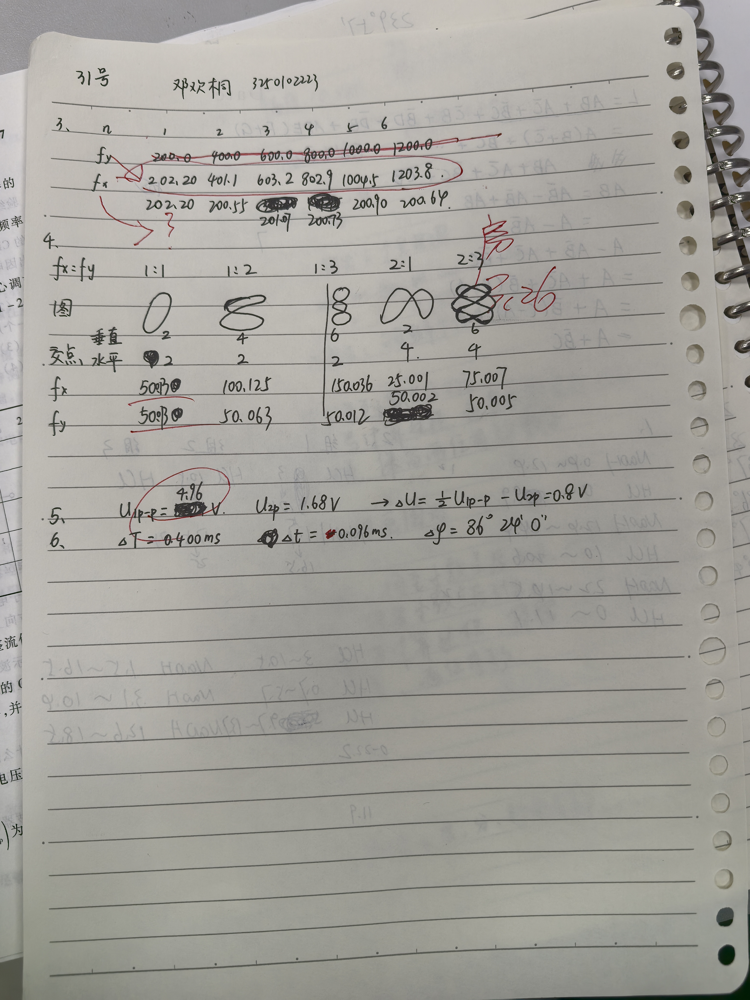
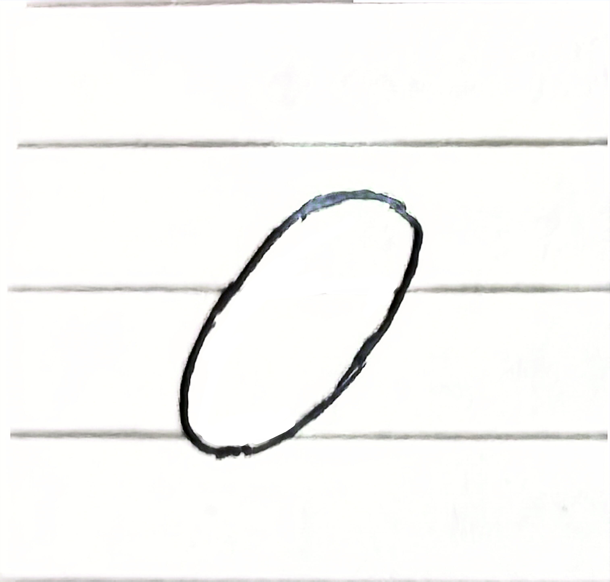
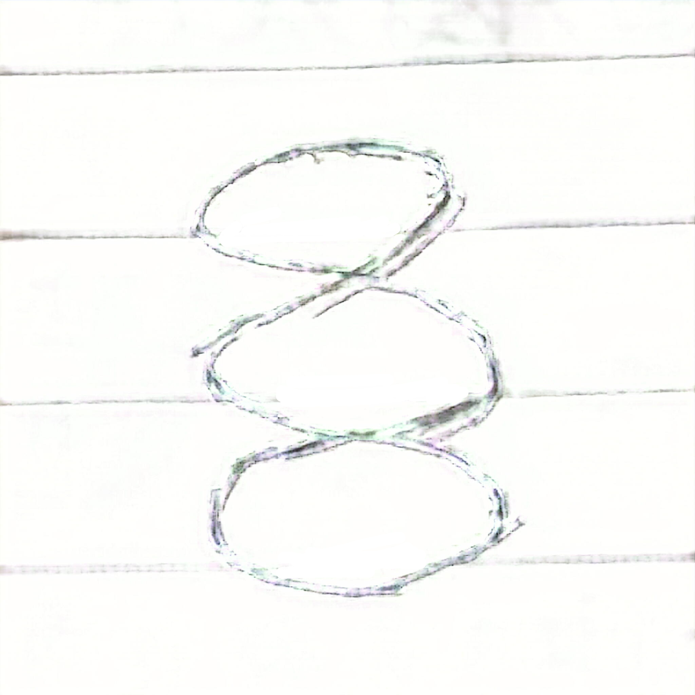
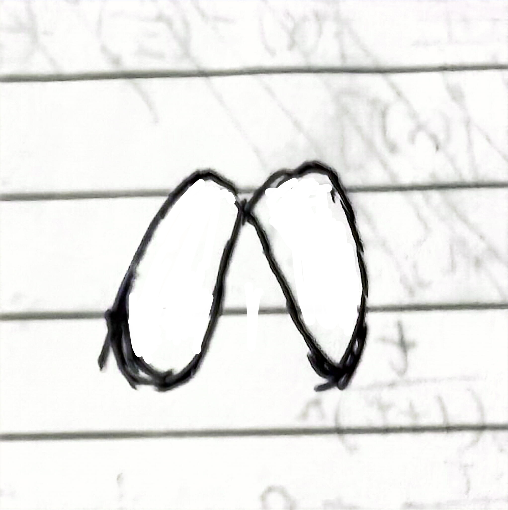
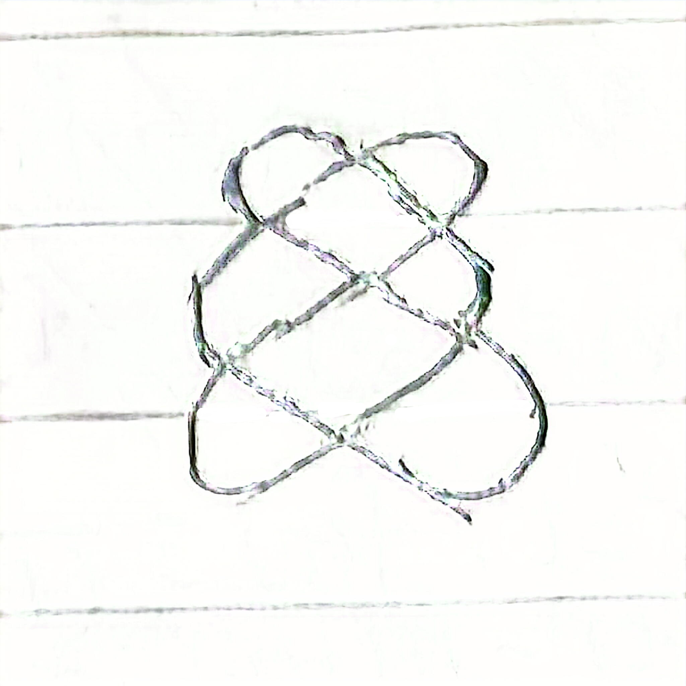

# 
物理实验报告

## 
实验名称：<u>示波器的应用</u>

## 
指导老师：<u>房若宇</u>

### 
周次：<u>四</u>

### 
姓名：<u>邓欢桐</u>

### 
实验日期：<u>2026</u>年<u>3</u>月<u>26</u>日 星期<u>四</u>上午

### 
浙江大学物理实验教学中心

---
### 一、预习报告
#### 1. 实验综述
（自述实验现象、实验原理和实验方法，不超过300字，5分）
本次实验主要学习示波器的基本使用方法，通过观察不同的交变电压信号，了解示波器的显示原理。实验中需要调节相关旋钮，使波形清晰、稳定地显示在屏幕上，并学会测量信号的幅值、周期和频率。同时利用李萨如图形的方法，对未知频率进行测量，加深对振动合成与电信号变化规律的认识，掌握基础电子仪器的实际操作技能。

---
#### 2.实验重点
（简述本实验的学习重点，不超过100字，3分）
熟悉示波器面板各个旋钮的功能与作用，学会正确调节显示波形；能够准确测量电信号的幅值、周期和频率；掌握利用李萨如图测量未知信号频率的方法。

---
#### 3.实验难点
（简述本实验的实现难点，不超过100字，2分）
触发调节难以快速掌握，容易出现波形左右移动的情况；档位选择不合适会导致波形显示不完整或过大；李萨如图形调节稳定较难，容易出现图形转动，影响读数与判断。

---
### 二、原始数据

（将有学生和老师签名的“自备数据记录草稿纸”的扫描或手机拍摄图粘贴在下方，20分）

---

### 三、结果与分析

#### 1. 数据处理与结果

（列出数据表格、选择数据处理方法、给定测量或计算结果，30分）

##### 实验三：比较法验证 $f_y=nf_x$
- 实验数据表格
|$n$|$1$|$2$|$3$|$4$|$5$|$6$|
|:---:|:---:|:---:|:---:|:---:|:---:|:---:|
|$f_y/Hz$|$202.2$|$401.1$|$603.2$|$802.9$|$1004.5$|$1203.8$|
|$f_x/Hz$|$202.20$|$200.55$|$201.07$|$200.73$|$200.90$|$200.64$|

- 求 $f_x$ 的平均值
   - $ \overline f_x= \frac{202.20+200.55+201.07+200.73+200.90+200.64}{6} = \frac{1206.09 Hz}{6} = 201.015 Hz$

- 求 $f_x$ 的相对误差
   - 根据实验标准值设定，取 $f_x$ 的真值为 $200 Hz$。
   - 计算公式：$相对误差=\frac{|测量值-真值|}{真值} × 100$%
   - 计算过程：$相对误差=\frac{|201.015-200|}{200} × 100$%$ =0.51$%

---
##### 实验四：用李萨如图形测量正弦波信号频率
- 实验数据表格（图形后期处理过，原图太丑，但图形和原图一致）
|频率比|$1:1$|$1:2$|$1:3$|$2:1$|$2:3$|
|:---:|:---:|:---:|:---:|:---:|:---:|
|图形||||||
|垂直交点数（Y）|$2$|$4$|$6$|$2$|$6$|
|水平交点数（X）|$2$|$2$|$2$|$4$|$4$|
|$f_x/Hz$|$50.013$|$100.125$|$150.036$|$25.001$|$75.007$|
|$f_y/Hz$|$50.013$|$50.063$|$50.012$|$50.002$|$50.005$|

- 求 $f_y$ 平均值
   - 计算过程：$\overline f_y=\frac {50.013+50.063+50.012+50.002+50.005}{5}=\frac {250.095}{5}=50.019 Hz$

- 求 $f_y$ 相对误差
   - 取真值为 $50Hz$。
   - 计算公式：$相对误差=\frac{|测量值-真值|}{真值} × 100$%
   - 计算过程：$相对误差=\frac{|50.019-50|}{50} × 100$%$=\frac {0.019}{50} ×100$%$=0.00038× 100$%$=0.038$%

---
##### 实验五：测量二极管正向导通电压
- $U_{1_{p-p}}=4.96V$
- $U_{2_p}=1.68V$
- $\frac {U_{1_{p-p}}}{2} - U_{2_p}=0.80V$

---
##### 实验六：光标法测相位差：
- $\Delta T=0.400ms$
- $\Delta t=0.096ms$
- $\Delta \varphi=\frac{\Delta t}{\Delta T}×360^\circ =86^\circ24'0''$

---

#### 2. 误差分析

（运用测量误差、相对误差、不确定度等分析实验结果，20分）

- 实验三
   - 本次实验误差为 $0.51$%，在允许的范围内。误差来源如下：
     - 信号源输出频率存在微小波动，可能并非恒定。
     - 示波器扫描精度有限。
     - 读取波形时存在人眼的定位偏差。

- 实验四
   - $f_y$ 的平均值为 $50.019Hz$，相对误差为 $0.038$%，在合理范围内。误差来源如下：
     - 调节李萨如图形时无法等待其完全静止，导致调节频率出现偏差。
     - 图形在未静止的情况下发生轻微转动，导致交点判断困难。
     - 信号源缺乏绝对足够的稳定性，导致图像漂移，影响频率比测量与确认。 

- 实验五
   - 测得的二极管正向导通电压为 $0.8V$，符合理论。误差来源如下：
     - 光标法读取时，存在人眼的定位误差。

- 实验六
   - 相位差测定为 $86^\circ24'0''$，数值合理。误差来源如下：
     - 光标法读取时，存在人眼定位误差。
     - 波形可能出现抖动，导致光标对齐步骤出现偏差。
     - 示波器水平扫描的线性度并非绝对理想，扫描速度的细微差异可能影响时间间隔测量的准确性。

---

#### 3. 实验探讨

（对实验内容、现象和过程的小结，不超过100字，10分）

通过实验，我掌握了示波器的触发调节与波形稳定方法，光标法可提高测量精度。李萨如图形测量频率直观快捷，但想要图形稳定需耐心调节。实验过程顺利，数据可靠，加深了对示波器原理的理解。

---

### 四、思考题

（解答教材或讲义或老师指定的思考题，10分）

- 示波器为什么能显示被测信号的波形？
   - 示波器的核心为电子示波管，其工作原理依赖于电子束的偏转与扫描：
   - 垂直偏转：被测信号经放大后加在示波管的垂直偏转板上，使电子束随信号电压的大小、方向上下偏转，从而反映信号的幅值变化。
   - 水平扫描：内部产生的锯齿波电压加在水平偏转板上，使电子束从左到右匀速扫描，形成时间轴。
   - 同步触发：通过触发电路使扫描周期与被测信号周期同步，保证每次扫描都从信号的同一相位点开始，最终在荧光屏上稳定显示出被测信号随时间变化的完整波形。

- 在观察李萨如图形时为什么总是不断地来回翻转，翻转快慢受哪种因素所影响？
   - 翻转原因：李萨如图形由两个不同频率的正弦信号分别驱动水平和垂直偏转形成。只有当两信号频率成严格整数比时，图形才稳定；实际中信号频率存在微小偏差，导致相位差随时间缓慢变化，不能完全达到精确的整数比，图形因此来回翻转。
   - 影响因素：翻转快慢取决于两信号频率的差值（即频差）。频差越小，翻转越慢；频差越大，翻转越快。

- 切实理解示波器同步的概念，如果发生波形左移或右移时应该如何调整才能使其稳定下来？ 
   - 同步概念：同步是指使水平扫描周期与被测信号周期保持整数倍关系，确保每次扫描都从信号的同一相位点开始，从而得到稳定的波形。
   - 波形漂移原因：波形左移/右移说明扫描周期与信号周期未同步，触发点未锁定在信号的固定相位上。
   - 调整方法：
     - 调节触发源选择开关，选择与被测信号一致的通道（如CH1或CH2）。
     - 调节触发电平旋钮（LEVEL），将触发电平调整到信号的合适幅值点，使扫描电路在信号的固定相位处触发。
     -  若仍不稳定，可调节扫描速度（TIME/DIV），使扫描周期接近信号周期的整数倍，再配合触发电平微调，最终锁定波形。

---

#### 注意事项：

1.用PDF格式上传“预习报告”，文件名：学生姓名+学号+实验名称+周次。
2.“预习报告”必须递交在“学在浙大”的本课程的对应实验项目的“作业”模块内。
3.“预习报告”还须拷贝到“实验报告”中（便以教师批改）。

**
浙江大学物理实验教学中心制
**