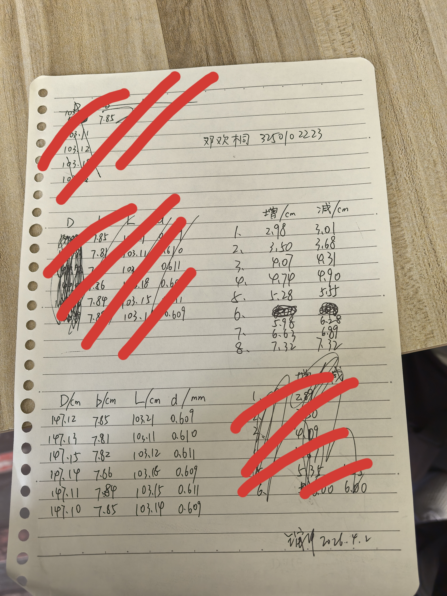
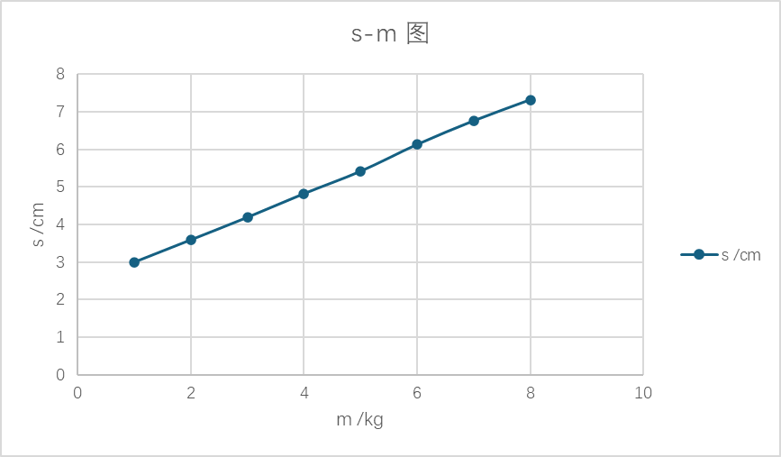

# 
物理实验报告

## 
实验名称：<u>金属材料杨氏模量的测定</u>

## 
指导老师：<u>王宙洋</u>

### 
周次：<u>五</u>

### 
姓名：<u>邓欢桐</u>

### 
实验日期：<u>2026</u>年<u>4</u>月<u>2</u>日 星期<u>四</u> 上午

### 
浙江大学物理实验教学中心

### 一、预习报告

#### 1. 实验综述

（自述实验现象、实验原理和实验方法，不超过300字，5分）

这次实验主要是用拉伸法测金属丝的杨氏模量。杨氏模量简单说即是衡量材料有多“硬”的一个物理量，值越大越不易被拉长。实验里通过给金属丝挂不同重量的砝码，测量它在拉力下的伸长量。由于伸长量很小，正常的尺子无法测量，因此需要用光杠杆把微小变化放大，再通过望远镜看标尺上的读数变化，反推出伸长量。除了测伸长量，还要测金属丝的长度、直径，还有光杠杆的臂长和镜面到标尺的距离。数据处理将使用用逐差法，可以减小偶然误差，最后再计算不确定度。实验后半部分还介绍了一种用单缝衍射测杨氏模量的方法，可和拉伸法对比。

---

#### 2.实验重点

（简述本实验的学习重点，不超过100字，3分）

- 学会光杠杆和望远镜的调节，能看懂标尺读数；
- 掌握用螺旋测微计、游标卡尺这些量具；
- 理解逐差法的思路，会计算杨氏模量和不确定度。

---

#### 3.实验难点

（简述本实验的实现难点，不超过100字，2分）

- 光杠杆和望远镜对焦比较麻烦；
- 挂砝码时金属丝会有蠕变，读数易跳难记；
- 逐差法和不确定度传递的公式复杂，须仔细计算；
- 拓展实验用激光衍射，调光路并不容易。

---

### 二、原始数据

（将有学生和老师签名的“自备数据记录草稿纸”的扫描或手机拍摄图粘贴在下方，20分）

---

### 三、结果与分析

#### 1. 数据处理与结果

（列出数据表格、选择数据处理方法、给定测量或计算结果，30分）

>原始数据记录 $1$

||$D/cm$|$b/cm$|$L/cm$|$d/mm$|
|:---:|:---:|:---:|:---:|:---:|
|$1$|$147.12$|$7.85$|$103.21$|$0.609$|
|$2$|$147.13$|$7.81$|$103.11$|$0.610$|
|$3$|$147.15$|$7.82$|$103.12$|$0.611$|
|$4$|$147.14$|$7.86$|$103.18$|$0.609$|
|$5$|$147.11$|$7.84$|$103.15$|$0.611$|
|$6$|$147.10$|$7.85$|$103.14$|$0.609$|
|平均值|$147.125$|$7.838$|$103.152$|$0.6098$|

>原始数据记录 $2$

|实验次数|作用力 $F=mg$|标尺读数（增砝码）/ cm|表尺读数（减砝码）/ cm|平均值 / cm|
|:---:|:---:|:---:|:---:|:---:|
|$1$|$1$ kg|$2.98$|$3.01$|$2.995$|
|$2$|$2$ kg|$3.50$|$3.68$|$3.590$|
|$3$|$3$ kg|$4.07$|$4.31$|$4.190$|
|$4$|$4$ kg|$4.74$|$4.90$|$4.820$|
|$5$|$5$ kg|$5.28$|$5.55$|$5.415$|
|$6$|$6$ kg|$5.98$|$6.28$|$6.130$|
|$7$|$7$ kg|$6.63$|$6.89$|$6.760$|
|$8$|$8$ kg|$7.32$|$7.32$|$7.320$|

---

##### 逐差法

>逐差法求单位质量对应的标尺读数变化：将数据分为两组（前 $4$ 个与后 $4$ 个），对应质量差 $\Delta m = 4\ \text{kg}$

| 序号 | 读数差 (cm)   |
|:---:| :---:|
| $5 - 1  $| $5.415 - 2.995 = 2.420$            |
| $6 - 2  $| $6.130 - 3.590 = 2.540$            |
| $7 - 3 $ | $6.760 - 4.190 = 2.570$            |
| $8 - 4$  | $7.320 - 4.820 = 2.500$            |

- 平均差值：  

$$
\overline{\Delta s} = \frac{2.420 + 2.540 + 2.570 + 2.500}{4} = 2.5075\ \text{cm}
$$

- 每 kg 引起的标尺读数变化为：  

$$
\Delta s = \frac{\overline{\Delta s}}{\Delta m} = \frac{2.5075}{4} = 0.626875\ \text{cm/kg} = 0.00626875\ \text{m/kg}
$$

- 杨氏模量计算公式：

$$
E = \frac{8mgLD}{\pi d^2 b \cdot \Delta s}
$$

- 采用逐差法斜率，取 $\Delta m = 1\ \text{kg}$ 对应的 $\Delta s = 0.00626875\ \text{m}$，对应拉力 $\Delta F = \Delta m  g = 1 \times 9.8 = 9.8\ \text{N}$：

$$
\frac{\Delta F}{\Delta s} = \frac{9.8}{0.00626875} = 1563.3\ \text{N/m}
$$

- 系数：  

$$
\frac{8LD}{\pi d^2 b} = \frac{8 \times 1.0315 \times 1.4713}{\pi \times 3.719 \times 10^{-7} \times 0.07838} = 1.325 \times 10^8\ \text{m}^{-1}
$$

- 求出的杨氏模量：  

$$
E = 1.325 \times 10^8 \times 1563.3 = 2.072 \times 10^{11}\ \text{Pa}
$$

---

##### 作图法

>拟合成为一次函数

- 拟合结果：$s=0.611m+2.386$

- $K=0.611$，代入系数求 $E$

$$
E = 1.325 \times 10^8 \div 0.611 \div 10^{-2} \times 9.8 = 2.125 \times 10^{11}\ \text{Pa}
$$

---

##### 两种方法综上：
   - 逐差法：$E=2.072 \times 10^{11}$
   - 作图法：$E=2.125 \times 10^{11}$

---

#### 2. 误差分析

（运用测量误差、相对误差、不确定度等分析实验结果，20分）

##### 不确定度

- 不确定度：

   - $$ u_A = \sqrt{\frac{\sum (x_i - \bar{x})^2}{n \times (n-1)}} $$ 
   - $$ u_B = \frac{\Delta_{\text{仪}}}{\sqrt{3}} $$ 
   - $$ u = \sqrt{u_A^2 + u_B^2} $$ 

- 不确定度传递公式：
   -  $$ \frac{\Delta E}{\bar{E}} = \sqrt{\left(\frac{\Delta m}{\bar{m}}\right)^2 + \left(\frac{\Delta L}{\bar{L}}\right)^2 + \left(\frac{\Delta D}{\bar{D}}\right)^2 + \left(\frac{2\Delta d}{\bar{d}}\right)^2 + \left(\frac{\Delta b}{\bar{b}}\right)^2 + \left(\frac{\Delta(\Delta s)}{\overline{\Delta s}}\right)^2} $$ 

- A类不确定度：
   - **金属丝原长 \(L\)**  
  $u_A(L) = 0.0154\ \text{cm} = 1.54\times10^{-4}\ \text{m}$

   - **镜面到标尺距离 \(D\)**  
  $u_A(D) = 0.00764\ \text{cm} = 7.64\times10^{-5}\ \text{m}$

   - **光杠杆短臂长 \(b\)**  
  $u_A(b) = 0.00793\ \text{cm} = 7.93\times10^{-5}\ \text{m}$

   - **金属丝直径 \(d\)**  
  $u_A(d) = 4.02\times10^{-4}\ \text{mm} = 4.02\times10^{-7}\ \text{m}$

   - **标尺读数变化 $(\Delta s)$**  
  $u_A(\Delta s) = 3.25\times10^{-4}\ \text{m}$

   - **质量 \(m\)**（逐差法质量差）  
  无重复测量数据，$u_A(m) = 0$

- B类不确定度：

   - $\Delta_{\text{仪}} m = \pm 500\ \text{mg}$

   - $\Delta_{\text{仪}} D = \pm 0.5\ \text{mm}$

   - $\Delta_{\text{仪}} L = \pm 0.5\ \text{mm}$

   - $\Delta_{\text{仪}} b = \pm 0.2\ \text{mm}$

   - $\Delta_{\text{仪}} d = \pm 0.004\ \text{mm}$

   - $\Delta_{\text{仪}} s = \pm 0.2\ \text{mm}$

   - $u_B = \frac{\Delta_{\text{仪}}}{\sqrt{3}}$

- 计算 B 类不确定度及合成结果：

| 物理量     | 测量值                         | $u_A$                         | $u_B = \Delta_{\text{仪}}/\sqrt{3}$ | 合成 $u = \sqrt{u_A^2+u_B^2}$ |
|:---:|:---: | :---: | :---: | :---: |
| $m$        | $4.000\,\text{kg}$             | $0$                           | $0.000289\,\text{kg}$               | $0.000289\,\text{kg}$         |
| $L$        | $1.0315\,\text{m}$             | $1.54\times10^{-4}\,\text{m}$ | $0.000289\,\text{m}$                | $3.27\times10^{-4}\,\text{m}$ |
| $D$        | $1.4713\,\text{m}$             | $7.64\times10^{-5}\,\text{m}$ | $0.000289\,\text{m}$                | $2.99\times10^{-4}\,\text{m}$ |
| $b$        | $0.07838\,\text{m}$            | $7.93\times10^{-5}\,\text{m}$ | $0.0001155\,\text{m}$               | $1.40\times10^{-4}\,\text{m}$ |
| $d$        | $6.098\times10^{-4}\,\text{m}$ | $4.02\times10^{-7}\,\text{m}$ | $2.31\times10^{-6}\,\text{m}$       | $2.34\times10^{-6}\,\text{m}$ |
| $\Delta s$ | $0.025075\,\text{m}$           | $3.25\times10^{-4}\,\text{m}$ | $0.0001155\,\text{m}$               | $3.45\times10^{-4}\,\text{m}$ |

- 最终结果：

$$
\displaystyle \frac{\Delta E}{\bar{E}} = 1.58\%
$$

---

##### 分析误差

>钢的杨氏模量为:$192−216(10^9𝑃a)$，本次实验两种方法测量均落入这一范围，实验过程和数据结果真实可信。

- 随机误差

   - 标尺读数变化 $Δs$ 的随机误差

     - 使用望远镜读取标尺刻度时，读数存在偏差，另外读数时也可能存在波动。
     - 蠕变引起的读数不稳定：金属丝在加载后并非立即达到稳定伸长，而是随时间缓慢继续伸长（蠕变）。在增砝码和减砝码过程中，若读数时机不一致，会引入随机波动。实验虽取增、减砝码读数的平均值，但每次加载后蠕变速率并不完全相同，导致平均值仍带有随机性。
     - 金属丝可能不是完全弹性形变，导致增减砝码时存在偏差。
     - 环境振动：实验台、地面或空气流动引起的微小振动会使望远镜中标尺像抖动，造成判读困难，引入随机误差。

   - 金属丝直径 $d$ 的随机误差

     - 金属丝沿长度方向和圆周方向的直径并非完全均匀。在不同位置、不同方向用螺旋测微计测量时，读数存在差异，虽然取平均值但仍有误差。

   - 长度量（$L$、$D$、$b$）的随机误差

     - 使用米尺和游标卡尺测量时，对位不准、读数估读等也会引入微小随机误差。但由于这些量相对较大，相对贡献很小。

   ---

- 系统误差

   - 光杠杆放大原理的系统误差

     - 理论近似误差：光杠杆的放大公式 $Δs = (2D/b)·ΔL$ 基于小角度近似$（tanθ ≈ θ）$。当伸长量较大时，反射镜转角不再满足严格线性关系，引入系统偏差。本实验中伸长量较小，此项误差可忽略，但理论上存在。
     - 若光杠杆的后足与夹持器之间发生微小滑移（非纯滚动），实际臂长 $b$ 会变化，导致计算出的 $ΔL$ 偏大或偏小。这种滑移往往是单向的，属于系统误差。

   - 金属丝直径 $d$ 的系统误差

     - 螺旋测微计零点误差：使用前若未校准零点，测量值会恒定偏大或偏小。
     - 若金属丝截面呈椭圆或不规则形状，用螺旋测微计测得的直径可能不是等效圆截面的直径，导致截面积计算错误，从而影响杨氏模量。

   - 标尺读数 $Δs$ 的系统误差

     - 标尺本身若出厂刻度不精确或长期使用后变形，会产生固定偏差。
     - 若望远镜光轴未严格垂直于标尺，读数会因投影效应产生系统误差（余弦误差）。
     - 光杠杆反射镜若未严格垂直于金属丝，或镜面本身有曲率，也会引入系统偏差。

   - 其他系统误差

     - 金属丝并非完全弹性体：杨氏模量定义要求材料在线弹性范围内。若加载质量过大，金属丝可能进入非线性区，或产生塑性变形，导致测量值偏离真值，比如增减砝码读数不一致的情况可能就来源于此。
     - 温度影响：环境温度变化会引起金属丝热胀冷缩，改变原长 $L$ 和直径 $d$，而实验未加温度补偿。
     - 砝码质量误差：砝码实际质量与标称值可能存在偏差（如磨损、锈蚀），且报告中重力加速度取 $9.8 m/s²$ 为近似值，各地 $g$ 值实际有微小差异。
     
---

#### 3. 实验探讨

（对实验内容、现象和过程的小结，不超过100字，10分）

本实验通过拉伸法结合光杠杆放大法成功测得金属丝杨氏模量，逐差法与作图法结果相近，验证了数据处理方法的可靠性。光杠杆的放大作用有效解决了微小伸长量难以测量的问题，不确定度计算结果表明实验精度较高。一点反思是悬挂砝码时，不应把缺口全部置于相同朝向，否则容易导致分力产生影响。总而言之实验成功。

---

### 四、思考题

（解答教材或讲义或老师指定的思考题，10分）

- **本实验中测量了哪些物理量？分别用什么量具进行测量？有效数字分别是几位？**
   - 本实验核心测量物理量及对应量具、有效数字位数如下：
| 物理量 | 测量量具 | 有效数字位数 | 说明 |
| :---:| :---: | :---: | :---: |
| 金属丝直径 $d$ | 螺旋测微器 | 3位 | 估读至 $0.01\ \text{mm}$ |
| 金属丝原长 $L$ | 米尺 | 2位 | 估读至 $0.1\ \text{mm}$ |
| 光杠杆臂长 $b$ | 直尺 | 2位 | 估读至 $0.1\ \text{mm}$ |
| 平面镜到标尺距 $D$ | 卷尺 | 2位 | 估读至 $0.1\ \text{mm}$ |
| 标尺读数 $\Delta n$ | 望远镜+标尺 | 2位 | 估读至 $0.1\ \text{mm}$ |

---

- **光杠杆中，增大 $D$ 和减小 $b$ 都可以增加放大倍数，那么两者有何不同？是否可以无限增大光杠杆的倍数？**

>光杠杆放大倍数公式为 $A = \frac{2D}{b}$。二者虽均能提升倍数，但原理与影响截然不同：

增大标尺距离 $D$：
   - 通过扩大光学观测范围实现放大，属于无近似误差的线性放大。$D$ 增大，$\Delta n = 2D\theta$ 关系严格成立，不破坏小角度近似。但受实验室空间限制，且 $D$ 过大易受环境振动干扰，导致成像不稳。

减小光杠杆臂长 $b$：
   - 通过缩短杠杆短臂改变几何比例，属于比例放大。$b$ 越小，相同 $\Delta L$ 产生的偏转角 $\theta$ 越大。$b$ 过小会使偏转角 $\theta$ 过大，导致 $\tan\theta \neq \theta$ 的小角度近似失效，引入显著的几何计算误差。

>放大倍数不可无限增大的原因

1. $b$ 过小会破坏物理公式的近似条件，且装置难以稳定。
2. $D$ 过大不仅受空间限制，也会因环境扰动造成读数抖动，增大误差。
3. 放大倍数过高时，读数误差的绝对值虽减小，但装置的稳定性误差、光路偏差会被成倍放大，导致整体实验精度下降。

- **逐差法、作图法、最小二乘法在处理数据时有何不同？**

>三种方法均适用于线性关系数据处理，其对比分析如下：

| 处理方法 | 核心逻辑 | 适用场景 | 精度与特点 | 操作难度 |
| :---: | :---: | :---: | :---: | :---: |
| **逐差法** | 将数据分前后两组对应相减，求平均 | 自变量等间距变化（如砝码加载） | **精度中等**，能充分利用数据，计算简单 | 低 |
| **作图法** | 绘图拟合直线，通过斜率/截距求解 | 直观展示数据趋势，快速估算结果 | **精度较低**，受绘图比例、手绘手法影响大 | 中 |
| **最小二乘法** | 使残差平方和最小，求理论最优解 | 高精度数据处理、严格误差分析 | **精度最高**，是数理统计的最优估值方法 | 高 |

---

#### 注意事项：

1.用PDF格式上传“预习报告”，文件名：学生姓名+学号+实验名称+周次。
2.“预习报告”必须递交在“学在浙大”的本课程的对应实验项目的“作业”模块内。
3.“预习报告”还须拷贝到“实验报告”中（便以教师批改）。

**
浙江大学物理实验教学中心制
**

