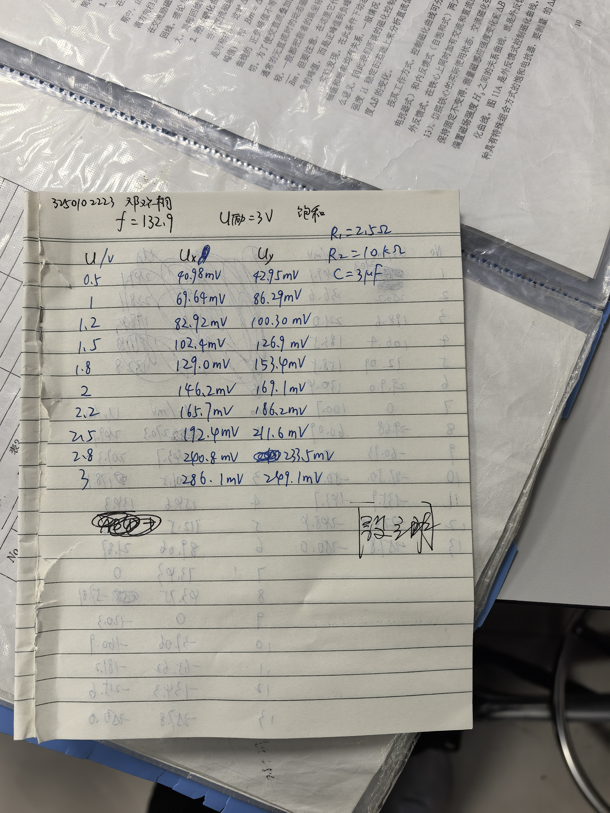
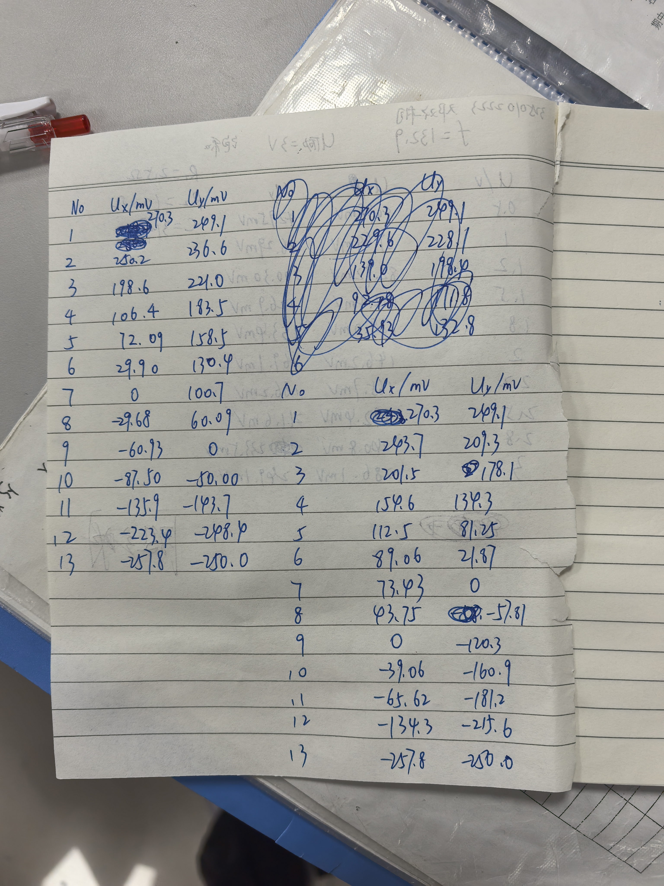
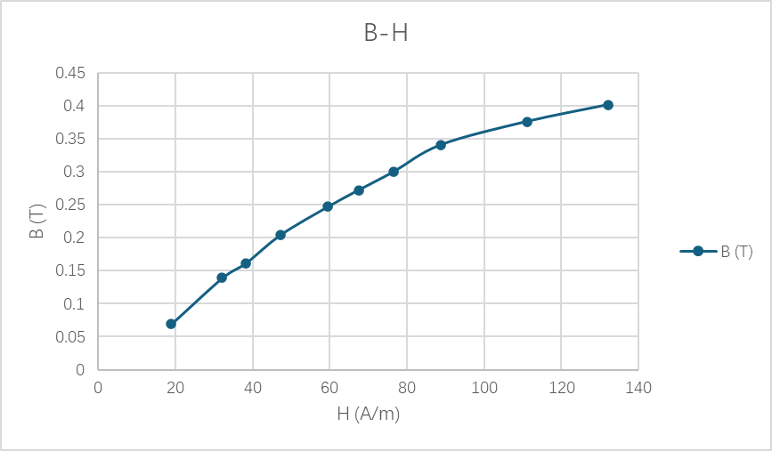
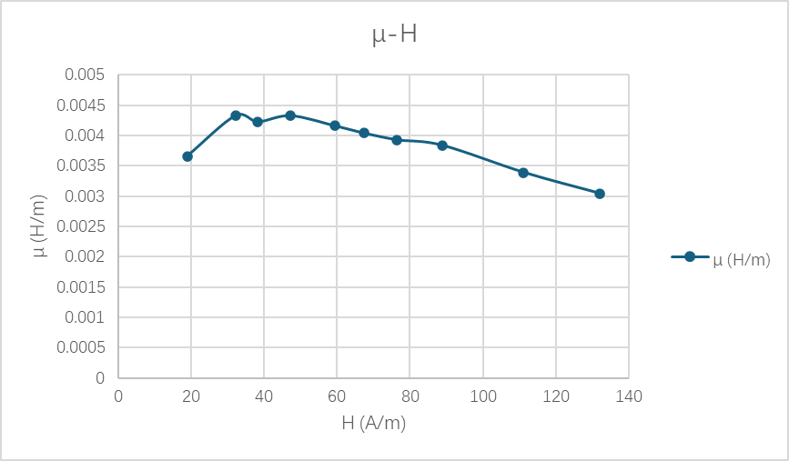
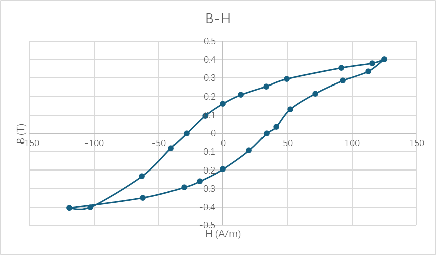

# 
物理实验报告

# 
实验名称：<u>铁磁材料的磁滞回线和基本磁化曲线</u>

## 
指导老师：<u>殷立明</u>

### 
周次：<u>九</u>

### 
姓名：<u>邓欢桐</u>

### 
实验日期：<u>2026</u>年<u>4</u>月<u>30</u>日 星期<u>四</u> 上午

### 
浙江大学物理实验教学中心

### 一、预习报告

#### 1. 实验综述

（自述实验现象、实验原理和实验方法，不超过300字，5分）

本次实验通过示波器观察铁磁材料的动态磁滞回线与基本磁化曲线，借助交变励磁电流对样品进行磁化与退磁。实验利用转换法，把磁场强度 H 和磁感应强度 B 转化为电压信号输入示波器，在 X-Y 模式下直接呈现 B-H 关系。铁磁材料内部存在磁畴，磁化时磁畴会发生转动与畴壁移动，磁感应强度变化滞后于磁场强度，形成磁滞现象。实验中需要测量饱和磁感应强度、剩磁、矫顽力等参数，并用软件处理数据、绘制曲线，理解磁滞损耗与材料特性的联系。

---

#### 2.实验重点

（简述本实验的学习重点，不超过100字，3分）

理解磁滞、磁滞回线、磁化曲线的物理意义；掌握示波器测绘磁滞回线的操作方法；学会测量 Bs、Br、Hc 等关键参数；体会实验中转换法的运用思路。

---

#### 3.实验难点

（简述本实验的实现难点，不超过100字，2分）

示波器 X-Y 模式调节，保证磁滞回线完整稳定显示；准确完成退磁操作，避免剩磁影响实验结果；正确进行电压与磁场、磁感应强度的单位换算，规范处理实验数据。

---

### 二、原始数据

（将有学生和老师签名的“自备数据记录草稿纸”的扫描或手机拍摄图粘贴在下方，20分）

---

### 三、结果与分析

#### 1. 数据处理与结果

（列出数据表格、选择数据处理方法、给定测量或计算结果，30分）

$N_1=N_2=N_3=150T$

$L=0.130m$

$S=1.24×10^{-4} m^2$

$R_1=2.5Ω$

$R_2=10kΩ$

$C=3μF$

---

##### 初始磁化曲线的测量

- $H = \frac{N_1}{L R_1} U_x$
  - $\frac{N_1}{L R_1} = \frac{150}{0.130×2.5} = \frac{150}{0.325} \approx 461.538\ \text{A/(m·V)}$

- $B = \frac{R_2 C}{N_2 S} U_y$
  - $\frac{R_2 C}{N_2 S} = \frac{10^4 \times 3 \times 10^{-6}}{150 \times 1.24 \times 10^{-4}} = \frac{0.03}{0.0186} \approx 1.6129\ \text{T/V}$

- $\mu = B/H$

---

| 励磁电压 $U (V)$ | $U_x (mV)$ | $U_y (mV)$ | 磁场强度 $H (A/m)$ | 磁感应强度 $B (T)$ | 磁导率 $μ (H/m)$ |
| :--------------: | :--------: | :--------: | :----------------: | :----------------: | :--------------: |
|       0.5        |   40.98    |   42.95    |       18.91        |       0.0693       |     0.00366      |
|       1.0        |   69.64    |   86.29    |       32.14        |       0.1392       |     0.00433      |
|       1.2        |   82.92    |   100.30   |       38.27        |       0.1618       |     0.00423      |
|       1.5        |   102.40   |   126.90   |       47.26        |       0.2047       |     0.00433      |
|       1.8        |   129.00   |   153.40   |       59.54        |       0.2474       |     0.00416      |
|       2.0        |   146.20   |   169.10   |       67.48        |       0.2727       |     0.00404      |
|       2.2        |   165.70   |   186.20   |       76.48        |       0.3003       |     0.00393      |
|       2.5        |   192.40   |   211.60   |       88.80        |       0.3413       |     0.00384      |
|       2.8        |   240.80   |   233.50   |       111.14       |       0.3766       |     0.00339      |
|       3.0        |   286.10   |   249.10   |       132.05       |       0.4018       |     0.00304      |

---

##### 动态磁滞回线的测量

- $H = \frac{N_1}{L R_1} U_x$
  - $\frac{N_1}{L R_1} = \frac{150}{0.130×2.5} = \frac{150}{0.325} \approx 461.538\ \text{A/(m·V)}$

- $B = \frac{R_2 C}{N_2 S} U_y$
  - $\frac{R_2 C}{N_2 S} = \frac{10^4 \times 3 \times 10^{-6}}{150 \times 1.24 \times 10^{-4}} = \frac{0.03}{0.0186} \approx 1.6129\ \text{T/V}$

- $\mu = B/H$

---

| 序号 | $U_x (mV)$ | $U_y (mV)$ | 磁场强度 $H (A/m)$ | 磁感应强度 $B (T)$ |
| :--: | :--------: | :--------: | :----------------: | :----------------: |
|  1   |   270.3    |   249.1    |       124.76       |       0.4018       |
|  2   |   250.2    |   236.6    |       115.48       |       0.3816       |
|  3   |   198.6    |   221.0    |       91.66        |       0.3564       |
|  4   |   106.4    |   183.5    |       49.11        |       0.2960       |
|  5   |   72.09    |   158.5    |       33.27        |       0.2556       |
|  6   |   29.90    |   130.4    |       13.80        |       0.2103       |
|  7   |     0      |   100.7    |         0          |       0.1624       |
|  8   |   -29.68   |   60.09    |       -13.70       |       0.0969       |
|  9   |   -60.93   |     0      |       -28.12       |         0          |
|  10  |   -87.50   |   -50.0    |       -40.38       |      -0.0806       |
|  11  |   -135.9   |   -143.7   |       -62.72       |      -0.2318       |
|  12  |   -223.4   |   -248.4   |      -103.10       |      -0.4006       |
|  13  |   -257.8   |   -250.0   |      -118.99       |      -0.4032       |
|  14  |   -257.8   |   -250.0   |      -118.99       |      -0.4032       |
|  15  |   -134.3   |   -215.6   |       -61.98       |      -0.3477       |
|  16  |   -65.62   |   -181.2   |       -30.29       |      -0.2922       |
|  17  |   -39.06   |   -160.9   |       -18.03       |      -0.2595       |
|  18  |     0      |   -120.3   |         0          |      -0.1940       |
|  19  |   43.75    |   -57.81   |       20.19        |      -0.0932       |
|  20  |   73.43    |     0      |       33.89        |         0          |
|  21  |   89.06    |   21.87    |       41.11        |       0.0353       |
|  22  |   112.5    |   81.25    |       51.92        |       0.1310       |
|  23  |   154.6    |   134.3    |       71.35        |       0.2166       |
|  24  |   201.5    |   178.1    |       92.99        |       0.2873       |
|  25  |   243.7    |   209.3    |       112.48       |       0.3376       |
|  26  |   270.3    |   249.1    |       124.76       |       0.4018       |

- 计算或寻找得：
  - $B_s \approx 0.403\ \text{T} \\$
  - $B_r \approx 0.162\ \text{T} \\$
  - $H_c \approx 28.1\ \text{A/m}$

---

#### 2. 误差分析

（运用测量误差、相对误差、不确定度等分析实验结果，20分）

##### 实验结果作图

> 该曲线为铁磁材料的初始磁化曲线，反映了单调递增外磁场 $H$ 下磁感应强度 $B$ 的变化规律。曲线呈现典型的非线性特征：在低场强区（$H<40\ \text{A/m}$），$B$ 随 $H$ 近似线性快速增长；中场强区（$40<H<100\ \text{A/m}$）增长速率明显放缓；高场强区（$H>100\ \text{A/m}$）趋于平缓，材料进入磁饱和状态。该曲线完整展现了铁磁材料磁化的三个阶段，验证了其非线性、可饱和的核心特性，与理论规律高度吻合。

> 该曲线反映了材料磁导率 $\mu$ 随磁场强度 $H$ 的变化规律，整体呈单峰分布特征。低场强区（$H<30\ \text{A/m}$），磁导率随 $H$ 快速上升，对应磁畴壁移与可逆转动阶段；在 $30\ \text{A/m} < H < 50\ \text{A/m}$ 区间达到峰值（约 $0.0043\ \text{H/m}$），为材料的最佳导磁状态；高场强区（$H>50\ \text{A/m}$）随 $H$ 增大持续下降，源于材料逐渐进入磁饱和状态，导磁能力被削弱。该曲线直观体现了铁磁材料磁导率的非线性特性，其峰值区间对变压器、电感等设备的设计是有意义的。

---

> 该闭合曲线反映了铁磁材料在交变磁场下的磁化与退磁过程，直接体现了磁滞现象。曲线对称分布，当 $H=0$ 时存在明显剩磁 $B_r$（约 $0.16\ \text{T}$）；当 $B=0$ 时需施加反向磁场，对应矫顽力 $H_c$（约 $28\ \text{A/m}$）。回线整体形态较“瘦”，包围面积较小，表明材料磁滞损耗较低，属于典型的软磁材料，适合用于交变磁场铁芯设备。回线包围的面积对应单位体积材料在一个磁化周期内的磁滞损耗，以热量形式耗散。

- 上支（令 $y=B,x=H$）：
  - $ y = 2 \times 10^{-13}x^6 - 3 \times 10^{-12}x^5 - 6 \times 10^{-9}x^4 - 3 \times 10^{-8}x^3 + 5 \times 10^{-5}x^2 + 0.0044x - 0.1969 $

- 下支（令 $y=B,x=H$）：
  - $ y = -6 \times 10^{-14}x^6 - 3 \times 10^{-12}x^5 + 3 \times 10^{-9}x^4 - 3 \times 10^{-8}x^3 - 4 \times 10^{-5}x^2 + 0.0045x + 0.1585 $

- 被积函数
  - $\Delta y(x) = y_2(x) - y_1(x) = -2.6\times10^{-13}x^6 + 9\times10^{-9}x^4 - 9\times10^{-5}x^2 + 0.0001x + 0.3554$
  - $S = \left| \int_{-118.99}^{124.76} \Delta y(x) dx \right|$

- 得到结果：$S \approx 102.5\ \text{J/m}^3$

> 即磁滞回线包围面积（[*BH*]）约为 $102.5\ \text{J/m}^3$，代表铁磁材料在一个磁化周期内，单位体积消耗的磁滞损耗能量，其物理意义是：铁芯在交变磁场中被反复磁化时，磁畴不断翻转、克服摩擦所产生的能量损失，最终以热量的形式耗散掉。

---

##### 误差来源分析：

> 这里并不是传统意义上的误差，而是与理论作图比较后得到的误差。

1. **系统误差**

- 示波器 X-Y 模式增益调节、基线偏移带来读数误差，导致 $U_x$、$U_y$ 存在固定偏差。
- 积分电路中电阻、电容的实际值与标称值不一致，使 $B$、$H$ 换算系数存在系统偏差。
- 样品退磁不充分，残留剩磁使磁滞回线整体偏移，影响 $B_r$、$H_c$ 测量。

2. **随机误差**

- 交流励磁电压与频率微小波动，导致磁滞回线轻微晃动。
- 人工读取示波器光标数据时存在视觉估读误差。
- 多项式拟合与数值积分本身为近似方法，带来计算方法误差。

---

#### 3. 实验探讨

（对实验内容、现象和过程的小结，不超过100字，10分）

本实验利用转换法与示波器观测铁磁材料动态磁滞回线与基本磁化曲线，测得 $B_s$、$B_r$、$H_c$ 及磁滞损耗。实验表明样品为软磁材料，磁滞损耗较低，适合交变磁场应用。磁畴翻转与磁滞现象清晰，加深了对铁磁材料磁化特性的理解。

---

### 四、思考题

（解答教材或讲义或老师指定的思考题，10分）

##### 1. 什么叫铁磁材料的磁滞现象？试说明铁磁材料基本磁化曲线和磁滞回线的特性。
- **磁滞现象**：铁磁材料在交变磁场中被反复磁化时，磁感应强度 $B$ 的变化总是滞后于磁场强度 $H$ 的变化。当外磁场 $H$ 减小到零时，材料仍会保留剩磁 $B_r$，只有施加反向磁场才能使其退磁。
- **基本磁化曲线特性**：由不同幅值磁滞回线的顶点连接而成，反映材料的整体磁化规律。曲线呈非线性，分为快速上升区、非线性区和饱和区，对应磁畴壁移、不可逆转动和磁饱和三个阶段。
- **磁滞回线特性**：为闭合对称曲线，是材料磁滞特性的直接体现。包含剩磁 $B_r$、矫顽力 $H_c$ 两个关键参数；回线包围的面积正比于磁滞损耗；根据形状可分为软磁材料（回线瘦、损耗低）和硬磁材料（回线胖、矫顽力大）。

---

##### 2. 铁磁材料的基本磁化曲线和磁滞回线各有什么意义？
- **基本磁化曲线的意义**：
  1.  反映材料的非线性磁化规律，是确定磁导率 $\mu = B/H$ 的依据；
  2.  可获得饱和磁感应强度 $B_s$，为变压器、电感等设备的铁芯设计提供参考；
  3.  用于选择合适的工作点，避免磁饱和导致的性能下降。
- **磁滞回线的意义**：
  1.  直观反映材料的磁滞损耗，回线面积代表单位体积材料在一个磁化周期内的能量损耗；
  2.  提供 $B_r$、$H_c$ 等关键磁参数，是区分软磁、硬磁材料的重要依据；
  3.  用于评估材料的应用场景，如软磁材料适合变压器，硬磁材料适合永磁体。

---

##### 3. 怎样才能在示波器上显示出铁磁材料的磁滞回线？
(1) **电路连接**：
- 励磁回路串联取样电阻 $R_1$，将其两端电压（正比于 $H$）接入示波器 **X通道**；
- 副边回路接入由 $R_2$ 和 $C$ 组成的积分电路，将电容两端电压（正比于 $B$）接入示波器 **Y通道**。

(2) **示波器设置**：
- 将示波器设置为 **X-Y模式**，此时X轴为 $H$，Y轴为 $B$。

(3) **励磁与调节**：
- 缓慢增大交流励磁电压，使材料充分磁化，示波器上会出现闭合曲线；
- 调节电压幅值和相位补偿，使回线居中、对称且轮廓清晰。

---

#### 注意事项：

1.用PDF格式上传“预习报告”，文件名：学生姓名+学号+实验名称+周次。
2.“预习报告”必须递交在“学在浙大”的本课程的对应实验项目的“作业”模块内。
3.“预习报告”还须拷贝到“实验报告”中（便以教师批改）。

**
浙江大学物理实验教学中心制
**