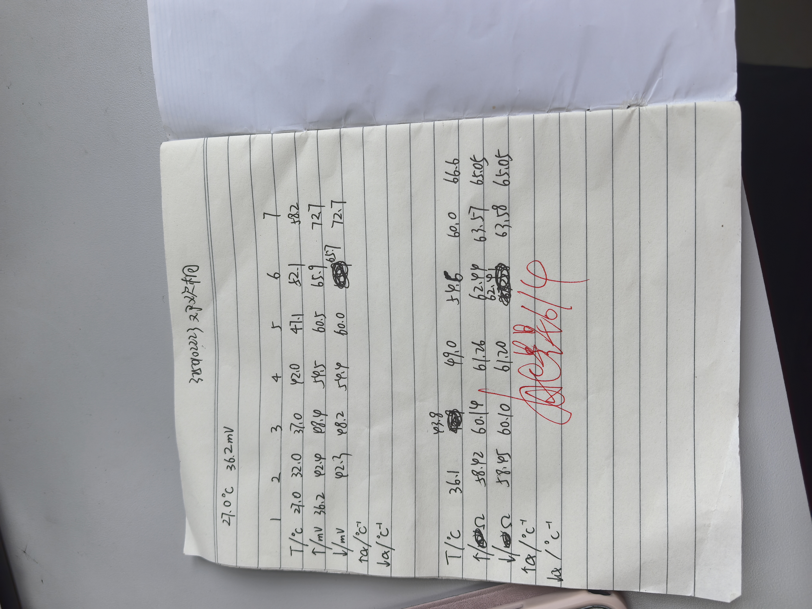
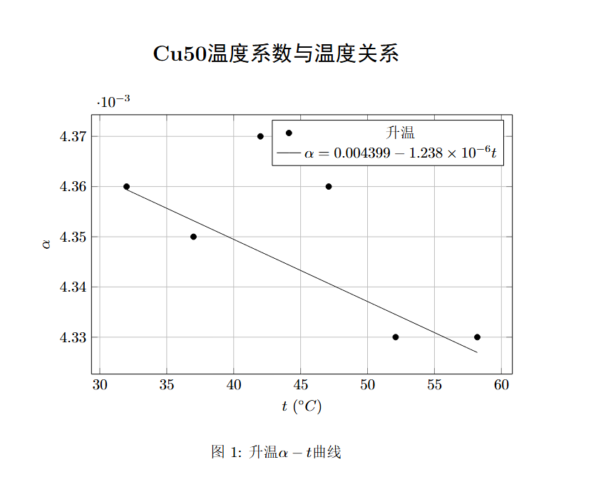
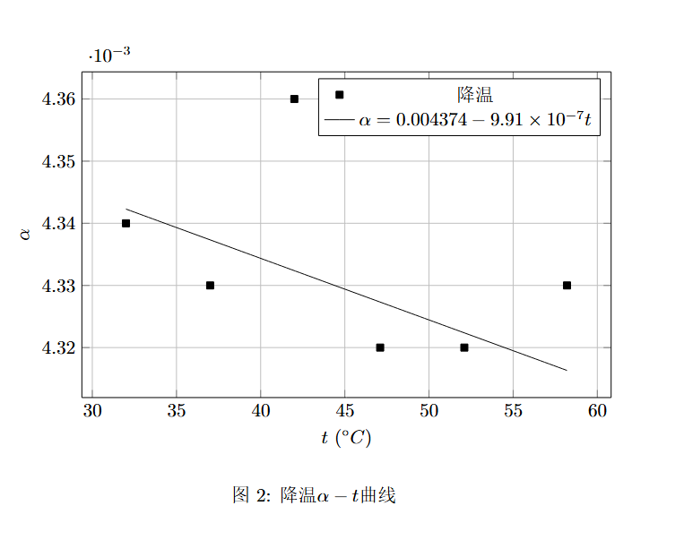
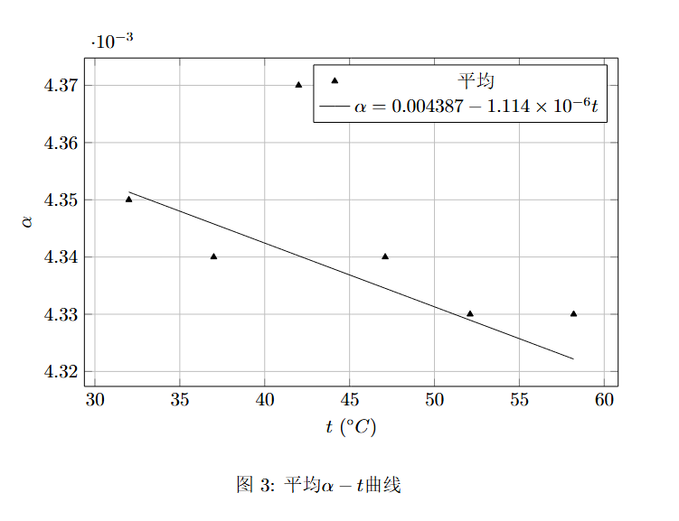
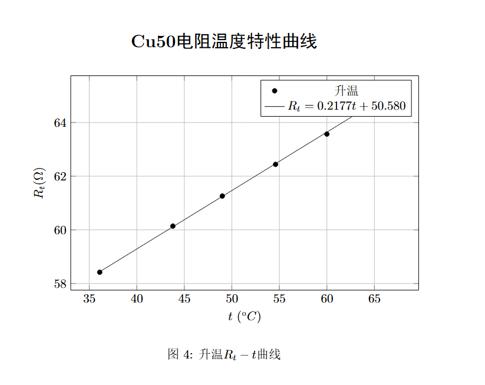
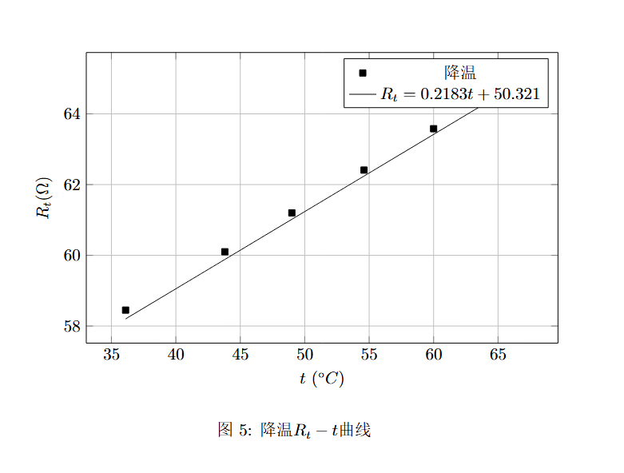
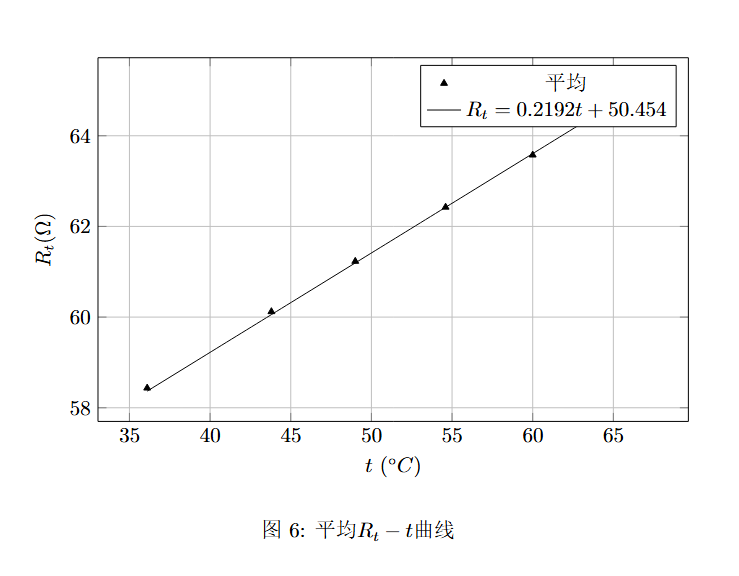
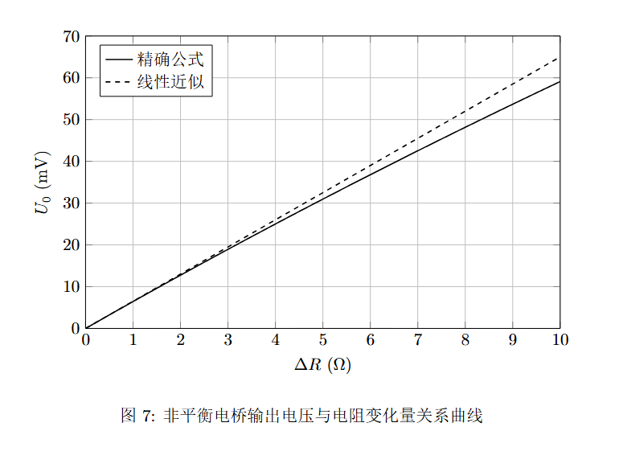

# 
物理实验预习报告

## 
实验名称：<u>非平衡电桥</u> 

## 
指导老师：<u>姚星星</u> 

### 
周次：<u>十四</u> 

### 
姓名：<u>邓欢桐</u> 

### 
实验日期：<u>2026</u>年<u>6</u>月<u>4</u>日 星期<u>四</u> 上午

### 
浙江大学物理实验教学中心

---

#### 1. 实验综述

（自述实验现象、实验原理和实验方法，不超过300字，5分）

本实验利用非平衡电桥研究金属电阻随温度变化的规律，并测量铜电阻（Cu50）的温度系数。实验中先搭建惠斯登电桥，当电桥平衡时满足 $R_1R_3=R_2R_x$；当待测电阻随温度变化发生微小改变量时，电桥失去平衡并产生输出电压，通过测量输出电压即可反推出电阻变化。实验采用平衡电桥测量不同温度下的电阻值，并绘制铜电阻温度特性曲线；再利用非平衡电桥将电阻变化转换为电压输出，从而测定温度系数。通过实验可以理解非平衡电桥在传感器测量中的应用原理。

---

#### 2.实验重点

（简述本实验的学习重点，不超过100字，3分）

掌握惠斯登电桥与非平衡电桥的工作原理，理解电桥平衡条件及输出电压与电阻变化之间的关系；学会利用非平衡电桥测量铜电阻温度系数，并分析温度与电阻的线性关系。

---

#### 3.实验难点

（简述本实验的实现难点，不超过100字，2分）

实验难点在于准确调节电桥达到平衡状态，并减小温度波动对测量结果的影响；同时需要正确建立输出电压与电阻变化之间的关系，通过数据处理求出温度系数。

---

### 二、原始数据
（将有学生和老师签名的“自备数据记录草稿纸”的扫描或手机拍摄图粘贴在下方，20分）

---

### 三、结果与分析

#### 1. 数据处理与结果

（列出数据表格、选择数据处理方法、给定测量或计算结果，30分）

##### 非平衡电桥测铜电阻 (Cu50) 温度系数

> 室温 27.0℃，测得电压值为 36.2 mV。

|                 次数                 |    1    |    2    |    3    |    4    |    5    |    6    |
| :----------------------------------: | :-----: | :-----: | :-----: | :-----: | :-----: | :-----: |
|       温度 $t/^\circ\text{C}$        |  32.0   |  37.0   |  42.0   |  47.1   |  52.1   |  58.2   |
|         升温 $U_0/\text{mV}$         |  42.4   |  48.4   |  54.5   |  60.5   |  65.9   |  72.7   |
|         降温 $U_0/\text{mV}$         |  42.3   |  48.2   |  54.4   |  60.0   |  65.7   |  72.7   |
|    $\alpha_↑/^\circ\text{C}^{-1}$    | 0.00436 | 0.00435 | 0.00437 | 0.00436 | 0.00433 | 0.00433 |
|    $\alpha_↓/^\circ\text{C}^{-1}$    | 0.00434 | 0.00433 | 0.00436 | 0.00432 | 0.00432 | 0.00433 |
| **平均值 $\bar{\alpha}/^\circ\text{C}^{-1}$** | 0.00435 | 0.00434 | 0.00437 | 0.00434 | 0.00433 | 0.00433 |

$$
\alpha = \frac{4U_0}{t(U_s-2U_0)}
$$

**公式各物理量说明：**

- **$\alpha$**：待测的铜电阻温度系数。

- **$U_0$**：输出的非平衡电桥电压值（即表格中的 $U_0/\text{mV}$）。

- **$t$**：当前的实际温度值。

- **$U_s$**：电桥的工作电源电压，取 1.3 V。

1. 计算平均温度系数 $\bar{\alpha}$
为了减少实验的随机误差，将升温和降温测得的共 12 个 $\alpha$ 值取算术平均值：
$$
\bar{\alpha} = \frac{\sum \alpha_↑ + \sum \alpha_↓}{12} \approx 0.00434 \text{ } ^\circ\text{C}^{-1}
$$

2. 相对误差
已知纯铜的电阻温度系数理论标准值取 $\alpha_0 = 0.00430 \text{ } ^\circ\text{C}^{-1}$，本次实验的相对误差计算如下：
$$
\text{相对误差 } \eta = \frac{|\bar{\alpha} - \alpha_0|}{\alpha_0} \times 100\% = \frac{|0.00434 - 0.00428|}{0.00428} \times 100\% \approx 1.40\%
$$

3. 结论 
实验测得铜电阻温度系数平均值为 $0.00434 \text{ } ^\circ\text{C}^{-1}$，与理论值的相对误差仅 $1.40\%$（远小于限制阀值 $5\%$），说明实验测量结果非常精准。

**拟合直线图**

**图像分析与讨论**

由升温、降温及平均温度系数拟合曲线可以看出，在实验测量温度范围内，铜电阻温度系数 $\alpha$ 基本保持稳定，各数据点均分布在拟合直线附近，离散程度较小。

升温过程拟合方程为：
$$
\alpha=0.004399-1.238\times10^{-6}t,
$$
降温过程拟合方程为：
$$
\alpha=0.004374-9.91\times10^{-7}t,
$$
平均数据拟合方程为：
$$
\alpha=0.004387-1.114\times10^{-6}t.
$$
由拟合结果可知，温度系数随温度升高略有减小，但变化幅度仅在 $10^{-5}$ 数量级，远小于温度系数本身的数值，说明在本实验温度范围内可近似认为铜电阻温度系数为常数。这与金属电阻温度特性的理论规律基本一致。

升温与降温曲线十分接近，未出现明显滞后现象，表明温度测量与电桥测量过程稳定可靠，实验系统具有较好的重复性。最终得到铜电阻温度系数平均值
$$
\bar{\alpha}=0.00434\ ^\circ\mathrm{C}^{-1},
$$
与理论值 $0.00430\ ^\circ\mathrm{C}^{-1}$ 相比，相对误差仅为 $1.40%$，说明实验结果与理论值符合较好，测量精度较高。

---

##### 绘制铜电阻 (Cu50) 温度特性曲线

|              次数              |   1    |   2    |   3    |   4    |   5    |   6    |
| :----------------------------: | :----: | :----: | :----: | :----: | :----: | :----: |
|    温度 $t/^\circ\text{C}$     |  36.1  |  43.8  |  49.0  |  54.6  |  60.0  |  66.6  |
|     升温 $R_t/\Omega$      | 58.42  | 60.14  | 61.26  | 62.44  | 63.57  | 65.05  |
|     降温 $R_t/\Omega$      | 58.45  | 60.10  | 61.20  | 62.41  | 63.58  | 65.05  |
| **平均值 $\bar{R}_t/\Omega$** | 58.435 | 60.120 | 61.230 | 62.425 | 63.575 | 65.050 |

1. $R_t - t$ 特性曲线拟合与推导
   根据金属电阻线性温阻基本原理：$ R_t = R_0(1 + \alpha t) = R_0\alpha \cdot t + R_0$

2. 拟合直线方程
   若以温度 $t$ 为横轴，平均电阻 $\bar{R}_t$ 为纵轴进行最小二乘法线性拟合，可得拟合直线方程：$R_t = 0.2192 \cdot t + 50.454$

3. 由此方程可外推得到：
- **$0^\circ\text{C}$ 时的初始阻值外推值**：$R_0 = 50.454\,\Omega$（与 Cu50 的标称阻值 $50\,\Omega$ 相比，相对误差仅 $0.91\%$）
- **由特性曲线斜率求出的温度系数**：$$\alpha = \frac{\text{斜率}}{R_0} = \frac{0.2192}{50.454} \approx 0.00434\text{ }^\circ\text{C}^{-1}$$

**拟合直线图**

**图像分析与讨论**

由升温、降温及平均电阻温度特性曲线可以看出，铜电阻阻值 $R_t$ 随温度升高而增大，且数据点基本分布在一条直线附近，表明在实验测量范围内铜电阻具有良好的线性温度特性。

对实验数据进行最小二乘法拟合得到

升温过程：
$$
R_t=0.2177t+50.580;
$$
降温过程：
$$
R_t=0.2183t+50.321;
$$
平均数据：
$$
R_t=0.2192t+50.454.
$$
三条拟合直线的斜率十分接近，说明升温和降温过程中电阻变化规律一致，实验重复性较好。

由平均拟合方程外推得到 $0^\circ\mathrm{C}$ 时的电阻值
$$
R_0=50.454\ \Omega,
$$
与 Cu50 的标称值 $50\ \Omega$ 非常接近，相对误差仅为 $0.91%$。

根据金属电阻温度特性关系：
$$
R_t=R_0(1+\alpha t),
$$
可由拟合直线斜率求得温度系数：
$$
\alpha=\frac{0.2192}{50.454}\approx0.00434\ ^\circ\mathrm{C}^{-1}.
$$
该结果与前面利用非平衡电桥法测得的温度系数完全一致，进一步验证了实验结果的可靠性和正确性。同时也说明在本实验温度范围内，铜电阻温度特性满足良好的线性关系，符合金属导体电阻随温度升高而增大的理论规律。

---

##### 非平衡电桥非线性分析

非平衡电桥输出电压与电阻变化量之间的精确关系为

$$
U_0=\frac{U_s}{4}\frac{\Delta R}{R}\cdot
\frac{1}{1+\dfrac{\Delta R}{2R}},
$$
当电阻变化量满足 $\Delta R\ll R$ 时，

$$
\frac{1}{1+\dfrac{\Delta R}{2R}}\approx 1,
$$
上式可近似写为

$$
U_0\approx \frac{U_s}{4}\frac{\Delta R}{R},
$$
即输出电压与电阻变化量呈线性关系。

由图7可见，在较小的电阻变化范围内，精确公式曲线与线性近似直线几乎重合，说明非平衡电桥具有良好的线性特性；随着 $\Delta R$ 的增大，精确曲线逐渐偏离线性近似直线，表明电桥输出存在一定的非线性误差。这是由于电桥输出电压与电阻变化量之间本质上并非严格线性关系，而是受到分母项 $1+\frac{\Delta R}{2R}$ 的影响。

本实验中 Cu50 电阻在测量温度范围内的阻值变化约为
$$
\Delta R_{\max}\approx 14.6\,\Omega,
$$
相对于标称阻值 $R=50\,\Omega$ 而言变化幅度较小，因此非线性误差对实验结果的影响有限。实验测得的温度系数与理论值相对误差仅为 $1.40\%$，说明采用线性近似进行数据处理具有较好的合理性和准确性。

---

#### 2. 误差分析

（运用测量误差、相对误差、不确定度等分析实验结果，20分）

本实验包括利用非平衡电桥测量铜电阻温度系数以及利用平衡电桥绘制铜电阻温度特性曲线两部分内容。实验测得铜电阻温度系数为
$$
\bar{\alpha}=0.00434\ ^\circ\mathrm{C}^{-1},
$$

与理论值相比相对误差为
$$
1.40\%,
$$
说明实验结果较为准确。

**（1）非平衡电桥测温度系数部分**

① 温度测量过程中，温度计示值与铜电阻实际温度之间存在一定热滞后，尤其在升温和降温过程中难以完全达到热平衡，从而引起温度误差。

② 非平衡电桥输出电压仅为几十毫伏量级，数字电压表分辨率有限，微小的读数波动会导致温度系数计算结果发生变化。

③ 电桥桥臂电阻存在制造误差和接触电阻，实际电路与理论模型存在一定偏差，影响温度系数的测量结果。

**（2）铜电阻温度特性曲线测量部分**

① 平衡电桥调节过程中难以达到绝对平衡状态，因此测得的电阻值存在一定系统误差。

② 铜电阻引线电阻及接触电阻会叠加到测量结果中，使测得电阻值略大于真实值。

③ 加热过程中温度场分布可能不均匀，温度计测得温度与电阻元件实际温度可能存在微小差异，从而影响拟合结果。

**（3）实验结果分析**

实验中升温与降温数据基本重合，两组拟合曲线差别很小，说明实验具有良好的重复性和稳定性。由温度特性曲线外推得到
$$
R_0=50.454\Omega
$$
与Cu50标称值50 Ω相比相对误差仅为0.91%；由拟合斜率计算得到的温度系数
$$
\alpha=0.00434\ ^\circ\mathrm{C}^{-1}
$$
与非平衡电桥法测得结果一致，表明实验数据可靠，实验方法正确。

---

#### 3. 实验探讨

（对实验内容、现象和过程的小结，不超过100字，10分）

本实验利用非平衡电桥将微小电阻变化转换为电压信号进行测量，充分体现了电桥对微小电阻变化的高灵敏度。实验结果表明，在测量温度范围内，铜电阻阻值随温度升高近似线性增加，温度系数基本保持不变，符合金属导体电阻温度特性的理论规律。

通过比较升温和降温过程的数据发现，两组结果基本一致，说明实验装置工作稳定、重复性较好。实验还验证了利用非平衡电桥测量温度系数的方法具有较高精度，在工业测温及传感器检测领域具有广泛应用价值。

---

### 四、思考题
（解答教材或讲义或老师指定的思考题，10分）

**1. 非平衡电桥与平衡电桥有何异同？**

平衡电桥和非平衡电桥都基于惠斯登电桥原理，通过桥路中各电阻之间的关系实现电阻测量或电阻变化检测。

二者的主要区别在于工作状态不同。平衡电桥工作时需调节桥路使检流计电流为零，即满足平衡条件
$$
\frac{R_1}{R_2}=\frac{R_3}{R_x},
$$
然后根据平衡条件计算未知电阻，其测量精度较高，适用于电阻值的精确测量。

非平衡电桥则工作在失衡状态，不再追求桥路平衡，而是利用桥路输出电压与电阻变化量之间的对应关系进行测量。其输出信号能够连续反映被测电阻的变化，因此灵敏度高、响应速度快，广泛应用于温度、压力、应变等传感器测量系统中。

因此，平衡电桥适用于静态精密测量，而非平衡电桥更适用于动态测量和自动检测。

------

**2. 等臂电桥、卧式电桥和立式电桥在应用上有什么区别？**

等臂电桥是指比例臂电阻相等（即 $R_1=R_2$）的电桥结构。其灵敏度较高，计算简单，常用于测量电阻变化量较小的场合，例如温度传感器和应变片测量。

卧式电桥和立式电桥主要是桥路结构连接方式不同。

卧式电桥通常将待测电阻与标准电阻布置在相邻桥臂中，结构简单、调节方便，适用于一般实验室测量和教学实验。

立式电桥则将待测电阻与标准电阻分布在对角桥臂中，对供电电压波动和外界干扰具有较好的抑制能力，在工业测量和高精度检测中应用较多。

实际应用中，应根据测量对象、灵敏度要求以及抗干扰能力要求选择合适的电桥结构。

------

**3. 温度控制对测温测量有什么影响？**

温度控制对测温实验的准确性具有重要影响。若温度变化过快，温度计与被测电阻之间可能尚未达到热平衡，此时测得温度不能真实反映电阻元件的实际温度，从而产生系统误差。

良好的温度控制能够保证加热或降温过程缓慢均匀，使温度场分布更加稳定，减小热滞后现象，提高测量结果的重复性和准确性。同时，在恒温状态下进行读数可以减小环境温度波动带来的影响，从而提高温度系数和温度特性曲线测量结果的可靠性。

因此，在温阻测量实验中，应尽量保持温度变化平稳，并在达到热平衡后进行数据读取，以获得更加准确的实验结果。

---

#### 注意事项：
1.用PDF格式上传“预习报告”，文件名：学生姓名+学号+实验名称+周次。
2.“预习报告”必须递交在“学在浙大”的本课程的对应实验项目的“作业”模块内。
3.“预习报告”还须拷贝到“实验报告”中（便以教师批改）。

**
浙江大学物理实验教学中心制
**
