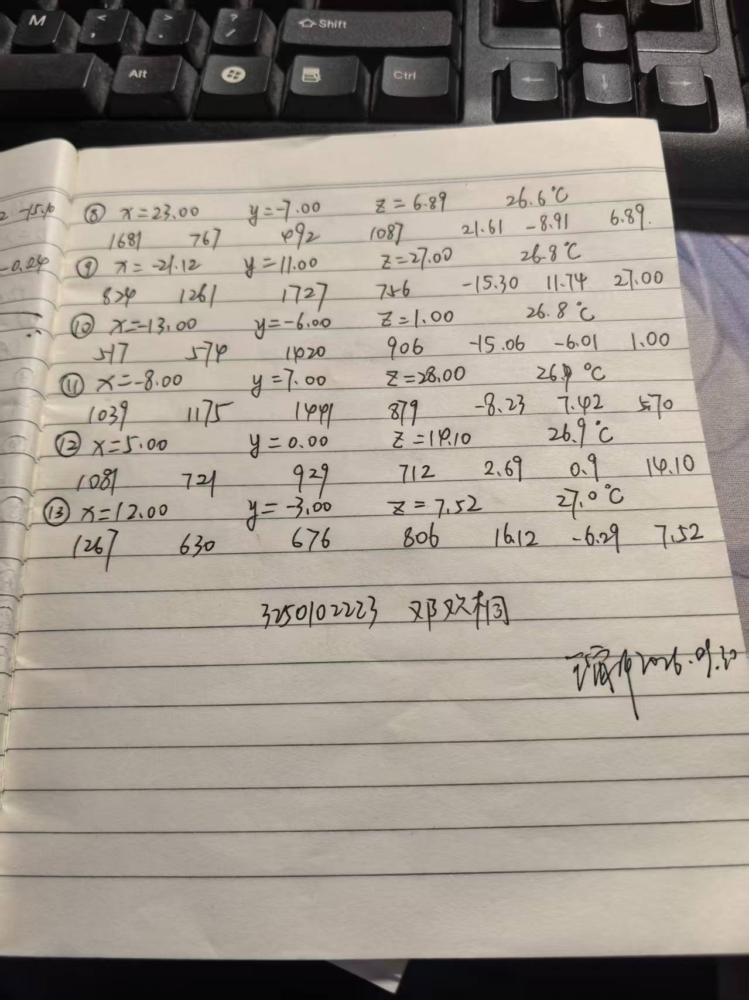
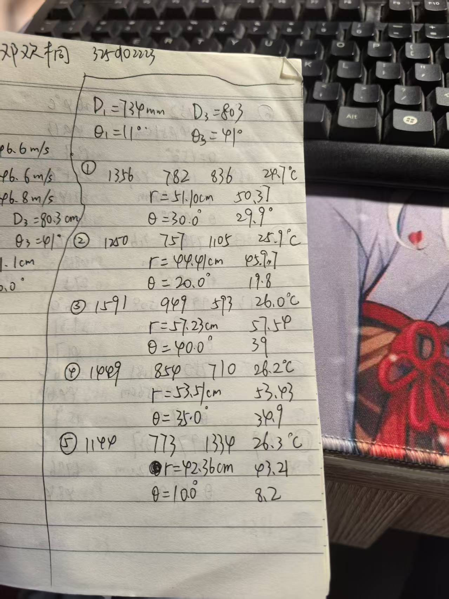
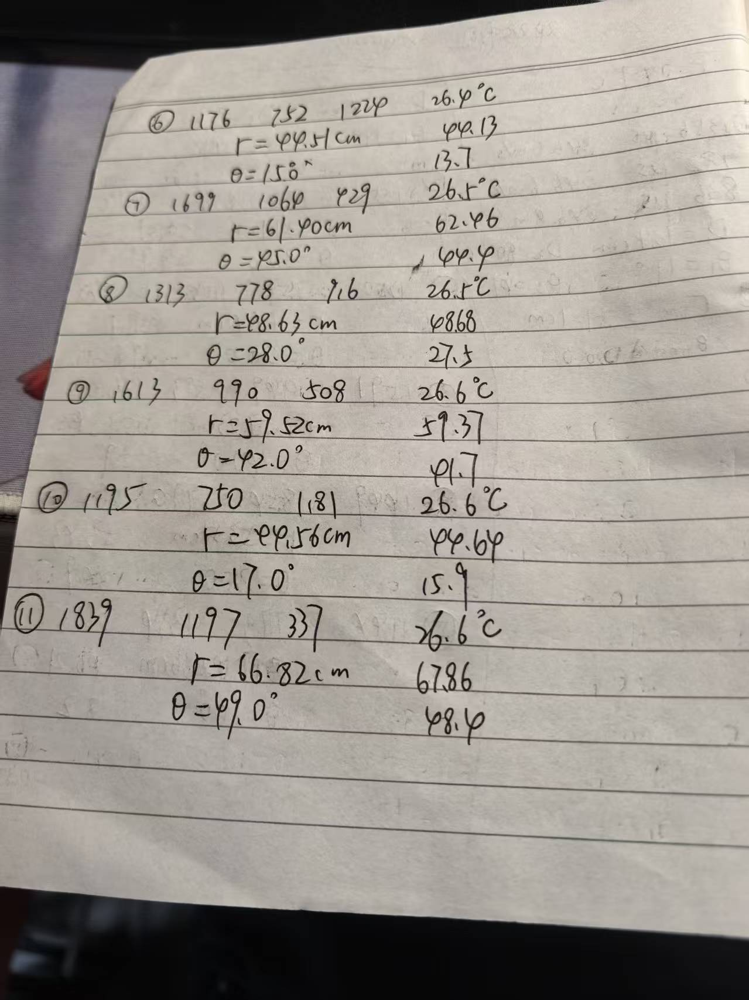
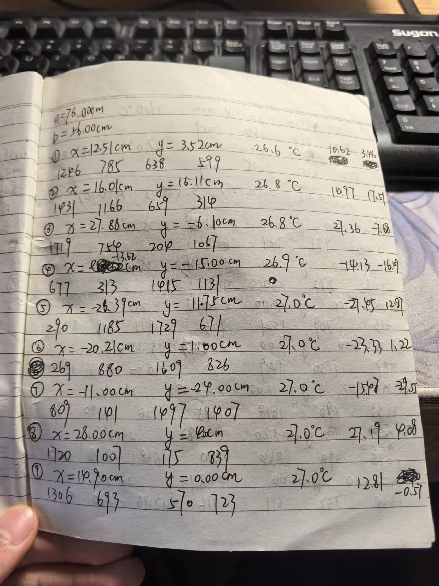
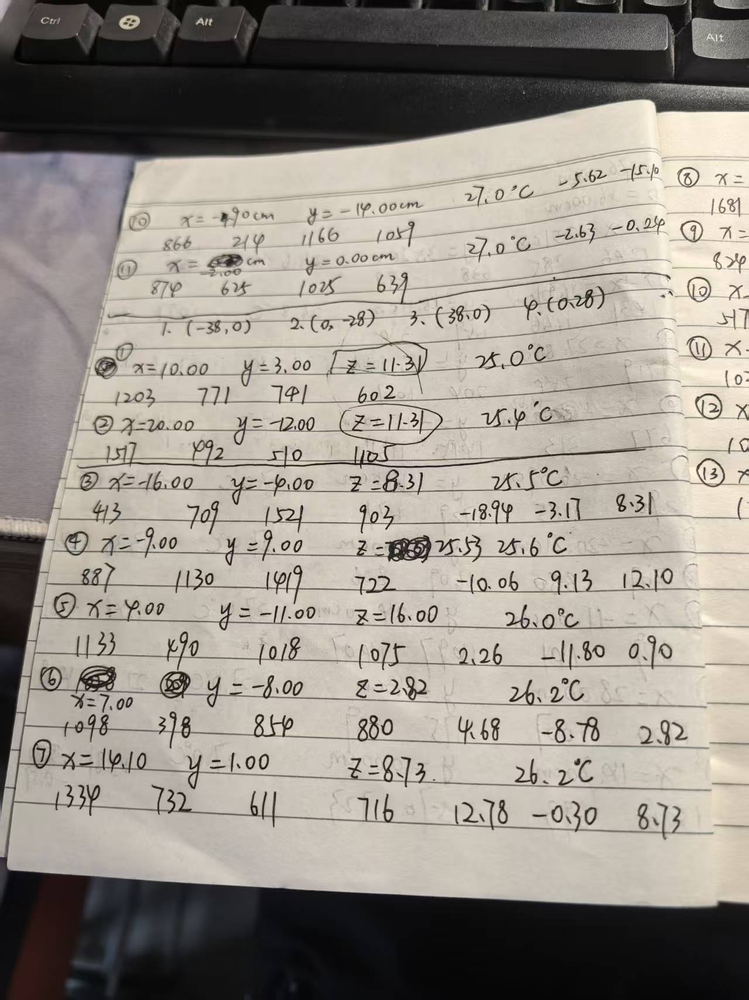
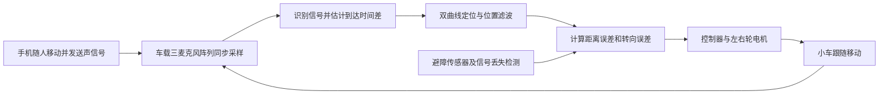

# 一、预习报告

### 1. 实验综述

（自述实验现象、实验原理和实验方法，不超过 300 字，5 分）

本实验用超声波模拟卫星导航信号。发射探头通过压电陶瓷将电信号转化为超声波，接收探头再将其转化为电信号。测出各路信号的到达时间差后，结合声速求出距离差，从而确定接收器的位置。二维定位中，三声源系统求接收器的距离和方位角，四声源系统通过双曲线交点求平面坐标；三维定位则根据四个发射器的坐标和时间差，利用梯度法求接收器的空间坐标。移动接收器并记录不同位置的数据，将计算结果与尺量结果比较，分析定位误差。

### 2. 实验重点

（简述本实验的学习重点，不超过 100 字，3 分）

理解时间差、距离差与接收器位置之间的关系，掌握二维和三维定位的基本方法。测量时要统一坐标系，准确记录探头位置和时间读数，并将计算结果与实测值比较。

### 3. 实验难点

（简述本实验的实现难点，不超过 100 字，2 分）

多个探头需要同时对准接收器，否则会影响信号接收和时间读数。三维定位方程为非线性方程，求解结果受初值和迭代条件影响，还要注意坐标正负号及解是否符合实际位置。

## 二、原始数据

    

### 实验数据记录表

### 表 2-3-1

$D_1=734\,\mathrm{mm}$，$D_3=803\,\mathrm{mm}$，$\theta_1=11^\circ$，$\theta_3=41^\circ$。

| 测量点 | T₁ 到测量点的时间 t₁/μs | T₂ 到测量点的时间 t₂/μs | T₃ 到测量点的时间 t₃/μs | r₁/cm（实测值） | r₁/cm（计算值） | θ/°（实测值） | θ/°（计算值） | 温度 T/℃ |
| --- | --- | --- | --- | --- | --- | --- | --- | --- |
| A | 1356 | 782 | 836 | 51.10 | 50.37 | 30.0 | 29.9 | 24.7 |
| B | 1250 | 757 | 1105 | 44.41 | 45.97 | 20.0 | 19.8 | 25.9 |
| C | 1591 | 949 | 593 | 57.23 | 57.54 | 40.0 | 39.0 | 26.0 |
| D | 1449 | 854 | 710 | 53.51 | 53.43 | 35.0 | 34.9 | 26.2 |
| E | 1144 | 773 | 1334 | 42.36 | 43.24 | 10.0 | 8.2 | 26.3 |
| F | 1176 | 752 | 1224 | 44.51 | 44.13 | 15.0 | 13.7 | 26.4 |
| G | 1699 | 1064 | 429 | 61.40 | 62.46 | 45.0 | 44.4 | 26.5 |
| H | 1313 | 778 | 916 | 48.63 | 48.68 | 28.0 | 27.5 | 26.5 |
| I | 1613 | 990 | 508 | 57.52 | 59.37 | 42.0 | 41.7 | 26.6 |
| J | 1195 | 750 | 1181 | 44.56 | 44.64 | 17.0 | 15.9 | 26.6 |
| K | 1839 | 1197 | 337 | 66.82 | 67.86 | 49.0 | 48.4 | 26.6 |

### 表 2-3-2

a=76.00 cm，b=56.00 cm。

| 测量点 | T₁ 到测量点的时间 t₁/μs | T₂ 到测量点的时间 t₂/μs | T₃ 到测量点的时间 t₃/μs | T₄ 到测量点的时间 t₄/μs | x/cm（实测值） | x/cm（计算值） | y/cm（实测值） | y/cm（计算值） | 温度 T/℃ |
| --- | --- | --- | --- | --- | --- | --- | --- | --- | --- |
| A | 1246 | 785 | 638 | 599 | 12.51 | 10.62 | 3.52 | 3.46 | 26.6 |
| B | 1431 | 1166 | 659 | 314 | 16.01 | 14.97 | 16.11 | 17.51 | 26.8 |
| C | 1779 | 754 | 204 | 1667 | 27.88 | 27.36 | -6.10 | -7.68 | 26.8 |
| D | 677 | 313 | 1415 | 1131 | -13.62 | -14.13 | -15.00 | -16.49 | 26.9 |
| E | 290 | 1185 | 1729 | 671 | -26.39 | -27.45 | 11.75 | 12.97 | 27.0 |
| F | 269 | 880 | 1609 | 826 | -20.21 | -23.33 | 1.00 | 1.22 | 27.0 |
| G | 809 | 141 | 1497 | 1407 | -11.00 | -15.47 | -24.00 | -29.55 | 27.0 |
| H | 1730 | 1007 | 175 | 839 | 28.00 | 27.19 | 4.00 | 4.08 | 27.0 |
| I | 1306 | 693 | 570 | 723 | 14.90 | 12.81 | 0.00 | -0.57 | 27.0 |
| J | 866 | 214 | 1166 | 1059 | -4.90 | -5.62 | -14.00 | -15.10 | 27.0 |
| K | 874 | 624 | 1025 | 639 | -2.00 | -2.63 | 0.00 | -0.24 | 27.0 |

### 表 2-3-3

原始记录编号 3～13 依次对应测量点 A～K。

#### 发射器坐标

四个坐标按 T₁、T₂、T₃、T₄ 顺序列出，与下表四个到达时间列一一对应。

| 测量点 | 原记录编号 | T₁ (x,y,z)/cm | T₂ (x,y,z)/cm | T₃ (x,y,z)/cm | T₄ (x,y,z)/cm |
| --- | --- | --- | --- | --- | --- |
| A | 3 | (-38, 0, 8.31) | (0, -28, 8.31) | (38, 0, 8.31) | (0, 28, 8.31) |
| B | 4 | (-38, 0, 25.53) | (0, -28, 25.53) | (38, 0, 25.53) | (0, 28, 25.53) |
| C | 5 | (-38, 0, 16.00) | (0, -28, 16.00) | (38, 0, 16.00) | (0, 28, 16.00) |
| D | 6 | (-38, 0, 2.82) | (0, -28, 2.82) | (38, 0, 2.82) | (0, 28, 2.82) |
| E | 7 | (-38, 0, 8.73) | (0, -28, 8.73) | (38, 0, 8.73) | (0, 28, 8.73) |
| F | 8 | (-38, 0, 6.89) | (0, -28, 6.89) | (38, 0, 6.89) | (0, 28, 6.89) |
| G | 9 | (-38, 0, 27.00) | (0, -28, 27.00) | (38, 0, 27.00) | (0, 28, 27.00) |
| H | 10 | (-38, 0, 1.00) | (0, -28, 1.00) | (38, 0, 1.00) | (0, 28, 1.00) |
| I | 11 | (-38, 0, 28.00) | (0, -28, 28.00) | (38, 0, 28.00) | (0, 28, 28.00) |
| J | 12 | (-38, 0, 14.10) | (0, -28, 14.10) | (38, 0, 14.10) | (0, 28, 14.10) |
| K | 13 | (-38, 0, 7.52) | (0, -28, 7.52) | (38, 0, 7.52) | (0, 28, 7.52) |

#### 接收器测量与计算数据

原记录 x、y 是接收器坐标，接收器实测 z 均为 0。

| 测量点 | T₁ 到测量点的时间 t₁/μs | T₂ 到测量点的时间 t₂/μs | T₃ 到测量点的时间 t₃/μs | T₄ 到测量点的时间 t₄/μs | 接收器 x/cm（实测值） | 接收器 x/cm（计算值） | 接收器 y/cm（实测值） | 接收器 y/cm（计算值） | 接收器 z/cm（实测值） | 接收器 z/cm（计算值） | 温度 T/℃ |
| --- | --- | --- | --- | --- | --- | --- | --- | --- | --- | --- | --- |
| A | 413 | 709 | 1521 | 903 | -16.00 | -18.94 | -4.00 | -3.17 | 0.00 | 8.31 | 25.5 |
| B | 887 | 1130 | 1419 | 722 | -9.00 | -10.06 | 9.00 | 9.13 | 0.00 | 12.10 | 25.6 |
| C | 1133 | 490 | 1018 | 1075 | 4.00 | 2.26 | -11.00 | -11.80 | 0.00 | 0.90 | 26.0 |
| D | 1098 | 398 | 854 | 880 | 7.00 | 4.68 | -8.00 | -8.78 | 0.00 | 2.82 | 26.2 |
| E | 1334 | 732 | 611 | 716 | 14.10 | 12.78 | 1.00 | -0.30 | 0.00 | 8.73 | 26.2 |
| F | 1681 | 767 | 492 | 1087 | 23.00 | 21.61 | -7.00 | -8.91 | 0.00 | 6.89 | 26.6 |
| G | 824 | 1261 | 1727 | 756 | -21.12 | -15.30 | 11.00 | 11.74 | 0.00 | 27.00 | 26.8 |
| H | 577 | 574 | 1420 | 906 | -13.00 | -15.06 | -6.00 | -6.01 | 0.00 | 1.00 | 26.8 |
| I | 1039 | 1175 | 1441 | 879 | -8.00 | -8.23 | 7.00 | 7.42 | 0.00 | 5.70 | 26.9 |
| J | 1081 | 721 | 929 | 712 | 5.00 | 2.69 | 0.00 | 0.90 | 0.00 | 14.10 | 26.9 |
| K | 1267 | 630 | 676 | 806 | 12.00 | 16.12 | -3.00 | -6.29 | 0.00 | 7.52 | 27.0 |

## 三、结果与分析

### 1. 数据处理与结果

#### （1）处理方法与误差指标

二维定位根据到达时间差求距离、方位角或平面坐标，三维定位则用梯度法求解距离差方程。下面采用原始记录中的计算结果，以尺量值为参考，计算各测量点的偏差。

设计算值与实测值的差为 $\Delta q=q_{\mathrm{计算}}-q_{\mathrm{实测}}$。距离相对偏差、平面位置偏差和空间位置偏差分别定义为

$$
\varepsilon_r=\frac{|r_{\mathrm{计算}}-r_{\mathrm{实测}}|}{r_{\mathrm{实测}}}\times100\%,
$$

$$
e_{xy}=\sqrt{(\Delta x)^2+(\Delta y)^2},\qquad
e_{xyz}=\sqrt{(\Delta x)^2+(\Delta y)^2+(\Delta z)^2}.
$$

平均绝对偏差为 $\mathrm{MAE}=\frac1N\sum_{i=1}^{N}|\Delta q_i|$，位置均方根偏差为 $\mathrm{RMSE}=\sqrt{\frac1N\sum_{i=1}^{N}e_i^2}$。三组实验均有 11 个测量点。尺量值也有读数误差，这里主要用来比较计算结果与实测结果的差别。

#### （2）三个声源系统的二维定位

| 测量点 | 距离偏差 Δr₁/cm | 距离相对偏差/% | 角度偏差 Δθ/° |
| --- | --- | --- | --- |
| A | -0.73 | 1.43 | -0.1 |
| B | 1.56 | 3.51 | -0.2 |
| C | 0.31 | 0.54 | -1.0 |
| D | -0.08 | 0.15 | -0.1 |
| E | 0.88 | 2.08 | -1.8 |
| F | -0.38 | 0.85 | -1.3 |
| G | 1.06 | 1.73 | -0.6 |
| H | 0.05 | 0.10 | -0.5 |
| I | 1.85 | 3.22 | -0.3 |
| J | 0.08 | 0.18 | -1.1 |
| K | 1.04 | 1.56 | -0.6 |

三声源系统的距离平均绝对偏差为 0.73 cm，平均相对偏差为 1.40%，角度平均绝对偏差为 0.69°。其中，I 点的距离偏差最大，为 1.85 cm；B 点的距离相对偏差最大，为 3.51%。整体来看，计算出的距离和方位角与实测结果较接近。

各点的角度计算值都偏小，平均偏差为 -0.69°，可能与角度零点或探头方位标定有关。E、F、J 点的角度偏差较明显，分别为 -1.8°、-1.3°、-1.1°，这些点的实测角度也较小。相比之下，距离偏差有正有负，在本组测量范围内没有随距离增大而明显增大的趋势。

#### （3）四个声源系统的二维定位

| 测量点 | 接收器实测位置 (x,y)/cm | Δx/cm | Δy/cm | 平面位置偏差 eₓᵧ/cm |
| --- | --- | --- | --- | --- |
| A | (12.51, 3.52) | -1.89 | -0.06 | 1.89 |
| B | (16.01, 16.11) | -1.04 | 1.40 | 1.74 |
| C | (27.88, -6.10) | -0.52 | -1.58 | 1.66 |
| D | (-13.62, -15.00) | -0.51 | -1.49 | 1.57 |
| E | (-26.39, 11.75) | -1.06 | 1.22 | 1.62 |
| F | (-20.21, 1.00) | -3.12 | 0.22 | 3.13 |
| G | (-11.00, -24.00) | -4.47 | -5.55 | 7.13 |
| H | (28.00, 4.00) | -0.81 | 0.08 | 0.81 |
| I | (14.90, 0.00) | -2.09 | -0.57 | 2.17 |
| J | (-4.90, -14.00) | -0.72 | -1.10 | 1.31 |
| K | (-2.00, 0.00) | -0.63 | -0.24 | 0.67 |

四声源二维定位的平均位置偏差为 2.16 cm，均方根偏差为 2.74 cm。除 F、G 两点外，其余各点的偏差均小于 2.2 cm。G 点偏差最大，为 7.13 cm，且 x、y 两个方向都偏向负方向，应重点复查该位置的探头对准情况和时间读数。

本组所有点的 x 计算值均小于实测值，平均偏差为 -1.53 cm。这种一致的偏移可能与坐标原点、探头位置标定或通道延迟有关。G 点靠近负 y 方向的发射器，但同样靠近阵列边缘的 H 点偏差只有 0.81 cm，因此不能只用接收器靠近边缘来解释误差。

#### （4）三维空间定位

三维实验中，每组四个发射器位于同一高度 $h$，接收器的实测高度均为 0。本组 A～K 对应原记录 3～13，与二维实验中的同名点位置不同。

| 测量点（原编号） | 发射器高度 h/cm | Δx/cm | Δy/cm | Δz/cm | 平面偏差 eₓᵧ/cm | 空间偏差 eₓᵧ𝓏/cm |
| --- | --- | --- | --- | --- | --- | --- |
| A（3） | 8.31 | -2.94 | 0.83 | 8.31 | 3.05 | 8.85 |
| B（4） | 25.53 | -1.06 | 0.13 | 12.10 | 1.07 | 12.15 |
| C（5） | 16.00 | -1.74 | -0.80 | 0.90 | 1.92 | 2.12 |
| D（6） | 2.82 | -2.32 | -0.78 | 2.82 | 2.45 | 3.73 |
| E（7） | 8.73 | -1.32 | -1.30 | 8.73 | 1.85 | 8.92 |
| F（8） | 6.89 | -1.39 | -1.91 | 6.89 | 2.36 | 7.28 |
| G（9） | 27.00 | 5.82 | 0.74 | 27.00 | 5.87 | 27.63 |
| H（10） | 1.00 | -2.06 | -0.01 | 1.00 | 2.06 | 2.29 |
| I（11） | 28.00 | -0.23 | 0.42 | 5.70 | 0.48 | 5.72 |
| J（12） | 14.10 | -2.31 | 0.90 | 14.10 | 2.48 | 14.32 |
| K（13） | 7.52 | 4.12 | -3.29 | 7.52 | 5.27 | 9.18 |

三维定位的平均平面偏差为 2.62 cm，平均空间偏差为 9.29 cm，空间均方根偏差为 11.55 cm。x、y、z 方向的平均绝对偏差分别为 2.30 cm、1.01 cm 和 8.64 cm，高度误差明显大于平面误差。

G 点的空间偏差最大，为 27.63 cm，其中高度偏差为 27.00 cm；C 点的空间偏差最小，为 2.12 cm。I 点虽然平面偏差只有 0.48 cm，高度偏差仍有 5.70 cm。高度误差平方和占空间误差平方和的 93.1%，因此本次三维定位需要重点分析高度求解的问题。

### 2. 误差分析

#### （1）共面阵列与高度求解

设接收器到第 $i$ 个发射器的距离为

$$
d_i(x,y,z)=\sqrt{(x-x_i)^2+(y-y_i)^2+(z-z_i)^2},
$$

三维定位通过最小化距离差方程的残差求位置：

$$
F(x,y,z)=\sum_{i=2}^{4}\left[d_i-d_1-v(t_i-t_1)\right]^2.
$$

本次四个发射器高度相同，即 $z_i=h$，距离中的高度项为 $(z-h)^2$。因此，位于发射器平面两侧、互为镜像的两个点满足

$$
d_i(x,y,z)=d_i(x,y,2h-z),
$$

它们的距离差相同，仅靠时间差无法区分，需要结合接收器在阵列下方的实际条件判断。

另外，$\partial d_i/\partial z=(z-h)/d_i$，在 $z=h$ 处，距离及目标函数对 z 的一阶导数都为 0。如果梯度法从这一平面开始迭代，z 值可能无法更新。记录中 A、D、E、F、G、H、J、K 共 8 个点的 z 计算值恰好等于发射器高度，这一现象可能与迭代初值或停止条件有关，需要查看程序和残差才能确认。

改进时可调整部分发射器的高度，使四个发射器不共面，并尝试不同初值，检查求解结果是否稳定。若只需要平面坐标，可直接利用接收器位于 z=0 平面的已知条件求 x、y。本组数据中，发射器高度和接收器位置同时变化，暂时无法单独判断高度对误差的影响。

#### （2）时间读数、探头对准与几何条件

距离差满足 $\Delta d=v\Delta t$，时间差读数的偏差会直接影响定位结果。探头未对准、接收信号较弱或反射波干扰，都可能影响到达时间的判断。测量时应先调整各探头方向，待信号稳定后再读数，并对偏差较大的点重复测量。

定位误差还与发射器和接收器的相对位置有关。两条双曲线在交点附近接近相切时，小的距离差变化也可能引起较大的坐标变化。四源二维的 G 点和三维的 G、K 点平面偏差较大，复测时应同时检查探头对准、时间读数和阵列布置。

#### （3）标定与温度

三源实验的角度和四源二维实验的 x 坐标都出现了同方向偏差，应检查角度参考线、坐标原点以及探头中心位置的标定。各通道的固定延迟也会影响时间差：共同的时间零点偏移可以在作差时消除，通道之间的延迟差则会保留下来。

声速随温度变化，因此计算距离差时应使用测量温度对应的声速。三次实验的温度范围分别为 24.7～26.6 ℃、26.6～27.0 ℃和 25.5～27.0 ℃。四源二维的 F、G、H、K 点都在 27.0 ℃下测量，定位偏差却相差较大，说明还需要考虑读数、标定和几何条件等因素。

#### （4）结果评价

接收器实测 z 均为 0，部分点的 x 或 y 也为 0，无法计算这些坐标的相对误差，因此采用坐标偏差和位置偏差比较结果。各点只有一组记录，仪器分辨率和尺量不确定度也未给出，本次分析以偏差统计为主。三组实验的测量位置和输出量不同，不能直接用平均偏差比较声源数量对定位精度的影响。

### 3. 实验探讨

本次实验通过超声波到达时间差求接收器位置，二维计算结果与实测值较接近，三维结果的高度偏差较大。后续可先复测偏差较大的点，检查探头标定，再调整发射器高度并比较不同初值的求解结果。

## 四、思考题

### 1. 简述基于时间的定位方法进行定位模拟的基本原理

已知各发射器的位置和信号传播速度，测量传播时间即可求出接收器到各发射器的距离，再利用多个圆或球面的交点确定接收器位置，这要求发射时刻已知且时钟同步。若使用到达时间差，则根据 $d_i-d_1=v(t_i-t_1)$ 求距离差。在二维中，距离差确定一条双曲线；在三维中，距离差确定一个双曲面。多组距离差对应的曲线或曲面相交，即可求出接收器坐标。本实验用超声波代替导航信号完成这一过程。

### 2. 设计借助智能手机的“小车跟人”系统，并说明移动原理

让手机随人移动，并周期性发出一段特定的声信号。小车上安装三个位置已知、不共线且同步采样的麦克风，用互相关方法求出信号的到达时间差，再通过双曲线定位求手机相对小车的位置。系统框图如下：

以小车前进方向为 x 正方向，手机坐标为 $(x,y)$，则距离为 $r=\sqrt{x^2+y^2}$，方向角为 $\alpha=\operatorname{atan2}(y,x)$。当距离大于设定的跟随距离 $r_0$ 时，小车前进；接近 $r_0$ 时减速或停车。根据方向角调整左右轮转速差，使车头朝向手机。不断测量并调整轮速，小车就能随人移动。为减小噪声和反射的影响，可对定位结果进行平滑处理；信号丢失或检测到障碍物时停车。
