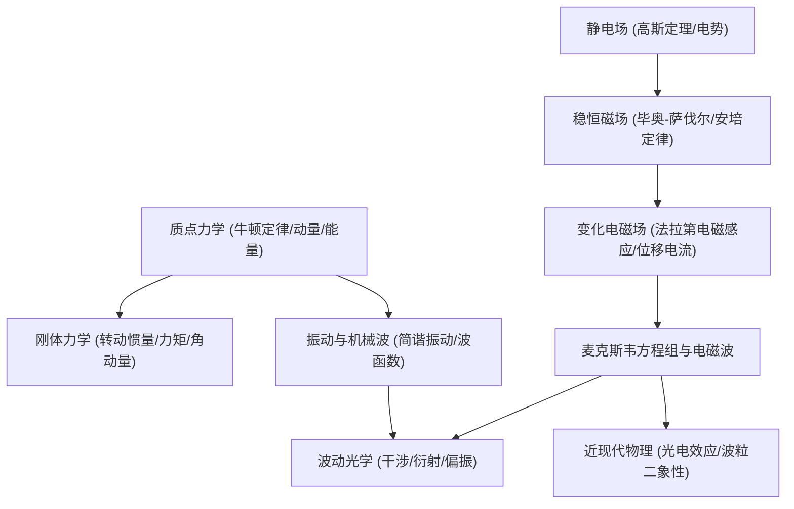

# 普通物理学（甲）· 课程总览与核心图谱

⚡ 格物穷理 · 物理世界运行的数理规律

普通物理学（甲）是理工科及计算机学科的核心数理基石课程，涵盖经典力学、热力学、电磁学、波动光学到近现代量子力学初步的完整唯象与理论体系。

---

## 课程分册深度笔记

  <a href="./General_Physics_I.html" class="bento-card">
    

      

        PHY-I
        力学与热学
      

      

        
🍎

        

          普通物理学（甲）I
          质点运动学、牛顿力学定律、动量与角动量守恒、刚体转动动力学、机械振动与波动、热力学第一与第二定律
        

      

    

    

      

        刚体角动量
        卡诺循环
      

      →
    

  </a>

  <a href="./General_Physics_II.html" class="bento-card">
    

      

        PHY-II
        电磁与光学
      

      

        
⚡

        

          普通物理学（甲）II
          静电场高斯定理与环路定理、介质极化、稳恒磁场与安培环路定理、法拉第电磁感应、麦克斯韦方程组、光的干涉衍射偏振
        

      

    

    

      

        麦克斯韦方程组
        干涉衍射
      

      →
    

  </a>

---

## 知识网络与学科衔接

---

## 实验与工程对应

物理理论课与实验课深度共振：
- 质点与刚体力学对应 **碰撞实验、转动惯量实验、均匀弦振动实验**
- 电磁学对应 **电桥测电阻、示波器使用、霍尔效应磁场测量、交流电功率因数整流**
- 光学与近代物理对应 **分光计、弗兰克-赫兹实验、北斗定位模拟**
详情欢迎查阅 [物理实验实战集](/Lab/Physics-Lab)。
