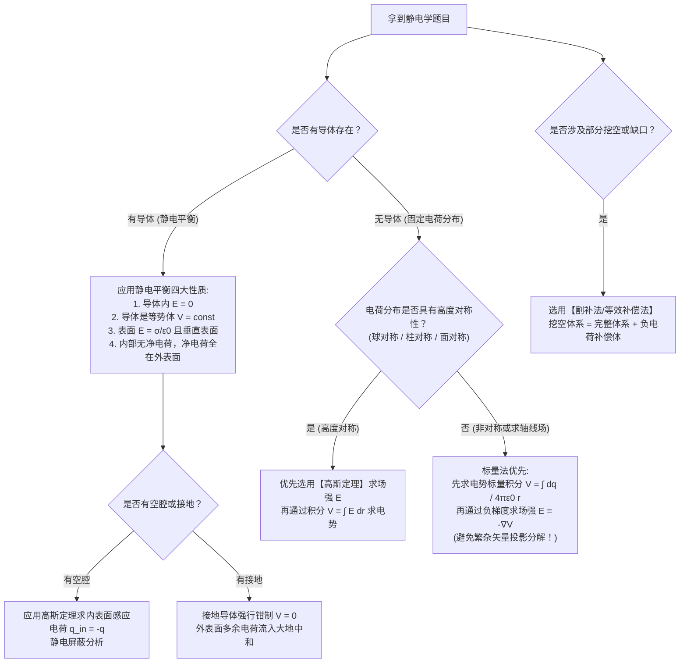

# 
普通物理学 II

浙江大学 竺可桢学院 混合2504班 邓欢桐 3250102223

---

---

[[toc]]

“ 原来你是我最想留住的幸运”—— 田馥甄《小幸运》

---

# 第一部分：课程导言、物理全景与初学者数学工具箱

## 1.1 课程导言与考核结构

欢迎来到**普通物理学 (H) II**（General Physics Honors II）的学习殿堂！
本课程由浙江大学物理学院**王业伍教授（Prof. Dr. Yewu Wang）**主讲。对于刚接触大学物理的初学者而言，物理学第二学期将带你从大一上学期的“质点力学与刚体”跨入精彩绝伦的**“电磁学（Electromagnetism）、光学（Optics）与近代物理（Modern Physics）”**。

在学习之前，请务必明确课程的考核与学习节奏：
- **总成绩评定**：
  $$
  \text{期末总成绩} = \text{平时成绩 } (50\%) + \text{期末考试成绩 } (50\%)
  $$
- **平时成绩构成**：
  - 每周作业（20分）：通过“学在浙大”每周提交一次，**每次作业需整理成一个单独的 PDF 文件提交**。缺交1次扣1分，缺交2次扣2分……缺交5次及以上平时作业分全扣！
  - 期中测验（20分）
  - 随堂测验与考勤（10分）
- **答疑时间与地点**：
  - 每周日下午 15:30—17:00，玉泉校区/紫金港校区 西2-305。

---

## 1.2 物理学全景图（The Map of Physics）与核心方程

物理学是研究宇宙万物最基本运行规律的科学。在经典的物理学全景图（Dominic Walliman 物理学地图）中，物理学被划分为三大支柱：
1. **经典力学与热学（Classical Mechanics & Thermodynamics）**：宏观、低速世界的物理规律（牛顿力学、流体力学、热力学）。
2. **电磁学与经典光学（Electromagnetism & Classical Optics）**：麦克斯韦方程组所统领的电磁场相互作用与光波动理论。
3. **现代物理学（Modern Physics）**：
   - **相对论（Relativity）**：爱因斯坦 1905 年狭义相对论（高速运动）与 1915 年广义相对论（引力与时空弯曲）。
   - **量子力学（Quantum Mechanics）**：普朗克、玻尔、薛定谔、海森堡等建立的微观世界规律。
   - **量子电动力学（QED）与大统一理论**：狄拉克、费曼、朝永振一郎、戴森等建立的电磁相互作用量子场论；格拉肖、温伯格、萨拉姆完成的弱电统一理论。

在物理学的十二大终极方程中，**麦克斯韦方程组（Maxwell's Equations）**占据着核心枢纽地位。本学期的全部静电、静磁、电磁感应与电磁波内容，最终都将汇聚于这组优美的方程之中。

---

## 1.3 核心思想启蒙：为什么自然界的物体普遍呈“电中性”？

作为初学者，在接触复杂的微积分公式之前，我们需要建立深刻的**物理直觉（Physical Intuition）**。
课件一开始抛出了一个引人深思的问题：
> **为什么我们周围的宏观物体（包括人体、桌子、空气）绝大多数都是电中性的，而不是带电的？**

为了回答这个问题，我们来进行两个极具启发性的定量估算（Thought Experiments）：

### 思考实验一：宏观人体间的引力 vs 库仑力
假设有两个体重各为 $m = 60\text{ kg}$ 的同学（Tom 与 Bob），两人相距 $r = 1\text{ m}$。
1. **两人之间的万有引力**：
   根据牛顿万有引力定律：
   $$
   F_G = G \frac{m_1 m_2}{r^2} = 6.67 \times 10^{-11} \times \frac{60 \times 60}{1^2} \approx 2.4 \times 10^{-7}\text{ N}
   $$
   这股力只有微牛量级（相当于一只微小蚂蚁重量的千分之一），在宏观生活中微弱到完全感觉不到。

2. **如果两人带有极其微小的不平衡电荷呢？**
   人体约 $70\%$ 是水，我们粗略将人视作水分子组成：
   - 摩尔质量 $M_{\text{H}_2\text{O}} \approx 18\text{ g/mol}$。
   - $60\text{ kg}$ 人体包含的水分子摩尔数：
     $$
     n = \frac{60\text{ kg}}{18 \times 10^{-3}\text{ kg/mol}} \approx 3.33 \times 10^3\text{ mol}
     $$
   - 水分子总个数：
     $$
     N_{\text{molecules}} = n \cdot N_A \approx 3.33 \times 10^3 \times 6.02 \times 10^{23} \approx 2 \times 10^{27}\text{ 个}
     $$
   
   **假设：如果每个人体内，每个水分子仅仅丢失了 1 个电子（即只有 $\approx 10^{-10}$ 的微小不平衡度）**：
   那么每个人带的净正电荷量为：
   $$
   Q = N_{\text{molecules}} \times e = 2 \times 10^{27} \times 1.6 \times 10^{-19}\text{ C} \approx 3.2 \times 10^8\text{ C}
   $$
   根据库仑定律，两人相距 $1\text{ m}$ 时的静电斥力为：
   $$
   F_e = \frac{1}{4\pi\varepsilon_0} \frac{Q^2}{r^2} \approx 8.99 \times 10^9 \times \frac{(3.2 \times 10^8)^2}{1^2} \approx 10^{26}\text{ N} \text{ ！}
   $$
   
   > [!WARNING]
   >
   > 
<b>物理震撼</b>

   >
   > $10^{26}\text{ N}$ 是一个什么概念？
   > 地球的总质量约为 $6 \times 10^{24}\text{ kg}$，地球在太阳引力作用下的力也仅为 $\approx 3.5 \times 10^{22}\text{ N}$！
   > 也就是说，若两个人体内仅有极微量的不平衡电荷，它们之间的排斥力将**远远超过整颗行星所能承受的力，甚至能把地球撕得粉碎！**
   > **物理结论**：电磁相互作用的强度极端巨大，正负电荷只要有一丝丝不平衡，就会爆发出毁天灭地的力量。因此，大自然在漫长的演化中，必须以极高的精度维持正负电荷的平衡——这就是为什么宏观物质必然呈现严格的**电中性**。

---

### 思考实验二：微观氢原子中库仑力与引力的对比
在微观原子尺度（例如氢原子中，质子与电子相距 $r$）：
- 静电引力：$F_e = \frac{1}{4\pi\varepsilon_0} \frac{e^2}{r^2}$
- 万有引力：$F_G = G \frac{m_e m_p}{r^2}$
二者比值为：
$$
\frac{F_e}{F_G} = \frac{\frac{e^2}{4\pi\varepsilon_0}}{G m_e m_p} = \frac{8.99 \times 10^9 \times (1.60 \times 10^{-19})^2}{6.67 \times 10^{-11} \times (9.11 \times 10^{-31}) \times (1.67 \times 10^{-27})} \approx 2.27 \times 10^{39}
$$
在微观世界中，**静电力比万有引力强整整 39 个数量级**！所以在原子、分子和凝聚态物理中，引力完全可以忽略不计。

---

## 1.4 现代场论视角与麦克斯韦方程组的解耦

### 1.4.1 相互作用方式的革命：从“超距作用”到“场的媒介”
在经典力学中，牛顿认为引力是瞬时传播的“超距作用”（Action at a distance）：质点 A 隔着虚空直接对质点 B 施力。
但电磁学彻底打破了这一观念，引入了**场论（Field Theory）**：
$$
\text{电荷 } A \longrightarrow \text{激发空间中的电磁场 } (\vec{E}, \vec{B}) \longrightarrow \text{场对电荷 } B \text{ 施加力}
$$
**“场”（Field）是一种客观存在的物质形态**，它不仅具备能量、动量，更以有限的光速 $c$ 传播。

### 1.4.2 麦克斯韦方程组的整体结构
为了完整描述电磁相互作用，需要两个空间矢量场：
- 电场强度 $\vec{E}(x, y, z, t)$
- 磁感应强度 $\vec{B}(x, y, z, t)$

麦克斯韦方程组的微分形式（引入真空介电常数 $\varepsilon_0$ 与真空磁导率 $\mu_0$）为：
$$
\begin{cases}
\nabla \cdot \vec{E} = \dfrac{\rho}{\varepsilon_0} & \text{(高斯电场定律：电荷是电场的源)} \\[8pt]
\nabla \cdot \vec{B} = 0 & \text{(高斯磁场定律：无磁单极子，磁感线闭合)} \\[8pt]
\nabla \times \vec{E} = -\dfrac{\partial \vec{B}}{\partial t} & \text{(法拉第电磁感应定律：变化的磁场产生涡旋电场)} \\[8pt]
\nabla \times \vec{B} = \mu_0 \vec{J} + \dfrac{1}{c^2}\dfrac{\partial \vec{E}}{\partial t} & \text{(安培-麦克斯韦定律：电流与变化的电场产生磁场)}
\end{cases}
$$
其中 $c = \frac{1}{\sqrt{\mu_0 \varepsilon_0}}$ 为真空光速，$\rho$ 为电荷体密度，$\vec{J}$ 为电流密度。

### 1.4.3 静电场的解耦（Decoupling of Static Fields）
观察上述方程中的时间偏导项：
如果电荷分布与电流分布不随时间改变，即所有物理量都是**静态的（Static）**：
$$
\frac{\partial \vec{E}}{\partial t} = 0, \quad \frac{\partial \vec{B}}{\partial t} = 0
$$
则麦克斯韦方程组瞬间**解耦为相互独立的两个部分**：
1. **静电学方程（Electrostatics）**：
   $$
   \begin{cases} \nabla \cdot \vec{E} = \dfrac{\rho}{\varepsilon_0} \\[6pt] \nabla \times \vec{E} = 0 \end{cases}
   $$
2. **静磁学方程（Magnetostatics）**：
   $$
   \begin{cases} \nabla \cdot \vec{B} = 0 \\[6pt] \nabla \times \vec{B} = \mu_0 \vec{J} \end{cases}
   $$

> [!NOTE]
>
> 
<b>教学启示</b>

>
> 这正是为什么我们的《普通物理学 II》从**静电场**开始讲起！
> 在静态条件下，电场 $\vec{E}$ 与磁场 $\vec{B}$ 完全脱钩，互不相干。静电场的性质完全由电荷分布 $\rho$ 决定。
>
> - $\nabla \cdot \vec{E} = \frac{\rho}{\varepsilon_0}$ 刻画了电场的**有源性**（对应第 23 章高斯定理）。
> - $\nabla \times \vec{E} = 0$ 刻画了静电场的**无旋性与保守性**（对应第 24 章电势）。

而在无源自由空间（$\rho=0, \vec{J}=0$）中，时变的 $\vec{E}$ 与 $\vec{B}$ 会交替激发，脱离源而独立存在，在空间中以光速传播，这就是**电磁波**！

---

## 1.5 初学者数学工具箱：从零掌握向量微积分与坐标系

很多同学觉得普通物理(H)难，并不是因为物理概念抽象，而是被**微积分与场论算符**卡住了。下面我们用最直白的大白话与几何图像，把这些数学工具彻底讲透！

### 1.5.1 什么是标量场与矢量场？
- **标量场（Scalar Field）**：在空间的每一点，物理量只有一个数值（大小），没有方向。
  - 例如：温度场 $T(x,y,z)$、电势场 $V(x,y,z)$、气压场 $P(x,y,z)$。
- **矢量场（Vector Field）**：在空间的每一点，物理量不仅有大小，还有空间方向。
  - 例如：速度场 $\vec{v}(x,y,z)$、电场 $\vec{E}(x,y,z)$、磁场 $\vec{B}(x,y,z)$。
  - 矢量场可分解为三个分量：$\vec{E} = E_x \hat{i} + E_y \hat{j} + E_z \hat{k}$。

### 1.5.2 核心算符：Nabla 算子（$\nabla$ 算子）
$\nabla$（读作“Nabla”或“Del”）是一个空间微分矢量算子，在笛卡尔直角坐标系下定义为：
$$
\nabla \equiv \hat{i}\frac{\partial}{\partial x} + \hat{j}\frac{\partial}{\partial y} + \hat{k}\frac{\partial}{\partial z} = \left(\frac{\partial}{\partial x}, \frac{\partial}{\partial y}, \frac{\partial}{\partial z}\right)
$$
它可以以三种不同的方式“作用”在物理量上：
1. **作用于标量**：标量乘法 $\longrightarrow$ **梯度（Gradient）** $\nabla V$
2. **点乘矢量**：点积 $\longrightarrow$ **散度（Divergence）** $\nabla \cdot \vec{E}$
3. **叉乘矢量**：叉积 $\longrightarrow$ **旋度（Curl）** $\nabla \times \vec{E}$

---

### 1.5.3 梯度（Gradient）：$\nabla V$
- **定义**：设 $V(x,y,z)$ 为标量场（如电势），则：
  $$
  \nabla V = \frac{\partial V}{\partial x}\hat{i} + \frac{\partial V}{\partial y}\hat{j} + \frac{\partial V}{\partial z}\hat{k}
  $$
- **直观物理意义**：
  想象你站在一座山坡上，$V(x,y)$ 表示高度。
  - 梯度的**方向**：是高度上升**最陡峭**的方向（最速上升方向）。
  - 梯度的**大小**：是这个方向上的变化率（坡度有多陡）。
  - 在静电学中，由于正电荷受到使电势降低的力，电场强度等于电势梯度的**负值**：
    $$
    \vec{E} = -\nabla V
    $$
    电场线永远指向电势下降最快的方向！

---

### 1.5.4 散度（Divergence）：$\nabla \cdot \vec{E}$
- **定义**：设 $\vec{E}$ 为矢量场，则标量点积为：
  $$
  \nabla \cdot \vec{E} = \frac{\partial E_x}{\partial x} + \frac{\partial E_y}{\partial y} + \frac{\partial E_z}{\partial z}
  $$
- **直观物理意义（有源还是有汇？）**：
  想象一个封闭的小水池，水流速度场为 $\vec{v}$：
  - 如果在某一点 $\nabla \cdot \vec{v} > 0$：说明从该点流出的水比流入的多，这里一定藏着一个**自来水龙头（源 Source）**！
  - 如果在某一点 $\nabla \cdot \vec{v} < 0$：说明流入的水比流出的多，这里一定有一个**排水地漏（汇 Sink）**！
  - 如果 $\nabla \cdot \vec{v} = 0$：说明流入等于流出，该点既无水源也无排水口（无源场）。
  - 在静电学中：
    $$
    \nabla \cdot \vec{E} = \frac{\rho}{\varepsilon_0}
    $$
    正电荷（$\rho > 0$）就是电场线的“水龙头”（源头）；负电荷（$\rho < 0$）就是电场线的“地漏”（汇集点）；没有电荷的地方，电场线只能穿过而不能无端产生或消失！

---

### 1.5.5 旋度（Curl）：$\nabla \times \vec{E}$
- **定义**：矢量叉积为：
  $$
  \nabla \times \vec{E} = \begin{vmatrix}
  \hat{i} & \hat{j} & \hat{k} \\
  \dfrac{\partial}{\partial x} & \dfrac{\partial}{\partial y} & \dfrac{\partial}{\partial z} \\
  E_x & E_y & E_z
  \end{vmatrix} = \left(\frac{\partial E_z}{\partial y} - \frac{\partial E_y}{\partial z}\right)\hat{i} + \left(\frac{\partial E_x}{\partial z} - \frac{\partial E_z}{\partial x}\right)\hat{j} + \left(\frac{\partial E_y}{\partial x} - \frac{\partial E_x}{\partial y}\right)\hat{k}
  $$
- **直观物理意义（打不打旋？）**：
  想象把一个极其轻小的微型旋转叶轮放在流体中：
  - 如果叶轮开始飞速旋转，说明该点存在**涡旋（漩涡）**，旋度不为零；
  - 如果叶轮无论怎么放都不自转，说明流体在该处**无旋**。
  - 在静电学中：
    $$
    \nabla \times \vec{E} = 0
    $$
    **静电场是处处无旋的保守场！** 这保证了静电场力做功与路径无关，从而允许我们定义单值的“电势”。

---

### 1.5.6 常用曲面坐标系微元与梯度表达

在具有圆柱对称性或球对称性的物理问题中，使用直角坐标系计算会极其冗繁，必须熟练切换到柱坐标系与球坐标系：

#### 1. 柱坐标系 $(r, \phi, z)$
- 坐标定义：$x = r\cos\phi$, $y = r\sin\phi$, $z = z$。
- 位移微元矢量：$d\vec{l} = dr\,\hat{u}_r + r\,d\phi\,\hat{u}_\phi + dz\,\hat{u}_z$。
- 体积微元：$dV = r\,dr\,d\phi\,dz$。
- 标量场梯度的表达式：
  $$
  \nabla V = \frac{\partial V}{\partial r}\hat{u}_r + \frac{1}{r}\frac{\partial V}{\partial \phi}\hat{u}_\phi + \frac{\partial V}{\partial z}\hat{u}_z
  $$

#### 2. 球坐标系 $(r, \theta, \phi)$
- 坐标定义（$\theta$ 为极角/天顶角，$\phi$ 为方位角）：
  $$
  x = r\sin\theta\cos\phi, \quad y = r\sin\theta\sin\phi, \quad z = r\cos\theta
  $$
- 位移微元矢量：$d\vec{l} = dr\,\hat{u}_r + r\,d\theta\,\hat{u}_\theta + r\sin\theta\,d\phi\,\hat{u}_\phi$。
- 球面面积微元（$r$ 固定）：$dA = r^2\sin\theta\,d\theta\,d\phi = r^2 d\Omega$（其中 $d\Omega = \sin\theta d\theta d\phi$ 为**立体角微元**）。
- 体积微元：$dV = r^2\sin\theta\,dr\,d\theta\,d\phi$。
- 标量场梯度的表达式：
  $$
  \nabla V = \frac{\partial V}{\partial r}\hat{u}_r + \frac{1}{r}\frac{\partial V}{\partial \theta}\hat{u}_\theta + \frac{1}{r\sin\theta}\frac{\partial V}{\partial \phi}\hat{u}_\phi
  $$

有了这些坚实的物理图像与数学工具，我们就可以正式开启电磁学之旅！

---

# 第二部分：第 22 章 库仑定律与静电场 (Coulomb’s Law & Electric Field)

## 2.1 电荷的基本特征 (Characteristics of Electric Charge)

人类对电现象的认识经历了数千年的探索历程：
- 公元前 600 年，古希腊泰勒斯（Thales）记录了毛皮摩擦琥珀吸引草屑的现象。
- 1600 年，英国吉尔伯特（Gilbert）在《论磁》（De Magnete）中首次使用“electric”一词。
- 1733 年，法国杜菲（Du Fay）发现存在两种电荷。
- 1750 年，美国富兰克林（Benjamin Franklin）将这两种电荷正式命名为**“正电荷（Positive）”与“负电荷（Negative）”**。

在现代物理学中，物质由原子构成，原子由带正电的原子核与带负电的核外电子构成。电荷具有四个最基本的物理本质特征：

### 1. 存在两种电荷与相互作用法则
自然界只有两种电荷：同种电荷相互排斥，异种电荷相互吸引。

### 2. 电荷量子化 (Charge Quantization)
任何带电体所携带的电荷量 $q$ 都不是连续可分的，而是某一基本电荷量 $e$ 的整数倍：
$$
q = \pm N e, \quad N = 1, 2, 3, \dots
$$
其中元电荷（Elementary Charge）：
$$
e = 1.602 \times 10^{-19}\text{ C}
$$

> [!NOTE]
>
> 
<b>密立根油滴实验（Millikan Oil-Drop Experiment, 1910~1913）</b>

>
> 罗伯特·密立根通过精巧的油滴实验直接测定了元电荷 $e$：
> 1. **平衡态测量**：带电小油滴在重力场与两块平行带电极板产生的匀强电场 $\vec{E}$ 中受力平衡：
>    $$
>    F_e = F_G \implies q E = m g = \left(\frac{4}{3}\pi r^3 \rho\right) g
>    $$
> 2. **阻力动态测量**：油滴在无电场下自由下落，受空气斯托克斯阻力 $F_{\text{drag}} = 6\pi \eta r v$，通过终极下落速度 $v$ 测算出油滴半径 $r$ 和质量 $m$。
> 3. **结果**：发现成百上千个油滴所带电量均严格是 $1.6 \times 10^{-19}\text{ C}$ 的整数倍！
> 4. **科学史小插曲（课件重点强调）**：历史学家研究密立根的实验笔记发现，他剔除了太大（下落过快超出测量精度）或太小（受布朗运动剧烈干扰）的油滴数据。这是追求科学严谨度、剔除系统误差的典范操作。

### 3. 电荷守恒定律 (Conservation of Charge)
在一个孤立系统（封闭系统）内发生任何物理、化学或核反应过程，**所有电荷的代数和保持严格恒定不变**。
- **核反应示例**：铀核 $\alpha$ 衰变：
  $$
  ^{238}_{92}\text{U} \longrightarrow ^{234}_{90}\text{Th} + ^{4}_{2}\text{He}
  $$
  反应前总核电荷数为 $+92e$，反应后 $90e + 2e = +92e$，严格守恒。
- **高能粒子湮灭/产生**：正负电子对碰撞湮灭为两个光子：
  $$
  e^- + e^+ \longrightarrow 2\gamma
  $$
  反应前总电荷 $(-e) + (+e) = 0$，反应后两个中性光子电荷为 0，严格守恒。

### 4. 电荷的相对论运动不变性 (Relativistic Invariance of Charge)
与物体的长度（长度收缩）、时间（时间膨胀）以及质量（质能关系）不同，**电荷量是一个洛伦兹标量（Lorentz Invariant）**。
无论带电粒子静止还是以接近光速的高速运动，其所带的电荷量 $q$ 绝对不变！

---

## 2.2 库仑定律 (Coulomb’s Law)

1785 年，法国物理学家查尔斯·库仑利用高灵敏度的**扭秤实验（Torsion Balance）**，定量测定了静止电荷之间的相互作用力。

### 2.2.1 点电荷理想模型 (Point Charge)
当带电体自身的几何线度（尺寸）远远小于它们之间的相互距离时，带电体的形状和电荷在其上的具体分布细节对相互作用力的影响可以忽略不计，此时带电体可以抽象为只具有电荷量、没有体积的**点电荷**。

### 2.2.2 库仑定律数学公式
在真空中，两个静止点电荷 $q_1$ 和 $q_2$ 之间相互作用的静电力大小与两电荷量的乘积成正比，与它们之间距离 $r$ 的平方成反比；作用力的方向沿着两者的连线：
$$
\vec{F}_{12} = \frac{1}{4\pi\varepsilon_0}\frac{q_1 q_2}{r^2}\hat{r}_{12}
$$
其中：
- $\vec{F}_{12}$ 表示电荷 1 施加在电荷 2 上的力。
- $\hat{r}_{12} = \frac{\vec{r}_2 - \vec{r}_1}{|\vec{r}_2 - \vec{r}_1|}$ 是从源电荷 1 指向受力电荷 2 的单位矢量。
- $\varepsilon_0$ 称为**真空介电常数（Vacuum Permittivity Constant）**：
  $$
  \varepsilon_0 = 8.854 \times 10^{-12}\text{ C}^2/(\text{N}\cdot\text{m}^2)
  $$
- 静电力常量 $k \equiv \frac{1}{4\pi\varepsilon_0} = 8.99 \times 10^9\text{ N}\cdot\text{m}^2/\text{C}^2$。

---

## 2.3 电场强度与电场线 (Electric Field & Field Lines)

### 2.3.1 电场强度的定义
引入“场”的概念后，库仑力问题被拆解为两步：
1. 源电荷 $Q$ 在空间各点激发出电场 $\vec{E}$；
2. 电场 $\vec{E}$ 对放入其中的试探电荷 $q_0$ 施加力 $\vec{F} = q_0 \vec{E}$。

**电场强度 $\vec{E}$ 的操作性定义**：
将一个充分小的正检验电荷（试探电荷 $q_0 > 0$，其电量必须足够小以至于不干扰源电荷的原有分布）放入电场中某点，它所受到的静电力 $\vec{F}$ 与其电量 $q_0$ 的比值定义为该点的电场强度：
$$
\vec{E} \equiv \frac{\vec{F}}{q_0}
$$
- 单位：$\text{N/C}$ 或 $\text{V/m}$。
- **单个真空中点电荷 $Q$ 在距离 $r$ 处产生的电场**：
  $$
  \vec{E} = \frac{1}{4\pi\varepsilon_0}\frac{Q}{r^2}\hat{r}
  $$

### 2.3.2 电场线（Electric Field Lines）的物理性质
法拉第提出了用电场线来直观形象地描绘矢量场：
1. **切线方向**：空间中任意一点的电场线切线方向代表该点电场强度 $\vec{E}$ 的方向。
2. **线条密度**：通过垂直于电场线的单位面积的电场线条数（面密度 $\frac{dN}{dA_\perp}$）与该处的场强大小 $|\vec{E}|$ 成正比。
3. **起点与终点**：在静电场中，**电场线发自正电荷（或来自无穷远），终止于负电荷（或伸向无穷远）**。
4. **互不相交**：空间任意一点的电场方向唯一，因此任何两条电场线绝不相交。
5. **绝不闭合**：静电场是无旋保守场（$\nabla \times \vec{E} = 0$），**静电场线绝对不可能形成闭合回路**！

---

## 2.4 离散点电荷系统的电场与叠加原理

根据电场的独立作用原理与线性叠加原理（Principle of Superposition），$n$ 个点电荷 $q_1, q_2, \dots, q_n$ 在某点产生的总电场强度等于各个点电荷单独存在时在该点产生的电场强度的矢量和：
$$
\vec{E} = \sum_{i=1}^n \vec{E}_i = \frac{1}{4\pi\varepsilon_0}\sum_{i=1}^n \frac{q_i}{r_i^2}\hat{r}_i
$$

---

### 【例题 1】三电荷受力与最大力位置的求解 (课件 Slide 34-35)
**题目描述**：
在 $xy$ 平面上，两个完全相同的正点电荷 $+q$ 分别固定在 $x$ 轴上的 $(-a, 0)$ 和 $(+a, 0)$ 处。第三个正点电荷 $Q$ 放置在 $y$ 轴正半轴上的 $(0, y)$ 处。
试求：
1. 电荷 $Q$ 所受到的合静电力 $\vec{F}$；
2. $y$ 取何值时，电荷 $Q$ 受到的静电力达到最大值？最大力为多少？此时两固定电荷对 $Q$ 的夹角是多少？

**初学者保姆级推导教学**：
- **步骤 1：对称性分析与受力分解**
  设点 $(0, y)$ 到 $(-a, 0)$ 和 $(a, 0)$ 的距离均为 $r = \sqrt{a^2 + y^2}$。
  左侧电荷对 $Q$ 施加排斥力 $\vec{F}_1$，右侧电荷施加排斥力 $\vec{F}_2$。
  大小为：
  $$
  F_1 = F_2 = \frac{1}{4\pi\varepsilon_0}\frac{qQ}{r^2} = \frac{1}{4\pi\varepsilon_0}\frac{qQ}{a^2 + y^2}
  $$
  由于左右对称，水平方向分力大小相等、方向相反：
  $$
  F_x = F_{1x} + F_{2x} = -F_1 \cos\theta + F_2 \cos\theta = 0
  $$
  因此合力仅有竖直向上的 $y$ 分量！
- **步骤 2：投影到 $y$ 轴**
  设连线与 $x$ 轴的夹角为 $\alpha$，或连线与 $y$ 轴夹角为 $\theta$（课件中取 $\theta$ 为与 $x$ 轴夹角，满足 $\sin\theta = \frac{y}{r}$）：
  $$
  F_y = 2 F_1 \sin\theta = 2 \left(\frac{1}{4\pi\varepsilon_0}\frac{qQ}{r^2}\right) \left(\frac{y}{r}\right) = \frac{qQ}{2\pi\varepsilon_0}\frac{y}{(a^2 + y^2)^{3/2}}
  $$
- **步骤 3：求极值（对 $y$ 求导）**
  令 $\frac{dF_y}{dy} = 0$：
  $$
  \frac{d}{dy}\left[\frac{y}{(a^2+y^2)^{3/2}}\right] = \frac{1 \cdot (a^2+y^2)^{3/2} - y \cdot \frac{3}{2}(a^2+y^2)^{1/2}(2y)}{(a^2+y^2)^3} = 0
  $$
  提取公因式 $(a^2+y^2)^{1/2}$：
  $$
  (a^2 + y^2) - 3y^2 = 0 \implies a^2 - 2y^2 = 0
  $$
  解得最佳极大值位置：
  $$
  y = \frac{a}{\sqrt{2}} = \frac{\sqrt{2}}{2}a
  $$
- **步骤 4：求最大力和几何角**
  将 $y = \frac{a}{\sqrt{2}}$ 代入 $a^2 + y^2 = a^2 + \frac{a^2}{2} = \frac{3}{2}a^2$：
  $$
  F_{\max} = \frac{qQ}{2\pi\varepsilon_0} \frac{\frac{a}{\sqrt{2}}}{\left(\frac{3}{2}a^2\right)^{3/2}} = \frac{qQ}{2\pi\varepsilon_0} \frac{\frac{a}{\sqrt{2}}}{\frac{3\sqrt{3}}{2\sqrt{2}} a^3} = \frac{qQ}{3\sqrt{3}\pi\varepsilon_0 a^2}
  $$
  几何夹角：$\tan\theta = \frac{y}{a} = \frac{1}{\sqrt{2}} \approx 0.707 \implies \theta \approx 35.3^\circ$。

---

## 2.5 电偶极子 (Electric Dipole) (课件 Slide 36-40)

### 2.5.1 电偶极矩定义
**电偶极子**是由相距很近的等量异种电荷 $+q$ 和 $-q$ 构成的物理系统。
- **电偶极矩（Dipole Moment）**：
  $$
  \vec{p} \equiv q\vec{d}
  $$
  其中 $\vec{d}$ 是**从负电荷 $-q$ 指向正电荷 $+q$** 的位移矢量。
- 现实应用：一氧化碳（CO）、水分子（$\text{H}_2\text{O}$）等极性分子的本征电偶极矩。

### 2.5.2 远距离处电偶极子的电场计算 ($r \gg d$)
设电偶极子沿 $z$ 轴放置，中心位于原点，$-q$ 位于 $-d/2$，$+q$ 位于 $+d/2$。考察远方一点 $P(r, \theta)$。
利用余弦定理与一阶泰勒展开：
$$
r_\pm = \sqrt{r^2 + (d/2)^2 \mp rd\cos\theta} \approx r \left(1 \mp \frac{d}{2r}\cos\theta\right)
$$
$$
\frac{1}{r_\pm^2} \approx \frac{1}{r^2}\left(1 \pm \frac{d}{r}\cos\theta\right)
$$
经过严格的球坐标矢量叠加推导，可得电场强度的一般矢量表达式为：
$$
\vec{E}(r) = \frac{1}{4\pi\varepsilon_0}\frac{1}{r^3} \left[3(\vec{p}\cdot\hat{r})\hat{r} - \vec{p}\right]
$$
在球坐标系下的分量为：
$$
\begin{cases}
E_r = \dfrac{1}{4\pi\varepsilon_0}\dfrac{2p\cos\theta}{r^3} \\[8pt]
E_\theta = \dfrac{1}{4\pi\varepsilon_0}\dfrac{p\sin\theta}{r^3}
\end{cases}
$$

#### 两个极其重要的特殊位置：
1. **轴线上（On the dipole axis, $\theta = 0$ 或 $\pi$）**：
   电场方向平行于 $\vec{p}$：
   $$
   \vec{E}_{\text{axis}} = \frac{1}{4\pi\varepsilon_0}\frac{2\vec{p}}{r^3}
   $$
2. **中垂线上/赤道面上（On the equatorial plane, $\theta = \pi/2$）**：
   电场方向反平行于 $\vec{p}$：
   $$
   \vec{E}_{\text{equatorial}} = -\frac{1}{4\pi\varepsilon_0}\frac{\vec{p}}{r^3}
   $$

> [!IMPORTANT]
>
> 
<b>核心规律对比</b>

>
> - 单个点电荷的电场随距离衰减规律：$E \propto \frac{1}{r^2}$。
> - 电偶极子的电场随距离衰减规律：$E \propto \frac{1}{r^3}$（因为等量异号电荷在远处的电场大部分相互抵消，衰减得更快！）。

---

## 2.6 连续带电体的电场积分方法 (Continuous Charge Distributions)

当带电体不能视为点电荷时，我们将其划分为无数个无限小的微元 $dq$。每个微元视作点电荷，利用微积分进行全空间矢量积分：
$$
\vec{E} = \frac{1}{4\pi\varepsilon_0}\int \frac{dq}{r^2}\hat{r}
$$

三种电荷密度定义：
1. **线电荷密度（Linear Charge Density）**：$\lambda = \frac{dq}{dl} \quad (\text{C/m})$
2. **面电荷密度（Surface Charge Density）**：$\sigma = \frac{dq}{dA} \quad (\text{C/m}^2)$
3. **体电荷密度（Volume Charge Density）**：$\rho = \frac{dq}{dV} \quad (\text{C/m}^3)$

---

### 【例题 3】有限长均匀带电细棒中垂线上的电场 (课件 Slide 42-44)
**题目描述**：
一根长度为 $2L$ 的细直细棒沿 $y$ 轴放置，中心位于原点，带电量为 $+q$（线电荷密度 $\lambda = \frac{q}{2L}$）。求在其垂直平分线（$z$ 轴）上距中心为 $z$ 的点 $P(0, 0, z)$ 处的电场强度。

**推导过程**：
- 取 $y$ 轴上的电荷微元 $dy$，其电荷量 $dq = \lambda dy$。
- 微元到点 $P$ 的距离 $r = \sqrt{y^2 + z^2}$。
- 微元在 $P$ 点产生的电场大小：
  $$
  dE = \frac{1}{4\pi\varepsilon_0}\frac{\lambda dy}{y^2 + z^2}
  $$
- **对称性分解**：
  细棒在 $[-L, L]$ 对称分布，对于任意 $+y$ 处的微元，总能在 $-y$ 处找到对应的微元，它们的水平分量 $dE_y$ 互相抵消，仅保留沿 $+z$ 轴的分量：
  $$
  dE_z = dE \cos\theta = dE \frac{z}{\sqrt{y^2 + z^2}} = \frac{\lambda z dy}{4\pi\varepsilon_0 (y^2 + z^2)^{3/2}}
  $$
- **全长积分**：
  $$
  E_z = \int_{-L}^L \frac{\lambda z dy}{4\pi\varepsilon_0 (y^2 + z^2)^{3/2}} = \frac{\lambda z}{4\pi\varepsilon_0} \left[ \frac{y}{z^2 \sqrt{y^2 + z^2}} \right]_{-L}^L
  $$
  代入上下限：
  $$
  E_z = \frac{\lambda z}{4\pi\varepsilon_0} \frac{2L}{z^2 \sqrt{z^2 + L^2}} = \frac{q}{4\pi\varepsilon_0 z \sqrt{z^2 + L^2}}
  $$

#### 极限情况探讨（物理检验）：
1. **远距离极限（$z \gg L$）**：
   此时 $\sqrt{z^2 + L^2} \approx z$，公式退化为：
   $$
   E \approx \frac{q}{4\pi\varepsilon_0 z^2}
   $$
   细棒在远方完全退化为一个点电荷！符合物理直觉。
2. **无限长直线极限（$z \ll L$ 或 $L \to \infty$）**：
   此时 $\sqrt{z^2 + L^2} \approx L$，公式退化为：
   $$
   E = \frac{q}{4\pi\varepsilon_0 z L} = \frac{2L\lambda}{4\pi\varepsilon_0 z L} = \frac{\lambda}{2\pi\varepsilon_0 z}
   $$
   这就是著名的**无限长均匀带电直线场强公式**！

---

### 【核心模型】均匀带电圆环轴线上的电场 (课件 Slide 48-49)
**模型描述**：
半径为 $R$ 的圆环均匀带总电量 $q$。求轴线上距圆心 $z$ 处点 $P$ 的电场。
- **对称性**：圆环上关于圆心对称的两个微元 $dq$，其垂直于轴线的分量大小相等、方向相反，完全抵消。合电场方向严格沿轴线 $\hat{k}$。
- **积分计算**：
  每个微元到 $P$ 点的距离均为常数 $r = \sqrt{R^2 + z^2}$。
  $$
  dE_z = \frac{1}{4\pi\varepsilon_0}\frac{dq}{R^2 + z^2}\cos\theta = \frac{1}{4\pi\varepsilon_0}\frac{dq}{R^2 + z^2}\frac{z}{\sqrt{R^2 + z^2}} = \frac{z\,dq}{4\pi\varepsilon_0 (R^2 + z^2)^{3/2}}
  $$
  对全环积分，由于除 $dq$ 外其余均为常数：
  $$
  E_z = \frac{z}{4\pi\varepsilon_0 (R^2 + z^2)^{3/2}} \int dq = \frac{q z}{4\pi\varepsilon_0 (R^2 + z^2)^{3/2}}
  $$

---

### 【例题 6】均匀带电圆盘轴线上的电场 (课件 Slide 50-52)
**题目描述**：
半径为 $R$ 的圆盘，表面均匀带电，面电荷密度为 $\sigma$。求轴线上距圆心 $z$ 处的电场。

**推导教学（同心环微元法）**：
- 将圆盘分割为无数个半径为 $w$、宽度为 $dw$ 的细同心圆环。
- 每个薄环的面积 $dA = 2\pi w dw$，带电量 $dq = \sigma 2\pi w dw$。
- 利用上方已求得的“圆环轴线公式”，薄环在 $P$ 点产生的场强为：
  $$
  dE_z = \frac{z\,dq}{4\pi\varepsilon_0 (w^2 + z^2)^{3/2}} = \frac{z (\sigma 2\pi w dw)}{4\pi\varepsilon_0 (w^2 + z^2)^{3/2}} = \frac{\sigma z}{2\varepsilon_0}\frac{w dw}{(w^2 + z^2)^{3/2}}
  $$
- 对半径 $w$ 从 $0$ 到 $R$ 积分：
  $$
  E_z = \frac{\sigma z}{2\varepsilon_0} \int_0^R \frac{w dw}{(w^2 + z^2)^{3/2}} = \frac{\sigma z}{2\varepsilon_0} \left[ -\frac{1}{\sqrt{w^2 + z^2}} \right]_0^R = \frac{\sigma}{2\varepsilon_0}\left(1 - \frac{z}{\sqrt{R^2 + z^2}}\right)
  $$

#### 极其重要的极限结论：
- **无限大均匀带电平面极限（$R \to \infty$ 或 $z \ll R$）**：
  $$
  \lim_{R \to \infty} E_z = \frac{\sigma}{2\varepsilon_0}
  $$
  > [!TIP]
  >
  > 
<b>惊人发现</b>

  >
  > 无限大平面的电场是**均匀常量场**，大小与距离 $z$ 完全无关！

---

### 【例题 7 & 8】均匀带电球壳的电场与立体角几何证明 (课件 Slide 53-59)
**题目描述**：
半径为 $R$ 的均匀带电球壳，总电量为 $q$。求空间任意一点的电场强度。

**结论**：
$$
E(r) = \begin{cases} 0 & (r < R, \text{球壳内部}) \\[8pt] \dfrac{1}{4\pi\varepsilon_0}\dfrac{q}{r^2} & (r > R, \text{球壳外部}) \end{cases}
$$

**立体角证明法（几何直观与深刻美感，Slide 58-59）**：
在球壳内部任意一点 $P$，通过 $P$ 作一个顶角极小的对顶圆锥（立体角微元 $d\Omega$）。
- 圆锥在球壳两侧截出两块微元面 $dA_1$ 与 $dA_2$。
- 根据立体角投影定义：$d\Omega = \frac{dA_1 \cos\theta_1}{r_1^2} = \frac{dA_2 \cos\theta_2}{r_2^2}$。
- 由球的几何对称性可知，两端切面与视线夹角必然相等，即 $\theta_1 = \theta_2$。
- 因此两块微元的面积之比为：$\frac{dA_1}{dA_2} = \frac{r_1^2}{r_2^2}$。
- 两块微元带电量之比为：$\frac{dq_1}{dq_2} = \frac{\sigma dA_1}{\sigma dA_2} = \frac{r_1^2}{r_2^2}$。
- 根据库仑定律，它们在 $P$ 点产生的电场大小分别为：
  $$
  dE_1 = \frac{1}{4\pi\varepsilon_0}\frac{dq_1}{r_1^2} \propto \frac{r_1^2}{r_1^2} = 1, \quad dE_2 = \frac{1}{4\pi\varepsilon_0}\frac{dq_2}{r_2^2} \propto \frac{r_2^2}{r_2^2} = 1
  $$
- **结论**：$dE_1 = dE_2$！二者大小严格相等，方向相反，**完全抵消**！
- 对整个 $4\pi$ 立体角空间积分，所有方向的微元全部两两精准抵消，因此**球壳内任意一点场强恒为 0**！

---

### 【例题 9】均匀带电实心球体的电场 (课件 Slide 60-64)
**题目描述**：
半径为 $R$ 的实心球体，均匀充满体电荷，总电量为 $q$，体电荷密度 $\rho = \frac{q}{\frac{4}{3}\pi R^3}$。求球内、球外的电场分布。

**推导教学（薄球壳叠加法）**：
1. **球体外部（$r > R$）**：
   整个球体可以看作无数个同心薄球壳套在一起。根据球壳定理，每一个球壳在外部产生的场等效于集中在球心的点电荷。
   因此，整个球体在外部产生的场等于全部电荷集中在球心：
   $$
   E(r) = \frac{1}{4\pi\varepsilon_0}\frac{q}{r^2}\hat{r} \quad (r > R)
   $$
2. **球体内部（$r < R$）**：
   通过半径 $r$ 的球面将球体分为两部分：
   - 半径 $r$ 以外的球壳层：根据球壳定理，它们在内部点 $P$ 产生的场强矢量和为 0！
   - 半径 $r$ 以内的实心球核：其电荷量为 $q_{\text{enc}} = \rho \frac{4}{3}\pi r^3 = q \frac{r^3}{R^3}$。这些电荷等效于球心点电荷！
   故内部场强为：
   $$
   E(r) = \frac{1}{4\pi\varepsilon_0}\frac{q_{\text{enc}}}{r^2} = \frac{1}{4\pi\varepsilon_0}\frac{q \frac{r^3}{R^3}}{r^2} = \frac{q r}{4\pi\varepsilon_0 R^3} = \frac{\rho r}{3\varepsilon_0}
   $$

> [!TIP]
>
> 
<b>麦克斯韦散度视角的秒杀推导 (Slide 63-64)</b>

>
> 在球内，根据高斯定律微分形式 $\nabla \cdot \vec{E} = \frac{\rho}{\varepsilon_0}$：
> 由球对称性，$\vec{E} = (E_x, E_y, E_z)$ 在三个方向的变化率必须完全均等：
> $$
> \frac{\partial E_x}{\partial x} = \frac{\partial E_y}{\partial y} = \frac{\partial E_z}{\partial z} = \frac{\rho}{3\varepsilon_0}
> $$
> 直接积分得 $E_x = \frac{\rho}{3\varepsilon_0}x$，故矢量式为：
> $$
> \vec{E} = \frac{\rho}{3\varepsilon_0}\vec{r}
> $$
> 微分形式和积分几何法得到的结果完全一致，展现了物理理论的极度自洽！

---

### 【例题 10】带微小缺口的均匀带电圆环圆心场强 (课件 Slide 65)
**题目描述**：
半径为 $R$ 的细圆环，原先均匀带正电 $Q$。现切除一小段宽度仅为 $\Delta l = \frac{R}{200}$ 的微小缺口。求圆心 $O$ 处的电场强度。

**解题技巧：割补法（等效补偿法）**
- **初学者常犯错误**：试图对剩余的 $\frac{199}{200}$ 圆环进行繁重的角度积分，极其容易算错。
- **神级思路**：
  一个完整闭合的均匀带电圆环，由中心对称性可知，圆心处的合场强必然严格为零：
  $$
  \vec{E}_{\text{complete}} = \vec{E}_{\text{remaining}} + \vec{E}_{\text{gap}} = 0
  $$
  因此，有缺口的圆环在圆心产生的场强，恰好等于**填补该缺口所需电荷所产生场强的相反数**！
  $$
  \vec{E}_{\text{remaining}} = -\vec{E}_{\text{gap}}
  $$
- 缺口所带电量为：
  $$
  q_{\text{gap}} = \lambda \Delta l = \left(\frac{Q}{2\pi R}\right) \left(\frac{R}{200}\right) = \frac{Q}{400\pi}
  $$
- 缺口尺寸极小，可完美视为点电荷，其在圆心处产生的场强指向远离缺口方向：
  $$
  E_{\text{gap}} = \frac{1}{4\pi\varepsilon_0}\frac{q_{\text{gap}}}{R^2} = \frac{1}{4\pi\varepsilon_0}\frac{\frac{Q}{400\pi}}{R^2} = \frac{Q}{1600\pi^2\varepsilon_0 R^2}
  $$
- 故剩余圆环在圆心的场强大小为 $\dfrac{Q}{1600\pi^2\varepsilon_0 R^2}$，**方向指向缺口**！

---

### 【例题 11】半圆环在圆心处的电场 (课件 Slide 66)
**题目描述**：
半径为 $R$ 的细半圆环，均匀带电 $Q$。求其在圆心 $O$ 处的电场强度。

**推导教学**：
- 线电荷密度：$\lambda = \frac{Q}{\pi R}$。
- 在半圆环上取角微元 $d\theta$，对应的弧长 $dl = R d\theta$，电荷微元 $dq = \lambda R d\theta = \frac{Q}{\pi}d\theta$。
- 对称轴取为 $y$ 轴，由对称性，水平 $x$ 分量积分必定抵消为 0，只有垂直于对称轴方向的分量：
  $$
  dE_y = \frac{1}{4\pi\varepsilon_0}\frac{dq}{R^2}\sin\theta = \frac{Q}{4\pi^2\varepsilon_0 R^2}\sin\theta d\theta
  $$
- 积分区间 $\theta \in [0, \pi]$：
  $$
  E = \int_0^\pi \frac{Q}{4\pi^2\varepsilon_0 R^2}\sin\theta d\theta = \frac{Q}{4\pi^2\varepsilon_0 R^2} [-\cos\theta]_0^\pi = \frac{Q}{4\pi^2\varepsilon_0 R^2} [1 - (-1)] = \frac{Q}{2\pi^2\varepsilon_0 R^2}
  $$

---

### 【例题 12】无限长带电直线对径向放置细棒的静电力 (课件 Slide 67)
**题目描述**：
一条无限长直导线带电线密度为 $\lambda_1$。在与其垂直的同一平面内放置一根长为 $L$ 的均匀带电细棒，细棒带电线密度为 $\lambda_2$，近端距长直导线为 $L$，远端距直导线为 $2L$。求长直导线对该细棒的总静电力。

**推导教学**：
- 无限长带电直导线在距离 $r$ 处的电场强度为：
  $$
  E(r) = \frac{\lambda_1}{2\pi\varepsilon_0 r}
  $$
- 在细棒上距离长导线 $r$ 处取微元 $dr$，其电荷量 $dq = \lambda_2 dr$。
- 该微元所受库仑力为：
  $$
  dF = dq \cdot E(r) = \frac{\lambda_1 \lambda_2}{2\pi\varepsilon_0}\frac{dr}{r}
  $$
- 细棒沿径向从 $r = L$ 延伸到 $r = 2L$，总受力为积分：
  $$
  F = \int_L^{2L} \frac{\lambda_1 \lambda_2}{2\pi\varepsilon_0}\frac{dr}{r} = \frac{\lambda_1 \lambda_2}{2\pi\varepsilon_0} \ln\left(\frac{2L}{L}\right) = \frac{\lambda_1 \lambda_2}{2\pi\varepsilon_0}\ln 2
  $$

---

# 第三部分：第 23 章 高斯定理 (Gauss’ Law)

## 3.1 矢量场的通量概念 (Flux of a Vector Field)

高斯定理是电磁学中最为优雅、深刻的基石定律之一。在理解静电场的高斯定理之前，我们需要先建立**“通量（Flux）”**这一流体与矢量场的通用概念。

### 3.1.1 流体流动的通量类比
想象水在管道中以速度场 $\vec{v}$ 流动，水的质量密度为 $\rho$：
- **质量通量（Mass Flux）**：单位时间内流过某一截面积 $A$ 的流体质量：
  $$
  \frac{dm}{dt} = \rho A v
  $$
- **体积通量（Volume Flux）**：单位时间内流过截面积 $A$ 的流体体积：
  $$
  \Phi_v = A v
  $$

如果管道截面与流速方向不垂直，夹角为 $\theta$（即截面法向单位矢量 $\hat{n}$ 与速度矢量 $\vec{v}$ 的夹角为 $\theta$）：
$$
\Phi_v = v A \cos\theta = \vec{v} \cdot \vec{A}
$$
其中面积矢量定义为：$\vec{A} \equiv A \hat{n}$。
如果流速场在面上不均匀，且曲面是弯曲的，则定义面积分：
$$
\Phi_v = \int_S \vec{v} \cdot d\vec{A}
$$

---

### 3.1.2 静电场的电通量 (Electric Flux)
类似地，对于静电场 $\vec{E}$，穿过任意曲面 $S$ 的**电通量**定义为电场强度在曲面上的面积分：
$$
\Phi_E \equiv \int_S \vec{E} \cdot d\vec{A} = \int_S E \cos\theta dA
$$

#### 几何物理图像：
根据第 22 章电场线的定义，电场的强弱等于穿过垂直单位面积的电场线条数（密度）。
因此，**电通量 $\Phi_E$ 在几何上直接对应于穿过该曲面的电场线净条数**！
$$
\Phi_E \propto N_{\text{lines}}
$$

#### 闭合曲面的正负号约定：
当曲面是一个封闭曲面（Closed Surface，如球面、柱面、立方体）时，习惯规定：
- **法向量 $\hat{n}$ 恒指向闭合曲面的外部（由内向外为正）**。
- 因此：
  - $\Phi_E > 0$：电场线净向外穿出，说明闭合面内包围着**正电荷（电场的源 Source）**；
  - $\Phi_E < 0$：电场线净向内穿入，说明闭合面内包围着**负电荷（电场的汇 Sink）**；
  - $\Phi_E = 0$：穿出的电场线条数等于穿入的电场线条数，说明闭合面内的净电荷为零。

---

## 3.2 静电场的高斯定理 (Gauss’ Law)

静电场的高斯定理陈述如下：
> **真空中任何闭合曲面 $S$（称为高斯面，Gaussian Surface）的电通量，等于该闭合曲面所包围的净电荷量 $Q_{\text{enc}}$（Enclosed Charge）除以真空介电常数 $\varepsilon_0$：**
> $$
> \Phi_E = \oint_S \vec{E} \cdot d\vec{A} = \frac{Q_{\text{enc}}}{\varepsilon_0} = \frac{1}{\varepsilon_0}\sum_{i \in \text{inside}} q_i
> $$

### 初学者必须极其小心的概念辨析：
> [!IMPORTANT]
>
> 
<b>高斯定理中的“在场”与“在内”</b>

>
> 1. 方程左边 $\oint_S \vec{E} \cdot d\vec{A}$ 中的电场 $\vec{E}$，是**全宇宙中所有电荷（无论是在高斯面内部还是高斯面外部）共同产生的总合电场**！
> 2. 方程右边的 $Q_{\text{enc}}$，**仅仅包含高斯面内部的净电荷**！
> 3. 为什么外部电荷不出现在右边？因为外部电荷发出的电场线进入闭合面后，必然会从另一侧穿出闭合面，一进一出，其对整个闭合曲面的**净通量贡献恰好为零**！外部电荷虽然改变了高斯面上各点的局部场强分布，但绝对不改变穿过整个面的总净通量。

---

## 3.3 严格数学证明：微分形式与积分形式的等价性 (课件 Slide 13-17)

麦克斯韦方程中的微分形式 $\nabla \cdot \vec{E} = \frac{\rho}{\varepsilon_0}$ 善于进行代数微分计算，而积分形式 $\oint_S \vec{E} \cdot d\vec{A} = \frac{Q_{\text{enc}}}{\varepsilon_0}$ 提供了宏观几何图像。两者在数学上是完全等价的！

下面我们完全按照课件的微元推导，从零证明这一过程：

### 步骤 1：考察一个微元长方体（Tiny Cube）
在笛卡尔坐标系中取一个中心位于 $(x,y,z)$、边长为 $dx, dy, dz$ 的微元六面体。
该六面体由 6 个面组成：
1. **前后两个面（垂直于 $x$ 轴，面积 $dy dz$）**：
   - 位于 $x + dx$ 的面，外法向为 $+\hat{i}$，电通量为：$+E_x(x+dx, y, z) dy dz$；
   - 位于 $x$ 的面，外法向为 $-\hat{i}$，电通量为：$-E_x(x, y, z) dy dz$。
   两面之和为：
   $$
   \Phi_x = \left[E_x(x+dx) - E_x(x)\right] dy dz \approx \frac{\partial E_x}{\partial x} dx dy dz
   $$
2. **左右两个面（垂直于 $y$ 轴，面积 $dx dz$）**：
   $$
   \Phi_y = \left[E_y(y+dy) - E_y(y)\right] dx dz \approx \frac{\partial E_y}{\partial y} dx dy dz
   $$
3. **上下两个面（垂直于 $z$ 轴，面积 $dx dy$）**：
   $$
   \Phi_z = \left[E_z(z+dz) - E_z(z)\right] dx dy \approx \frac{\partial E_z}{\partial z} dx dy dz
   $$

将 6 个面的通量全部相加，得到穿出微元立方体的总通量：
$$
\Phi_{\text{cube}} = \oint_{\text{cube}} \vec{E} \cdot d\vec{A} = \left(\frac{\partial E_x}{\partial x} + \frac{\partial E_y}{\partial y} + \frac{\partial E_z}{\partial z}\right) dx dy dz = (\nabla \cdot \vec{E}) dV
$$

### 步骤 2：建立微分高斯定理
根据高斯定理，穿出该微元长方体的通量等于其内部电荷除以 $\varepsilon_0$：
$$
\Phi_{\text{cube}} = \frac{dq}{\varepsilon_0} = \frac{\rho dV}{\varepsilon_0}
$$
对比两式：
$$
(\nabla \cdot \vec{E}) dV = \frac{\rho}{\varepsilon_0} dV \implies \nabla \cdot \vec{E} = \frac{\rho}{\varepsilon_0}
$$

### 步骤 3：从微元拼装到任意宏观闭合曲面（散度定理 Gauss-Ostrogradsky Theorem）
任何任意形状的宏观体积 $V$ 及其外表面 $S$，都可以划分为无数个（$N \to \infty$）拼合在一起的微元小立方体：
$$
\oint_S \vec{E} \cdot d\vec{A} = \sum_{i=1}^N \oint_{S_i} \vec{E} \cdot d\vec{A}_i
$$
**关键几何抵消**：
- 任意两个相邻小立方体之间的内部分界面，属于第一个立方体时外法向朝外，属于第二个立方体时外法向恰好相反！
- 因此，在内部所有内表面上，面积分两两严格对消！
- 最终只有位于最外层宏观曲面 $S$ 上的表面通量留存下来：
$$
\oint_S \vec{E} \cdot d\vec{A} = \lim_{N\to\infty} \sum_{i=1}^N (\nabla \cdot \vec{E})_i \Delta V_i = \int_V (\nabla \cdot \vec{E}) dV = \frac{1}{\varepsilon_0}\int_V \rho dV = \frac{Q_{\text{enc}}}{\varepsilon_0}
$$
证明完毕！

---

## 3.4 高斯定理的经典应用 (Applications of Gauss’ Law)

> [!TIP]
>
> 
<b>高斯定理求场强的核心心法</b>

>
> 高斯定理对**任意**闭合曲面恒成立。但是，如果随便选一个曲面，积分 $\oint_S \vec{E} \cdot d\vec{A}$ 会极其难算！
> **只有在电荷分布具有高度对称性时**，我们才能挑选一个极其特殊的“高斯面”，使得：
> 1. 在高斯面的主要部分上，$|\vec{E}|$ 为常数，且 $\vec{E} \parallel d\vec{A}$（方向垂直于面），此时 $\int \vec{E}\cdot d\vec{A} = E \int dA = E \cdot A$；
> 2. 在其余部分上，$\vec{E} \perp d\vec{A}$（电场线与曲面平行擦过），此时 $\int \vec{E}\cdot d\vec{A} = 0$；
> 3. 从而将复杂的面积分彻底退化为简单的乘法：$E \cdot A_{\text{eff}} = \frac{Q_{\text{enc}}}{\varepsilon_0} \implies E = \frac{Q_{\text{enc}}}{\varepsilon_0 A_{\text{eff}}}$！

具有这种高度对称性的模型只有三种：**轴对称（圆柱形）、面对称（扁盒形）、球对称（同心球形）**。

---

### 【例题 1】无限长均匀带电直线的电场 (课件 Slide 19-20)
**题目描述**：
一根无限长直导线均匀带电，线电荷密度为 $\lambda$。求距离导线垂直距离为 $r$ 处的电场强度。

**高斯面选取与求解步骤**：
- **对称性分析**：由于无限长直导线具有轴对称性，电场线只能沿垂直于导线的径向向外发散，且大小只与到导线的垂直距离 $r$ 有关。
- **构建高斯面**：选取一个与导线同轴、半径为 $r$、高为 $h$ 的圆柱面。
- **通量分块计算**：
  圆柱面由上底面、下底面和侧面组成：
  $$
  \oint_S \vec{E} \cdot d\vec{A} = \int_{\text{top}} \vec{E} \cdot d\vec{A} + \int_{\text{bottom}} \vec{E} \cdot d\vec{A} + \int_{\text{side}} \vec{E} \cdot d\vec{A}
  $$
  1. 上下两端盖：电场 $\vec{E}$ 沿径向水平向外，端盖法向量竖直向外，$\vec{E} \perp d\vec{A}$，故 $\int_{\text{top}} = 0, \int_{\text{bottom}} = 0$；
  2. 圆柱侧面：电场 $\vec{E}$ 处处垂直于侧面，且由于侧面上所有点到导线距离均为 $r$，场强大小恒定为 $E(r)$：
     $$
     \int_{\text{side}} \vec{E} \cdot d\vec{A} = E(r) \int_{\text{side}} dA = E(r) \cdot (2\pi r h)
     $$
- **包围电荷量**：
  高斯柱体内截取的导线长度为 $h$，包围的净电荷量为 $Q_{\text{enc}} = \lambda h$。
- **由高斯定理求场强**：
  $$
  E(r) \cdot (2\pi r h) = \frac{\lambda h}{\varepsilon_0} \implies E(r) = \frac{\lambda}{2\pi\varepsilon_0 r}
  $$
  这比第 22 章用库仑定律积分求导快了十倍！

---

### 【例题 2】无限大均匀带电平板的电场 (课件 Slide 21)
**题目描述**：
一无限大非导体薄平板，均匀带正电，面电荷密度为 $\sigma$。求平板两侧的电场强度。

**高斯面选取与求解步骤**：
- **对称性分析**：由于无限大平面具有平面对称性，电场线必定垂直于平面，在平面两侧对称地背离平面向外。场强大小只与垂直距离有关。
- **构建高斯面**：选取一个对称穿过平板的小圆柱体（药丸盒 Pillbox），底面积为 $A$，左右两端盖平行于带电平板且与平板距离相等。
- **通量计算**：
  1. 圆柱侧面：电场线与侧面平行，$\vec{E} \perp d\vec{A}$，通量为 0；
  2. 左右两个端盖：电场垂直穿出端盖，且大小均为 $E$：
     $$
     \oint_S \vec{E} \cdot d\vec{A} = E \cdot A + E \cdot A = 2 E A
     $$
- **包围电荷量**：
  圆柱体在带电平板上截取的面积为 $A$，包围电荷量为 $Q_{\text{enc}} = \sigma A$。
- **由高斯定理求场强**：
  $$
  2 E A = \frac{\sigma A}{\varepsilon_0} \implies E = \frac{\sigma}{2\varepsilon_0}
  $$
  电场为均匀场，方向垂直离开正电荷平板。

---

### 【例题 3】均匀带电球壳的电场 (课件 Slide 22)
**题目描述**：
薄球壳半径为 $R$，均匀分布总电量 $q$。用高斯定理求全空间场强。

**高斯面选取与求解步骤**：
- **对称性**：电荷分布具有球对称性，电场线必须呈球对称的径向辐射状，场强大小仅由到球心的距离 $r$ 决定。
- **构建高斯面**：选取以球心为中心、半径为 $r$ 的同心球面。
  球面面积为 $4\pi r^2$。在球面上处处有 $\vec{E} \parallel d\vec{A}$ 且 $|\vec{E}| = \text{const}$：
  $$
  \oint_S \vec{E} \cdot d\vec{A} = E(r) \oint dA = E(r) \cdot 4\pi r^2
  $$
- **分区域讨论**：
  1. **球壳内部（$r < R$）**：
     高斯球面内没有包围任何电荷，$Q_{\text{enc}} = 0$：
     $$
     E(r) \cdot 4\pi r^2 = 0 \implies E(r) = 0
     $$
  2. **球壳外部（$r > R$）**：
     高斯球面完全包围了整个球壳，$Q_{\text{enc}} = q$：
     $$
     E(r) \cdot 4\pi r^2 = \frac{q}{\varepsilon_0} \implies E(r) = \frac{q}{4\pi\varepsilon_0 r^2}
     $$

---

### 【例题 4】非均匀带电平板的电场分布 (课件 Slide 28-29)
**题目描述**：
一个在 $y$ 和 $z$ 方向无限延展的厚平板，厚度为 $2b$（从 $x = -b$ 到 $x = +b$）。板内的体电荷密度是非均匀分布的，随到中心面距离满足：
$$
\rho(x) = \rho_0 \frac{x}{b} \quad \text{或} \quad \rho(x) = \rho_0 x \quad (0 \le x \le b)
$$
板外为真空（$\rho = 0$）。求全空间的电场强度分布 $E(x)$。

**推导教学**：
- **对称性与场强方向**：
  电场只具有 $x$ 方向分量 $E_x(x)$。由奇对称性，在中心面 $x = 0$ 处，$E(0) = 0$。
- **构建高斯面**：
  取一个底面积为 $A$ 的圆柱体高斯面，左端盖固定在中心对称面 $x = 0$ 处（该处 $E=0$，通量为 0），右端盖位于坐标 $x$ 处。
  穿过该高斯面的总电通量为：
  $$
  \Phi_E = E(x) \cdot A - E(0) \cdot A = E(x) A
  $$
- **区域 1：平板内部（$0 \le x \le b$）**：
  包围的电荷量为积分：
  $$
  Q_{\text{enc}} = \int_0^x \rho(x') A dx' = A \int_0^x (\rho_0 x') dx' = A \rho_0 \frac{x^2}{2}
  $$
  由高斯定理：
  $$
  E(x) A = \frac{Q_{\text{enc}}}{\varepsilon_0} = \frac{A \rho_0 x^2}{2\varepsilon_0} \implies E(x) = \frac{\rho_0 x^2}{2\varepsilon_0}
  $$
- **区域 2：平板外部（$x > b$）**：
  此时右端盖位于板外，高斯面已完全包围了右半边的全部电荷：
  $$
  Q_{\text{enc}} = \int_0^b \rho(x') A dx' = A \frac{\rho_0 b^2}{2}
  $$
  由高斯定理：
  $$
  E(x) A = \frac{A \rho_0 b^2}{2\varepsilon_0} \implies E(x) = \frac{\rho_0 b^2}{2\varepsilon_0} = \text{常数！}
  $$
  在板外，电场蜕化为一个均匀恒定场！

---

### 【例题 5】同轴双层薄圆柱面壳的电场 (课件 Slide 30-32)
**题目描述**：
两个长直、同轴、半径分别为 $R_1$ 和 $R_2$（$R_1 < R_2$）的薄圆柱壳。
- 内柱面壳带电面密度为 $-\sigma$；
- 外柱面壳带电面密度为 $+\sigma$。
利用高斯定理计算全空间的电场强度。

**推导教学**：
选取长为 $h$、半径为 $r$ 的同轴圆柱形高斯面。端面通量为 0，侧面通量为 $E(r) \cdot 2\pi r h$。
- **区域 1：内柱壳内部（$r < R_1$）**：
  高斯面内无电荷，$Q_{\text{enc}} = 0$：
  $$
  E(r) = 0
  $$
- **区域 2：两圆柱壳之间（$R_1 < r < R_2$）**：
  高斯面仅包围了内柱面壳上长度为 $h$ 的电荷：
  $$
  Q_{\text{enc}} = -\sigma \cdot (2\pi R_1 h)
  $$
  由高斯定理：
  $$
  E_r \cdot 2\pi r h = \frac{-\sigma \cdot 2\pi R_1 h}{\varepsilon_0} \implies E_r = -\frac{\sigma R_1}{\varepsilon_0 r}
  $$
  负号表示**电场方向沿径向指向轴线向内**！
- **区域 3：外柱壳外部（$r > R_2$）**：
  高斯面同时包围内外两层柱面壳：
  $$
  Q_{\text{enc}} = (+\sigma \cdot 2\pi R_2 h) + (-\sigma \cdot 2\pi R_1 h) = 2\pi \sigma h (R_2 - R_1)
  $$
  由高斯定理：
  $$
  E_r \cdot 2\pi r h = \frac{2\pi \sigma h (R_2 - R_1)}{\varepsilon_0} \implies E_r = \frac{\sigma(R_2 - R_1)}{\varepsilon_0 r}
  $$
  因为 $R_2 > R_1$，所以净电荷为正，**电场方向沿径向向外**！

---

## 3.5 高斯定理 vs 库仑定律：深刻对比总结 (课件 Slide 24)

| 比较维度 | 库仑定律 (Coulomb's Law) | 高斯定理 (Gauss' Law) |
| :--- | :--- | :--- |
| **理论地位** | 实验经验定律，静止点电荷相互作用的基础 | 麦克斯韦方程组第一条，电磁场的基本公理 |
| **适用范围** | 仅严格适用于**静止**点电荷 | 对**静止及高速相对论运动电荷**均完全成立 |
| **计算复杂度** | 计算连续带电体时常涉及繁杂的多重矢量积分 | 在高度对称体系中，无需积分即可秒杀场强 |
| **场论衔接** | 超距作用色彩较浓 | 深刻揭示了电荷是电场的“通量源”（散度），直接通向电磁场统一论 |

---

# 第四部分：第 24 章 寻找电势 (Finding the Electric Potential)

## 4.1 静电场力的功与路径无关性 (Work Done by Electrostatic Force)

在力学中，重力做功与路径无关，这使我们能够定义重力势能；弹性力做功与路径无关，使我们能够定义弹性势能。
静电场力是否也具有完全相同的优美性质？答案是肯定的！

### 4.1.1 点电荷场中静电力做功的推导
设在真空中有一定点正电荷 $q$ 位于原点，另一检验电荷 $q_0$ 在其激发的静电场中从位置 $a$ 沿任意曲线移动到位置 $b$。
静电力的功为线积分：
$$
W_{a \to b} = \int_a^b \vec{F} \cdot d\vec{l} = q_0 \int_a^b \vec{E} \cdot d\vec{l}
$$
点电荷的电场为：
$$
\vec{E} = \frac{1}{4\pi\varepsilon_0}\frac{q}{r^2}\hat{r}
$$
位移矢量 $d\vec{l}$ 在径向上的投影恰好等于径向距离的变化量：
$$
\hat{r} \cdot d\vec{l} = dl \cos\theta = dr
$$
代入功的积分表达式中：
$$
W_{a \to b} = \frac{q q_0}{4\pi\varepsilon_0}\int_{r_a}^{r_b} \frac{dr}{r^2} = \frac{q q_0}{4\pi\varepsilon_0} \left[ -\frac{1}{r} \right]_{r_a}^{r_b} = \frac{q q_0}{4\pi\varepsilon_0}\left(\frac{1}{r_a} - \frac{1}{r_b}\right)
$$

> [!NOTE]
>
> 
<b>核心结论</b>

>
> 静电力对检验电荷所做的功，**只取决于起始位置 $r_a$ 和终点位置 $r_b$，而与移动的具体路径形态完全无关！**

### 4.1.2 任意点电荷系场中的普适性
根据场强的线性叠加原理 $\vec{E} = \sum_i \vec{E}_i$，当存在 $N$ 个源电荷 $q_1, q_2, \dots, q_N$ 时：
$$
W_{a \to b} = q_0 \int_a^b \left(\sum_{i=1}^N \vec{E}_i\right) \cdot d\vec{l} = \sum_{i=1}^N \frac{q_i q_0}{4\pi\varepsilon_0}\left(\frac{1}{r_{ia}} - \frac{1}{r_{ib}}\right)
$$
功依然严格与路径无关！

---

## 4.2 静电场的无旋性与保守性：$\nabla \times \vec{E} = 0$ (课件 Slide 4-7)

### 4.2.1 闭合回路积分为零
由于静电力做功与路径无关，如果检验电荷沿任意闭合路径 $C$ 运动一周回到出发点（$a \equiv b$）：
$$
\oint_C \vec{E} \cdot d\vec{l} = 0
$$
在物理上，把电场沿闭合路径的线积分称为**电场环流（Circulation）**。
**结论：静电场沿任意闭合路径的环流恒等于零。**

### 4.2.2 微元闭合回路线积分推导（等价于旋度为零）
在 $xy$ 平面上取一个微元矩形回路，边长为 $dx, dy$。按逆时针方向绕行一周计算环流：
1. 底边（沿 $+x$ 方向，位于 $y$）：$\int_1 = E_x(x, y) dx$；
2. 右边（沿 $+y$ 方向，位于 $x+dx$）：$\int_2 = E_y(x+dx, y) dy \approx \left[E_y(x,y) + \frac{\partial E_y}{\partial x}dx\right] dy$；
3. 顶边（沿 $-x$ 方向，位于 $y+dy$）：$\int_3 = -E_x(x, y+dy) dx \approx -\left[E_x(x,y) + \frac{\partial E_x}{\partial y}dy\right] dx$；
4. 左边（沿 $-y$ 方向，位于 $x$）：$\int_4 = -E_y(x, y) dy$。

四条边的线积分求和为：
$$
\oint_{\text{tiny loop}} \vec{E} \cdot d\vec{l} = \left(\frac{\partial E_y}{\partial x} - \frac{\partial E_x}{\partial y}\right) dx dy = (\nabla \times \vec{E})_z dA_z
$$
由于闭合环流恒为 0，且 $dA_z \ne 0$：
$$
(\nabla \times \vec{E})_z = 0
$$
同理对 $yz$ 和 $zx$ 面成立。因此全空间：
$$
\nabla \times \vec{E} = 0
$$
**斯托克斯定理（Stokes’ Theorem）**：
$$
\oint_C \vec{E} \cdot d\vec{l} = \int_S (\nabla \times \vec{E}) \cdot d\vec{A} = 0 \iff \nabla \times \vec{E} = 0
$$
这构成了静电场是**无旋场、保守力场**的最深层数学证明！

---

## 4.3 电势能 $U$ 与电势 $V$ 的定义 (Electric Potential Energy & Potential)

### 4.3.1 电势能（Electric Potential Energy）$U$
保守力所做的功等于势能增量的相反数（即势能的减少量）：
$$
W_{a \to b} = -\Delta U = U_a - U_b
$$
由前述推导：
$$
U_a - U_b = \frac{q q_0}{4\pi\varepsilon_0}\left(\frac{1}{r_a} - \frac{1}{r_b}\right)
$$
选定参考点（通常规定当电荷相距无穷远时势能为零，即 $U_\infty = 0$）：
$$
U(r) = \frac{1}{4\pi\varepsilon_0}\frac{q q_0}{r}
$$

### 4.3.2 电势（Electric Potential）$V$
电势能 $U$ 与试探电荷 $q_0$ 的大小有关，为了纯粹描述电场本身的能量属性，将**单位正电荷所具有的电势能**定义为**电势 $V$**：
$$
V \equiv \frac{U}{q_0}
$$
- 单位：伏特（$\text{V}$），$1\text{ V} = 1\text{ J/C}$。
- **两点间的电势差（Potential Difference / Voltage）**：
  $$
  V_a - V_b = \frac{U_a - U_b}{q_0} = \int_a^b \vec{E} \cdot d\vec{l}
  $$
- **电势的绝对值定义（选无穷远为零电势点 $V_\infty = 0$）**：
  $$
  V(r) = \int_r^\infty \vec{E} \cdot d\vec{l}
  $$
  > [!NOTE]
  >
  > 
<b>物理定义言简意赅</b>

  > 
  >**空间某点的电势，在数值上等于把单位正电荷从该点经任意路径移动到零电势参考点（无穷远）过程中，静电场力所做的功。**
  
- **单个真空中点电荷的电势**：
  $$
  V(r) = \frac{1}{4\pi\varepsilon_0}\frac{q}{r}
  $$
- **离散点电荷系统的电势标量叠加**：
  $$
  V(r) = \sum_{i=1}^N \frac{1}{4\pi\varepsilon_0}\frac{q_i}{r_i}
  $$
  > [!TIP]
  >
  > 
<b>标量叠加的巨大优势</b>

  >
  > 电场强度 $\vec{E}$ 是矢量，叠加时需要分解三维坐标轴，极易算错；而电势 $V$ 是**纯标量**，叠加时只需要纯数字代数相加，极为简便！

---

## 4.4 经典电势模型与例题详解

### 【例题 1】电偶极子的电势 (课件 Slide 12-13)
**题目描述**：
真空中有一电偶极子，电偶极矩为 $\vec{p} = q\vec{d}$。求距离偶极子中心为 $r$（$r \gg d$）、极角为 $\theta$ 处的电势 $V(r, \theta)$。

**推导教学**：
- 设点 $P$ 到 $+q$ 和 $-q$ 的距离分别为 $r_+$ 和 $r_-$。
  $$
  V = \frac{1}{4\pi\varepsilon_0}\left(\frac{q}{r_+} - \frac{q}{r_-}\right) = \frac{q}{4\pi\varepsilon_0}\frac{r_- - r_+}{r_+ r_-}
  $$
- 当 $r \gg d$ 时，利用几何投影近似：
  $$
  r_- - r_+ \approx d \cos\theta, \quad r_+ r_- \approx r^2
  $$
- 代入得：
  $$
  V(r, \theta) = \frac{q d \cos\theta}{4\pi\varepsilon_0 r^2} = \frac{p \cos\theta}{4\pi\varepsilon_0 r^2} = \frac{\vec{p} \cdot \hat{r}}{4\pi\varepsilon_0 r^2}
  $$

---

### 【例题 2】外电场中电偶极子的力矩与电势能 (课件 Slide 14-15)
**题目描述**：
将电偶极子 $\vec{p}$ 放置在均匀外电场 $\vec{E}$ 中。
1. 计算电偶极子所受的合力与合力矩 $\vec{\tau}$；
2. 计算电偶极子在外电场中的静电势能 $U(\theta)$。

**推导教学**：
1. **合力与力矩**：
   - 合力：$\vec{F}_{\text{net}} = (+q)\vec{E} + (-q)\vec{E} = 0$（在匀强电场中偶极子不受合平动力）。
   - 合力矩：取负电荷为支点，位移矢量为 $\vec{d}$：
     $$
     \vec{\tau} = \vec{d} \times (+q\vec{E}) = (q\vec{d}) \times \vec{E} = \vec{p} \times \vec{E}
     $$
     力矩大小为 $\tau = p E \sin\theta$，力矩方向总是促使电偶极矩 $\vec{p}$ 转动并顺应外电场 $\vec{E}$ 的方向对齐。
2. **电势能计算**：
   规定当 $\vec{p} \perp \vec{E}$（$\theta = \pi/2$）时势能为零参考点。
   外力矩克服静电力矩将偶极子从 $\pi/2$ 转到 $\theta$ 角所做的功：
   $$
   U(\theta) = -W_{\text{field}} = -\int_{\pi/2}^\theta (-\tau) d\theta' = \int_{\pi/2}^\theta (pE\sin\theta') d\theta' = -pE\cos\theta
   $$
   写成矢量点积形式：
   $$
   U = -\vec{p} \cdot \vec{E}
   $$
   - 当 $\vec{p} \parallel \vec{E}$（$\theta = 0$）：$U_{\min} = -pE$（能量最低，稳定平衡态）；
   - 当 $\vec{p}$ 反平行于 $\vec{E}$（$\theta = \pi$）：$U_{\max} = +pE$（能量最高，不稳定平衡态）。

---

### 【例题 3】两点电荷的零电势面求解 (课件 Slide 16)
**题目描述**：
真空中固定有两个电荷：$+q$ 和 $-2q$，相距为 $a$。求全空间中电势为零（$V=0$）的点构成的曲面方程。

**推导教学**：
设空间某点到 $+q$ 的距离为 $r_1$，到 $-2q$ 的距离为 $r_2$。
零电势条件：
$$
V = \frac{1}{4\pi\varepsilon_0}\frac{q}{r_1} + \frac{1}{4\pi\varepsilon_0}\frac{-2q}{r_2} = 0 \implies \frac{q}{r_1} = \frac{2q}{r_2} \implies r_2 = 2 r_1
$$
这在几何学上正是著名的**阿波罗尼奥斯圆/阿波罗尼奥斯球面（Apollonian Sphere）**！
所有满足到两定点距离之比为常数 $1:2$ 的点构成一个封闭的球面。

---

### 4.4.1 连续带电体的电势积分公式
对于连续带电体，将其分割为电荷微元 $dq$，则全空间电势为纯标量积分：
$$
V = \frac{1}{4\pi\varepsilon_0}\int \frac{dq}{r}
$$

---

### 【例题 4】均匀带电细棒垂直平分线上的电势 (课件 Slide 18-19)
**题目描述**：
长为 $L$ 的细棒均匀带电，线电荷密度为 $\lambda$。求中垂线上距棒中心为 $y$ 处点 $P$ 的电势。

**解法一：直接积分法**
- 细棒沿 $z$ 轴放置在 $[-L/2, L/2]$ 之间。取微元 $dz$，带电量 $dq = \lambda dz$。
- 微元到 $P(0, y, 0)$ 的距离为 $r = \sqrt{z^2 + y^2}$。
- 标量积分：
  $$
  V(y) = \frac{1}{4\pi\varepsilon_0}\int_{-L/2}^{L/2} \frac{\lambda dz}{\sqrt{z^2 + y^2}} = \frac{\lambda}{4\pi\varepsilon_0} \left[ \ln\left(z + \sqrt{z^2 + y^2}\right) \right]_{-L/2}^{L/2}
  $$
  代入上下限：
  $$
  V(y) = \frac{\lambda}{4\pi\varepsilon_0} \ln\left[ \frac{\sqrt{y^2 + (L/2)^2} + L/2}{\sqrt{y^2 + (L/2)^2} - L/2} \right]
  $$

**解法二：利用已知的电场沿路径积分**
在第 22 章中我们已算出该处的场强为：
$$
E_y(y) = \frac{\lambda L}{2\pi\varepsilon_0 y \sqrt{4y^2 + L^2}}
$$
根据定义 $V(y) = \int_y^\infty E_y(y') dy'$ 进行代换积分，所得结果与直接积分法完全一致！

---

### 【核心模型】无限长均匀带电导线的电势与对数发散 (课件 Slide 20)
对于无限长带电直导线，其电场为 $E(r) = \frac{\lambda}{2\pi\varepsilon_0 r}$。
如果我们试图把参考点选在无穷远处：
$$
V(r) = \int_r^\infty \frac{\lambda}{2\pi\varepsilon_0 r'} dr' = \frac{\lambda}{2\pi\varepsilon_0} [\ln \infty - \ln r] \longrightarrow \infty \text{ （发散！）}
$$
> [!CAUTION]
>
> 
<b>极其重要的考点</b>

>
> **当带电体自身延伸到无穷远时，绝对不能将无穷远选为零电势参考点！**
> 此时必须在有限距离 $r_0$ 处指定参考点（设 $V(r_0) = 0$）：
> $$
> V(r) = \int_r^{r_0} E(r') dr' = \frac{\lambda}{2\pi\varepsilon_0} \ln\left(\frac{r_0}{r}\right)
> $$

---

### 【例题 5】均匀带电圆环轴线上的电势 (课件 Slide 21-22)
**题目描述**：
半径为 $R$ 的圆环均匀带电 $q$。求轴线上距圆心 $z$ 处的电势。
- 圆环上所有电荷微元 $dq$ 到轴线上点 $P$ 的距离全部恒等于 $\sqrt{R^2 + z^2}$！
- 标量积分极其简单：
  $$
  V(z) = \frac{1}{4\pi\varepsilon_0}\int \frac{dq}{\sqrt{R^2 + z^2}} = \frac{1}{4\pi\varepsilon_0 \sqrt{R^2 + z^2}} \int dq = \frac{q}{4\pi\varepsilon_0 \sqrt{R^2 + z^2}}
  $$
- **求场强检验**：利用负导数关系 $E_z = -\frac{dV}{dz}$：
  $$
  E_z = -\frac{d}{dz}\left[\frac{q}{4\pi\varepsilon_0 (R^2+z^2)^{1/2}}\right] = \frac{q z}{4\pi\varepsilon_0 (R^2+z^2)^{3/2}}
  $$
  完全无需繁琐的矢量投影分解，电势法求场强展现出无与伦比的优雅！

---

### 【例题 6】均匀带电圆盘轴线上的电势 (课件 Slide 23)
**题目描述**：
半径为 $R$ 的圆盘，均匀带电面密度为 $\sigma$。求轴线上距圆心 $z$ 处的电势。
- 分割为半径为 $w$、宽为 $dw$ 的同心圆环，$dq = \sigma 2\pi w dw$。
- 利用圆环电势公式累加：
  $$
  V(z) = \int_0^R \frac{\sigma 2\pi w dw}{4\pi\varepsilon_0 \sqrt{w^2 + z^2}} = \frac{\sigma}{2\varepsilon_0} \int_0^R \frac{w dw}{\sqrt{w^2 + z^2}} = \frac{\sigma}{2\varepsilon_0} \left[ \sqrt{w^2 + z^2} \right]_0^R = \frac{\sigma}{2\varepsilon_0}\left(\sqrt{R^2 + z^2} - z\right)
  $$

---

### 【例题 7】均匀带电球壳的电势分布 (课件 Slide 24-25)
**题目描述**：
半径为 $R$ 的球壳，均匀带总电量 $q$。求全空间电势。

**推导教学（沿径向对场强积分）**：
1. **球壳外部（$r \ge R$）**：
   $$
   V(r) = \int_r^\infty E(r') dr' = \int_r^\infty \frac{q}{4\pi\varepsilon_0 r'^2} dr' = \frac{q}{4\pi\varepsilon_0 r}
   $$
2. **球壳内部（$r < R$）**：
   积分路径分两段：从 $r$ 到球面 $R$，再从球面到无穷远：
   $$
   V(r) = \int_r^R E_{\text{in}} dr' + \int_R^\infty E_{\text{out}} dr' = \int_r^R (0) dr' + \frac{q}{4\pi\varepsilon_0 R} = \frac{q}{4\pi\varepsilon_0 R} = \text{常数！}
   $$

> [!TIP]
>
> 
<b>物理本质</b>

>
> 均匀带电球壳内部不仅场强处处为零，而且**球壳内部全空间是一个等势体**，其电势等于球表面处的电势！

---

### 【例题 8】均匀带电实心球的电势分布 (课件 Slide 26-27)
**题目描述**：
半径为 $R$ 的实心球体，均匀分布总电量 $q$。求全空间电势。

**推导教学**：
1. **球外（$r \ge R$）**：
   $$
   V(r) = \int_r^\infty \frac{q}{4\pi\varepsilon_0 r'^2} dr' = \frac{q}{4\pi\varepsilon_0 r}
   $$
2. **球内（$r < R$）**：
   $$
   V(r) = \int_r^R E_{\text{in}} dr' + \int_R^\infty E_{\text{out}} dr' = \int_r^R \frac{q r'}{4\pi\varepsilon_0 R^3} dr' + \frac{q}{4\pi\varepsilon_0 R}
   $$
   $$
   V(r) = \frac{q}{4\pi\varepsilon_0 R^3} \left[ \frac{R^2 - r^2}{2} \right] + \frac{q}{4\pi\varepsilon_0 R} = \frac{q}{8\pi\varepsilon_0 R}\left(3 - \frac{r^2}{R^2}\right)
   $$
   - 球心处（$r = 0$）：$V(0) = \frac{3}{2}\frac{q}{4\pi\varepsilon_0 R} = 1.5 V_{\text{surface}}$（球心电势是球表面电势的 $1.5$ 倍！）。

---

### 【例题 9】实心带电球与带电细棒的相互作用电势能 (课件 Slide 28)
**题目描述**：
实心球与细棒均均匀带有电荷 $Q$。球半径为 $R$，棒长为 $2R$，细棒沿径向放置在 $r = 2R$ 到 $r = 4R$ 之间。求细棒在球产生的电场中的静电势能。

**推导教学**：
- 实心球在外部 $r \ge 2R$ 产生的电势完全等效于球心处点电荷 $Q$ 的电势：
  $$
  V(r) = \frac{Q}{4\pi\varepsilon_0 r}
  $$
- 细棒的线电荷密度 $\lambda = \frac{Q}{2R}$。在细棒上取微元 $dr$，其电荷量 $dq = \lambda dr$。
- 微元的静电势能：$dU = dq \cdot V(r) = \frac{Q \lambda dr}{4\pi\varepsilon_0 r}$。
- 对全棒积分（从 $r = 2R$ 到 $4R$）：
  $$
  U = \int_{2R}^{4R} \frac{Q \lambda dr}{4\pi\varepsilon_0 r} = \frac{Q \lambda}{4\pi\varepsilon_0}\ln\left(\frac{4R}{2R}\right) = \frac{Q (Q / 2R)}{4\pi\varepsilon_0}\ln 2 = \frac{Q^2 \ln 2}{8\pi\varepsilon_0 R}
  $$

---

### 【例题 10】带电圆环带（垫圈）中心电子穿越的临界动能 (课件 Slide 29)
**题目描述**：
一个内外半径分别为 $R_1 = 0.5\text{ m}$ 和 $R_2 = 1.0\text{ m}$ 的平垫圈形薄环带，均匀带有负电荷 $Q = -5 \times 10^{-7}\text{ C}$。现有一个电子从无穷远处沿着轴线射向环带中心。求电子能够恰好穿过环带中心所需的最小初动能。

**推导教学**：
- **步骤 1：求环心处的电势 $V(0)$**
  环带的面电荷密度：$\sigma = \frac{Q}{\pi(R_2^2 - R_1^2)}$。
  环带由无数细圆环组成，半径 $r$ 的细环带电 $dq = \sigma 2\pi r dr$。细环在中心产生的电势为 $dV = \frac{dq}{4\pi\varepsilon_0 r} = \frac{\sigma dr}{2\varepsilon_0}$。
  积分：
  $$
  V(0) = \int_{R_1}^{R_2} \frac{\sigma dr}{2\varepsilon_0} = \frac{\sigma (R_2 - R_1)}{2\varepsilon_0} = \frac{Q (R_2 - R_1)}{2\pi\varepsilon_0 (R_2^2 - R_1^2)} = \frac{Q}{2\pi\varepsilon_0 (R_1 + R_2)} = \frac{2 Q}{4\pi\varepsilon_0 (R_1 + R_2)}
  $$
  代入具体数据：
  $$
  V(0) = (8.99 \times 10^9) \times \frac{2 \times (-5 \times 10^{-7})}{0.5 + 1.0} = -6000\text{ V} = -6\text{ kV}
  $$
- **步骤 2：能量守恒定律**
  电子带负电 $q_e = -e = -1.6 \times 10^{-19}\text{ C}$。
  电子在中心的电势能为：
  $$
  U(0) = q_e V(0) = (-e) \times (-6000\text{ V}) = +6\text{ keV} = 9.6 \times 10^{-16}\text{ J}
  $$
  在无穷远处势能为 0，电子要能够到达中心，其在无穷远处的初始动能至少要等于势能势垒：
  $$
  K_{\min} = U(0) = 9.6 \times 10^{-16}\text{ J} = 6\text{ keV}
  $$

---

## 4.5 电荷系统的静电能 (Energy of a System of Charges) (课件 Slide 30-32)

把相互分散在无穷远处的电荷聚集起来组装成一个带电系统，外力克服静电力所做的总功就转化为储存在该系统中的**静电能（Electrostatic Energy）**。

### 4.5.1 两点电荷相互作用能
把 $q_1$ 从无穷远移到原点，因无外电场，外力做功 $W_1 = 0$。
把 $q_2$ 从无穷远移到距 $q_1$ 为 $r_{12}$ 处，外力做功 $W_2 = q_2 V_1 = \frac{1}{4\pi\varepsilon_0}\frac{q_1 q_2}{r_{12}}$。
因此系统相互作用能为：
$$
U = \frac{1}{4\pi\varepsilon_0}\frac{q_1 q_2}{r_{12}} = \frac{1}{2}\left(q_1 V_1 + q_2 V_2\right)
$$

### 4.5.2 离散多电荷系统与连续电荷体
- 离散电荷系统（因成对计算避免重复，乘以 $1/2$）：
  $$
  U = \frac{1}{2}\sum_{i=1}^N q_i V_i
  $$
  其中 $V_i$ 是**除 $q_i$ 本身之外，其余所有电荷在 $q_i$ 处产生的电势**。
- 连续带电体静电能：
  $$
  U = \frac{1}{2}\int_V V(\vec{r}) \rho(\vec{r}) dV = \frac{1}{2}\int_S V(\vec{r}) \sigma(\vec{r}) dA
  $$

---

### 【核心经典】均匀带电球壳的静电自能 (课件 Slide 32)
求半径为 $R$、均匀带电量为 $q$ 的薄球壳的静电自能。

**解法一：利用公式 $U = \frac{1}{2}\int V dq$（秒杀法）**
由于球壳表面各点电势恒为常数 $V_{\text{shell}} = \frac{q}{4\pi\varepsilon_0 R}$：
$$
U = \frac{1}{2} V_{\text{shell}} \int dq = \frac{1}{2} \left(\frac{q}{4\pi\varepsilon_0 R}\right) q = \frac{q^2}{8\pi\varepsilon_0 R}
$$

**解法二：组装充聚法（Assembling Method）**
假设球壳上的电荷是从无穷远处一薄层一薄层运送过来的。
当球壳已带电量为 $q'$ 时，球壳电势为 $V' = \frac{q'}{4\pi\varepsilon_0 R}$。
此时再从无穷远处运来微元电荷 $dq'$，外力需做功：
$$
dU = V' dq' = \frac{q' dq'}{4\pi\varepsilon_0 R}
$$
积分总电量从 $0$ 到 $q$：
$$
U = \int_0^q \frac{q' dq'}{4\pi\varepsilon_0 R} = \frac{1}{4\pi\varepsilon_0 R} \left[ \frac{q^2}{2} \right] = \frac{q^2}{8\pi\varepsilon_0 R}
$$

---

## 4.6 等势面与电势梯度的微分关系：$\vec{E} = -\nabla V$ (课件 Slide 33-36)

### 4.6.1 等势面（Equipotential Surface）
电势相等的点构成的曲面称为**等势面**。
- **重要物理性质**：
  1. 在等势面上移动电荷，静电力做功恒为 0（$W = q \Delta V = 0$）；
  2. **电场线在空间处处与等势面正交（垂直）**；
  3. 电场线永远指向电势下降最快的方向；
  4. 等势面密集的地方电场强度大，等势面稀疏的地方电场强度小。

### 4.6.2 微分关系推导
考虑两个相距极近、电势分别为 $V$ 和 $V + dV$ 的等势面。
沿任意微元位移 $d\vec{l}$ 移动电荷：
$$
dV = - \vec{E} \cdot d\vec{l} = - E dl \cos\theta = - E_l dl \implies E_l = -\frac{\partial V}{\partial l}
$$
沿等势面法线方向（最短距离 $dn$）：
$$
\vec{E} = -\frac{dV}{dn}\hat{n} = -\nabla V
$$

### 4.6.3 三大坐标系中的梯度表达式
1. **直角坐标系**：
   $$
   \vec{E} = -\left(\frac{\partial V}{\partial x}\hat{i} + \frac{\partial V}{\partial y}\hat{j} + \frac{\partial V}{\partial z}\hat{k}\right)
   $$
2. **柱坐标系**：
   $$
   \vec{E} = -\left(\frac{\partial V}{\partial r}\hat{u}_r + \frac{1}{r}\frac{\partial V}{\partial \phi}\hat{u}_\phi + \frac{\partial V}{\partial z}\hat{u}_z\right)
   $$
3. **球坐标系**：
   $$
   \vec{E} = -\left(\frac{\partial V}{\partial r}\hat{u}_r + \frac{1}{r}\frac{\partial V}{\partial \theta}\hat{u}_\theta + \frac{1}{r\sin\theta}\frac{\partial V}{\partial \phi}\hat{u}_\phi\right)
   $$

---

## 4.7 课件经典拓展与作业大题精讲 (Slides 44~57)

课件第 44~57 页包含了王教授为同学们精选的经典教材习题，涵盖了考试常考的高频模型，下面逐题进行深度解析与标准解答：

### 题目 1：平行带电极板间电子受力与板间电压 (Slide 44, Exercise 13)
> **题意**：两块相距 $d = 12.0\text{ cm} = 0.12\text{ m}$ 的大型平行带电导体板，内表面带等量异种电荷。两板正中间的电子受力为 $F = 3.90 \times 10^{-15}\text{ N}$。
> (a) 求电子所在处的电场强度；(b) 求两板间的电势差。

**详解**：
- (a) 板间为匀强电场：
  $$
  E = \frac{F}{e} = \frac{3.90 \times 10^{-15}\text{ N}}{1.60 \times 10^{-19}\text{ C}} = 2.44 \times 10^4\text{ N/C} \quad (\text{或 V/m})
  $$
- (b) 两板间电势差：
  $$
  \Delta V = E \cdot d = (2.44 \times 10^4\text{ V/m}) \times (0.12\text{ m}) = 2.92 \times 10^3\text{ V} = 2.92\text{ kV}
  $$

---

### 题目 2：移动第三个电荷至对称点做功与总势能 (Slide 44, Exercise 27)
> **题意**：两个固定点电荷 $q = +2.13\ \mu\text{C}$，相距 $d = 1.96\text{ cm}$。取无穷远处电势为 0。
> (a) 求两电荷中垂线上距连线中点为 $\frac{1}{2}d$ 的点 $C$ 处的电势；
> (b) 将第三个电荷 $Q = +1.91\ \mu\text{C}$ 从无穷远缓慢移到点 $C$，外力必须做多少功？
> (c) 当第三个电荷到位后，整个三电荷系统的总静电势能 $U$ 是多少？

**详解**：
- (a) 点 $C$ 到两个底角电荷的距离相等：
  $$
  r = \sqrt{\left(\frac{d}{2}\right)^2 + \left(\frac{d}{2}\right)^2} = \frac{\sqrt{2}}{2}d = \frac{d}{\sqrt{2}}
  $$
  根据电势叠加：
  $$
  V_C = 2 \times \frac{1}{4\pi\varepsilon_0}\frac{q}{r} = \frac{2\sqrt{2} q}{4\pi\varepsilon_0 d} = \frac{2\sqrt{2} \times (8.99 \times 10^9) \times (2.13 \times 10^{-6})}{1.96 \times 10^{-2}} = 2.77 \times 10^6\text{ V}
  $$
- (b) 缓慢移动意味着动能变化为 0，外力做功等于电势能增量：
  $$
  W_{\text{ext}} = Q V_C = (1.91 \times 10^{-6}\text{ C}) \times (2.77 \times 10^6\text{ V}) = 5.28\text{ J}
  $$
- (c) 系统总势能等于三对电荷相互作用势能之和：
  $$
  U_{\text{total}} = U_{12} + U_{13} + U_{23} = \frac{1}{4\pi\varepsilon_0}\frac{q^2}{d} + W_{\text{ext}}
  $$
  $$
  U_{12} = \frac{(8.99 \times 10^9) \times (2.13 \times 10^{-6})^2}{1.96 \times 10^{-2}} = 2.08\text{ J}
  $$
  $$
  U_{\text{total}} = 2.08\text{ J} + 5.28\text{ J} = 7.36\text{ J}
  $$

---

### 题目 3：带电圆环轴线上点电荷移至圆心的外力功 (Slide 46, Problem 29)
> **题意**：电荷量为 $Q = -9.12\text{ nC}$ 的电荷均匀分布在半径为 $R = 1.48\text{ m}$ 的圆环上，圆环位于 $yz$ 平面且中心在原点。一个带电荷量为 $q = -5.93\text{ pC}$ 的点电荷位于 $x$ 轴上的 $x = 3.07\text{ m}$ 处。计算外力将该点电荷从 $x$ 移动到原点所做的功。

**详解**：
- 圆环在轴线上 $x$ 处的电势：$V(x) = \frac{Q}{4\pi\varepsilon_0 \sqrt{x^2 + R^2}}$。
- 圆环在圆心处的电势：$V(0) = \frac{Q}{4\pi\varepsilon_0 R}$。
- 外力做功等于末态与初态的势能差：
  $$
  W_{\text{ext}} = q [V(0) - V(x)] = \frac{q Q}{4\pi\varepsilon_0} \left[ \frac{1}{R} - \frac{1}{\sqrt{x^2 + R^2}} \right]
  $$
  代入数据：$R = 1.48\text{ m}$，$x = 3.07\text{ m}$，$\sqrt{x^2+R^2} = \sqrt{3.07^2 + 1.48^2} \approx 3.41\text{ m}$。
  $$
  \frac{1}{1.48} - \frac{1}{3.41} \approx 0.6757 - 0.2933 = 0.3824\text{ m}^{-1}
  $$
  $$
  q Q = (-5.93 \times 10^{-12}) \times (-9.12 \times 10^{-9}) = 5.408 \times 10^{-20}\text{ C}^2
  $$
  $$
  W_{\text{ext}} = (8.99 \times 10^9) \times (5.408 \times 10^{-20}) \times (0.3824) \approx 1.86 \times 10^{-10}\text{ J}
  $$

---

### 题目 4：根据电势折线图反求电场强度分布 (Slide 47, Exercise 30)
> **题意**：已知 $V(x)$ 随 $x$ 变化的折线图，找出 $E_x$ 绝对值最大的区间和最小的区间，并画出 $E_x$ 随 $x$ 的图像。

**详解**：
- **微分核心判据**：$E_x = -\frac{dV}{dx}$（电场强度等于 $V-x$ 图线斜率的相反数）。
- 斜率绝对值越大，场强绝对值 $|E_x|$ 越大；图线水平（斜率为 0）处，场强为 0。
- 分析图中各段斜率：
  - 区间 $[b, c]$ 与 $[e, f]$：$V = \text{常数}$，斜率为 0，此时 $E_x = 0$（**场强绝对值最小**）。
  - 区间 $[d, e]$：$V$ 从 $0\text{ V}$ 急剧下降到 $-8\text{ V}$，经历极短的距离 $\Delta x = 1\text{ m}$，斜率极陡（负值很大），其相反数 $E_x = -\frac{-8}{1} = +8\text{ V/m}$（**场强绝对值最大**）。

---

### 题目 5：卢瑟福原子模型的电势与场强反求 (Slide 48, Exercise 34)
> **题意**：卢瑟福给出的原子内部电势公式为：
> $$
> V(r) = \frac{Ze}{4\pi\varepsilon_0}\left(\frac{1}{r} - \frac{3}{2R} + \frac{r^2}{2R^3}\right)
> $$
> (a) 由此电势表达式求电场强度 $E(r)$；(b) 为什么该公式在 $r \to \infty$ 时不趋于 0？

**详解**：
- (a) 由球对称性：
  $$
  E(r) = -\frac{dV}{dr} = -\frac{Ze}{4\pi\varepsilon_0}\frac{d}{dr}\left(\frac{1}{r} - \frac{3}{2R} + \frac{r^2}{2R^3}\right) = -\frac{Ze}{4\pi\varepsilon_0}\left(-\frac{1}{r^2} + \frac{2r}{2R^3}\right) = \frac{Ze}{4\pi\varepsilon_0}\left(\frac{1}{r^2} - \frac{r}{R^3}\right)
  $$
  - 第一项 $\frac{Ze}{4\pi\varepsilon_0 r^2}$ 是中心点状原子核产生的库仑场；
  - 第二项 $-\frac{Ze r}{4\pi\varepsilon_0 R^3}$ 是均匀分布电子云球体产生的抵消电场！
- (b) 为什么 $r \to \infty$ 不趋于 0？因为该电势公式是在**原子内部（$r \le R$）**推导出的有效模型！当 $r > R$ 时原子整体对外呈现电中性，外界电场为 0，不能将内部公式错误外推到无穷远。

---

### 题目 6：电四极子（Quadrupole）的远场规律 (Slide 51 & Slide 54)
> **题意**：证明电四极子在远处的电场强度衰减规律为 $E \propto \frac{1}{r^4}$。

**物理图像与深度解析**：
- 单极子（单个点电荷）：$V \propto \frac{1}{r}$，$E \propto \frac{1}{r^2}$。
- 偶极子（两个等量异号电荷）：$V \propto \frac{1}{r^2}$，$E \propto \frac{1}{r^3}$。
- 四极子（由两个反向平行的偶极子构成）：电荷和为 0，偶极矩和也为 0！其抵消更加彻底，其余项多阶展开后：
  $$
  V \propto \frac{1}{r^3}, \quad E \propto \frac{1}{r^4}
  $$
  这正是多极矩展开（Multipole Expansion）的核心精髓！

---

### 题目 7：穿过均匀带电圆环的微小振动简谐周期 (Slide 55, Problem 12)
> **题意**：一个电子限制在带电量为 $q$、半径为 $R$ 的均匀正电圆环轴线上运动。证明电子在圆心附近做微小振动，并求振动角频率 $\omega$。

**推导教学**：
- 圆环轴线上距离圆心 $x$ 处的电场为：
  $$
  E(x) = \frac{q x}{4\pi\varepsilon_0 (x^2 + R^2)^{3/2}}
  $$
- 当微小位移 $x \ll R$ 时，分母中 $x^2$ 可忽略：
  $$
  E(x) \approx \frac{q x}{4\pi\varepsilon_0 R^3}
  $$
- 电子带电量为 $-e$，受到的静电恢复力为：
  $$
  F = -e E(x) = -\left(\frac{e q}{4\pi\varepsilon_0 R^3}\right) x
  $$
- 根据牛顿第二定律 $F = m \ddot{x}$：
  $$
  m \frac{d^2 x}{dt^2} + \left(\frac{e q}{4\pi\varepsilon_0 R^3}\right) x = 0
  $$
  这完全是标准的**简谐振动微分方程** $\ddot{x} + \omega^2 x = 0$！
- 振动固有角频率为：
  $$
  \omega = \sqrt{\frac{eq}{4\pi\varepsilon_0 m R^3}}
  $$

---

### 题目 8：偏心球形空腔内的均匀电场严格证明 (Slide 57, Problem 14)
> **题意**：一个半径为 $R$ 的实心球体均匀带电，体电荷密度为 $\rho$。现从球内挖去一个半径较小的球形空腔，球心到空腔中心的位移矢量为 $\vec{a}$。
> 证明：**空腔内任意一点的电场为匀强电场，且 $\vec{E} = \frac{\rho \vec{a}}{3\varepsilon_0}$，与球体及空腔的半径完全无关！**

**推导教学（绝妙的矢量割补法）**：
- **步骤 1：完整实心球内的场强**
  在第 22 章和第 23 章中我们已经严格证明：半径为 $R$、电荷密度为 $\rho$ 的完整实心球，其内部任意一点 $\vec{r}$（以大球球心 $O_1$ 为原点）处的电场为：
  $$
  \vec{E}_1 = \frac{\rho}{3\varepsilon_0} \vec{r}
  $$
- **步骤 2：挖去空腔等效于填入等体积的负电荷**
  挖去一个空腔，等效于在完整大球的基础上，在空腔区域重叠放置一个电荷密度为 $-\rho$、中心位于 $O_2$ 的小球。
  设空腔内任意一点 $P$ 相对于小球中心 $O_2$ 的位移矢量为 $\vec{r}'$。
  该负电球在点 $P$ 产生的电场为：
  $$
  \vec{E}_2 = \frac{-\rho}{3\varepsilon_0} \vec{r}'
  $$
- **步骤 3：矢量叠加**
  根据几何矢量三角形法则，大球球心 $O_1$ 到小球中心 $O_2$ 的位移矢量为 $\vec{a}$，必满足：
  $$
  \vec{r} = \vec{a} + \vec{r}' \implies \vec{r} - \vec{r}' = \vec{a}
  $$
  因此，空腔内点 $P$ 的总场强为两者的矢量和：
  $$
  \vec{E} = \vec{E}_1 + \vec{E}_2 = \frac{\rho}{3\varepsilon_0} \vec{r} - \frac{\rho}{3\varepsilon_0} \vec{r}' = \frac{\rho}{3\varepsilon_0} (\vec{r} - \vec{r}') = \frac{\rho \vec{a}}{3\varepsilon_0}
  $$

> [!NOTE]
>
> 
<b>物理叹为观止之美</b>

>
> 结果中完全不含场点位置矢量 $\vec{r}$ 或 $\vec{r}'$！
> 这意味着：**空腔内的电场在大小和方向上均处处严格相等，是完美的匀强电场！**
> 其大小仅由电荷密度 $\rho$ 和两球心相对位移 $\vec{a}$ 决定。这个结论无论大球还是空腔多大多小均严格成立！

---

# 第五部分：第 25 章 导体与静电平衡 (Conductors & Electrostatic Equilibrium)

## 6.1 导体的微观模型与静电平衡 (Electrostatic Equilibrium)

在前面的章节中，我们研究的电荷大多被固定在绝缘体（如绝缘细棒、塑料圆盘、带电球体）上无法自由移动。
而在**导体（Conductor，如金属铜、铝、铁、金等）**内部，物理图像发生了极其深刻的质变！

### 6.1.1 导体的微观图像：自由电子海
在金属导体内部，每个金属原子的外层价电子脱离了单个原子核的束缚，形成在整个导体晶格内自由穿梭的**自由电子（Free Electrons）**：
- 导体内自由电子数密度极高，约为 $n \sim 10^{28}\text{ m}^{-3}$（或每立方厘米约 $10^{22} \sim 10^{23}$ 个自由电子）。
- 在没有外电场时，自由电子做无规则的热运动，宏观上任意小体积内的正负电荷严格平衡，导体呈现**电中性**。

### 6.1.2 静电感应过程与静电平衡的建立
当把一个原本电中性的金属导体放入外电场 $\vec{E}_0$ 中时：
1. **定向漂移**：外电场对自由电子施加静电力 $\vec{F} = -e\vec{E}_0$（电子带负电，受力方向与外电场方向相反）。大量的自由电子向逆着电场方向移动，积聚在导体的迎场面（左侧表面），使左表面带负电；
2. **感应电荷形成**：背场面（右侧表面）由于缺少了电子，暴露出带正电的原子实，使右表面带等量的正电。这些在导体表面重新分布而显现的电荷称为**感应电荷（Induced Charges）**；
3. **感应电场的建立**：左右两表面的感应正、负电荷在导体内激发出一个附加电场——**感应电场 $\vec{E}'$**。感应电场从正电荷指向负电荷，其方向恰好**逆着外电场 $\vec{E}_0$**！
4. **动态平衡达成**：导体内任何一点的总电场为外电场与感应电场的矢量和：
   $$
   \vec{E}_{\text{net}} = \vec{E}_0 + \vec{E}'
   $$
   随着电荷的继续积聚，反向的感应电场 $\vec{E}'$ 不断增强，直到在导体内各点：
   $$
   \vec{E}' = -\vec{E}_0 \implies \vec{E}_{\text{net}} = 0
   $$
   此时，导体内合电场降为零，自由电子不再受到宏观静电力作用，定向移动停止！这种状态称为**静电平衡状态（Electrostatic Equilibrium）**。

> [!NOTE]
>
> 
<b>极速响应时间</b>

>
> 在优良金属导体中，建立静电平衡所需的时间极其微小，弛豫时间仅约为 $\tau \sim 10^{-14} \sim 10^{-19}\text{ s}$，在宏观和常态实验中几乎是瞬间完成的！

---

## 6.2 静电平衡状态的四大基本特征 (Properties of Conductors in Equilibrium)

处于静电平衡状态的导体，具有以下四条极具物理美感的核心性质（初学者必须烂熟于心！）：

### 特征 1：导体内部各处的电场强度处处为零
$$
\vec{E}_{\text{inside}} = 0 \quad (\text{处处成立})
$$
- **反证法证明**：如果导体内某处场强不为零，自由电子就会在静电力 $\vec{F} = -e\vec{E}$ 驱动下继续做定向运动，电荷还在流动，这便违背了“静电平衡”的前提！

### 特征 2：整个导体是等势体，导体表面是等势面
$$
V = \text{const} \quad (\text{导体体积内与表面上处处电势相等})
$$
- **推导**：在导体内或表面上任意两点 $A$ 和 $B$ 之间移动电荷，电势差为：
  $$
  V_A - V_B = \int_A^B \vec{E} \cdot d\vec{l} = \int_A^B (0) \cdot d\vec{l} = 0 \implies V_A = V_B
  $$
  因此，整个导体是一个连通的**等势体（Equipotential Body）**。

### 特征 3：导体表面附近的电场线处处垂直于导体表面
$$
\vec{E}_{\text{surface}} \perp \text{表面} \quad (E_t = 0)
$$
- **推导**：
  若导体表面存在平行于表面的切向电场分量 $E_t \ne 0$，表面上的自由电子就会沿着导体表面发生切向滑动，从而破坏平衡。因此静电平衡时，表面切向电场必然恒等于零，电场线必须**严格正交（垂直）穿入或穿出导体表面**！

### 特征 4：净电荷只能分布在导体的外表面上，导体内部各处净电荷恒为零
$$
q_{\text{inside}} = 0, \quad \rho_{\text{inside}} = 0
$$
- **高斯定理严格证明**：
  在导体内部任意位置作一个任意形状的封闭高斯面 $S$（无论多小或多大，只要完全落在导体金属内部）：
  根据高斯定理：
  $$
  \oint_S \vec{E} \cdot d\vec{A} = \frac{Q_{\text{enc}}}{\varepsilon_0}
  $$
  因为在导体内部处处有 $\vec{E} = 0$，所以左端面积分处处为零：
  $$
  \oint_S 0 \cdot d\vec{A} = 0 \implies Q_{\text{enc}} = 0
  $$
  既然高斯面是任意选取的，这意味着**导体内部任何区域包围的净电荷量都严格为零（$\rho = 0$）**。无论给导体充多少额外电荷，由于同种电荷相互排斥，过剩的净电荷最终将被迫**全部推挤到导体的最外表面上**！

---

## 6.3 导体表面附近的电场与面电荷密度的关系

我们来定量求解紧邻带电导体外表面处的电场强度大小。

### 6.3.1 高斯药丸盒推导 (Pillbox Method)
设导体表面某处的面电荷密度为 $\sigma$。
在紧贴导体表面的位置构造一个小圆柱形高斯面（Pillbox），底面积为 $\Delta A$：
1. **内底面**：位于导体内部，由于导体内场强处处为零，穿过内底面的电通量为 $\Phi_{\text{in}} = 0$；
2. **外底面**：平行紧贴在导体外表面处，电场垂直穿出表面，大小为 $E$，电通量为 $\Phi_{\text{out}} = E \Delta A$；
3. **圆柱侧面**：高度无限趋近于 0，且电场线与表面正交，侧面通量为 $\Phi_{\text{side}} = 0$。

穿过整个高斯面的总电通量为：
$$
\oint_S \vec{E} \cdot d\vec{A} = E \Delta A
$$
高斯面截取导体表面的净电荷量为：
$$
Q_{\text{enc}} = \sigma \Delta A
$$
由高斯定理：
$$
E \Delta A = \frac{\sigma \Delta A}{\varepsilon_0} \implies E = \frac{\sigma}{\varepsilon_0}
$$

矢量式为：
$$
\vec{E} = \frac{\sigma}{\varepsilon_0}\hat{n}
$$
其中 $\hat{n}$ 为导体表面的外法向单位矢量。若 $\sigma > 0$，电场指向导体外；若 $\sigma < 0$，电场指向导体内。

---

### 【核心对比辨析】为什么导体表面是 $\frac{\sigma}{\varepsilon_0}$，而非导体平板是 $\frac{\sigma}{2\varepsilon_0}$？
初学者极易在这个经典概念上混淆，请务必理清以下本质机理：
- **无限大非导体薄带电面（第 23 章）**：
  电荷被“冻结”在薄层上，两侧都是空气/真空。电场线对称地从平面的**正面和背面同时向两侧穿出**。高斯面的两个底面各分担一半通量（$2EA = \frac{\sigma A}{\varepsilon_0}$），所以场强为：
  $$
  E = \frac{\sigma}{2\varepsilon_0}
  $$
- **导体表面**：
  导体内部的自由电子会重新分布，导致**导体内部场强为零**！因此，电荷激发的所有电场线**全部只向外侧一个方向穿出**，没有电场线进入内侧。所有的通量全部从外底面独揽，因此场强大小等于两倍的单侧场：
  $$
  E = \frac{\sigma}{\varepsilon_0}
  $$

---

## 6.4 导体表面电荷分布与尖端放电 (Charge Distribution & Corona Discharge)

如果导体的几何外形不是对称的球体，而是任意不规则形状，表面电荷密度 $\sigma$ 的分布规律是怎样的？

### 6.4.1 双导体球导线连接模型（曲率与电荷密度的反比关系）
考虑两个相距很远（互不影响分布）、半径分别为 $R_1$ 和 $R_2$ 的导体球。
用一根细长导线将它们连接起来，使它们达到同一个电势：
$$
V_1 = V_2
$$
- 远距离导体球的电势公式：
  $$
  V_1 = \frac{1}{4\pi\varepsilon_0}\frac{q_1}{R_1}, \quad V_2 = \frac{1}{4\pi\varepsilon_0}\frac{q_2}{R_2}
  $$
  由 $V_1 = V_2$ 可得：
  $$
  \frac{q_1}{R_1} = \frac{q_2}{R_2} \implies \frac{q_1}{q_2} = \frac{R_1}{R_2}
  $$
- 计算两球表面的平均面电荷密度：
  $$
  \sigma_1 = \frac{q_1}{4\pi R_1^2}, \quad \sigma_2 = \frac{q_2}{4\pi R_2^2}
  $$
  两者比值为：
  $$
  \frac{\sigma_1}{\sigma_2} = \frac{\frac{q_1}{R_1^2}}{\frac{q_2}{R_2^2}} = \left(\frac{q_1}{q_2}\right) \left(\frac{R_2^2}{R_1^2}\right) = \left(\frac{R_1}{R_2}\right) \left(\frac{R_2^2}{R_1^2}\right) = \frac{R_2}{R_1}
  $$
  紧邻两球表面的电场强度比值为：
  $$
  \frac{E_1}{E_2} = \frac{\sigma_1 / \varepsilon_0}{\sigma_2 / \varepsilon_0} = \frac{\sigma_1}{\sigma_2} = \frac{R_2}{R_1}
  $$

> [!IMPORTANT]
>
> 
<b>尖端电场极强定理</b>

>
> **导体的表面电荷密度 $\sigma$ 与该处的曲率半径 $R$ 成反比**：
> $$
> \sigma \propto \frac{1}{R}, \quad E \propto \frac{1}{R}
> $$
> - 导体表面越平坦（曲率半径 $R$ 极大），电荷分布越稀疏，表面场强越弱；
> - 导体表面凸起尖锐处（曲率半径 $R \to 0$），电荷高度密集，表面附近的电场强度极度强大！

---

### 6.4.2 尖端放电（Corona Discharge）
在导体的尖端突起处，电场强度可以轻易超过空气的介电击穿场强（在常温常压干燥空气中，$E_{\text{breakdown}} \approx 3 \times 10^6\text{ V/m}$）：
1. 强大的局部电场将尖端附近的空气分子撕裂并电离成正离子和自由电子；
2. 带与尖端同种电荷的离子被强烈排斥飞出，形成高速流动的带电粒子流（**电风 Electric Wind**）；
3. 这一微观剧烈电离发光过程在宏观上表现为微弱辉光与爆鸣，称为**电晕放电（Corona Discharge）**或**尖端放电**。

**实际技术应用**：
- **避雷针（Lightning Rod）**：安装在高大建筑物顶端的尖锐金属针。它通过尖端放电不断中和雷雨云层的电荷，或者诱导雷电安全导入大地，保护建筑；
- **范德格拉夫起电机（Van de Graaff Generator）**：利用高压电刷的尖端放电原理，将传动皮带上的电荷高效喷射并传送积累到巨大的空心金属球壳上，产生数百万伏的高电压。

---

## 6.5 课件【例题 1】点电荷附近金属球的感应电荷场强 (Slide 9)

**题目描述**：
一个半径为 $R$ 的不带电中性金属球，球心位于原点 $O$。在球外距离球心为 $r$（$r > R$）处放置一个点电荷 $+q$。
试求：
1. 金属球达到静电平衡后，球面上**感应电荷在球心 $O$ 处产生的电场强度**；
2. 感应电荷在金属球内部任意点 $P$ 处产生的电场强度（设点 $P$ 到点电荷 $+q$ 的距离为 $r_P$）。

**推导教学（静电平衡抵消心法）**：
- **第 1 问（球心处）**：
  金属球处于静电平衡状态，其内部任何一点的**总合电场强度必须严格为零**！
  球心处的总合电场由两部分组成：
  $$
  \vec{E}_{\text{total}}(O) = \vec{E}_q(O) + \vec{E}_{\text{induced}}(O) = 0
  $$
  外点电荷 $+q$ 在球心处产生的电场为：
  $$
  \vec{E}_q(O) = \frac{1}{4\pi\varepsilon_0}\frac{q}{r^2}\hat{r}
  $$
  因此，金属球表面感应电荷在球心产生的电场为：
  $$
  \vec{E}_{\text{induced}}(O) = -\vec{E}_q(O) = -\frac{1}{4\pi\varepsilon_0}\frac{q}{r^2}\hat{r}
  $$
  大小为 $\frac{q}{4\pi\varepsilon_0 r^2}$，**方向严格指向外电荷 $+q$**！
- **第 2 问（内部任意点 $P$）**：
  同理，点 $P$ 位于金属球内部，总电场为零：
  $$
  \vec{E}_{\text{total}}(P) = \vec{E}_q(P) + \vec{E}_{\text{induced}}(P) = 0
  $$
  点电荷 $+q$ 在点 $P$ 产生的电场为：
  $$
  \vec{E}_q(P) = \frac{1}{4\pi\varepsilon_0}\frac{q}{r_P^2}\hat{r}_P
  $$
  因此感应电荷在点 $P$ 产生的电场必然是：
  $$
  \vec{E}_{\text{induced}}(P) = -\frac{1}{4\pi\varepsilon_0}\frac{q}{r_P^2}\hat{r}_P
  $$

> [!TIP]
>
> 
<b>妙不可言的物理思想</b>

>
> 导体表面感应电荷的分布形状是极其不对称且极其复杂的，直接通过库仑定律微积分对复杂的感应电荷求场几乎是不可能完成的任务；
> 但是**利用静电平衡内部总场为零（$\vec{E}_{\text{induced}} = -\vec{E}_{\text{ext}}$）的物理原理，无需做任何积分，瞬间秒杀答案！**

---

## 6.6 有空腔的导体与静电屏蔽 (Cavities & Electrostatic Shielding)

如果金属导体内部不是实心的，而是挖有一个或多个中空腔体（空腔 Cavity），静电规律会发生什么奇妙变化？

### 6.6.1 空腔内无电荷的情形
如果金属壳的空腔内部没有放置任何电荷：
1. **内表面电荷为零**：在紧贴空腔内壁的导体壁内作高斯面，由于导体内部 $\vec{E} = 0$，高斯面电通量为 0，且腔内无电荷，故**空腔内表面处处没有净电荷（$\sigma_{\text{inner}} = 0$）**；
2. **腔内电场处处为零**：空腔内电场严格为零（$\vec{E}_{\text{cavity}} = 0$）；
3. **等势腔**：整个空腔内部全空间的电势等于金属壳的电势（$V = \text{const}$）。外加任何电场，都不会渗入空腔内！

---

### 6.6.2 空腔内放有电荷 $+q$ 的情形
如果向空腔内部放入一个带电量为 $+q$ 的带电体：
1. 在包围该空腔的金属壳壁内作封闭高斯面 $S$。因为高斯面处于金属内部，其上各点处处有 $\vec{E} = 0$；
2. 由高斯定理：
   $$
   \oint_S \vec{E} \cdot d\vec{A} = \frac{Q_{\text{enc}}}{\varepsilon_0} = 0 \implies Q_{\text{enc}} = 0
   $$
3. 高斯面内部包含两部分电荷：放入的电荷 $+q$ 与空腔内表面分布的感应电荷 $q_{\text{inner}}$：
   $$
   Q_{\text{enc}} = q + q_{\text{inner}} = 0 \implies q_{\text{inner}} = -q
   $$
4. **结论**：**空腔内表面必然感应出等量异号的电荷 $-q$**！
5. 若金属壳原先整体带电 $Q$，根据电荷守恒，金属壳外表面带电量必然为：
   $$
   q_{\text{outer}} = Q - q_{\text{inner}} = Q - (-q) = Q + q
   $$

---

### 6.6.3 静电屏蔽的两大核心机制 (Electrostatic Shielding)

静电屏蔽分为截然不同的两种情形：

| 屏蔽类别 | 物理情景与操作 | 屏蔽效果与物理本质 |
| :--- | :--- | :--- |
| **类型一：外场对内部的屏蔽** | 用**不接地的闭合金属壳**（或金属网）包裹内部空间 | **外电场进不去内部！** 金属壳外表面的感应电荷完全抵消了外电场，壳内空间电场恒为零，内部精密仪器不受外界强电场干扰。 |
| **类型二：内电荷对外部的屏蔽** | 腔内放有带电体 $+q$，必须将**金属壳接地（Grounding, $V=0$）** | **内部电荷影响不到外部！** 外表面原先感应出的 $+q$ 顺着接地线流入大地被中和，使外表面带电量严格为零！外部全空间场强为零，内部剧烈的电火花和高压无法被外部感知。 |

> [!CAUTION]
>
> 
<b>易错警示</b>

>
> - 屏蔽**外电场**：金属壳**无需接地**即可有效屏蔽。
> - 屏蔽**内部电荷对外面的影响**：金属壳**必须接地**！若不接地，外表面感应出的 $+q$ 依然会对壳外空间激发辐射电场。

---

## 6.7 课件【例题 4】同心球与球壳的三种典型情况精讲 (Slide 16)

**题目模型**：
系统由中心处半径为 $R_1$ 的实心导体球 $A$（带电量 $q$）和与其同心的导体球壳 $B$（内半径 $R_2$、外半径 $R_3$，带总电量 $Q$）构成。
分析以下三种情况的电场分布、电荷分布与电势：

### 情况 (a)：系统孤立，互不连接
1. **电荷分布**：
   - 导体球 $A$ 外表面（$r = R_1$）：分布全部电荷 $+q$；
   - 球壳 $B$ 内表面（$r = R_2$）：受电荷 $+q$ 感应，分布感应电荷 $-q$；
   - 球壳 $B$ 外表面（$r = R_3$）：由电荷守恒，分布电荷 $+(Q + q)$。
2. **电场分布（利用高斯定理沿径向分区求解）**：
   $$
   E(r) = \begin{cases}
   0 & (r < R_1, \text{球 } A \text{ 内部}) \\[6pt]
   \dfrac{q}{4\pi\varepsilon_0 r^2} & (R_1 < r < R_2, \text{两球之间真空区}) \\[6pt]
   0 & (R_2 < r < R_3, \text{球壳 } B \text{ 金属壁内}) \\[6pt]
   \dfrac{q + Q}{4\pi\varepsilon_0 r^2} & (r > R_3, \text{球壳外部})
   \end{cases}
   $$
3. **电势计算（从无穷远向内沿路径分段积分）**：
   - 外球壳 $B$ 的电势：
     $$
     V_B = \int_{R_3}^\infty E_{\text{out}} dr = \int_{R_3}^\infty \frac{q + Q}{4\pi\varepsilon_0 r^2} dr = \frac{q + Q}{4\pi\varepsilon_0 R_3}
     $$
   - 内导体球 $A$ 的电势：
     $$
     V_A = \int_{R_1}^{R_2} E(r) dr + \int_{R_2}^{R_3} (0) dr + \int_{R_3}^\infty E(r) dr
     $$
     $$
     V_A = \frac{q}{4\pi\varepsilon_0}\left(\frac{1}{R_1} - \frac{1}{R_2}\right) + \frac{q + Q}{4\pi\varepsilon_0 R_3} = \frac{1}{4\pi\varepsilon_0}\left(\frac{q}{R_1} - \frac{q}{R_2} + \frac{q+Q}{R_3}\right)
     $$

---

### 情况 (b)：用一根细金属导线将内球 $A$ 与外壳 $B$ 连接
1. **物理过程与电荷转移**：
   连接后，内球与外壳连为一个统一的整体导体。由于静电平衡要求导体内部净电荷为零，**内球 $A$ 上的全部电荷 $+q$ 将顺着导线全部奔向外球壳的最外表面（$r = R_3$）**！
   - 球 $A$ 表面与球壳内表面电荷全部消失归零（$q_{\text{inner}} = 0$）；
   - 球壳外表面聚集系统的全部电量 $q_{\text{outer}} = q + Q$。
2. **电势与电场**：
   - 两导体成为同一等势体：
     $$
     V_A = V_B = \frac{q + Q}{4\pi\varepsilon_0 R_3}
     $$
   - $r < R_3$ 内部全空间电场处处为零！

---

### 情况 (c)：外球壳 $B$ 接地（$V_B = 0$）
1. **物理过程与电荷分布**：
   - 将球壳 $B$ 用导线与大地相连，规定大地电势为零，因此球壳电势被强行钳制为零：
     $$
     V_B = 0
     $$
   - 球壳外表面的电荷 $q+Q$ 与大地之间存在电势差，全部流向大地中和，**外表面带电量变为 0**！
   - 内球 $A$ 上电荷 $+q$ 不变，球壳内表面感应的 $-q$ 受到内球正电荷的静电束缚牢牢锁定，依然为 $-q$。
2. **内球 $A$ 的电势**：
   由电势定义，$V_A = V_A - V_B$：
   $$
   V_A = \int_{R_1}^{R_2} \frac{q}{4\pi\varepsilon_0 r^2} dr = \frac{q}{4\pi\varepsilon_0}\left(\frac{1}{R_1} - \frac{1}{R_2}\right)
   $$

---

## 6.8 课件【例题 5】两块大型平行带电导体平板的四面电荷分布 (Slide 17-18)

**题目描述**：
两块面积均为 $S$ 的大型平行导体平板 $A$ 和 $B$ 平行放置，分别带有总电荷量 $Q_A$ 和 $Q_B$。
求四个表面（板 $A$ 左面 $\sigma_1$、右面 $\sigma_2$；板 $B$ 左面 $\sigma_3$、右面 $\sigma_4$）上的面电荷密度分布。

**推导教学（静电平衡受力平衡法）**：
- **方程 1 & 2：电荷守恒定律**
  $$
  \sigma_1 S + \sigma_2 S = Q_A \implies \sigma_1 + \sigma_2 = \frac{Q_A}{S}
  $$
  $$
  \sigma_3 S + \sigma_4 S = Q_B \implies \sigma_3 + \sigma_4 = \frac{Q_B}{S}
  $$
- **方程 3：板 $A$ 内部处于静电平衡（$E_A = 0$）**
  在板 $A$ 内部取一点，各个面上电荷产生的场强大小均为 $\frac{\sigma_i}{2\varepsilon_0}$（方向由正电荷背离面，负电荷指向面）。
  向右为正方向：
  $$
  \frac{\sigma_1}{2\varepsilon_0} - \frac{\sigma_2}{2\varepsilon_0} - \frac{\sigma_3}{2\varepsilon_0} - \frac{\sigma_4}{2\varepsilon_0} = 0 \implies \sigma_1 - \sigma_2 - \sigma_3 - \sigma_4 = 0
  $$
- **方程 4：板 $B$ 内部处于静电平衡（$E_B = 0$）**
  在板 $B$ 内部取一点：
  $$
  \frac{\sigma_1}{2\varepsilon_0} + \frac{\sigma_2}{2\varepsilon_0} + \frac{\sigma_3}{2\varepsilon_0} - \frac{\sigma_4}{2\varepsilon_0} = 0 \implies \sigma_1 + \sigma_2 + \sigma_3 - \sigma_4 = 0
  $$

**联立求解得出惊人普适结论**：
将两式相减或相加，立刻解得：
$$
\begin{cases}
\sigma_1 = \sigma_4 = \dfrac{Q_A + Q_B}{2S} \\[8pt]
\sigma_2 = -\sigma_3 = \dfrac{Q_A - Q_B}{2S}
\end{cases}
$$

> [!TIP]
>
> 
<b>平行金属板表面电荷分布黄金法则</b>

>
> 1. **两外侧表面的面电荷密度严格相等**：都等于两板总电量之和的一半除以面积：$\sigma_1 = \sigma_4 = \frac{Q_A + Q_B}{2S}$；
> 2. **两相对内表面的面电荷密度严格等量异号**：$\sigma_2 = -\sigma_3 = \frac{Q_A - Q_B}{2S}$！

#### 经典特例分析：
1. **理想平行板电容器（$Q_A = +Q, Q_B = -Q$）**：
   - 外侧：$\sigma_1 = \sigma_4 = \frac{Q + (-Q)}{2S} = 0$（外表面完全不带电！）；
   - 内侧：$\sigma_2 = -\sigma_3 = \frac{Q - (-Q)}{2S} = \frac{Q}{S}$（所有电荷 $100\%$ 全部束缚在两个相对的内表面上！）。
2. **一块板带电 $Q$，另一块板不带电 $Q_B = 0$**：
   - 外侧：$\sigma_1 = \sigma_4 = \frac{Q}{2S}$；
   - 内侧：$\sigma_2 = -\sigma_3 = \frac{Q}{2S}$。

---

## 6.9 课件拓展习题全解 (Slides 21)

### 习题 1：两带电平行金属板内外空间场强分布 (Exercise 15)
> **题意**：两块相向放置的大型金属板，内表面分别带有面电荷密度 $+\sigma$ 与 $-\sigma$。求 (a) 左侧区域；(b) 板间区域；(c) 右侧区域的电场强度。

**详解**：
根据前述结论，两板外侧场强相互抵消：
- (a) 左侧区域：$E_{\text{left}} = \frac{\sigma}{2\varepsilon_0} - \frac{\sigma}{2\varepsilon_0} = 0$；
- (b) 中间板间区域：正板向右产生 $\frac{\sigma}{2\varepsilon_0}$，负板向右产生 $\frac{\sigma}{2\varepsilon_0}$，方向相同叠加：
  $$
  E_{\text{mid}} = \frac{\sigma}{2\varepsilon_0} + \frac{\sigma}{2\varepsilon_0} = \frac{\sigma}{\varepsilon_0} \quad (\text{水平向右})
  $$
- (c) 右侧区域：$E_{\text{right}} = \frac{\sigma}{2\varepsilon_0} - \frac{\sigma}{2\varepsilon_0} = 0$。

---

### 习题 2：长圆柱导体与共轴圆柱导体壳 (Problem 5)
> **题意**：长为 $L$ 的长圆柱导体带总电荷 $+q$；外包围同轴薄圆柱导体壳，总电量 $-2q$。用高斯定理求：(a) 导体壳外侧场强；(b) 导体壳内外表面的电荷分布；(c) 柱体与柱壳之间的电场强度。

**详解**：
- (b) 由高斯定理（壳壁内 $\vec{E}=0$）：
  - 导体壳**内表面**感应电荷严格与内柱等量异号：$q_{\text{inner}} = -q$；
  - 导体壳**外表面**电量为总电量减去内表面：$q_{\text{outer}} = -2q - (-q) = -q$。
- (c) 两圆柱之间（半径 $r$ 处）：
  高斯面只包围内圆柱电荷 $+q$：
  $$
  E(2\pi r L) = \frac{q}{\varepsilon_0} \implies E(r) = \frac{q}{2\pi\varepsilon_0 L r}
  $$
- (a) 导体壳外部（半径 $r$ 处）：
  高斯面包围系统总电量 $q_{\text{total}} = (+q) + (-2q) = -q$：
  $$
  E(2\pi r L) = \frac{-q}{\varepsilon_0} \implies E(r) = -\frac{q}{2\pi\varepsilon_0 L r} \quad (\text{沿径向向内})
  $$

---

### 习题 3：同心与非同心球壳感应电荷辨析 (Problem 19)
> **题意**：带电导体球 $Q$ 外部被球形导体壳包围。
> (a) 球壳内表面的净电荷是多少？
> (b) 在球壳外部放置另一个电荷 $q$，此时球壳内表面净电荷是多少？
> (c) 若将 $q$ 移入球壳与内球之间的夹层，内表面净电荷是多少？
> (d) 若内球与球壳不是同心的，上述答案是否依然成立？

**详解**：
- (a) 在球壳壁内作封闭高斯面，因金属内 $\vec{E}=0$，高斯面内净电荷必为 0，故内表面电量为 $-Q$；
- (b) 外放电荷 $q$ 时，由于金属壳的静电屏蔽作用，外电荷在壳外产生感应电荷，但绝不影响壳壁内部的高斯通量，**内表面电量依然恒为 $-Q$**；
- (c) 若 $q$ 移入夹层，高斯面包围的总电荷变为 $Q + q$，为使金属壁内场强为 0，内表面电量必然变为 $-(Q + q)$；
- (d) **全部严格成立！** 高斯定理的通量抵消性质只取决于高斯面内包围的总电量，与球心是否重合、形状是否同心没有任何关系！

---

### 习题 4：两带电导体球细导线连接后电荷与电势 (Exercise 47)
> **题意**：两个相距甚远的导体球，半径分别为 $R_1 = 5.88\text{ cm} = 0.0588\text{ m}$ 与 $R_2 = 12.2\text{ cm} = 0.122\text{ m}$，各自初始带有电荷 $q_1 = q_2 = 28.6\text{ nC}$。随后用细导线连接。
> 求：(a) 最终各自所带的电荷量；(b) 最终各球的电势。

**详解**：
- (a) 总电量守恒：
  $$
  Q_{\text{total}} = q_1 + q_2 = 28.6 + 28.6 = 57.2\text{ nC}
  $$
  连接后电势相等：$\frac{q_1'}{R_1} = \frac{q_2'}{R_2} \implies q_1' = \frac{R_1}{R_1 + R_2} Q_{\text{total}}$
  $$
  q_1' = \frac{5.88}{5.88 + 12.2} \times 57.2\text{ nC} = \frac{5.88}{18.08} \times 57.2 \approx 18.6\text{ nC}
  $$
  $$
  q_2' = Q_{\text{total}} - q_1' = 57.2 - 18.6 = 38.6\text{ nC}
  $$
- (b) 两球最终电势相等：
  $$
  V = \frac{1}{4\pi\varepsilon_0}\frac{q_1'}{R_1} = (8.99 \times 10^9) \times \frac{18.6 \times 10^{-9}}{0.0588} \approx 2845\text{ V} \approx 2.85\text{ kV}
  $$

---

### 习题 5：带电金属球表面电势与电势衰减距离 (Exercise 48)
> **题意**：半径为 $R = 16.2\text{ cm} = 0.162\text{ m}$ 的金属球，净电荷为 $q = 31.5\text{ nC}$。
> (a) 求球表面的电势；
> (b) 距离球表面多远处的电势降低了 $550\text{ V}$？

**详解**：
- (a) 导体球表面电势：
  $$
  V_{\text{surf}} = \frac{1}{4\pi\varepsilon_0}\frac{q}{R} = (8.99 \times 10^9) \times \frac{31.5 \times 10^{-9}}{0.162} \approx 1748\text{ V}
  $$
- (b) 电势降低 $550\text{ V}$ 后的目标电势为：
  $$
  V(r) = V_{\text{surf}} - 550\text{ V} = 1748 - 550 = 1198\text{ V}
  $$
  由球外电势公式 $V(r) = \frac{1}{4\pi\varepsilon_0}\frac{q}{r}$：
  $$
  r = \frac{1}{4\pi\varepsilon_0}\frac{q}{V(r)} = (8.99 \times 10^9) \times \frac{31.5 \times 10^{-9}}{1198} \approx 0.236\text{ m} = 23.6\text{ cm}
  $$
  距离球表面的垂直距离为：
  $$
  \Delta d = r - R = 23.6\text{ cm} - 16.2\text{ cm} = 7.4\text{ cm}
  $$

---

## 6.10 课后作业题号总览（学在浙大课后习题索引）

- **Chap. 25 导体与静电平衡**（课件 P20）：
  第 3, 7, 17, 20, 29, 33 题。

---

# 第六部分：第 26 章 电容器与电容 (Capacitors & Capacitance)

> [!NOTE]
>
> 本部分对应 **Chapter 26-1, Slides 2-13**，只整理课件中的 **§26.1 Capacitors** 与 **§26.2 Capacitors in Series and Parallel**。
>
> **这一章最核心的一条主线：**
> $$
> \boxed{q=C\Delta V}
> $$
> 电容器先用几何结构产生电场，再用电场计算极板间电势差，最后得到电容 $C$。多个电容器组合时，再利用“并联同电压、串联同电荷”的特点求等效电容。

## 7.1 26.1 电容器 (Capacitors)

### 7.1.1 什么是电容器？

**电容器（Capacitor）**是一种能够**储存电荷，并进一步把能量储存在静电场中**的器件。

课件用“杯子装水”作类比：

- 杯子可以储存一定数量的水；
- 电容器可以储存一定数量的电荷；
- 杯子的容量描述“能装多少水”；
- 电容 $C$ 描述在给定电势差下“能储存多少电荷”。

因此，电容器最基本的功能可以概括为：

$$
\boxed{\text{储存电荷} \quad \longrightarrow \quad \text{储存静电场能量}}
$$

---

### 7.1.2 孤立导体的电容

在前面的静电学中，我们已经知道，一个孤立导体带上电荷 $q$ 后，会产生电势 $V$。

对于一个给定形状和大小的孤立导体，有：

$$
q\propto V
$$

因此可以定义它的电容：

$$
\boxed{C=\frac{q}{V}}
$$

这里的 $V$ 是**相对于无穷远处零电势**定义的导体电势。

#### 【例子】孤立导体球

设半径为 $a$ 的孤立导体球带电量 $q$。

根据前面学过的点电荷/球壳模型，球外电场为：

$$
\vec E=\frac{1}{4\pi\varepsilon_0}\frac{q}{r^2}\hat r
$$

取无穷远处电势为 $0$，球面的电势为：

$$
V=\int_a^\infty E\,dr
$$

$$
=\int_a^\infty
\frac{q}{4\pi\varepsilon_0r^2}\,dr
$$

$$
=\frac{q}{4\pi\varepsilon_0a}
$$

于是：

$$
C=\frac{q}{V}
=4\pi\varepsilon_0a
$$

即：

$$
\boxed{C=4\pi\varepsilon_0a}
$$

> [!IMPORTANT]
>
> **电容不是“电荷越多就越大”。**
>
> 对一个确定的孤立导体而言，$q$ 和 $V$ 可以同时增大，但它们的比值
> $$
> C=\frac qV
> $$
> 只由导体本身的几何因素决定。

---

### 7.1.3 地球也可以看成一个巨大的电容

课件给出了一个非常直观的例子：把地球看成半径

$$
R=6370\text{ km}=6.37\times10^6\text{ m}
$$

的孤立导体球。

因此：

$$
C=4\pi\varepsilon_0R
$$

代入

$$
\varepsilon_0=8.85\times10^{-12}\text{ F/m}
$$

得到：

$$
C\approx
4\pi(8.85\times10^{-12})(6.37\times10^6)
$$

$$
\boxed{C\approx7.1\times10^{-4}\text{ F}}
$$

也就是：

$$
\boxed{C\approx710\,\mu\text{F}}
$$

**物理意义：**

地球虽然没有我们平时所见的“两块金属极板”，但从“储存电荷”的角度看，作为一个孤立导体，它同样具有电容。

---

### 7.1.4 真正的电容器：两个导体组成

一个真正意义上的**电容器**由两个任意形状的导体组成，这两个导体称为**极板（plates）**。

当电容器被充电后：

- 一个极板带 $+q$；
- 另一个极板带 $-q$；
- 两极板之间存在电势差 $\Delta V$。

因此：

$$
\boxed{\Delta V=V_+-V_-}
$$

并且实验与理论都表明：

$$
q\propto\Delta V
$$

于是定义**电容（Capacitance）**：

$$
\boxed{C=\frac q{\Delta V}}
$$

等价地：

$$
\boxed{q=C\Delta V}
$$

这就是第 26 章最重要的基本公式之一。

> [!TIP]
>
> **一定要区分两个公式：**
>
> - 孤立导体：
>   $$
>   C=\frac qV
>   $$
>   其中 $V$ 是相对于无穷远的电势；
> - 两极板组成的电容器：
>   $$
>   C=\frac q{\Delta V}
>   $$
>   其中 $\Delta V$ 是**两极板之间的电势差**。
>
> 但它们的本质完全一致：都是“储存的电荷量 / 对应的电势”。

---

### 7.1.5 电容的单位

电容的 SI 单位是**法拉（farad）**：

$$
\boxed{1\text{ F}=1\text{ C/V}}
$$

常见的小单位：

$$
\boxed{1\,\mu\text{F}=10^{-6}\text{ F}}
$$

$$
\boxed{1\text{ pF}=10^{-12}\text{ F}}
$$

实际电容器通常远小于 $1$ F，因此 $\mu$F、nF、pF 等单位非常常见。

---

### 7.1.6 电容由什么决定？

课件特别强调：

> **电容是一个几何因素（geometrical factor）。**

它主要取决于：

1. **极板的大小（size）**；
2. **极板的形状（shape）**；
3. **极板之间的距离（separation）**；
4. **极板之间所填充的材料（material）**。

因此：

$$
\boxed{C\text{ 由电容器的结构和介质决定，而不是由当前储存了多少电荷决定}}
$$

对于理想线性电容器：

$$
q=C\Delta V
$$

如果 $C$ 不变，增大 $\Delta V$，$q$ 就按比例增大。

---

## 7.2 电容的计算方法：先求电场，再求电势差

对于一个结构比较复杂的电容器，不能直接“看图猜 $C$”。

课件给出了一个非常重要的标准计算流程。

### 【电容计算四步法】

假设电容器两极板分别带有：

$$
+q,\qquad -q
$$

#### 步骤 1：假设电容器已经充电

在两个极板上放置等量异号电荷：

$$
+q,\quad -q
$$

---

#### 步骤 2：求两极板之间的电场 $\vec E$

利用：

- 库仑定律；
- 电场叠加原理；
- 高斯定理；
- 导体静电平衡性质；

求出极板之间的电场：

$$
\boxed{\vec E=?}
$$

---

#### 步骤 3：由电场求两极板的电势差

利用：

$$
\boxed{
\Delta V
=
V_+-V_-
=
-\int_{-}^{+}\vec E\cdot d\vec s
}
$$

或者按照课件中从正极板到负极板的路径写成等价的线积分形式。

**核心思想只有一句话：**

$$
\boxed{\text{先求 }E\quad\longrightarrow\quad\text{再求 }\Delta V}
$$

---

#### 步骤 4：代入定义求电容

最后使用：

$$
\boxed{C=\frac q{\Delta V}}
$$

这样就完成了电容的计算。

> [!IMPORTANT]
>
> **考试遇到“求电容”时，不要一上来硬套公式。**
>
> 先问自己：
>
> **“我能不能利用对称性/高斯定理把极板之间的 $E$ 求出来？”**
>
> 求出 $E$ 后，再积分得到 $\Delta V$，最后才是
> $$
> C=\frac q{\Delta V}.
> $$

---

## 7.3 三种经典电容器模型

课件依次给出了三种最重要的理想电容器：

1. 平行板电容器；
2. 圆柱形电容器；
3. 球形电容器。

---

### 7.3.1 平行板电容器 (Parallel-plate Capacitor)

设：

- 两块平行金属板面积为 $A$；
- 两板距离为 $d$；
- 两板分别带 $+q$ 和 $-q$；
- 忽略边缘效应。

定义面电荷密度：

$$
\sigma=\frac qA
$$

理想无限大带电平板产生的电场大小为：

$$
E=\frac{\sigma}{\varepsilon_0}
$$

因此：

$$
E=\frac q{\varepsilon_0A}
$$

两板间电势差为：

$$
\Delta V=Ed
$$

所以：

$$
\Delta V
=
\frac q{\varepsilon_0A}d
=
\frac{qd}{\varepsilon_0A}
$$

代入：

$$
C=\frac q{\Delta V}
$$

得到：

$$
\boxed{
C=\frac{\varepsilon_0A}{d}
}
$$

这是最重要的电容公式之一。

#### 物理规律

由

$$
\boxed{C=\frac{\varepsilon_0A}{d}}
$$

可以直接看出：

- 极板面积 $A$ 越大，$C$ 越大；
- 极板距离 $d$ 越小，$C$ 越大。

也就是：

$$
\boxed{C\propto A}
$$

$$
\boxed{C\propto\frac1d}
$$

> [!TIP]
>
> **平行板电容器一定要记住：**
>
> $$
> \boxed{C=\frac{\varepsilon_0A}{d}}
> $$
>
> 这条公式的前提是**两板之间是真空（或空气近似真空）且忽略边缘效应**。
>
> 如果中间换成介电材料，后面会引入相对介电常数 $\kappa_e$，电容会进一步增大。

---

### 7.3.2 圆柱形电容器 (Cylindrical Capacitor)

设同轴圆柱形电容器：

- 内圆柱半径 $a$；
- 外圆柱半径 $b$；
- 长度为 $L$；
- $L\gg a,b$；
- 内外导体分别带 $+q$、$-q$。

在：

$$
a < r < b
$$

的区域取半径为 $r$、长度为 $L$ 的同轴圆柱形高斯面。

根据高斯定理：

$$
E(2\pi rL)=\frac q{\varepsilon_0}
$$

因此：

$$
\boxed{
\vec E(r)
=
\frac{q}{2\pi\varepsilon_0Lr}\hat u_r
}
$$

然后计算两极板之间的电势差：

$$
\Delta V
=
\int_a^b\vec E\cdot d\vec r
$$

$$
=
\int_a^b
\frac{q}{2\pi\varepsilon_0Lr}\,dr
$$

$$
=
\frac q{2\pi\varepsilon_0L}
\ln\frac{b}{a}
$$

于是：

$$
C=\frac q{\Delta V}
$$

得到：

$$
\boxed{
C=
\frac{2\pi\varepsilon_0L}
{\ln(b/a)}
}
$$

#### 记忆方法

平行板是：

$$
C=\frac{\varepsilon_0A}{d}
$$

圆柱形则因为电场满足：

$$
E\propto\frac1r
$$

积分以后自然出现：

$$
\ln\frac{b}{a}
$$

所以：

$$
\boxed{
C_{\text{cyl}}
=
\frac{2\pi\varepsilon_0L}{\ln(b/a)}
}
$$

---

### 7.3.3 球形电容器 (Spherical Capacitor)

设两个同心球形导体：

- 内球半径 $a$；
- 外球壳内半径 $b$；
- 内球带 $+q$；
- 外球壳带 $-q$。

在：

$$
a < r < b
$$

的区域，利用球对称性取半径 $r$ 的高斯球面。

根据高斯定理：

$$
E(4\pi r^2)=\frac q{\varepsilon_0}
$$

所以：

$$
\boxed{
\vec E(r)
=
\frac{q}{4\pi\varepsilon_0r^2}\hat u_r
}
$$

两极板之间的电势差：

$$
\Delta V
=
\int_a^b\vec E\cdot d\vec r
$$

$$
=
\int_a^b
\frac{q}{4\pi\varepsilon_0r^2}\,dr
$$

$$
=
\frac q{4\pi\varepsilon_0}
\left(
\frac1a-\frac1b
\right)
$$

因此：

$$
C=\frac q{\Delta V}
$$

得到：

$$
\boxed{
C=
\frac{4\pi\varepsilon_0}
{\frac1a-\frac1b}
}
$$

整理：

$$
\boxed{
C=
4\pi\varepsilon_0
\frac{ab}{b-a}
}
$$

#### 三种经典电容器公式总览

| 电容器模型 | 电容 |
| :--- | :--- |
| **平行板** | $\displaystyle C=\frac{\varepsilon_0A}{d}$ |
| **圆柱形** | $\displaystyle C=\frac{2\pi\varepsilon_0L}{\ln(b/a)}$ |
| **球形** | $\displaystyle C=4\pi\varepsilon_0\frac{ab}{b-a}$ |

> [!NOTE]
>
> 这三道题的计算套路其实完全一样：
>
> $$
> \boxed{
> \text{假设 }\pm q
> \rightarrow
> \text{求 }E
> \rightarrow
> \text{积分求 }\Delta V
> \rightarrow
> C=\frac q{\Delta V}
> }
> $$
>
> **变化的只是几何形状，因此 $E(r)$ 的形式不同。**

---

## 7.4 26.2 电容器的串联与并联 (Capacitors in Series and Parallel)

### 7.4.1 电容器的并联 (Parallel)

设两个电容器 $C_1$、$C_2$ 并联在 $a,b$ 两端。

并联最重要的特点是：

$$
\boxed{\Delta V_1=\Delta V_2=\Delta V}
$$

也就是说：

> **并联：大家连接在同一对节点上，所以电压相同。**

根据：

$$
q=C\Delta V
$$

两个电容器分别储存：

$$
q_1=C_1\Delta V
$$

$$
q_2=C_2\Delta V
$$

整个并联电路从外部看，储存的总电荷为：

$$
q=q_1+q_2
$$

因此：

$$
q
=
C_1\Delta V+C_2\Delta V
$$

提取 $\Delta V$：

$$
q=(C_1+C_2)\Delta V
$$

定义等效电容 $C$：

$$
q=C\Delta V
$$

所以：

$$
C\Delta V=(C_1+C_2)\Delta V
$$

得到：

$$
\boxed{C=C_1+C_2}
$$

对于 $n$ 个并联电容器：

$$
\boxed{
C_{\mathrm{eq}}
=
\sum_i C_i
}
$$

### 并联的物理直觉

并联相当于把多个“储电能力”直接加起来，因此：

$$
\boxed{C_{\mathrm{parallel}}>C_i}
$$

例如：

$$
C_1=2\,\mu\text F,\qquad
C_2=3\,\mu\text F
$$

并联：

$$
C_{\mathrm{eq}}=2+3=5\,\mu\text F
$$

---

### 7.4.2 电容器的串联 (Series)

现在考虑两个电容器 $C_1$、$C_2$ 串联。

串联的核心特点是：

$$
\boxed{q_1=q_2=q}
$$

即两个电容器上的电荷量大小相同。

为什么？

中间连接的节点没有额外的电荷来源，系统达到静电平衡后，中间导体区域的净电荷必须保持为零，因此两个电容器具有等量异号的电荷。

> [!IMPORTANT]
>
> **串联：电荷相同。**
>
> **并联：电压相同。**
>
> 这是电容器串并联题最重要的判断口诀：
>
> $$
> \boxed{\text{串联同电荷，并联同电压}}
> $$

---

#### 串联电势差

串联时，总电势差等于每个电容器电势差之和：

$$
\boxed{
\Delta V=\Delta V_1+\Delta V_2
}
$$

由于：

$$
q=C_1\Delta V_1
$$

所以：

$$
\Delta V_1=\frac q{C_1}
$$

同理：

$$
\Delta V_2=\frac q{C_2}
$$

代入总电势差：

$$
\Delta V
=
\frac q{C_1}
+
\frac q{C_2}
$$

提取 $q$：

$$
\Delta V
=
q
\left(
\frac1{C_1}
+
\frac1{C_2}
\right)
$$

定义等效电容：

$$
\Delta V=\frac qC
$$

于是：

$$
\frac qC
=
q
\left(
\frac1{C_1}
+
\frac1{C_2}
\right)
$$

约去 $q$：

$$
\boxed{
\frac1C
=
\frac1{C_1}
+
\frac1{C_2}
}
$$

因此两个电容器串联的等效电容为：

$$
\boxed{
C=
\frac{C_1C_2}{C_1+C_2}
}
$$

对于 $n$ 个串联电容器：

$$
\boxed{
\frac1{C_{\mathrm{eq}}}
=
\sum_i\frac1{C_i}
}
$$

### 串联的物理直觉

串联后，整个系统的“有效储电能力”反而下降，因此：

$$
\boxed{
C_{\mathrm{series}}<C_i
}
$$

对于两个正值电容器：

$$
\frac{C_1C_2}{C_1+C_2}
<
C_1,\ C_2
$$

例如：

$$
C_1=2\,\mu\text F,\qquad
C_2=3\,\mu\text F
$$

串联：

$$
C_{\mathrm{eq}}
=
\frac{2\times3}{2+3}
=
1.2\,\mu\text F
$$

---

### 7.4.3 串联与并联一眼判断

| 连接方式 | 最核心特点 | 等效电容 |
| :--- | :--- | :--- |
| **并联** | $\Delta V_1=\Delta V_2=\cdots=\Delta V$ | $\displaystyle C_{\mathrm{eq}}=\sum_iC_i$ |
| **串联** | $q_1=q_2=\cdots=q$ | $\displaystyle \frac1{C_{\mathrm{eq}}}=\sum_i\frac1{C_i}$ |

> [!TIP]
>
> **考试最容易混淆的地方：**
>
> $$
> \boxed{\text{并联看电压，串联看电荷}}
> $$
>
> 然后再根据：
>
> $$
> q=C\Delta V
> $$
>
> 一步一步推导，不需要死记复杂公式。

---

### 7.4.4 课件【例题 1】平行板电容器中插入薄金属片

**题目描述：**

一个平行板电容器：

- 极板面积为 $S$；
- 两极板间距为 $d$；
- 在两极板之间插入一块厚度为 $t$ 的薄金属片；
- 满足：
  $$
  t<d
  $$
- 金属片与两极板之间均不接触。

求插入金属片后的电容。

---

#### 步骤 1：先看没有金属片时

原来的平行板电容器：

$$
\boxed{
C_0=\frac{\varepsilon_0S}{d}
}
$$

---

#### 步骤 2：关键物理性质——金属内部 $E=0$

金属处于静电平衡时：

$$
\boxed{E_{\mathrm{metal}}=0}
$$

因此，插入厚度为 $t$ 的金属片以后，**电势降落不会发生在金属片内部**。

真正存在电场的，只是金属片两侧的两个空气/真空间隙。

设：

$$
d_1+d_2=d-t
$$

其中：

- $d_1$：左侧间隙；
- $d_2$：右侧间隙。

于是整个结构可以看成两个串联的平行板电容器。

---

#### 步骤 3：分别计算两个小电容

左侧间隙：

$$
\boxed{
C_1=\frac{\varepsilon_0S}{d_1}
}
$$

右侧间隙：

$$
\boxed{
C_2=\frac{\varepsilon_0S}{d_2}
}
$$

因为两部分是串联：

$$
\frac1C
=
\frac1{C_1}
+
\frac1{C_2}
$$

代入：

$$
\frac1C
=
\frac{d_1}{\varepsilon_0S}
+
\frac{d_2}{\varepsilon_0S}
$$

$$
=
\frac{d_1+d_2}{\varepsilon_0S}
$$

又因为：

$$
d_1+d_2=d-t
$$

所以：

$$
\frac1C
=
\frac{d-t}{\varepsilon_0S}
$$

最终：

$$
\boxed{
C=
\frac{\varepsilon_0S}{d-t}
}
$$

---

#### 步骤 4：为什么插入金属片后电容变大？

原来：

$$
C_0=\frac{\varepsilon_0S}{d}
$$

插入金属片后：

$$
C=\frac{\varepsilon_0S}{d-t}
$$

由于：

$$
t>0
\quad\Longrightarrow\quad
d-t<d
$$

因此：

$$
\boxed{
C>C_0
}
$$

**物理本质：**

金属片内部电场为零，所以虽然它占据了厚度 $t$，但这段距离**不产生电势降落**。从电容的角度看，真正有效的极板间距从 $d$ 缩短成了 $d-t$。

因此：

$$
\boxed{
\text{插入不接触极板的金属片}
\quad\Longrightarrow\quad
\text{有效间距减小}
\quad\Longrightarrow\quad
C\text{ 增大}
}
$$

> [!CAUTION]
>
> **这里最容易犯的错误：**
>
> 不能直接写成
> $$
> C=\frac{\varepsilon_0S}{d-t}
> $$
> 然后不解释原因。
>
> 真正的物理依据是：
> $$
> \boxed{E_{\mathrm{metal}}=0}
> $$
> 因此电势差只发生在金属片两侧的空隙中。
>
> 也可以把两个空隙看成两个平行板电容器的**串联**：
> $$
> C_1=\frac{\varepsilon_0S}{d_1},
> \qquad
> C_2=\frac{\varepsilon_0S}{d_2}
> $$
> 再使用串联公式得到最终结果。

---

### 7.4.5 §26.1 + §26.2 核心知识总览

### 1. 电容的定义

孤立导体：

$$
\boxed{C=\frac qV}
$$

两极板电容器：

$$
\boxed{C=\frac q{\Delta V}}
$$

基本关系：

$$
\boxed{q=C\Delta V}
$$

---

### 2. 电容的计算套路

$$
\boxed{
\pm q
\rightarrow
\vec E
\rightarrow
\Delta V
\rightarrow
C=\frac q{\Delta V}
}
$$

---

### 3. 三种经典电容器

平行板：

$$
\boxed{
C=\frac{\varepsilon_0A}{d}
}
$$

圆柱形：

$$
\boxed{
C=
\frac{2\pi\varepsilon_0L}
{\ln(b/a)}
}
$$

球形：

$$
\boxed{
C=
4\pi\varepsilon_0\frac{ab}{b-a}
}
$$

---

### 4. 串并联

并联：

$$
\boxed{
\Delta V_1=\Delta V_2=\cdots=\Delta V
}
$$

$$
\boxed{
C_{\mathrm{eq}}=\sum_iC_i
}
$$

串联：

$$
\boxed{
q_1=q_2=\cdots=q
}
$$

$$
\boxed{
\frac1{C_{\mathrm{eq}}}
=
\sum_i\frac1{C_i}
}
$$

---

### 5. 金属片插入平行板电容器

$$
\boxed{
E_{\mathrm{metal}}=0
}
$$

因此有效间距：

$$
d_{\mathrm{eff}}=d-t
$$

最终：

$$
\boxed{
C=\frac{\varepsilon_0S}{d-t}
}
$$

---

### 7.4.6 初学者必背的“电容器三句话”

> [!IMPORTANT]
>
> ### 第一句：电容是什么？
>
> $$
> \boxed{C=\frac q{\Delta V}}
> $$
>
> **电容 = 储存的电荷 / 两极板电势差。**
>
> ### 第二句：怎么算电容？
>
> $$
> \boxed{
> \text{先求 }E
> \rightarrow
> \text{再求 }\Delta V
> \rightarrow
> C=\frac q{\Delta V}
> }
> $$
>
> ### 第三句：串并联怎么判断？
>
> $$
> \boxed{
> \text{串联同电荷，并联同电压}
> }
> $$

---

### 7.4.7 课件易错点与避坑指南

1. **把 $C$ 当成“电荷量”**
   - $q$ 是实际储存的电荷量；
   - $C$ 是电容器本身的性质；
   - 对固定结构，$C$ 不会因为充入更多电荷而自动改变。

2. **混淆 $V$ 与 $\Delta V$**
   - 孤立导体使用：
     $$
     C=\frac qV
     $$
     这里 $V$ 通常相对于无穷远；
   - 电容器使用：
     $$
     C=\frac q{\Delta V}
     $$
     这里是两极板之间的电势差。

3. **串联、并联条件记反**
   - 串联：
     $$
     q_1=q_2=\cdots
     $$
   - 并联：
     $$
     \Delta V_1=\Delta V_2=\cdots
     $$

4. **串联公式与并联公式写反**
   - 并联：
     $$
     C_{\mathrm{eq}}=\sum_iC_i
     $$
   - 串联：
     $$
     \frac1{C_{\mathrm{eq}}}=\sum_i\frac1{C_i}
     $$

5. **求电容时跳过电势差**
   - 电容的定义不是直接由 $E$ 给出的；
   - 标准路线必须是：
     $$
     E
     \rightarrow
     \Delta V
     \rightarrow
     C
     $$

6. **插入金属片后仍把整个 $d$ 当作有效距离**
   - 金属内部：
     $$
     E=0
     $$
   - 因此金属厚度 $t$ 不产生电势降落；
   - 有效距离变为：
     $$
     d-t
     $$

---

### 7.4.8 课后作业题号总览（课件 P161）

根据课件最后给出的习题索引，**Chapter 26-1** 对应：

$$
\boxed{4,\ 14,\ 19,\ 24,\ 27}
$$

> [!NOTE]
>
> **Chapter 26-2** 的课件继续进入介质、电极化等内容；本次整理按照要求只写入 **§26.1 与 §26.2**，因此不在这里展开后续 §26.3、§26.4 等内容。

# 第七部分：核心公式全景速查、解题心法与避坑指南 (Chap 22 ~ 26)

## 8.1 静电学核心模型全景速查表

| 模型类别 | 电荷分布与特征 | 电场强度 $\vec{E}$ | 电势 $V$ (通常 $V_\infty=0$) | 典型极限与物理性质 |
| :--: | :--: | :--: | :--: | :--: |
| **点电荷** | 电荷量 $q$ | $\dfrac{1}{4\pi\varepsilon_0}\dfrac{q}{r^2}\hat{r}$ | $\dfrac{1}{4\pi\varepsilon_0}\dfrac{q}{r}$ | 球对称场，最基本源 |
| **电偶极子** | 偶极矩 $\vec{p} = q\vec{d}$ | 轴线: $\dfrac{2\vec{p}}{4\pi\varepsilon_0 r^3}$ 中垂面: $-\dfrac{\vec{p}}{4\pi\varepsilon_0 r^3}$ | $\dfrac{\vec{p}\cdot\hat{r}}{4\pi\varepsilon_0 r^2} = \dfrac{p\cos\theta}{4\pi\varepsilon_0 r^2}$ | 远场衰减快 ($E \propto 1/r^3$) 外场势能 $U = -\vec{p}\cdot\vec{E}$ |
| **无限长直导线** | 线密度 $\lambda$ | $\dfrac{\lambda}{2\pi\varepsilon_0 r}\hat{u}_r$ | $\dfrac{\lambda}{2\pi\varepsilon_0}\ln\left(\dfrac{r_0}{r}\right)$ | 对数发散，**必选有限距离 $r_0$ 为零势点** |
| **有限长细棒中垂线** | 长 $2L$, 电量 $q$ | $\dfrac{q}{4\pi\varepsilon_0 z\sqrt{z^2+L^2}}\hat{k}$ | $\dfrac{\lambda}{4\pi\varepsilon_0}\ln\left[\dfrac{\sqrt{z^2+L^2}+L}{\sqrt{z^2+L^2}-L}\right]$ | $z \gg L \to \text{点电荷}$ $z \ll L \to \text{无限长线}$ |
| **无限大非导体薄板** | 面密度 $\sigma$ | $\dfrac{\sigma}{2\varepsilon_0}\hat{n}$ | $-\dfrac{\sigma}{2\varepsilon_0}z + V_0$ | 匀强场，双侧发出电场线 |
| **平行板电容器** | 极板面积 $A$, 间距 $d$ | $\dfrac{q}{\varepsilon_0A}$ | $\Delta V=\dfrac{qd}{\varepsilon_0A}$ | $\displaystyle C=\frac{\varepsilon_0A}{d}$；$C\propto A$，$C\propto1/d$ |
| **静电平衡导体表面** | 面密度 $\sigma$ | $\dfrac{\sigma}{\varepsilon_0}\hat{n}$ | $V = \text{const}$ (等势体) | 内部场强为 0，单侧发出电场线 |
| **曲率与尖端放电** | 局部曲率半径 $R$ | $E \propto \sigma \propto \dfrac{1}{R}$ | $V = \text{const}$ | 尖端极强场强引发电晕放电 |
| **均匀带电圆环轴线** | 半径 $R$, 电量 $q$ | $\dfrac{q z}{4\pi\varepsilon_0 (R^2+z^2)^{3/2}}\hat{k}$ | $\dfrac{q}{4\pi\varepsilon_0 \sqrt{R^2+z^2}}$ | 场强极大值在 $z = \dfrac{R}{\sqrt{2}}$ |
| **均匀带电圆盘轴线** | 半径 $R$, 面密度 $\sigma$ | $\dfrac{\sigma}{2\varepsilon_0}\left(1-\dfrac{z}{\sqrt{R^2+z^2}}\right)\hat{k}$ | $\dfrac{\sigma}{2\varepsilon_0}\left(\sqrt{R^2+z^2}-z\right)$ | $z \ll R \to \dfrac{\sigma}{2\varepsilon_0}$ $z \gg R \to \text{点电荷}$ |
| **均匀球壳 (外)** | 半径 $R$, 电量 $q$ | $\dfrac{q}{4\pi\varepsilon_0 r^2}\hat{r}$ | $\dfrac{q}{4\pi\varepsilon_0 r}$ | 等效于球心处点电荷 |
| **均匀球壳 (内)** | 半径 $R$, 电量 $q$ | $0$ | $\dfrac{q}{4\pi\varepsilon_0 R}$ (等势体) | 静电自能 $U = \dfrac{q^2}{8\pi\varepsilon_0 R}$ |
| **实心均匀球 (外)** | 半径 $R$, 电量 $q$ | $\dfrac{q}{4\pi\varepsilon_0 r^2}\hat{r}$ | $\dfrac{q}{4\pi\varepsilon_0 r}$ | $r > R$ |
| **实心均匀球 (内)** | 体密度 $\rho$ | $\dfrac{\rho r}{3\varepsilon_0}\hat{r} = \dfrac{q r}{4\pi\varepsilon_0 R^3}\hat{r}$ | $\dfrac{q}{8\pi\varepsilon_0 R}\left(3-\dfrac{r^2}{R^2}\right)$ | 中心电势 $V(0) = 1.5 V_{\text{surface}}$ |
| **两平行带电导体板** | 总电量 $Q_A, Q_B$ | 板间: $\dfrac{Q_A - Q_B}{2\varepsilon_0 S}\hat{n}$ | $\Delta V = E \cdot d$ | 外侧: $\sigma_1 = \sigma_4 = \dfrac{Q_A+Q_B}{2S}$ 内侧: $\sigma_2 = -\sigma_3 = \dfrac{Q_A-Q_B}{2S}$ |

---

## 8.2 初学者解题心法：静电学解题全景决策树

在面对一道静电学大题时，按照以下“四步决策树”思考，可以确保思路极其清晰：

---

## 8.3 考场常见“致命陷阱”与避坑指南

1. **陷阱一：导体表面场强公式与绝缘平板混淆**
   - 绝缘板两面出线：$E = \frac{\sigma}{2\varepsilon_0}$；
   - 导体由于内部场强为 0，电场线全部从外表面穿出：$E = \frac{\sigma}{\varepsilon_0}$！
2. **陷阱二：混淆“静电屏蔽外场”与“静电屏蔽内场”的接地条件**
   - 屏蔽**外电场对内部**的影响：导体壳**无需接地**即可实现内部无场；
   - 屏蔽**内部电荷对外部**的影响：导体壳**必须接地**！不接地时外表面会感应出同种电荷对外辐射电场。
3. **陷阱三：两平行金属板表面电荷胡乱分配**
   - 牢记绝对守则：两块板**外侧两个表面电荷必定严格相等**（$\sigma_1 = \sigma_4 = \frac{Q_A+Q_B}{2S}$）；两块板**相向的内表面必定等量异号**（$\sigma_2 = -\sigma_3 = \frac{Q_A-Q_B}{2S}$）！
4. **陷阱四：无限大电荷分布乱选无穷远为零参考点**
   - 遇到无限长带电直线或无限大平面，严禁设 $V_\infty = 0$（对数发散），必须选有限距离 $r_0$ 处为基准点。
5. **陷阱五：连续带电体静电能漏掉系数 $\frac{1}{2}$**
   - 单电荷外场势能是 $qV$；但系统自身的聚集能（自能）$U = \frac{1}{2}\int V dq$，必须有 $\frac{1}{2}$ 消除重复成对计算。
6. **陷阱六：把电容器串联、并联的规律记反**
   - 串联：$q_1=q_2=\cdots=q$，且 $\Delta V=\sum_i\Delta V_i$；
   - 并联：$\Delta V_1=\Delta V_2=\cdots=\Delta V$，且 $q=\sum_iq_i$。
7. **陷阱七：把“金属片占据的厚度”继续算进电势降落距离**
   - 金属静电平衡时 $E_{\mathrm{metal}}=0$，因此金属片内部没有电势降落；插入厚度 $t$ 的金属片后，平行板电容器的有效间距为 $d-t$。

---

## 8.4 课后作业题号总览（学在浙大课后习题索引）

- **Chap. 22 库仑定律与静电场**（课件 P68）：
  第 4, 15, 18, 22, 33, 36, 43, 44, 47, 57 题。
- **Chap. 23 高斯定理**（课件 P33）：
  第 5, 16, 19, 23, 27, 31 题。
- **Chap. 24 寻找电势**（课件 P43）：
  第 7, 8, 13, 16, 22, 28, 40 题。
- **Chap. 25 导体与静电平衡**（课件 P20）：
  第 3, 7, 17, 20, 29, 33 题。
- **Chap. 26 电容器与电容**（课件 P161）：
  第 4, 14, 19, 24, 27 题。

---

<b>祝邓欢桐同学在《普通物理学 (H) II》的学习中势如破竹，斩获优异成绩！</b>

