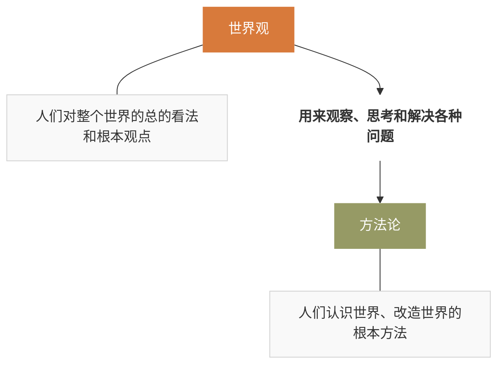

# 马克思主义基本原理

浙江大学 竺可桢学院 混合2504班 邓欢桐 3250102223

---

---

[TOC]

" 是晚风,是星河,是我哼的歌,是宇宙坐标闪烁."-- 房东的猫"和宇宙的温柔关联"

## 一,导论

### 1.1 什么是马克思主义

**狭义**:马克思主义是马克思的观点和学说的体系.

**广义**:首先是马克思和恩格斯创立的基本理论,基本观点和学说的体系,也包括后继的各国马克思主义者根据实际情况不断丰富和发展的理论成果.

### 1.2 多角度理解马克思主义

1. **从学说创造的主体**

   包含诸多思想家革命家智慧结晶;

2. **从学说的阶级属性**

   关于无产阶级斗争的性质目的和解放条件的学说;

3. **从学说的研究对象**

   关于自然,社会和思维发展的普遍规律的学说;

4. **从学说的内容**

   马克思主义哲学,马克思主义政治经济学和科学社会主义.

### 1.3 马克思主义体系的划分

恩格斯在"**反社林论**"中最早做了这一划分:

- **马克思主义哲学** $\rightarrow$ **德国古典哲学**
- **马克思主义政治经济学** $\rightarrow$ **英国古典政治经济学**
- **科学社会主义** $\rightarrow$ **法国空想社会主义**

### 1.4 马克思主义的世界化

马克思主义的传播和发展,出现了许多马克思主义的分支.欧美发达国家主要用来知道工人斗争与权益维护,亚非拉发展中国家主要用来指导反抗帝国主义与民族独立发展.

### 1.5 马克思主义的鲜明特征

1. **实践性**:马克思主义首要的和基本的观点;
2. **人民性**:站在最广大人民群众的立场;
3. **科学性**:努力把握社会发展的客观规律;
4. **发展性**:开放体系,容纳新情况新问题.

### 1.6 马克思主义的整体界定

马克思主义是以资本主义批判为切入口,对人类社会的未来进行总体统筹的学说.它是为底层人民谋求解放的学说,同时有时为人类整体摆脱阶级女一和物质束缚的学说.

> 简而言之,马克思主义即人的解放学.

## 二,马克思主义的产生

### 2.1 马克思主义是时代的产物

1. **西欧资本主义生产力的发展**:自 18 世纪中期以蒸汽机的发明和使用为标志的工业革命以来,欧洲资本主义获得了高度的发展,为马克思主义产生提供了经济,历史社会条件.

2. **资本主义生产力与生产关系的矛盾开始激化,经济危机周期性爆发**:在英国,自工业革命开始后,就先后于 1778,1793,1797,1810,1815,1819 年多次发生过局部性的经济危机,1825 年则爆发了第一次全国性生产过剩危机.此后于 1836 年和 1847 年又相继爆发了波及欧洲各主要资本主义国家的经济危机.

3. **阶级矛盾尖锐与工人运动的爆发,迫切需要系统理论的指导**:不合作破坏 → 诉诸正义等抽象原则 → 共产主义理论

   > [!NOTE]
   >
   > 1831 和 1834 年法国里昂工人起义;
   >
   > 1836 年长达十余年的英国宪章运动;
   >
   > 1844 年德国西里西亚纺织工人起义.

### 2.2 马克思主义是人类思想史发展的产物

- **马克思主义哲学** $\leftarrow$ **德国古典哲学** --直接理论来源
- **马克思主义政治经济学** $\leftarrow$ **英国古典政治经济学** --直接理论来源
- **科学社会主义** $\leftarrow$ **法国空想社会主义**--直接理论来源

### 2.3 马克思主义是马克思恩格斯个人努力的结果

卡尔·海因里希·马克思

弗里德里希·恩格斯 

## 3. 马克思主义的发展

### 3.1 形形色色的马克思主义

1. 狄慈根主义,杜林主义,巴枯宁主义...
2. 马克思主义的庸俗化,同机会主义,无政府主义以及改良主义的结合;
3. 马克思恩格斯生前与所谓的"马克思主义"斗争;
4. 马克思:据我所知,我不是一个马克思主义者.

### 3.2 马克思恩格斯逝世后,马克思主义的发展

1. **苏联模式**的马克思主义;
2. **西方**马克思主义;
3. **中国化**的马克思主义.

- "莱茵报"时期的实践:动摇了对黑格尔哲学的信仰;
- 

## 4. 马克思主义哲学导论

### 4.1 什么是哲学

哲学,追求智慧.

哲学最初表现为"诧异",没有外在目的,是最符合人性的学问,是最自由的学问.

哲学是一种理性的思维方式.早期自然主义哲学家是以理性辅佐证据的方式归纳出自然现象,与神话,艺术和诗歌等其他思维方式区分开来.

> 柏拉图:理性教育,驱逐诗人

哲学学科是西方文明中最古老的学科.

哲学是一门创造概念的艺术,不仅进行创造,而且进行分析,对比,演绎等逻辑推理.一和多,静和动,本质和现象,必然与偶然,永恒和变化,存在和生成等等.

早期哲学**包括三部分**:形而上学(本体论),知识论(认知论),伦理学(价值论)

从**三个方面定义**哲学:追问终极存在,探求终极解释,寻找终极关怀.

**按内容分**:世界观--本质还原与因果递推;方法论--辩证法与"形而上学".

哲学**方法**:①反思:思想的思想;②批判:发展的视角;③综合:全面的思维.

### 4.2 世界观

> 人们对世界的总的看法和根本观点.

> 引理:方法论,即人们认识世界和改造世界的根本原则和根本方法.

#### 4.2.1 世界的本质

唯心主义,唯物主义,二元论

##### 4.2.1.1 唯物主义

**发展**:古代朴素唯物主义 → 近代机械唯物主义 → 现代辩证唯物主义

**现代辩证唯物主义(马克思)**:主客体是不断变化的 → 主体与客体之间的界限也是不断变化的 → 通过实践--主体客体化与客体主体化

##### 4.2.1.2 唯心主义

- 主观唯心主义:人的心灵,意识,观念是第一性的(贝克莱,王阳明)
- 客观唯心主义:某种客观精神或精神原则是第一性的(谢林,朱熹)

#### 4.2.2 世界的基本属性

> 
时空 ← 世界的基本属性 → 运动

**时空**:

1. 古代希腊时空观;
2. 绝对主义时空观;
3. 相对主义时空观;
4. 主观主义时空观;
5. 存在主义时空观;
6. 现代通俗时空观.

- 万物皆在运动;
- 运动是绝对的,静止是相对的;
- 运动不能脱离物质;
- 运动不能被思维束缚.

## 5. 本体论与辩证唯物主义

关于存在的学问:

> 古希腊各派哲学家把世界本原归结为自然因素和实体原则,从巴门尼德开始,哲学开始研究抽象"存在".

感性世界和理念世界:

非存在(无知) $\rightarrow$ 感性世界(意见) $\rightarrow$ 存在(知识)

> 理念即纯形式的共相.

邓欢桐

