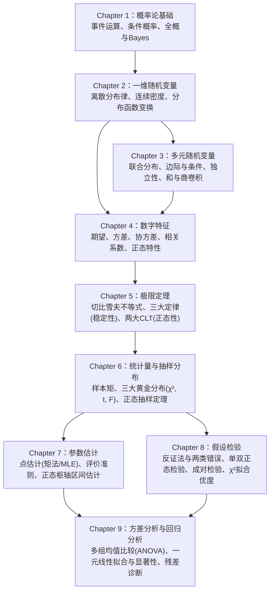

# <center>概率论与数理统计</center>

<center>浙江大学 竺可桢学院 混合2504班 邓欢桐 3250102223</center>

---

<center>


</center>


---

[[toc]]

<div style="display: block !important; text-align: center !important; margin: 60px auto 20px !important; padding: 20px 0 !important; width: 85% !important; border-top: 1px dashed var(--wi-epigraph-border) !important; border-bottom: 1px dashed var(--wi-epigraph-border) !important; font-family: '钟齐志莽行书', cursive !important; font-size: 20px !important; line-height: 1.8 !important; letter-spacing: 2px !important; font-weight: normal !important; font-style: italic !important; color: var(--wi-quote-text) !important;">“爱你是孤单的心事”<span style="display: block !important; text-align: right !important; margin-top: 10px !important; font-size: 18px !important;">—— 2026.7.17 玉湖七幢</span></div>

## Chapter 1：概率论的基本概念

概率论研究**随机现象的数量规律**：一次试验的结果不确定，但大量重复试验往往呈现稳定的统计规律。

> **Key Words**
>
> 随机试验、样本空间、随机事件、事件运算、频率、概率、古典概型、条件概率、乘法公式、全概率公式、Bayes 公式、事件独立性。

### 1.1 样本空间与随机事件

#### 1.1.1 随机现象与随机试验

自然界和社会生活中的现象可以分成两类：

- **确定性现象**：在给定条件下，结果可以预先确定。
- **随机现象**：一次观察的具体结果无法预先确定，但大量重复观察可能表现出统计规律。

对随机现象进行观察、记录或实验，称为**随机试验**，常记为 $E$。它具有以下三个特点：

1. **可重复**：可以在相同条件下重复进行。
2. **结果可列举**：试验前能够确定可能出现的结果有哪些。
3. **结果不确定**：试验前无法确定哪一个具体结果会出现。

例如：抛一枚硬币、统计一辆公交车的下车人数、测量电子产品的输入电压。

#### 1.1.2 样本空间、样本点与事件

> **定义：样本空间（Sample Space）**
>
> 随机试验 $E$ 的所有可能结果构成的集合称为样本空间，记为 $S=\{e\}$（也常记为 $\Omega$）。其中每个结果 $e$ 称为**样本点**。

例如：

| 随机试验 | 样本空间 $S$ |
| --- | --- |
| 抛一枚硬币 | $\{\text{正面},\text{反面}\}$ |
| 记录一天的交通事故次数 | $\{0,1,2,\ldots\}$ |
| 记录某产品的寿命 $x$ | $\{x\mid x\geq 0\}$ |
| 抛两枚骰子并记录点数 | $\{(i,j)\mid i,j\in\{1,\ldots,6\}\}$ |

> **定义：随机事件（Random Event）**
>
> 样本空间 $S$ 的子集 $A$ 称为事件。当且仅当本次试验出现的样本点属于 $A$ 时，称事件 $A$ 发生。

- **基本事件**：只含一个样本点的事件，如抛骰子得到 3 点。
- **必然事件**：$S$，每次试验一定发生。
- **不可能事件**：$\varnothing$，不包含任何样本点。

例：记录某公交站候车人数，$S=\{0,1,2,\ldots\}$，事件“至少有 10 人”即 $A=\{10,11,12,\ldots\}$。

> **理解**：样本点是“一次试验出现的具体结果”；事件是“满足某种条件的一批结果”。

#### 1.1.3 事件的关系与运算

设 $A,B\subseteq S$，课程中经常把 $A\cap B$ 简记为 $AB$。

| 记号 | 名称 | 含义 |
| --- | --- | --- |
| $A\subseteq B$ | 包含 | $A$ 发生一定使 $B$ 发生 |
| $A=B$ | 相等 | $A\subseteq B$ 且 $B\subseteq A$ |
| $A\cup B$ | 和事件（并） | $A,B$ **至少一个**发生 |
| $A\cap B=AB$ | 积事件（交） | $A,B$ **同时**发生 |
| $\overline A=S\setminus A$ | 对立（逆）事件 | $A$ 不发生 |
| $A-B=A\cap\overline B$ | 差事件 | $A$ 发生而 $B$ 不发生 |

对多个事件：

$$
\bigcup_{i=1}^{n}A_i=\{A_1,\ldots,A_n\text{ 至少一个发生}\},
\qquad
\bigcap_{i=1}^{n}A_i=\{A_1,\ldots,A_n\text{ 全部发生}\}.
$$

**互斥（互不相容）**：若 $A\cap B=\varnothing$，则 $A,B$ 不可能同时发生。若任意 $i\neq j$ 都有 $A_i\cap A_j=\varnothing$，称这些事件**两两互斥**。

**对立**：$A$ 与 $\overline A$ 不仅互斥，还必须满足

$$
A\cap\overline A=\varnothing,\qquad A\cup\overline A=S.
$$

所以“对立”比“互斥”要求更强：**互斥不代表对立**。

**德摩根定律（重点）**：

$$
\overline{A\cup B}=\overline A\cap\overline B,
\qquad
\overline{A\cap B}=\overline A\cup\overline B.
$$

$$
\overline{\bigcup_{i=1}^{n}A_i}=\bigcap_{i=1}^{n}\overline{A_i},
\qquad
\overline{\bigcap_{i=1}^{n}A_i}=\bigcup_{i=1}^{n}\overline{A_i}.
$$

**如何翻译题目中的文字？**

- “至少有一个成功” $\longleftrightarrow\ \bigcup_i A_i$。
- “全部成功” $\longleftrightarrow\ \bigcap_i A_i$。
- “一个也不成功” $\longleftrightarrow\ \bigcap_i\overline{A_i}$。
- “并非全部成功” $\longleftrightarrow\ \bigcup_i\overline{A_i}$。
- “恰有一个发生”（两个事件时）$\longleftrightarrow (A\overline B)\cup(\overline A B)$。

**课件中的系统例子**：设 $A_i=\{\text{第 }i\text{ 个元件正常}\}$，则

- 串联系统：每个元件都正常才能正常，$A=\bigcap_{i=1}^n A_i$。
- 并联系统：只要有一个元件正常就能正常，$A=\bigcup_{i=1}^n A_i$。

---

### 1.2 频率与概率

#### 1.2.1 频率

在相同条件下进行 $n$ 次试验，若事件 $A$ 发生了 $n_A$ 次，定义其**频率**为

$$
f_n(A)=\frac{n_A}{n}.
$$

频率满足：$0\le f_n(A)\le1$、$f_n(S)=1$，两两互斥事件的频率可以相加。

频率是**已经进行的这 $n$ 次试验的统计结果**；概率是用来刻画随机事件发生可能性的数学量。大量重复试验时，频率通常趋于稳定，这是从频率理解概率的直观依据。单次或少数次试验的频率**不一定等于**概率。

#### 1.2.2 概率的三条公理

> **定义：概率（Probability）**
>
> 对样本空间 $S$ 上的事件 $A$ 赋予实数 $P(A)$，若满足以下公理，则称 $P(A)$ 为事件 $A$ 的概率。

1. **非负性**：$P(A)\ge 0$。
2. **规范性**：$P(S)=1$。
3. **可列可加性**：若 $A_1,A_2,\ldots$ 两两互斥，则

   $$
   P\!\left(\bigcup_{i=1}^{\infty}A_i\right)=\sum_{i=1}^{\infty}P(A_i).
   $$

#### 1.2.3 概率的常用性质与公式

**基本性质**：

$$
P(\varnothing)=0,\qquad 0\le P(A)\le1,
\qquad P(\overline A)=1-P(A).
$$

如果 $A\subseteq B$，则

$$
P(A)\le P(B),\qquad P(B-A)=P(B)-P(A).
$$

一般情况下（不要求包含关系）：

$$
\boxed{P(B-A)=P(B)-P(A\cap B)}.
$$

**两个事件的加法公式（必会）**：

$$
\boxed{P(A\cup B)=P(A)+P(B)-P(A\cap B)}.
$$

推导：$A\cup B=A\cup(B-A)$ 是不交并，因此

$$
P(A\cup B)=P(A)+P(B-A)=P(A)+P(B)-P(AB).
$$

若 $A,B$ 互斥，交集概率为零，公式简化成 $P(A\cup B)=P(A)+P(B)$。

**三个事件的加法公式（容斥原理）**：

$$
\begin{aligned}
P(A\cup B\cup C)={}&P(A)+P(B)+P(C)\\
&-P(AB)-P(AC)-P(BC)+P(ABC).
\end{aligned}
$$

> **为什么要减交集？** 简单相加时，交集被重复计算；减掉两两交集以后，三个事件的公共交集又被多减了一次，所以最后还要加回来。

**求“至少一个”的思路**：如果“一个也不发生”更容易算，则优先使用补事件

$$
P\left(\bigcup_{i=1}^{n}A_i\right)=1-P\left(\bigcap_{i=1}^{n}\overline{A_i}\right).
$$

此时**不必先假定各事件独立**；只有将交集概率进一步拆成概率乘积时才需要独立性。

---

### 1.3 等可能概型（古典概型）

#### 1.3.1 定义与计算公式

一个随机试验满足以下条件时，称为**古典概型**：

1. **有限性**：样本空间中只有有限个样本点；
2. **等可能性**：所有样本点出现的概率相等。

若 $S$ 中共有 $N$ 个等可能样本点，事件 $A$ 包含其中 $M$ 个，则

$$
\boxed{P(A)=\frac{M}{N}=\frac{\text{有利结果数}}{\text{所有等可能结果数}}}.
$$

> **做题顺序**：先说明什么是一个样本点，检查是否等可能，再确定分母和分子。不能只因为结果有几种，就默认每一种结果等可能。

#### 1.3.2 排列、组合与抽样

$$
A_n^k=\frac{n!}{(n-k)!},\qquad C_n^k=\binom nk=\frac{n!}{k!(n-k)!}.
$$

- **顺序有区别**：常用排列数 $A_n^k$。
- **只在乎选中了谁**：常用组合数 $C_n^k$。
- **有放回抽样**：每次抽取后总体组成不变，若每次从 $N$ 个对象中选一个且记录顺序，总结果数为 $N^n$。
- **不放回抽样**：总体组成发生变化；若忽略顺序，从 $N$ 件中取 $n$ 件，总结果数为 $C_N^n$。

**课件例：有 $N$ 件产品，其中 $D$ 件次品，不放回取 $n$ 件，恰有 $k$ 件次品**：

$$
\boxed{P(X=k)=\frac{\binom Dk\binom{N-D}{n-k}}{\binom Nn}}.
$$

分母是总取法数；分子是“从次品选 $k$ 件”乘“从正品选 $n-k$ 件”。这正是第二章要学习的**超几何分布**。

**课件例：$n$ 个不同的球投入 $N$ 个不同盒子（$n\le N$），各球独立且等可能地选择盒子，求全部落入不同盒子的概率**：

$$
P=\frac{N(N-1)\cdots(N-n+1)}{N^n}=\frac{A_N^n}{N^n}.
$$

**抽签问题**：在 $a$ 个红球、$b$ 个白球中不放回依次抽取，对任意固定位置 $k$，抽到红球的概率都是

$$
P(\text{第 }k\text{ 次取到红球})=\frac a{a+b}.
$$

原因是每个球出现在每个抽取位置上的可能性相同；但这**不说明各次是否抽到红球相互独立**。

#### 1.3.3 小概率事件的实际推断原理

课件指出：概率很小的事件，在**一次试验中**通常不容易发生。如果某种假设下一个极小概率的事件确实出现，可以据此怀疑原有假设是否合理。

注意：**“小概率”绝不等于“不可能”**，也不能仅因为事件罕见就逻辑上证明某个假设必然错误。这与课件中通过反常观测质疑原假设的思路一致。

---

### 1.4 条件概率、乘法公式、全概率公式与 Bayes 公式

#### 1.4.1 条件概率

> **定义：条件概率**
>
> 已知事件 $A$ 已经发生（且 $P(A)>0$），事件 $B$ 发生的概率为
>
> $$
> \boxed{P(B\mid A)=\frac{P(A\cap B)}{P(A)}}.
> $$

这里 $A$ 是**条件**，$B$ 是要求的事件；条件出现后，我们只在 $A$ 对应的范围内重新计算比例。

**例：一个家庭有两个小孩，已知至少一个是女孩，求两个都是女孩的概率。** 假定两个孩子性别独立、男女等可能，并区分长幼：

$$
S=\{(男,男),(男,女),(女,男),(女,女)\}.
$$

设 $A=\{\text{至少有一个女孩}\}$，$B=\{\text{都是女孩}\}$。在 $A$ 的三个等可能结果中，只有一种属于 $B$，所以

$$
P(B\mid A)=\frac{P(AB)}{P(A)}=\frac{1/4}{3/4}=\boxed{\frac13}.
$$

**易错点**：$P(B\mid A)$ 和 $P(A\mid B)$ 通常不相等；不能随意交换竖线左右的事件。

#### 1.4.2 乘法公式

由条件概率定义，立即得到

$$
\boxed{P(AB)=P(A)P(B\mid A)=P(B)P(A\mid B)}.
$$

推广到三个事件：

$$
P(ABC)=P(A)P(B\mid A)P(C\mid AB).
$$

进一步推广：

$$
\boxed{P(A_1A_2\cdots A_n)
=P(A_1)\prod_{k=2}^{n}P(A_k\mid A_1\cdots A_{k-1})}.
$$

其中各条件概率应有定义。

**典型题：分阶段考核**。第一次通过概率 $0.6$；第一次没过再参加第二次，通过条件概率 $0.8$；前两次都没过再参加第三次，通过条件概率 $0.9$。通过考核的概率为

$$
\begin{aligned}
P(\text{最终通过})
&=0.6+(1-0.6)\times0.8\\
&\quad +(1-0.6)(1-0.8)\times0.9\\
&=\boxed{0.992}.
\end{aligned}
$$

也可用补事件：$1-0.4\times0.2\times0.1=0.992$。

#### 1.4.3 样本空间的划分

事件 $B_1,\ldots,B_n$ 构成样本空间 $S$ 的一个**划分**，指

$$
\bigcup_{i=1}^n B_i=S,\qquad B_i\cap B_j=\varnothing\quad(i\ne j).
$$

即**不漏且不重**：任意一次试验恰好属于一个 $B_i$。

#### 1.4.4 全概率公式（由原因求结果）

当 $B_1,\ldots,B_n$ 构成划分且 $P(B_i)>0$，有

$$
\boxed{P(A)=\sum_{i=1}^nP(B_i)P(A\mid B_i)}.
$$

因为 $A=(AB_1)\cup\cdots\cup(AB_n)$ 是互斥的分解，所以先相加，再逐项运用乘法公式。

最常用的两种情况：

$$
\boxed{P(A)=P(B)P(A\mid B)+P(\overline B)P(A\mid\overline B)}.
$$

**使用场景**：同一个结果 $A$ 可以沿不同路径出现。例如不同车间制造次品、不同人群检测阳性、不同交通状况下迟到。

#### 1.4.5 Bayes 公式（由结果反推原因）

已知结果 $A$ 已发生，想判断是哪个原因 $B_i$ 造成的：

$$
\boxed{P(B_i\mid A)=
\frac{P(B_i)P(A\mid B_i)}{\sum_{j=1}^{n}P(B_j)P(A\mid B_j)}}.
$$

- 分子：**原因 $B_i$ 与结果 $A$ 同时发生**的概率。
- 分母：**结果 $A$ 总共发生**的概率（由全概率公式计算）。

**课件例：甲、乙是否出差**。设 $A=\{\text{甲出差}\}$，$B=\{\text{乙出差}\}$，已知

$$
P(A)=0.7,\quad P(B\mid A)=0.1,\quad P(B\mid\overline A)=0.6.
$$

先求乙出差的概率：

$$
P(B)=0.7\times0.1+0.3\times0.6=\boxed{0.25}.
$$

已知乙出差，求甲也出差的概率：

$$
P(A\mid B)=\frac{0.7\times0.1}{0.25}=\boxed{0.28}.
$$

> **区分**：全概率公式回答“结果发生的总概率是多少”；Bayes 公式回答“已经观察到结果，各原因对应的条件概率是多少”。

**医疗检测例子的提醒**：即使假阳性率很低，当患病率本身非常低时，“已检测阳性的人真正患病”的概率也可能不高。计算时必须同时考虑基础患病率和检测准确率，不能把 $P(阳性\mid患病)$ 直接当成 $P(患病\mid阳性)$。

---

### 1.5 事件的独立性与独立试验

#### 1.5.1 两个事件的独立性

> **定义：事件独立**
>
> 若
>
> $$
> \boxed{P(A\cap B)=P(A)P(B)},
> $$
>
> 则称事件 $A,B$ 相互独立。

当 $P(A)>0$ 时，上式等价于 $P(B\mid A)=P(B)$，即 **$A$ 是否发生不改变 $B$ 的概率**。

若 $A,B$ 独立，则以下事件对也独立：

$$
(A,\overline B),\qquad(\overline A,B),\qquad(\overline A,\overline B).
$$

**互斥与独立的区别（必考）**：

| | 互斥 | 独立 |
| --- | --- | --- |
| 直观含义 | 不可能同时发生 | 一个事件不改变另一个事件的概率 |
| 数学条件 | $A\cap B=\varnothing$ | $P(AB)=P(A)P(B)$ |
| 交集概率 | 必须为 0 | 等于两者概率的乘积 |
| 能否同时发生 | 不能 | 可以 |

当 $P(A)>0$、$P(B)>0$ 时，$A,B$ **不可能既互斥又独立**。

#### 1.5.2 多个事件的独立性

三个事件 $A,B,C$ 相互独立，必须同时满足：

$$
\begin{cases}
P(AB)=P(A)P(B),\\
P(AC)=P(A)P(C),\\
P(BC)=P(B)P(C),\\
P(ABC)=P(A)P(B)P(C).
\end{cases}
$$

前三个条件只保证**两两独立**，并不保证**相互独立**。

**课件反例：四色四面体**。四个面分别为仅红、仅黄、仅蓝、红黄蓝三色，等可能抽一面；$A,B,C$ 分别表示含红、黄、蓝色。则

$$
P(A)=P(B)=P(C)=\tfrac12,
\quad P(AB)=P(AC)=P(BC)=\tfrac14,
$$

但 $P(ABC)=\tfrac14\ne\tfrac18=P(A)P(B)P(C)$，所以两两独立却不相互独立。

#### 1.5.3 独立重复试验

- **独立试验**：各次试验的结果不会相互影响。
- **重复试验**：在相同条件下反复进行同一种试验。
- **独立重复试验**：同时满足以上两点，是第二章二项分布等模型的基础。

一个常见区别：从一袋球里**不放回**抽取时，后一次的概率随前一次的结果改变；**有放回**且各次独立抽取时，每一次所面对的条件相同。

#### 1.5.4 至少发生一次的概率

若一件事每次独立试验中发生的概率都是 $p$，那么 $n$ 次中一次也不发生的概率为 $(1-p)^n$，因此

$$
\boxed{P(\text{$n$ 次中至少发生一次})=1-(1-p)^n}.
$$

课件最后讨论：即使一次事故的概率很低，随着独立重复操作次数的增加，“至少出一次事故”的概率也会不断增大。例如 $p=0.0001$ 时，要求上述概率**超过 $50\%$**：

$$
1-(0.9999)^n>0.5
\iff n>\frac{\ln 0.5}{\ln 0.9999}\approx6931.13.
$$

因此最少需要 $\boxed{6932}$ 次独立试验。这与前面“一次试验中小概率事件不容易发生”**并不矛盾**。

---

### Chapter 1：做题方法总结

1. **先定义事件**：把“至少、恰好、至多、全部、没有”准确转成集合运算。
2. **判断模型**：如果样本点有限且等可能，用古典概率；不是所有题都能简单套“有利数/总数”。
3. **已知前提**：见到“已知……发生”“在……条件下”，考虑 $P(B\mid A)$。
4. **过程分阶段**：考虑乘法公式、条件概率或分类讨论。
5. **多条互斥路径**：使用全概率公式；已知结果追溯原因，使用 Bayes 公式。
6. **不要误用独立性**：只有满足独立时才有 $P(AB)=P(A)P(B)$。
7. **“至少一个”不好直接数**：尝试 $1-P(\text{一个也没有})$。

## Chapter 2：随机变量及其概率分布

第二章的核心是**把随机试验的结果映射到数轴**，从而不只讨论“事件是否发生”，而且讨论“一个数值会取多少、落在哪个范围、变换后怎样分布”。

> **Key Words**
>
> 随机变量、离散型随机变量、分布律、0-1 分布、二项分布、泊松分布、超几何分布、几何分布、巴斯卡分布、分布函数、连续型随机变量、概率密度、均匀分布、正态分布、指数分布、随机变量函数的分布。

### 2.1 随机变量

> **定义：随机变量（Random Variable）**
>
> 设随机试验的样本空间为 $S$。若 $X=X(e)$ 是定义在 $S$ 上的实值单值函数，则称 $X$ 为随机变量。

简单说：给每一个样本点指定**唯一的实数**，就把随机试验的结果数量化了。通常用 $X,Y,Z$ 等大写字母表示随机变量，用 $x,y,z$ 表示具体数值。

例如：抛硬币三次，设 $X$ 是正面出现的次数，则 $X\in\{0,1,2,3\}$。八种等可能结果对应的概率为

| $X$ | 0 | 1 | 2 | 3 |
| --- | ---: | ---: | ---: | ---: |
| $P(X=x)$ | $1/8$ | $3/8$ | $3/8$ | $1/8$ |

随机变量最常见的两类是：

- **离散型**：可能的取值是有限个或可数无限个，如次数、人数、缺陷个数。
- **连续型**：由概率密度描述取值，如长度、时间、测量误差等。

若 $I$ 是实数集合，则 $\{X\in I\}$ 表示样本空间中所有使 $X(e)\in I$ 的试验结果所构成的事件。

---

### 2.2 离散型随机变量及其分布律

#### 2.2.1 概率分布律

离散型随机变量 $X$ 的可能取值为 $x_1,x_2,\ldots$，记

$$
\boxed{p_i=P(X=x_i)}.
$$

| $X$ | $x_1$ | $x_2$ | $\cdots$ | $x_i$ | $\cdots$ |
| --- | --- | --- | --- | --- | --- |
| $P$ | $p_1$ | $p_2$ | $\cdots$ | $p_i$ | $\cdots$ |

任何合法分布律都必须满足

$$
\boxed{p_i\ge0,\qquad\sum_i p_i=1}.
$$

**求分布律的标准流程**：①列出所有可能取值；②对每个取值求相应概率；③检查概率非负且总和为 1。

**例：三个独立红绿灯**。每灯为红灯的概率为 $p$；令 $X$ 为首次停车前已经通过的信号灯数；如果三个灯全是绿灯，则 $X=3$：

| $X$ | 0 | 1 | 2 | 3 |
| --- | --- | --- | --- | --- |
| $P(X=x)$ | $p$ | $(1-p)p$ | $(1-p)^2p$ | $(1-p)^3$ |

这里 $X=3$ 表示三个灯全部通过，**不意味着第四个灯是红灯**。

#### 2.2.2 0-1 分布（Bernoulli 分布）

设一次试验只有“成功”和“失败”两种可能，成功概率为 $p$，令 $X=1$ 表示成功，$X=0$ 表示失败，则

$$
P(X=k)=p^k(1-p)^{1-k},\qquad k=0,1.
$$

记为 $X\sim B(1,p)$（课件也记作 $0-1(p)$）。

| $X$ | 0 | 1 |
| --- | --- | --- |
| $P$ | $1-p$ | $p$ |

应用：产品合格与否、某次检测成功与否、某次掷骰子是否得到指定点数。

#### 2.2.3 二项分布（Binomial Distribution）

进行 $n$ 次相互独立、成功概率同为 $p$ 的 Bernoulli 试验。若 $X$ 是**成功次数**，则

$$
\boxed{X\sim B(n,p)},\qquad
\boxed{P(X=k)=\binom nk p^k(1-p)^{n-k}},\quad k=0,1,\ldots,n.
$$

理解公式的三个因素：

- $\binom nk$：$n$ 次中选出哪 $k$ 次成功。
- $p^k$：这 $k$ 次成功的概率因子。
- $(1-p)^{n-k}$：其余失败的概率因子。

**使用条件必须同时成立**：试验次数固定为 $n$；各次独立；每次只有成功/失败两类；每次成功概率相同。

常见求法：

$$
P(X\le m)=\sum_{k=0}^{m}\binom nkp^k(1-p)^{n-k},
$$

$$
P(X\ge m)=1-\sum_{k=0}^{m-1}\binom nkp^k(1-p)^{n-k}.
$$

**课件例：$X\sim B(100,0.05)$**。计算 $P(X\le10)$ 或 $P(X=10)$ 时，分别使用二项分布的累积和单项概率。Excel 中可以使用：

```text
=BINOM.DIST(10,100,0.05,TRUE)   // P(X≤10)
=BINOM.DIST(10,100,0.05,FALSE)  // P(X=10)
```

#### 2.2.4 泊松分布（Poisson Distribution）

若非负整数随机变量 $X$ 满足

$$
\boxed{P(X=k)=\frac{\lambda^k e^{-\lambda}}{k!}},\qquad k=0,1,2,\ldots,\quad\lambda>0,
$$

则称 $X$ 服从参数为 $\lambda$ 的泊松分布，记为 $X\sim P(\lambda)$。常用于描述**某段时间或某个区域内的事件发生次数**。

容易用补事件计算“至少”：

$$
\begin{aligned}
P(X\ge3)
&=1-P(X=0)-P(X=1)-P(X=2)\\
&=1-e^{-\lambda}\left(1+\lambda+\frac{\lambda^2}{2!}\right).
\end{aligned}
$$

**课件例**：单位时间候车人数 $X\sim P(4.8)$，则

$$
P(X\ge3)=1-e^{-4.8}\left(1+4.8+\frac{4.8^2}{2}\right)\approx0.8580.
$$

若独立观察五个单位时间，记 $Y$ 为“至少 3 人候车”的时间段数，则 $Y\sim B(5,0.8580)$，从而 $P(Y=4)=\binom54(0.8580)^4(1-0.8580)$。

**二项分布的泊松近似**：当 $n$ 较大、$p$ 较小，并令 $\lambda=np$ 时，

$$
\boxed{\binom nkp^k(1-p)^{n-k}\approx\frac{e^{-\lambda}\lambda^k}{k!}}.
$$

课件给出 $n>10$、$p<0.1$ 作为常用近似情形；它是**经验提示而非误差保证**，实际还要看 $np$ 等参数。

**课件例：1000 人中每人某月患病概率 $1/200$，相互独立**。有 $X\sim B(1000,1/200)$，用泊松分布近似，取 $\lambda=np=5$：

$$
P(X\ge3)\approx1-e^{-5}\left(1+5+\frac{5^2}{2}\right)\approx\boxed{0.8753}.
$$

#### 2.2.5 超几何分布（Hypergeometric Distribution）

总体有 $N=a+b$ 个对象，其中 $a$ 个为某类对象，$b$ 个为另一类。**不放回**抽取 $n$ 个，令 $X$ 为抽中第一类的个数，则

$$
\boxed{P(X=k)=\frac{\binom ak\binom b{n-k}}{\binom Nn}},
$$

其中

$$
\boxed{\max(0,n-b)\le k\le\min(a,n)},\qquad k\text{ 取整数}.
$$

重点是**不放回**：前一次抽取会改变后一次抽中该类对象的概率，不能直接假设各次独立。

**和二项分布的区别**：固定次数地有放回独立抽样，成功次数通常服从二项分布；固定次数地不放回抽样，成功个数通常服从超几何分布。

#### 2.2.6 几何分布（Geometric Distribution）

每次独立试验成功概率为 $p$，**直到第一次成功才停止**。以 $X$ 表示包含成功那次在内的总试验次数：

$$
\boxed{P(X=k)=(1-p)^{k-1}p},\qquad k=1,2,3,\ldots.
$$

前 $k-1$ 次全部失败，第 $k$ 次首次成功。这与二项分布的区别在于**次数不是预先固定的**。

#### 2.2.7 巴斯卡分布（Pascal / Negative Binomial Distribution）

每次独立试验成功概率为 $p$，**直到第 $r$ 次成功才停止**，以 $X$ 表示试验总次数：

$$
\boxed{P(X=k)=\binom{k-1}{r-1}p^r(1-p)^{k-r}},
\qquad k=r,r+1,\ldots.
$$

解释：最后第 $k$ 次必须成功；此前 $k-1$ 次中，恰好 $r-1$ 次成功，因此有 $\binom{k-1}{r-1}$ 种排列方式。

当 $r=1$ 时，巴斯卡分布退化为几何分布。

#### 2.2.8 六种离散分布如何选择

| 分布 | 试验方式/问题关键词 | 随机变量表示 | 取值 |
| --- | --- | --- | --- |
| 0-1 分布 | 做一次，成功/失败 | 成功与否 | $0,1$ |
| 二项 $B(n,p)$ | 固定 $n$ 次、独立、成功率恒定 | 成功次数 | $0,\ldots,n$ |
| 泊松 $P(\lambda)$ | 时间/区域内计数，或稀有事件近似 | 发生次数 | $0,1,\ldots$ |
| 超几何 | 固定抽取 $n$ 个、**不放回** | 抽中某类的个数 | 有限整数范围 |
| 几何 | **首次**成功即停止 | 总试验次数 | $1,2,\ldots$ |
| 巴斯卡 | **第 $r$ 次**成功即停止 | 总试验次数 | $r,r+1,\ldots$ |

**综合辨析（来自课件思考题）**：有 2 个红球、4 个白球，抽到红球记为成功，概率 $p=1/3$。

- 取一次，记录红球数：$X\sim B(1,1/3)$。
- 不放回取三次，记录红球数：超几何分布。
- 有放回独立取三次，记录红球数：$Z\sim B(3,1/3)$。
- 有放回独立取球直到第一次红球：$U$ 服从几何分布，参数 $1/3$。
- 有放回独立取球直到第三次红球：$V$ 服从巴斯卡分布，参数 $(3,1/3)$。

---

### 2.3 随机变量的分布函数

#### 2.3.1 定义与性质

> **定义：累积分布函数（CDF）**
>
> 对任意实数 $x$，
>
> $$
> \boxed{F_X(x)=P(X\le x)}.
> $$
>
> 它描述随机变量落在 $(-\infty,x]$ 范围内的概率。**任何随机变量都有分布函数**。

分布函数的四条关键性质：

1. **取值范围**：$0\le F_X(x)\le1$。
2. **单调不减**：$x_1<x_2\Rightarrow F_X(x_1)\le F_X(x_2)$。
3. **两端极限**：$\lim_{x\to-\infty}F_X(x)=0$，$\lim_{x\to+\infty}F_X(x)=1$。
4. **右连续**：$\lim_{t\to x^+}F_X(t)=F_X(x)$。

通过分布函数计算概率：

$$
\boxed{P(a<X\le b)=F_X(b)-F_X(a)},\quad a<b.
$$

点概率（跳跃大小）：

$$
\boxed{P(X=a)=F_X(a)-F_X(a^-)}.
$$

其中 $F_X(a^-)=\lim_{x\to a^-}F_X(x)$。因此

$$
P(a\le X\le b)=F_X(b)-F_X(a^-).
$$

注意**端点开闭**；对于有跳跃的分布函数，不能随意把 $<$ 换成 $\le$。

#### 2.3.2 离散型随机变量的分布函数

若 $P(X=x_i)=p_i$，则

$$
\boxed{F_X(x)=\sum_{x_i\le x}p_i}.
$$

因为每经过一个可能取值，就会累积相应的概率，离散型随机变量的分布函数通常呈**阶梯状**。

**例：$X\sim B(1,p)$**，设 $q=1-p$：

$$
F_X(x)=\begin{cases}
0,&x<0,\\
q,&0\le x<1,\\
1,&x\ge1.
\end{cases}
$$

**反过来由阶梯状 $F$ 求分布律**：找到跳跃位置，跳跃幅度就是该点的概率。

例如课件给出

$$
F(x)=\begin{cases}
0,&x<-1,\\
0.2,&-1\le x<3,\\
0.6,&3\le x<4,\\
1,&x\ge4.
\end{cases}
$$

则 $P(X=-1)=0.2$，$P(X=3)=0.4$，$P(X=4)=0.4$。

---

### 2.4 连续型随机变量及其概率密度函数

#### 2.4.1 概率密度函数

> **定义：概率密度函数（PDF）**
>
> 若存在非负函数 $f_X(x)$，使
>
> $$
> \boxed{F_X(x)=\int_{-\infty}^{x}f_X(t)\,dt},
> $$
>
> 则 $X$ 为连续型随机变量，$f_X(x)$ 是它的概率密度函数。

**密度的基本性质**：

$$
f_X(x)\ge0,\qquad \boxed{\int_{-\infty}^{+\infty}f_X(x)\,dx=1}.
$$

$$
\boxed{P(a<X\le b)=\int_a^b f_X(x)\,dx}.
$$

在 $f_X$ 的连续点，$F_X'(x)=f_X(x)$。对于很小的 $\Delta x>0$，

$$
P(x<X\le x+\Delta x)\approx f_X(x)\Delta x.
$$

> **注意三件事**：
>
> 1. $f_X(x)$ 是**概率密度**，不是 $P(X=x)$；密度值可以大于 1。
> 2. 连续型随机变量满足 $P(X=a)=0$，但“概率为 0”并不等于该事件在集合意义上绝不可能。
> 3. 所以连续型情形下，$P(a<X<b)=P(a\le X\le b)$；但离散型不能随便去掉端点。

**求未知常数 $c$**：把密度在全部取值范围内积分，令其等于 1。**求分布函数**：从 $-\infty$ 积到 $x$，尤其要按支持区间的端点分段讨论。

**课件例：**

$$
f_X(x)=\begin{cases}
c,&0<x<1,\\
2/9,&3<x<6,\\
0,&\text{其他}.
\end{cases}
$$

归一化：$c\cdot1+(2/9)\cdot3=1\Rightarrow\boxed{c=1/3}$。因此

$$
F_X(x)=\begin{cases}
0,&x<0,\\
x/3,&0\le x<1,\\
1/3,&1\le x<3,\\
(2x-3)/9,&3\le x<6,\\
1,&x\ge6.
\end{cases}
$$

要求 $P(X<k)=2/3$，令 $F_X(k)=2/3$，得 $\boxed{k=4.5}$。

#### 2.4.2 均匀分布（Uniform Distribution）

若 $X$ 在 $(a,b)$ 上均匀分布，记 $X\sim U(a,b)$，其密度为

$$
\boxed{f_X(x)=\begin{cases}
\dfrac1{b-a},&a<x<b,\\
0,&\text{其他}.
\end{cases}}
$$

分布函数为

$$
F_X(x)=\begin{cases}
0,&x\le a,\\
\dfrac{x-a}{b-a},&a<x<b,\\
1,&x\ge b.
\end{cases}
$$

区间 $[c,c+\ell]\subseteq[a,b]$ 上的概率是

$$
\boxed{P(c<X<c+\ell)=\frac{\ell}{b-a}}.
$$

结论：**概率只与区间长度有关，与区间所在位置无关**。

**例：在 $(-1,2)$ 上均匀取一个数**，$P(X>0)=2/3$。若独立取 10 次，记大于零的个数为 $Y$，则 $Y\sim B(10,2/3)$，恰有两个大于零的概率为

$$
P(Y=2)=\binom{10}2\left(\frac23\right)^2\left(\frac13\right)^8.
$$

#### 2.4.3 正态分布（Normal / Gaussian Distribution）

若

$$
\boxed{f_X(x)=\frac1{\sqrt{2\pi}\sigma}\exp\!\left[-\frac{(x-\mu)^2}{2\sigma^2}\right]},
\qquad -\infty<x<+\infty,
$$

则称 $X$ 服从正态分布，记为 $\boxed{X\sim N(\mu,\sigma^2)}$，其中 $\sigma>0$。

- $\mu$ 是**位置参数**，决定钟形曲线中心与对称轴 $x=\mu$。
- $\sigma$ 是**尺度参数**，$\sigma$ 越小曲线越窄、越高；越大曲线越宽、越矮。
- 曲线关于 $x=\mu$ 对称，最大密度为 $f_X(\mu)=1/(\sqrt{2\pi}\sigma)$。

**标准正态分布**：$Z\sim N(0,1)$，其密度与分布函数分别为

$$
\varphi(z)=\frac1{\sqrt{2\pi}}e^{-z^2/2},
\qquad
\Phi(z)=\int_{-\infty}^{z}\varphi(t)\,dt.
$$

对称性：

$$
\boxed{\Phi(-z)=1-\Phi(z)}.
$$

**标准化（最重要的计算步骤）**：如果 $X\sim N(\mu,\sigma^2)$，则

$$
\boxed{Z=\frac{X-\mu}{\sigma}\sim N(0,1)}.
$$

于是：

$$
\boxed{P(X\le b)=\Phi\left(\frac{b-\mu}{\sigma}\right)},
$$

$$
\boxed{P(a<X<b)=\Phi\left(\frac{b-\mu}{\sigma}\right)-\Phi\left(\frac{a-\mu}{\sigma}\right)}.
$$

**正态分布常用区间概率**（课件中的近似数值）：

| 区间 | 概率 |
| --- | ---: |
| $\mu-\sigma<X<\mu+\sigma$ | $\approx68.26\%$ |
| $\mu-2\sigma<X<\mu+2\sigma$ | $\approx95.44\%$ |
| $\mu-3\sigma<X<\mu+3\sigma$ | $\approx99.74\%$ |

**课件例：钢材长度**。若 $X\sim N(100,2^2)$，求 $P(X<97.8)$：

$$
P(X<97.8)=\Phi\left(\frac{97.8-100}{2}\right)
=\Phi(-1.1)=1-\Phi(1.1)\approx\boxed{0.1357}.
$$

若 $\mu=100$，要求 $P(97<X<103)\ge0.9$，则

$$
2\Phi(3/\sigma)-1\ge0.9
\iff \Phi(3/\sigma)\ge0.95
\Rightarrow \sigma\le\frac3{1.645}\approx\boxed{1.8237}.
$$

> **最常见错误**：题目写的是 $N(\mu,\sigma^2)$，括号第二个参数是**方差 $\sigma^2$**，但标准化分母是**标准差 $\sigma$**。

#### 2.4.4 指数分布（Exponential Distribution）

若 $X$ 的概率密度为

$$
\boxed{f_X(x)=\begin{cases}
\lambda e^{-\lambda x},&x>0,\\
0,&x\le0,
\end{cases}}
\qquad \lambda>0,
$$

则称 $X$ 服从参数为 $\lambda$ 的指数分布，记为 $X\sim E(\lambda)$ 或 $\operatorname{Exp}(\lambda)$。

其分布函数和尾概率为

$$
F_X(x)=\begin{cases}
0,&x\le0,\\
1-e^{-\lambda x},&x>0,
\end{cases}
\qquad
\boxed{P(X>t)=e^{-\lambda t}\ (t\ge0)}.
$$

**无记忆性（Memoryless Property）**：

$$
\boxed{P(X>t+s\mid X>t)=P(X>s)=e^{-\lambda s}},\quad t,s\ge0.
$$

含义：如果 $X$ 表示等待故障发生的时间，那么设备已经正常运行了 $t$ 小时这一事实，并不改变“接下来至少再运行 $s$ 小时”的概率（在指数模型成立的前提下）。

**与泊松分布的联系**：若任意长度 $t$ 的区间内故障次数 $N(t)\sim P(\lambda t)$，那么首次故障到来的等待时间 $T$ 满足

$$
P(T>t)=P(N(t)=0)=e^{-\lambda t},
$$

所以 $T\sim E(\lambda)$。已正常运行 10 小时，再正常运行至少 8 小时的条件概率为 $e^{-8\lambda}$。

#### 2.4.5 不是所有随机变量都只分为离散型和连续型

课件中的**银行等候例子**很重要：令 $X\sim E(0.1)$ 表示原本等候服务的时间；若超过 15 分钟就离开，则实际等待时间为

$$
Y=\min(X,15).
$$

其分布函数为

$$
F_Y(y)=\begin{cases}
0,&y<0,\\
1-e^{-y/10},&0\le y<15,\\
1,&y\ge15.
\end{cases}
$$

且 $P(Y=15)=P(X\ge15)=e^{-1.5}>0$。因此 $Y$ 在 $(0,15)$ 上有连续部分，但在 $15$ 处又有一个**点质量**，属于混合型分布，既不是纯离散型也不是纯连续型。

> **重点**：不论离散、连续或混合型，都有 $F_X(x)$；但不一定有离散型分布律，也不一定能用单个密度函数描述全部概率。

---

### 2.5 随机变量函数的分布

已知 $X$ 的分布，构造 $Y=g(X)$，问题是：如何求 $Y$ 的概率分布？

**核心思路：把关于 $Y$ 的事件改写成关于 $X$ 的等价事件。**

#### 2.5.1 离散型：找像、合并概率

1. 列出 $X$ 的所有可能取值 $x_i$。
2. 计算每个像 $y_i=g(x_i)$。
3. **若不同 $x_i$ 对应相同 $y$，要把它们的概率相加**：

   $$
   \boxed{P(Y=y)=\sum_{x_i:\,g(x_i)=y}P(X=x_i)}.
   $$

**课件例**：$X$ 的分布律为

| $X$ | $-1$ | $0$ | $1$ |
| --- | ---: | ---: | ---: |
| $P$ | $0.2$ | $0.5$ | $0.3$ |

令 $Y=X^2$，则

$$
P(Y=0)=P(X=0)=0.5,
$$

$$
P(Y=1)=P(X=-1)+P(X=1)=0.2+0.3=0.5.
$$

所以 $Y$ 仅能取 $0,1$，各以 $0.5$ 的概率出现。

#### 2.5.2 连续型：分布函数法（最通用）

求 $Y=g(X)$ 的密度，可按以下步骤：

1. 确定 $Y$ 的**取值范围**。
2. 写 $F_Y(y)=P(Y\le y)=P(g(X)\le y)$。
3. 将不等式 $g(X)\le y$ 换成关于 $X$ 的取值范围，并使用 $F_X$ 或 $f_X$ 求概率。
4. 对 $F_Y(y)$ 关于 $y$ 求导，得到 $f_Y(y)$（适用处）；区间外写 $0$。

**课件例**：若

$$
f_X(x)=\begin{cases}x/8,&0<x<4,\\0,&\text{其他},\end{cases}
\qquad Y=X^2,
$$

由于 $X>0$，所以 $0<Y<16$。当 $0<y<16$ 时，

$$
F_Y(y)=P(X^2\le y)=P(X\le\sqrt y)
=\int_0^{\sqrt y}\frac{x}{8}\,dx=\frac{y}{16}.
$$

因此

$$
f_Y(y)=\begin{cases}1/16,&0<y<16,\\0,&\text{其他},\end{cases}
$$

即 $\boxed{Y\sim U(0,16)}$。

#### 2.5.3 单调可微函数的密度变换公式

若 $g$ 在 $X$ 的相应取值区间内严格单调且可微，反函数记为 $x=h(y)=g^{-1}(y)$，在适用条件下：

$$
\boxed{f_Y(y)=f_X(h(y))\,|h'(y)|},
$$

在 $Y$ 的取值范围外，$f_Y(y)=0$。

**使用步骤**：求反函数 $h$ $\rightarrow$ 求导 $h'$ $\rightarrow$ 把 $h(y)$ 代入原密度 $f_X$ $\rightarrow$ 乘 $|h'(y)|$ $\rightarrow$ 写清 $y$ 的范围。

**典型结论：正态分布的线性变换**：

$$
\boxed{X\sim N(\mu,\sigma^2),\quad Y=aX+b\ (a\ne0)
\Longrightarrow Y\sim N(a\mu+b,a^2\sigma^2)}.
$$

特别地，令 $a=1/\sigma$、$b=-\mu/\sigma$，就得到标准化公式。

**课件例：正弦变换**。如果 $X\sim U(-\pi/2,\pi/2)$，$Y=\sin X$，则因为 $\sin x$ 在该区间严格递增，

$$
x=\arcsin y,\qquad \frac{dx}{dy}=\frac1{\sqrt{1-y^2}},
$$

$$
\boxed{f_Y(y)=\begin{cases}
\dfrac1{\pi\sqrt{1-y^2}},&-1<y<1,\\
0,&\text{其他}.
\end{cases}}
$$

#### 2.5.4 非单调变换：不能强行只用一个反函数

当 $g$ 不单调时，一个 $y$ 可能对应多个 $x$，必须把这些来源的概率都考虑进去，或直接采用分布函数法。

**常见结论（课件例 5.4）**：若 $X$ 是连续型且有密度 $f_X$，

对于 $Y=|X|$，有

$$
\boxed{f_Y(y)=\begin{cases}
f_X(y)+f_X(-y),&y>0,\\
0,&y\le0.
\end{cases}}
$$

对于 $Z=X^2$，有

$$
\boxed{f_Z(z)=\begin{cases}
\dfrac{f_X(\sqrt z)+f_X(-\sqrt z)}{2\sqrt z},&z>0,\\
0,&z\le0.
\end{cases}}
$$

例如 $X\sim N(0,1)$，令 $Z=X^2$，代入标准正态密度可得

$$
f_Z(z)=\begin{cases}
\dfrac{e^{-z/2}}{\sqrt{2\pi z}},&z>0,\\
0,&z\le0.
\end{cases}
$$

课件指出这就是**自由度为 1 的 $\chi^2$ 分布**。

而若 $X\sim U(0,\pi)$，$Y=\sin X$，因为正弦在整个 $(0,\pi)$ 上先增后减，不能直接使用单调变换定理。由分布函数法可得

$$
F_Y(y)=\frac{2\arcsin y}{\pi}\quad(0<y<1),
$$

$$
\boxed{f_Y(y)=\begin{cases}
\dfrac2{\pi\sqrt{1-y^2}},&0<y<1,\\
0,&\text{其他}.
\end{cases}}
$$

#### 2.5.5 分布函数变换：得到均匀分布

课件最后一个例子：设 $X\sim E(\lambda)$，其分布函数为 $F_X(x)=1-e^{-\lambda x}$（$x>0$），令 $Y=F_X(X)$，则

$$
\boxed{Y\sim U(0,1)}.
$$

这一例说明：适当使用随机变量本身的分布函数，可以将原分布转成 $(0,1)$ 上的均匀分布。

---

### Chapter 2：公式与易错点速查

| 知识点 | 必须记住的内容 |
| --- | --- |
| 离散型分布律 | $P(X=x_i)=p_i$，$p_i\ge0$，$\sum p_i=1$ |
| 分布函数 | $F(x)=P(X\le x)$，右连续、单调不减 |
| 区间概率 | $P(a<X\le b)=F(b)-F(a)$ |
| 离散型的点概率 | $P(X=a)=F(a)-F(a^-)$ |
| 连续型的密度 | $F(x)=\int_{-\infty}^{x}f(t)\,dt$，$\int f=1$ |
| 连续型的点概率 | $P(X=a)=0$ |
| 二项分布 | 固定次数、独立、同一成功概率；$\binom nkp^k(1-p)^{n-k}$ |
| 泊松分布 | $e^{-\lambda}\lambda^k/k!$，常用 $\lambda=np$ 近似二项 |
| 超几何分布 | **不放回**：$\binom ak\binom b{n-k}/\binom Nn$ |
| 几何 / 巴斯卡 | 首次成功 / 第 $r$ 次成功时的试验总次数 |
| 正态标准化 | $Z=(X-\mu)/\sigma$，注意 $\sigma$ 不是 $\sigma^2$ |
| 指数分布 | 尾概率 $P(X>t)=e^{-\lambda t}$，无记忆性 |
| 随机变量变换 | 先求 $Y$ 的范围，再求等价事件，必要时求 $F_Y$ 并求导 |

#### 综合解题检查清单

1. 随机变量到底表示的是**次数、人数、持续时间，还是成功发生时的试验序号**？
2. 对离散型题：有没有列全可能取值？概率和是否等于 1？
3. 对抽样题：究竟是**有放回还是不放回**？试验是否真正独立？
4. 对概率区间题：**左端/右端是开还是闭**？随机变量是否可能在端点有非零点概率？
5. 对分段密度题：积分上下限有没有跨越支持区间端点？求得的密度积分是否为 1？
6. 对正态题：写出 $\mu$ 和 $\sigma$，**先标准化、再查 $\Phi$**。
7. 对函数变换：新变量的取值范围是什么？映射是否单调？一个 $y$ 会不会对应多个 $x$？

> **两章串联**：第一章研究事件 $A$ 的概率 $P(A)$；第二章通过随机变量 $X$ 把事件写成 $\{X\in I\}$，再用分布律、分布函数或密度函数计算它的概率。所有公式最终都回到第一章的事件运算、条件概率与可加性。

---

## Chapter 3：多元随机变量及其分布

现实问题中，往往需要同时记录同一个随机试验中的多个数值指标（例如儿童的身高与体重、炮弹弹着点的横纵坐标、电子系统的输入与输出电压）。此时，仅单独研究每一个分量的分布是不够的，必须引入定义在同一样本空间上的多个随机变量组成的随机向量，重点研究**联合分布规律、边际分布规律、条件分布规律**以及各变量之间的**统计独立性**。

> **Key Words**
>
> 二元随机变量、联合分布律、边际分布律、条件分布律、联合分布函数、矩形公式、联合概率密度、边际密度、条件密度、二元均匀分布、二元正态分布、独立性、卷积公式、商分布、极值分布、串并联系统可靠度。

### 3.1 二元离散型随机变量

#### 3.1.1 联合分布律及其性质

> **定义：二元离散型随机变量及其联合分布律**
>
> 设二元随机变量 $(X,Y)$ 全部可能取到的不同值是有限对或可列无限对 $(x_i, y_j)$（$i,j=1,2,\dots$），称 $(X,Y)$ 为**二元离散型随机变量**。
>
> 称事件的概率
>
> $$\boxed{p_{ij} = P(X=x_i, Y=y_j)}$$
>
> 为 $(X,Y)$ 的**联合概率分布律**（简称联合分布律）。

联合分布律常用二维表格表示：

| $X \backslash Y$ | $y_1$ | $y_2$ | $\cdots$ | $y_j$ | $\cdots$ | 边际分布 $p_{i\cdot}$ |
| :---: | :---: | :---: | :---: | :---: | :---: | :---: |
| $x_1$ | $p_{11}$ | $p_{12}$ | $\cdots$ | $p_{1j}$ | $\cdots$ | $p_{1\cdot}$ |
| $x_2$ | $p_{21}$ | $p_{22}$ | $\cdots$ | $p_{2j}$ | $\cdots$ | $p_{2\cdot}$ |
| $\vdots$ | $\vdots$ | $\vdots$ | $\ddots$ | $\vdots$ | $\ddots$ | $\vdots$ |
| $x_i$ | $p_{i1}$ | $p_{i2}$ | $\cdots$ | $p_{ij}$ | $\cdots$ | $p_{i\cdot}$ |
| $\vdots$ | $\vdots$ | $\vdots$ | $\ddots$ | $\vdots$ | $\ddots$ | $\vdots$ |
| **边际分布 $p_{\cdot j}$** | $p_{\cdot 1}$ | $p_{\cdot 2}$ | $\cdots$ | $p_{\cdot j}$ | $\cdots$ | **$1$** |

**联合分布律的两条核心性质**：

1. **非负性**：对任意 $i,j$，有 $p_{ij} \ge 0$；
2. **规范性**：所有可能取值的概率总和为 1：

   $$\boxed{\sum_{i}\sum_{j} p_{ij} = 1}.$$

**课件例 1.1（分步取值模型）**：设随机变量 $X$ 在 $1,2,3,4$ 四个整数中等可能地取一个值，另一个随机变量 $Y$ 在 $1\sim X$ 中等可能地取一整数值，试求 $(X,Y)$ 的联合概率分布。

**解**：
1. $X$ 的可能取值为 $1,2,3,4$，且 $P(X=i) = \frac{1}{4}$（$i=1,2,3,4$）。
2. 在 $X=i$ 的条件下，$Y$ 在 $1,2,\dots,i$ 中等可能取值，即条件概率为 $P(Y=j\mid X=i) = \frac{1}{i}$（$1\le j \le i$）。
3. 由乘法公式，当 $1\le j \le i \le 4$ 时：

   $$P(X=i, Y=j) = P(X=i)P(Y=j\mid X=i) = \frac{1}{4} \cdot \frac{1}{i} = \frac{1}{4i}.$$

   当 $j > i$ 时，$P(X=i, Y=j) = 0$。

联合分布律表格如下：

| $X \backslash Y$ | 1 | 2 | 3 | 4 |
| :---: | :---: | :---: | :---: | :---: |
| **1** | $1/4$ | $0$ | $0$ | $0$ |
| **2** | $1/8$ | $1/8$ | $0$ | $0$ |
| **3** | $1/12$ | $1/12$ | $1/12$ | $0$ |
| **4** | $1/16$ | $1/16$ | $1/16$ | $1/16$ |

#### 3.1.2 边际分布律（Marginal PMF）

> **定义：边际分布律**
>
> 设二元离散随机变量 $(X,Y)$ 的联合分布律为 $p_{ij}$。分量 $X$ 和 $Y$ 各自作为一维离散随机变量的分布律，分别称为 $(X,Y)$ 关于 $X$ 和关于 $Y$ 的**边际概率分布律**（简称边际分布律）。

计算公式为**求和消元法**：

$$\boxed{p_{i\cdot} = P(X=x_i) = \sum_{j} P(X=x_i, Y=y_j) = \sum_{j} p_{ij}},$$

$$\boxed{p_{\cdot j} = P(Y=y_j) = \sum_{i} P(X=x_i, Y=y_j) = \sum_{i} p_{ij}}.$$

> **理解**：
> - 求 $X$ 的边际分布，就是固定某一行 $x_i$，把该行所有的列概率**横向相加**；
> - 求 $Y$ 的边际分布，就是固定某一列 $y_j$，把该列所有的行概率**纵向相加**。
> - 联合分布律**唯一确定**边际分布律；但反过来，仅知道边际分布律，**不能唯一确定**联合分布律（除非已知独立性）。

#### 3.1.3 条件分布律（Conditional PMF）

> **定义：条件分布律**
>
> 设 $(X,Y)$ 是二元离散型随机变量，其联合分布律为 $p_{ij}$，$X$ 的边际分布律为 $p_{i\cdot}$。
>
> 对于固定的 $i$（只要 $P(X=x_i) = p_{i\cdot} > 0$），在条件 $\{X=x_i\}$ 下 $Y$ 的**条件分布律**定义为：
>
> $$\boxed{P(Y=y_j \mid X=x_i) = \frac{P(X=x_i, Y=y_j)}{P(X=x_i)} = \frac{p_{ij}}{p_{i\cdot}} \quad (j=1,2,\dots)}.$$
>
> 对称地，对于固定的 $j$（只要 $P(Y=y_j) = p_{\cdot j} > 0$），在条件 $\{Y=y_j\}$ 下 $X$ 的条件分布律为：
>
> $$\boxed{P(X=x_i \mid Y=y_j) = \frac{P(X=x_i, Y=y_j)}{P(Y=y_j)} = \frac{p_{ij}}{p_{\cdot j}} \quad (i=1,2,\dots)}.$$

条件分布律依然是合法的概率分布律，满足非负性且对所有可能取值求和为 1：

$$\sum_{j} P(Y=y_j \mid X=x_i) = \frac{\sum_{j} p_{ij}}{p_{i\cdot}} = \frac{p_{i\cdot}}{p_{i\cdot}} = 1.$$

**课件例 1.4（抽样模型：不放回 vs 放回）**：盒中装有 3 只黑球、2 只红球、1 只白球（共 6 只）。从中任取 2 球，以 $X$ 记取出的黑球数，$Y$ 记取出的红球数。
试分别在**不放回抽样**和**有放回抽样**下求：
1. $(X,Y)$ 的联合分布律及边际分布律；
2. 在 $\{X=1\}$ 条件下 $Y$ 的条件分布律；
3. 在 $\{Y=0\}$ 条件下 $X$ 的条件分布律。

**解**：
显然 $X, Y \in \{0, 1, 2\}$，且 $X + Y \le 2$。

**(一) 不放回抽样**：
样本点总数为 $\binom{6}{2} = 15$。由超几何分布组合公式：

$$P(X=i, Y=j) = \frac{\binom{3}{i}\binom{2}{j}\binom{1}{2-i-j}}{\binom{6}{2}} \quad (i+j \le 2).$$

联合与边际分布律表格如下：

| $X \backslash Y$ | 0 | 1 | 2 | $p_{i\cdot}$ |
| :---: | :---: | :---: | :---: | :---: |
| **0** | $\frac{\binom{3}{0}\binom{2}{0}\binom{1}{2}}{15} = 0$ | $\frac{\binom{3}{0}\binom{2}{1}\binom{1}{1}}{15} = \frac{2}{15}$ | $\frac{\binom{3}{0}\binom{2}{2}\binom{1}{0}}{15} = \frac{1}{15}$ | **$3/15$** |
| **1** | $\frac{\binom{3}{1}\binom{2}{0}\binom{1}{1}}{15} = \frac{3}{15}$ | $\frac{\binom{3}{1}\binom{2}{1}\binom{1}{0}}{15} = \frac{6}{15}$ | $0$ | **$9/15$** |
| **2** | $\frac{\binom{3}{2}\binom{2}{0}\binom{1}{0}}{15} = \frac{3}{15}$ | $0$ | $0$ | **$3/15$** |
| **$p_{\cdot j}$** | **$6/15$** | **$8/15$** | **$1/15$** | **$1$** |

- 在 $\{X=1\}$ 条件下，$p_{1\cdot} = \frac{9}{15}$：
  $$P(Y=0\mid X=1) = \frac{3/15}{9/15} = \frac{1}{3}, \qquad P(Y=1\mid X=1) = \frac{6/15}{9/15} = \frac{2}{3}, \qquad P(Y=2\mid X=1) = 0.$$
- 在 $\{Y=0\}$ 条件下，$p_{\cdot 0} = \frac{6}{15}$：
  $$P(X=0\mid Y=0) = 0, \qquad P(X=1\mid Y=0) = \frac{3/15}{6/15} = \frac{1}{2}, \qquad P(X=2\mid Y=0) = \frac{3/15}{6/15} = \frac{1}{2}.$$

**(二) 有放回抽样**：
每次抽到黑球、红球、白球的概率恒为 $p_B = \frac{3}{6} = \frac{1}{2}$, $p_R = \frac{2}{6} = \frac{1}{3}$, $p_W = \frac{1}{6}$。
两次抽样相互独立，服从多项分布：

$$P(X=i, Y=j) = \frac{2!}{i!\,j!\,(2-i-j)!} \left(\frac{1}{2}\right)^i \left(\frac{1}{3}\right)^j \left(\frac{1}{6}\right)^{2-i-j}.$$

计算得联合分布律表格：

| $X \backslash Y$ | 0 | 1 | 2 | $p_{i\cdot}$ |
| :---: | :---: | :---: | :---: | :---: |
| **0** | $1/36$ | $4/36$ | $4/36$ | **$9/36 = 1/4$** |
| **1** | $6/36$ | $12/36$ | $0$ | **$18/36 = 1/2$** |
| **2** | $9/36$ | $0$ | $0$ | **$9/36 = 1/4$** |
| **$p_{\cdot j}$** | **$16/36 = 4/9$** | **$16/36 = 4/9$** | **$4/36 = 1/9$** | **$1$** |

**课件例 1.5（等待时间离散联合分布）**：一射手独立射击，每次击中概率为 $p$（$0<p<1$）。射击直到击中目标两次为止。以 $X$ 表示首次击中时的射击次数，以 $Y$ 表示总共进行的射击次数。求 $(X,Y)$ 的联合分布律及条件分布律。

**解**：
1. $X$ 的可能取值为 $1,2,3,\dots$；$Y$ 的可能取值为 $2,3,4,\dots$；且必然有 $Y > X$。
2. 事件 $\{X=i, Y=j\}$（$1\le i < j$）表示：
   - 第 $i$ 次击中（前 $i-1$ 次未中，概率为 $(1-p)^{i-1}p$）；
   - 从第 $i+1$ 次到第 $j-1$ 次均未击中（共 $j-1-i$ 次失败，概率为 $(1-p)^{j-1-i}$）；
   - 第 $j$ 次击中（概率为 $p$）。
   故联合分布律为：

   $$\boxed{P(X=i, Y=j) = (1-p)^{i-1} p \cdot (1-p)^{j-1-i} p = p^2(1-p)^{j-2} \quad (1\le i < j)}.$$

3. 容易验证：
   - $X$ 的边际分布为几何分布：$P(X=i) = \sum_{j=i+1}^{\infty} p^2(1-p)^{j-2} = p(1-p)^{i-1}$（$X\sim \text{Geom}(p)$）；
   - 在 $\{X=i\}$ 的条件下：
     $$P(Y=j\mid X=i) = \frac{p^2(1-p)^{j-2}}{p(1-p)^{i-1}} = p(1-p)^{(j-i)-1} \quad (j = i+1, i+2, \dots).$$
     这说明**在已知第一次于第 $i$ 次击中后，再击中一次所需要的追加试验次数 $Y-i$ 依然服从参数为 $p$ 的几何分布**（马尔可夫无记忆性）。

---

### 3.2 二元随机变量的分布函数

#### 3.2.1 联合分布函数的定义与几何意义

> **定义：联合分布函数（Joint CDF）**
>
> 设 $(X,Y)$ 为二元随机变量，对于任意实数对 $(x,y)$，二元实值函数
>
> $$\boxed{F(x,y) = P(X\le x, Y\le y)}$$
>
> 称为二元随机变量 $(X,Y)$ 的**分布函数**（或联合分布函数）。

**几何意义**：$F(x,y)$ 表示随机点 $(X,Y)$ 落在以点 $(x,y)$ 为右上顶点、边界向左下方无限延伸的无穷矩形区域 $(-\infty, x] \times (-\infty, y]$ 内的概率。

#### 3.2.2 联合分布函数的性质

1. **有界性**：对任意实数 $x,y$，有 $0 \le F(x,y) \le 1$。
2. **单调不减性**：固定一个变量，关于另一个变量单调不减。即当 $x_1 < x_2$ 时，$F(x_1, y) \le F(x_2, y)$；当 $y_1 < y_2$ 时，$F(x, y_1) \le F(x, y_2)$。
3. **极限性质**：
   - 负无穷极限为 0：$F(-\infty, y) = 0$，$F(x, -\infty) = 0$，$F(-\infty, -\infty) = 0$；
   - 正无穷极限为 1：$F(+\infty, +\infty) = 1$。
4. **右连续性**：关于每个分量都是右连续的：
   $$F(x+0, y) = F(x,y), \qquad F(x, y+0) = F(x,y).$$
5. **矩形公式（核心判定条件）**：
   对于任意 $x_1 < x_2$ 和 $y_1 < y_2$，随机点落在半开半闭矩形区域 $(x_1, x_2] \times (y_1, y_2]$ 内的概率为：

   $$\boxed{P(x_1 < X \le x_2, y_1 < Y \le y_2) = F(x_2, y_2) - F(x_1, y_2) - F(x_2, y_1) + F(x_1, y_1) \ge 0}.$$

> **注意**：满足单调不减且极限符合要求的二元函数**不一定**是分布函数，必须满足上述矩形公式对**任意**矩形都 $\ge 0$。

#### 3.2.3 边际分布函数与条件分布函数

> **定义：边际分布函数**
>
> 分量 $X$ 和 $Y$ 各自的分布函数 $F_X(x)$ 和 $F_Y(y)$ 称为 $(X,Y)$ 的**边际分布函数**。

由概率的连续性，取极限即可获得边际分布函数：

$$\boxed{F_X(x) = P(X\le x, Y<+\infty) = \lim_{y\to+\infty} F(x,y) = F(x, +\infty)},$$

$$\boxed{F_Y(y) = P(X<+\infty, Y\le y) = \lim_{x\to+\infty} F(x,y) = F(+\infty, y)}.$$

条件分布函数则为：

$$F_{Y\mid X}(y\mid x_i) = P(Y\le y \mid X=x_i) = \frac{\sum_{y_j \le y} p_{ij}}{p_{i\cdot}} \quad (p_{i\cdot}>0).$$

---

### 3.3 二元连续型随机变量及其概率密度

#### 3.3.1 联合概率密度函数及其性质

> **定义：联合概率密度函数（Joint PDF）**
>
> 设二元随机变量 $(X,Y)$ 的分布函数为 $F(x,y)$。若存在非负可积函数 $f(x,y)$，使得对于任意实数对 $(x,y)$，都有
>
> $$\boxed{F(x,y) = \int_{-\infty}^{x}\int_{-\infty}^{y} f(u,v)\,dv\,du},$$
>
> 则称 $(X,Y)$ 为**二元连续型随机变量**，称 $f(x,y)$ 为 $(X,Y)$ 的**联合概率密度函数**（简称联合密度）。

**联合密度的性质**：

1. **非负性**：$f(x,y) \ge 0$；
2. **规范性**：在全平面的二重积分为 1：

   $$\boxed{\int_{-\infty}^{+\infty}\int_{-\infty}^{+\infty} f(x,y)\,dx\,dy = 1}.$$

3. **区域概率计算**：若 $G$ 是平面上任一可求面积的区域，则

   $$\boxed{P((X,Y)\in G) = \iint_{G} f(x,y)\,dx\,dy}.$$

4. **微积分基本定理**：若 $f(x,y)$ 在点 $(x,y)$ 处连续，则

   $$f(x,y) = \frac{\partial^2 F(x,y)}{\partial x\partial y}.$$

5. **点与线的概率为 0**：二元连续随机变量落在任意单点、有限直线段或平面平滑曲线上的概率均为 0：
   $$P(X=a, Y=b) = 0, \qquad P(Y=g(X)) = 0.$$
   因此积分区域的边界开或闭不影响概率值。

**课件例 3.1（指数衰减型联合密度）**：设 $(X,Y)$ 的概率密度函数为

$$f(x,y) = \begin{cases} k e^{-(2x+3y)}, & x>0, y>0, \\ 0, & \text{其他}. \end{cases}$$

试求：(1) 常数 $k$；(2) 联合分布函数 $F(x,y)$；(3) 概率 $P(Y\le X)$。

**解**：
1. 由规范性 $\int_0^\infty \int_0^\infty k e^{-2x} e^{-3y}\,dy\,dx = 1$：
   $$\int_0^\infty k e^{-2x}\,dx \cdot \int_0^\infty e^{-3y}\,dy = k \cdot \frac{1}{2} \cdot \frac{1}{3} = \frac{k}{6} = 1 \implies \boxed{k = 6}.$$
2. 当 $x>0, y>0$ 时：
   $$F(x,y) = \int_0^x 2e^{-2u}\,du \cdot \int_0^y 3e^{-3v}\,dv = (1-e^{-2x})(1-e^{-3y}).$$
   若 $x\le 0$ 或 $y\le 0$，则 $F(x,y)=0$。
3. 概率 $P(Y\le X)$ 对应的积分区域为 $G = \{(x,y): 0 < y \le x < +\infty\}$：
   $$P(Y\le X) = \int_0^\infty dx \int_0^x 6e^{-(2x+3y)}\,dy = \int_0^\infty 6e^{-2x} \left[\frac{1-e^{-3x}}{3}\right] dx = 2 \int_0^\infty (e^{-2x} - e^{-5x})\,dx = 2\left(\frac{1}{2} - \frac{1}{5}\right) = \boxed{\frac{3}{5}}.$$

**课件例 3.2（三角形区域上的联合密度）**：设 $(X,Y)$ 的联合密度函数为

$$f(x,y) = \begin{cases} c y, & 0 < x < 1,\; x < y < 1, \\ 0, & \text{其他}. \end{cases}$$

求：(1) 常数 $c$；(2) $P(X>0.5)$；(3) $P(Y\le 0.5)$；(4) $P(X>0.5, Y\le 0.5)$。

**解**：
1. 支撑集区域为由直线 $x=0, y=1, y=x$ 围成的三角形。
   $$\iint_D c y\,dx\,dy = \int_0^1 dy \int_0^y c y\,dx = c \int_0^1 y^2\,dy = \frac{c}{3} = 1 \implies \boxed{c = 3}.$$
2. $P(X>0.5) = \int_{0.5}^1 dx \int_x^1 3y\,dy = \int_{0.5}^1 \frac{3}{2}(1-x^2)\,dx = \frac{3}{2}\left[\frac{1}{2} - \frac{1 - 1/8}{3}\right] = \frac{3}{2}\left(\frac{1}{2} - \frac{7}{24}\right) = \boxed{\frac{5}{16}}$。
3. $P(Y\le 0.5) = \int_0^{0.5} dy \int_0^y 3y\,dx = \int_0^{0.5} 3y^2\,dy = (0.5)^3 = \boxed{\frac{1}{8}}$。
4. 在区域 $D$ 中，要求 $x < y$。但如果 $X > 0.5$ 且 $Y \le 0.5$，则必然出现 $X > Y$，这在支撑集 $D$ 之外！因此其概率为 $\boxed{0}$。

#### 3.3.2 边际概率密度函数（Marginal PDF）

> **定义：边际概率密度**
>
> 连续型随机变量 $(X,Y)$ 关于 $X$ 和 $Y$ 的边际概率密度函数分别定义为：
>
> $$\boxed{f_X(x) = \int_{-\infty}^{+\infty} f(x,y)\,dy}, \qquad \boxed{f_Y(y) = \int_{-\infty}^{+\infty} f(x,y)\,dx}.$$

> **解题技巧**：确定积分上下限时，务必画出 $f(x,y) > 0$ 的支撑集区域。
> - 求 $f_X(x)$：固定一条坚直线 $x$，看它穿入和穿出区域的 $y$ 的范围；
> - 求 $f_Y(y)$：固定一条水平线 $y$，看它穿入和穿出区域的 $x$ 的范围。

在上述课件例 3.2 中（支撑集 $0<x<y<1$，$f(x,y)=3y$）：
- 当 $0 < x < 1$ 时，$f_X(x) = \int_x^1 3y\,dy = \frac{3}{2}(1-x^2)$，其他为 0；
- 当 $0 < y < 1$ 时，$f_Y(y) = \int_0^y 3y\,dx = 3y^2$，其他为 0。

#### 3.3.3 条件概率密度函数（Conditional PDF）

> **定义：条件概率密度**
>
> 设二元连续随机变量 $(X,Y)$ 的联合密度为 $f(x,y)$，边际密度为 $f_X(x), f_Y(y)$。
>
> 在满足 $f_X(x) > 0$ 的任意点 $x$，给定 $X=x$ 条件下 $Y$ 的**条件概率密度**定义为：
>
> $$\boxed{f_{Y\mid X}(y\mid x) = \frac{f(x,y)}{f_X(x)}}.$$
>
> 对称地，在满足 $f_Y(y) > 0$ 的任意点 $y$，给定 $Y=y$ 条件下 $X$ 的条件概率密度定义为：
>
> $$\boxed{f_{X\mid Y}(x\mid y) = \frac{f(x,y)}{f_Y(y)}}.$$

**课件例 3.4（接力工作时间模型）**：某项工作由甲乙两人接力完成，总完成时间不超过 30 分钟。甲先工作 $X$ 分钟，乙再接着工作，两人总用时 $Y$ 分钟。已知 $X \sim U(0, 30)$；且在已知甲工作了 $x$ 分钟（$X=x$）的条件下，$Y \sim U(x, 30)$。
试求：
1. $(X,Y)$ 的联合概率密度函数 $f(x,y)$ 与条件密度函数 $f_{X\mid Y}(x\mid y)$；
2. 当已知两人共花了 25 分钟完成工作（$Y=25$）时，甲的工作时间不超过 10 分钟的概率。

**解**：
1. 由题意，甲的边际密度为 $f_X(x) = \frac{1}{30}$（$0 < x < 30$）。
   在 $X=x$ 条件下，$Y$ 服从 $[x, 30]$ 上的均匀分布，故条件密度为：
   $$f_{Y\mid X}(y\mid x) = \frac{1}{30-x} \quad (x < y < 30).$$
   由乘法公式，$(X,Y)$ 的联合密度为：
   $$f(x,y) = f_X(x) f_{Y\mid X}(y\mid x) = \begin{cases} \frac{1}{30(30-x)}, & 0 < x < y < 30, \\ 0, & \text{其他}. \end{cases}$$
2. 求 $Y$ 的边际密度：当 $0 < y < 30$ 时，
   $$f_Y(y) = \int_0^y \frac{1}{30(30-x)}\,dx = -\frac{1}{30} \ln(30-x)\Big|_0^y = \frac{1}{30} \ln\left(\frac{30}{30-y}\right).$$
3. 在 $Y=y$ 条件下，$X$ 的条件密度为：
   $$f_{X\mid Y}(x\mid y) = \frac{f(x,y)}{f_Y(y)} = \frac{\frac{1}{30(30-x)}}{\frac{1}{30}\ln\left(\frac{30}{30-y}\right)} = \frac{1}{(30-x)\ln\left(\frac{30}{30-y}\right)} \quad (0 < x < y).$$
4. 当 $Y=25$ 时，$f_{X\mid Y}(x\mid 25) = \frac{1}{(30-x)\ln(30/5)} = \frac{1}{(30-x)\ln 6}$（$0 < x < 25$）。
   因此甲工作时间不超过 10 分钟的概率为：
   $$P(X\le 10 \mid Y=25) = \int_0^{10} \frac{1}{(30-x)\ln 6}\,dx = \frac{-\ln(30-x)\big|_0^{10}}{\\ln 6} = \frac{\ln 30 - \ln 20}{\ln 6} = \frac{\ln(1.5)}{\ln 6} \approx 0.2263.$$

#### 3.3.4 两个重要的二元连续分布

##### 1. 二元均匀分布（Uniform Distribution）

> **定义：二元均匀分布**
>
> 设平面有界区域 $D$ 的面积为 $S_D$。若 $(X,Y)$ 的联合密度为
>
> $$\boxed{f(x,y) = \begin{cases} \frac{1}{S_D}, & (x,y)\in D, \\ 0, & \text{其他}, \end{cases}}$$
>
> 则称 $(X,Y)$ 在区域 $D$ 上服从**二元均匀分布**，记为 $(X,Y) \sim U(D)$。

- **性质**：对 $D$ 内的任意子区域 $A$，$P((X,Y)\in A) = \frac{S_A}{S_D}$（几何概型的连续变量表述）。
- **警惕误区**：即使 $(X,Y)$ 在 $D$ 上均匀分布，其分量 $X$ 或 $Y$ 的边际分布**通常不是**均匀分布（除非 $D$ 是矩形区域 $[a,b]\times[c,d]$）。
  例如课件例 3.5：$(X,Y)$ 在 $x^2 < y < 1$ 上均匀分布，$D$ 的面积为 $\int_{-1}^1 (1-x^2)\,dx = \frac{4}{3}$，密度为 $\frac{3}{4}$。此时 $f_X(x) = \frac{3}{4}(1-x^2)$ 为抛物线形密度，绝非均匀分布。

##### 2. 二元正态分布（Bivariate Normal Distribution）

> **定义：二元正态分布**
>
> 设 $(X,Y)$ 的联合概率密度函数具有形式：
>
> $$\boxed{f(x,y) = \frac{1}{2\pi\sigma_1\sigma_2\sqrt{1-\rho^2}} \exp\left\{ -\frac{1}{2(1-\rho^2)}\left[ \frac{(x-\mu_1)^2}{\sigma_1^2} - 2\rho\frac{(x-\mu_1)(y-\mu_2)}{\sigma_1\sigma_2} + \frac{(y-\mu_2)^2}{\sigma_2^2} \right] \right\}},$$
>
> 其中 $\mu_1, \mu_2 \in \mathbb{R}$，$\sigma_1 > 0, \sigma_2 > 0$，$-1 < \rho < 1$。
> 称 $(X,Y)$ 服从参数为 $\mu_1, \mu_2, \sigma_1^2, \sigma_2^2, \rho$ 的**二元正态分布**，记为 $(X,Y) \sim N(\mu_1, \mu_2, \sigma_1^2, \sigma_2^2, \rho)$。

**二元正态分布的核心性质**：

1. **边际分布仍为一维正态分布**：
   $$\boxed{X \sim N(\mu_1, \sigma_1^2), \qquad Y \sim N(\mu_2, \sigma_2^2)}.$$
   参数中 $\mu_1, \sigma_1^2$ 与 $\mu_2, \sigma_2^2$ 分别是 $X$ 和 $Y$ 自身的均值与方差。
2. **条件分布仍为一维正态分布**：
   在 $X=x$ 的条件下，$Y$ 的条件分布为正态分布：
   $$\boxed{Y \mid X=x \sim N\left(\mu_2 + \rho\frac{\sigma_2}{\sigma_1}(x-\mu_1), \; \sigma_2^2(1-\rho^2)\right)}.$$
   其条件均值 $E(Y\mid X=x) = \mu_2 + \rho\frac{\sigma_2}{\sigma_1}(x-\mu_1)$ 是关于 $x$ 的线性函数，几何上称为 $Y$ 关于 $X$ 的**回归直线**；$\rho$ 决定了相关程度与直线斜率方向。
3. **独立性与不相关的等价性**：
   当 $\rho = 0$ 时，联合密度指数项交叉项消失，直接分解为 $f_X(x) f_Y(y)$。因此在二元正态分布中：
   $$\boxed{X \text{ 与 } Y \text{ 相互独立} \iff \rho = 0}.$$

---

### 3.4 随机变量的独立性

#### 3.4.1 独立性的定义与判别

> **定义：随机变量的相互独立性**
>
> 设 $(X,Y)$ 为二元随机变量，其联合分布函数为 $F(x,y)$，边际分布函数为 $F_X(x), F_Y(y)$。
>
> 若对**任意实数** $x,y$，都有
>
> $$\boxed{F(x,y) = F_X(x) F_Y(y)},$$
>
> 则称随机变量 $X$ 与 $Y$ 是**相互独立**的。

**离散型与连续型的判别准则**：

- **离散型**：$X$ 与 $Y$ 独立 $\iff$ 对所有的可能取值对 $(x_i, y_j)$，都有
  $$\boxed{p_{ij} = p_{i\cdot} \, p_{\cdot j}}.$$
- **连续型**：$X$ 与 $Y$ 独立 $\iff$ 联合密度几乎处处等于边际密度的乘积：
  $$\boxed{f(x,y) = f_X(x) \, f_Y(y)}.$$

#### 3.4.2 连续型独立性的快速判定法则

在做考题时，验证连续型独立性有两大准则必须**同时满足**：

1. **表达式可分离变量**：$f(x,y) = g(x) \cdot h(y)$；
2. **支撑集必须是无耦合的直积区域**：支撑集 $D = \{(x,y): f(x,y)>0\}$ 必须是 $I_X \times I_Y$（如 $a < x < b, c < y < d$）。

> **秒杀技巧（几何直观）**：
> 如果积分区域的边界表达式中包含了另一个变量（例如 $0 < x < y < 1$、$x^2+y^2 \le 1$、$0 < x+y < 1$），则 $X$ 的取值范围依赖于 $Y$ 的取值，**必然不独立**！只有支撑集为矩形且密度可分离时，才可能相互独立。

---

### 3.5 二元随机变量函数的分布

设已知 $(X,Y)$ 的联合分布，要求新随机变量 $Z = g(X,Y)$ 的概率分布。

**通用核心思路：分布函数法（从定义出发）**：
$$F_Z(z) = P(Z\le z) = P(g(X,Y) \le z) = \iint_{g(x,y)\le z} f(x,y)\,dx\,dy.$$
求得 $F_Z(z)$ 后，求导得到概率密度 $f_Z(z) = F'_Z(z)$。

#### 3.5.1 和的分布：$Z = X + Y$ 与卷积公式

对于连续型随机变量：

$$F_Z(z) = P(X+Y\le z) = \int_{-\infty}^{+\infty} dx \int_{-\infty}^{z-x} f(x,y)\,dy.$$

对上限 $z$ 求导，得到 $Z=X+Y$ 的密度函数：

$$\boxed{f_Z(z) = \int_{-\infty}^{+\infty} f(x, z-x)\,dx = \int_{-\infty}^{+\infty} f(z-y, y)\,dy}.$$

> **定理：独立变量的卷积公式（Convolution Formula）**
>
> 若 $X$ 与 $Y$ **相互独立**，则和 $Z = X+Y$ 的概率密度为两者密度的卷积：
>
> $$\boxed{f_Z(z) = \int_{-\infty}^{+\infty} f_X(x) f_Y(z-x)\,dx = \int_{-\infty}^{+\infty} f_X(z-y) f_Y(y)\,dy = f_X * f_Y}.$$

**三大重要分布的可加性（直接记为结论）**：

1. **正态分布的可加性**：
   设 $X \sim N(\mu_1, \sigma_1^2), Y \sim N(\mu_2, \sigma_2^2)$ 相互独立，则对任意常数 $a, b$（不全为 0）：
   $$\boxed{aX + bY \sim N(a\mu_1 + b\mu_2, \; a^2\sigma_1^2 + b^2\sigma_2^2)}.$$
2. **泊松分布的可加性**：
   设 $X \sim P(\lambda_1), Y \sim P(\lambda_2)$ 相互独立，则：
   $$\boxed{X + Y \sim P(\lambda_1 + \lambda_2)}.$$
3. **二项分布的可加性**：
   设 $X \sim B(n_1, p), Y \sim B(n_2, p)$ 相互独立（**同成功概率 $p$**），则：
   $$\boxed{X + Y \sim B(n_1 + n_2, p)}.$$

**课件例 5.5（两个独立均匀分布的和：Simpson 三角分布）**：设 $X, Y \sim U(0,1)$ 相互独立，求 $Z = X+Y$ 的概率密度函数。

**解**：
$f_X(x) = \begin{cases} 1, & 0 < x < 1, \\ 0, & \text{其他}, \end{cases} \qquad f_Y(y) = \begin{cases} 1, & 0 < y < 1, \\ 0, & \text{其他}. \end{cases}$

由卷积公式 $f_Z(z) = \int_{-\infty}^{+\infty} f_X(x) f_Y(z-x)\,dx$。被积函数不为 0 要求：
$$\begin{cases} 0 < x < 1, \\ 0 < z - x < 1 \implies z - 1 < x < z. \end{cases}$$
显然 $0 < Z < 2$：
- 当 $0 < z \le 1$ 时，积分区间为 $[0, z]$：
  $$f_Z(z) = \int_0^z 1\,dx = z;$$
- 当 $1 < z < 2$ 时，积分区间为 $[z-1, 1]$：
  $$f_Z(z) = \int_{z-1}^1 1\,dx = 1 - (z-1) = 2 - z.$$

因此 $Z$ 的概率密度为三角分布：

$$\boxed{f_Z(z) = \begin{cases} z, & 0 < z \le 1, \\ 2 - z, & 1 < z < 2, \\ 0, & \text{其他}. \end{cases}}$$

#### 3.5.2 商的分布：$Z = Y / X$

若 $(X,Y)$ 为连续型变量，其商 $Z = \frac{Y}{X}$ 的分布函数为：
$$F_Z(z) = P\left(\frac{Y}{X}\le z\right) = \iint_{y/x \le z} f(x,y)\,dx\,dy = \int_0^\infty dx \int_{-\infty}^{xz} f(x,y)\,dy + \int_{-\infty}^0 dx \int_{xz}^{+\infty} f(x,y)\,dy.$$
对 $z$ 求导得商的概率密度公式：

$$\boxed{f_{Y/X}(z) = \int_{-\infty}^{+\infty} |x| f(x, xz)\,dx}.$$

> **典型结论（Cauchy 分布）**：若 $X, Y \sim N(0,1)$ 独立，则其比值 $Z = Y/X$ 服从标准柯西分布 $\text{Cauchy}(0,1)$，密度为 $f_Z(z) = \frac{1}{\pi(1+z^2)}$。

#### 3.5.3 极值分布：$M = \max(X_1,\dots,X_n)$ 与 $N = \min(X_1,\dots,X_n)$

设 $X_1, X_2, \dots, X_n$ 为 $n$ 个**相互独立**的随机变量，其分布函数分别为 $F_1(x), \dots, F_n(x)$。

##### 1. 最大值分布 $M = \max(X_1, X_2, \dots, X_n)$
事件 $\{\max \le z\}$ 等价于“**每一个 $X_i$ 都小于等于 $z$**”：

$$F_{\max}(z) = P(X_1 \le z, X_2 \le z, \dots, X_n \le z) = \prod_{i=1}^n P(X_i \le z) = \boxed{\prod_{i=1}^n F_i(z)}.$$

特别地，当 $X_i$ 独立同分布（i.i.d.）于 $F(x)$ 时：

$$\boxed{F_{\max}(z) = [F(z)]^n}, \qquad f_{\max}(z) = n [F(z)]^{n-1} f(z).$$

##### 2. 最小值分布 $N = \min(X_1, X_2, \dots, X_n)$
事件 $\{\min \le z\}$ 的对立事件是“**每一个 $X_i$ 都严格大于 $z$**”：

$$F_{\min}(z) = 1 - P(X_1 > z, \dots, X_n > z) = 1 - \prod_{i=1}^n [1 - P(X_i \le z)] = \boxed{1 - \prod_{i=1}^n [1 - F_i(z)]}.$$

特别地，当 $X_i$ 独立同分布于 $F(x)$ 时：

$$\boxed{F_{\min}(z) = 1 - [1 - F(z)]^n}, \qquad f_{\min}(z) = n [1 - F(z)]^{n-1} f(z).$$

#### 3.5.4 系统可靠度应用：串联、并联与备用系统

**课件例 5.9**：系统 $L$ 由两个相互独立的子系统 $L_1, L_2$ 组成，设 $L_1, L_2$ 的寿命分别为 $X, Y$，分别服从参数为 $\alpha$ 和 $\beta$ 的指数分布（$\alpha \ne \beta$），密度为 $f_X(x) = \alpha e^{-\alpha x}$（$x>0$），$f_Y(y) = \beta e^{-\beta y}$（$y>0$）。
求系统寿命 $Z$ 在以下三种联结方式下的概率密度：
1. **串联系统**；
2. **并联系统**；
3. **备用系统**（当 $L_1$ 损坏时，$L_2$ 立即开机投入工作）。

**解**：
1. **串联系统**：任一元件损坏系统即停机，故寿命 $Z = \min(X,Y)$。
   $$F_Z(z) = 1 - [1 - F_X(z)][1 - F_Y(z)] = 1 - e^{-\alpha z} e^{-\beta z} = 1 - e^{-(\alpha+\beta)z} \quad (z>0).$$
   求导得：
   $$\boxed{f_Z(z) = (\alpha+\beta)e^{-(\alpha+\beta)z} \quad (z>0)}.$$
   **结论**：独立指数分布的最小值依然服从指数分布，参数为**参数之和**！
2. **并联系统**：当且仅当两个元件都损坏系统才停机，故寿命 $Z = \max(X,Y)$。
   $$F_Z(z) = F_X(z) F_Y(z) = (1 - e^{-\alpha z})(1 - e^{-\beta z}) = 1 - e^{-\alpha z} - e^{-\beta z} + e^{-(\alpha+\beta)z} \quad (z>0).$$
   求导得：
   $$\boxed{f_Z(z) = \alpha e^{-\alpha z} + \beta e^{-\beta z} - (\alpha+\beta)e^{-(\alpha+\beta)z} \quad (z>0)}.$$
3. **备用系统**：总工作时间为两者之和 $Z = X + Y$。由于 $X, Y$ 独立，利用卷积公式：
   当 $z > 0$ 时：
   $$f_Z(z) = \int_0^z \alpha e^{-\alpha x} \cdot \beta e^{-\beta(z-x)}\,dx = \alpha\beta e^{-\beta z} \int_0^z e^{-(\alpha-\beta)x}\,dx = \alpha\beta e^{-\beta z} \cdot \frac{1 - e^{-(\alpha-\beta)z}}{\alpha-\beta}.$$
   整理得：
   $$\boxed{f_Z(z) = \frac{\alpha\beta}{\beta-\alpha} \left(e^{-\alpha z} - e^{-\beta z}\right) \quad (z>0)}.$$

---

### Chapter 3：公式与易错点速查

| 知识点 | 必须记住的内容与公式 |
| :--- | :--- |
| **联合分布律** | $\sum_i \sum_j p_{ij} = 1$，$p_{ij} \ge 0$ |
| **边际分布律** | $p_{i\cdot} = \sum_j p_{ij}$（行和消 $Y$），$p_{\cdot j} = \sum_i p_{ij}$（列和消 $X$） |
| **条件分布律** | $P(Y=y_j \mid X=x_i) = \frac{p_{ij}}{p_{i\cdot}}$，条件分布也是合法分布律 |
| **分布函数矩形公式** | $P(x_1 < X \le x_2, y_1 < Y \le y_2) = F(x_2, y_2) - F(x_1, y_2) - F(x_2, y_1) + F(x_1, y_1) \ge 0$ |
| **联合概率密度** | $\iint_{\mathbb{R}^2} f(x,y)\,dx\,dy = 1$，$P((X,Y)\in G) = \iint_G f(x,y)\,dx\,dy$ |
| **边际密度** | $f_X(x) = \int_{-\infty}^{+\infty} f(x,y)\,dy$（积分限严格受限于支撑集） |
| **条件密度** | $f_{Y\mid X}(y\mid x) = \frac{f(x,y)}{f_X(x)}$（必须注明 $f_X(x)>0$） |
| **二元正态分布** | 边际仍正态；条件仍正态且均值成线性回归；独立 $\iff \rho = 0$ |
| **独立性判别** | $F=F_X F_Y$ 或 $f=f_X f_Y$；支撑集必须为无牵涉的矩形直积 |
| **和的卷积公式** | $f_{X+Y}(z) = \int_{-\infty}^{+\infty} f_X(x) f_Y(z-x)\,dx$（独立时） |
| **极值分布** | $F_{\max}(z) = \prod F_i(z)$；$F_{\min}(z) = 1 - \prod [1 - F_i(z)]$ |

#### 综合解题检查清单

1. **求边际积分限时**：有没有随手写成 $(-\infty, +\infty)$ 而忘了根据 $f(x,y)>0$ 的不等式定界？
2. **判断独立性时**：支撑集是否有 $x < y$ 或 $x^2+y^2 \le 1$ 这样的绑定边界？若有，直接断定**不独立**！
3. **条件分布题目中**：求 $f_{Y\mid X}(y\mid x)$ 之后，有没有写清 $y$ 的取值范围（该范围往往依赖于 $x$）？
4. **卷积公式积分时**：是否把 $x$ 和 $z-x$ 同时代入了各自的定义域，求出正确的交集积分区间？
5. **极值分布公式**：是最大值全小于（乘积），还是最小值全大于（$1-\prod(1-F)$）？不要记混！

> **章节串联**：第一、二章把我们带入了一维随机变量的世界；第三章通过联合分布与条件分布，刻画了变量之间的相关性与联动规律。第四章我们将在此基础上，提取出概括这些复杂分布的宏观数值特征——均值、方差、协方差与相关系数。

---

## Chapter 4：随机变量的数字特征

分布函数和概率密度虽然全面刻画了随机变量的统计性质，但在实际工程与科学决策中，往往很难完整获知分布函数；即便已知，其复杂表达式也不利于直观把握变量的核心行为。因此，我们需要用少数几个最关键的特征数来概括随机变量的**集中趋势、离散程度以及变量之间的相互关联**——这就是随机变量的数字特征。

> **Key Words**
>
> 数学期望、方差、标准差、标准化变量、随机变量函数的期望、协方差、相关系数、不相关、零相关、矩、原点矩、中心矩、分位数、中位数、协方差矩阵、多元正态分布。

### 4.1 数学期望（Mathematical Expectation）

#### 4.1.1 数学期望的定义与绝对收敛性

> **定义：离散型随机变量的数学期望**
>
> 设离散型随机变量 $X$ 的概率分布律为 $P(X=x_k) = p_k$（$k=1,2,\dots$）。
>
> 若级数 $\sum_{k=1}^{\infty} |x_k| p_k < \infty$（即级数**绝对收敛**），则称级数
>
> $$\boxed{E(X) = \sum_{k=1}^{\infty} x_k p_k}$$
>
> 为随机变量 $X$ 的**数学期望**（又称**均值**，Mean）。

> **定义：连续型随机变量的数学期望**
>
> 设连续型随机变量 $X$ 的概率密度函数为 $f(x)$。
>
> 若积分 $\int_{-\infty}^{+\infty} |x| f(x)\,dx < \infty$（即广义积分**绝对收敛**），则称积分
>
> $$\boxed{E(X) = \int_{-\infty}^{+\infty} x f(x)\,dx}$$
>
> 为随机变量 $X$ 的**数学期望**。

> **理解与考点警示**：
> 1. **为什么必须要求绝对收敛？**
>    若级数或积分非绝对收敛（例如条件收敛），调整加项次序会导致极限值发生改变；而数学期望代表试验结果的客观统计平均值，不应依赖于人为编号的先后顺序。
> 2. **无期望的反例：柯西分布（Cauchy Distribution）**
>    密度为 $f(x) = \frac{1}{\pi(1+x^2)}$。由于 $\int_{-\infty}^{+\infty} \frac{|x|}{\pi(1+x^2)}\,dx = \infty$，柯西分布的数学期望**不存在**（即使其密度关于原点对称）。

**课件例 1.1（赌场赔率与期望收益）**：赌场猜大小游戏中，掷 3 颗均匀骰子，点数之和为 4 点赌场赔付 1 赔 50（即押 1 元若中返还 51 元，净赚 50 元；若不中损失 1 元）。试从数学期望分析赌客长期投注的盈亏。

**解**：
3 颗骰子点数和的可能取值为 $3\sim 18$，样本点总数为 $6^3 = 216$。
点数和为 4 点的可能组合为 $(1,1,2), (1,2,1), (2,1,1)$ 共 3 种，概率为 $p = \frac{3}{216} = \frac{1}{72}$。
设投注 1 元的净收益为 $X$：
$$P(X = 50) = \frac{1}{72}, \qquad P(X = -1) = \frac{71}{72}.$$
赌客的平均净收益期望为：
$$E(X) = 50 \times \frac{1}{72} + (-1) \times \frac{71}{72} = -\frac{21}{72} \approx -0.2917 \text{ 元}.$$
期望收益为负，说明长期重复玩此游戏，赌客平均每押 1 元就要净亏约 0.29 元（“久赌必输”的数学本质）。

#### 4.1.2 随机变量函数的数学期望公式

若 $Y = g(X)$，求 $E(Y)$ 时**无需先求 $Y$ 的分布律或密度函数**，直接利用下述定理即可计算：

> **定理：随机变量函数的期望公式**
>
> 1. **一维离散型**：若 $X$ 的分布律为 $P(X=x_k) = p_k$，只要 $\sum |g(x_k)| p_k < \infty$，则：
>    $$\boxed{E[g(X)] = \sum_{k} g(x_k) p_k}.$$
> 2. **一维连续型**：若 $X$ 的密度为 $f(x)$，只要 $\int_{-\infty}^{+\infty} |g(x)| f(x)\,dx < \infty$，则：
>    $$\boxed{E[g(X)] = \int_{-\infty}^{+\infty} g(x) f(x)\,dx}.$$
> 3. **二维连续型**：若 $(X,Y)$ 的联合密度为 $f(x,y)$，则对二元函数 $Z = h(X,Y)$ 有：
>    $$\boxed{E[h(X,Y)] = \int_{-\infty}^{+\infty}\int_{-\infty}^{+\infty} h(x,y) f(x,y)\,dx\,dy}.$$

**课件例 1.7（产品保修与平均净收入）**：某厂电子产品寿命 $X$（单位：年）服从指数分布，密度为 $f(x) = \frac{1}{3} e^{-x/3}$（$x>0$）。产品成本 350 元，售价 500 元。厂家承诺：售出 1 年内发生故障免费调换一件新产品（成本 350 元）；1 年至 3 年内发生故障免费维修（维修费 50 元）；3 年以上发生故障厂家不负责。求每售出一件产品的平均净收益期望。

**解**：
设售出一件产品的净收益为 $Y$。由题意，$Y$ 是寿命 $X$ 的分段函数：
$$Y = g(X) = \begin{cases} 500 - 350 - 350 = -200, & 0 < X \le 1, \\ 500 - 350 - 50 = 100, & 1 < X \le 3, \\ 500 - 350 = 150, & X > 3. \end{cases}$$
各区间的概率为：
- $P(0 < X \le 1) = \int_0^1 \frac{1}{3} e^{-x/3}\,dx = 1 - e^{-1/3} \approx 0.2835$；
- $P(1 < X \le 3) = e^{-1/3} - e^{-3/3} = e^{-1/3} - e^{-1} \approx 0.3486$；
- $P(X > 3) = e^{-3/3} = e^{-1} \approx 0.3679$。
利用期望公式：
$$E(Y) = -200(1 - e^{-1/3}) + 100(e^{-1/3} - e^{-1}) + 150 e^{-1} = -200 + 300 e^{-1/3} + 50 e^{-1} \approx 33.35 \text{ 元}.$$

**课件例 1.10（商业进货与随机需求期望收益）**：商店销售某种商品，每周进货量 $X$ 与需求量 $Y$ 相互独立，均服从 $[10, 20]$ 上的均匀分布。每售出一单位商品获利 1 万元；若需求量超过进货量（$Y > X$），商店可从外部调剂供货，此时调剂商品每单位获利 0.5 万元。求商店每周利润的期望值。

**解**：
$(X,Y)$ 在区域 $D = [10,20]\times[10,20]$ 上均匀分布，联合密度为 $f(x,y) = \frac{1}{100}$。
利润函数为：
$$W = h(X,Y) = \begin{cases} 1 \cdot Y = Y, & Y \le X, \\ 1 \cdot X + 0.5(Y-X) = 0.5X + 0.5Y, & Y > X. \end{cases}$$
由期望公式，将区域 $D$ 沿直线 $y=x$ 分割为两部分积分：
$$E(W) = \iint_{y\le x} y \cdot \frac{1}{100}\,dx\,dy + \iint_{y>x} (0.5x+0.5y) \cdot \frac{1}{100}\,dx\,dy.$$
1. 在 $y \le x$ 区域：
   $$\int_{10}^{20} dx \int_{10}^x \frac{y}{100}\,dy = \frac{1}{200}\int_{10}^{20} (x^2 - 100)\,dx = \frac{1}{200}\left[\frac{8000-1000}{3} - 1000\right] = \frac{1}{200}\left(\frac{4000}{3}\right) = \frac{20}{3}.$$
2. 在 $y > x$ 区域（由对称性）：
   $$\iint_{y>x} 0.5(x+y)\frac{1}{100}\,dx\,dy = \frac{1}{200} \int_{10}^{20} dy \int_{10}^y (x+y)\,dx = \frac{1}{200} \int_{10}^{20} \left(\frac{y^2-100}{2} + y(y-10)\right) dy = \frac{45}{6} = 7.5.$$
因此每周平均利润期望为 $E(W) = \frac{20}{3} + 7.5 \approx 14.17 \text{ 万元}$。

#### 4.1.3 数学期望的性质

1. **常数的期望是常数本身**：$E(C) = C$。
2. **提出常数因子**：$E(CX) = C E(X)$。
3. **加法定理（线性性）**：
   $$\boxed{E(X_1 + X_2 + \dots + X_n) = E(X_1) + E(X_2) + \dots + E(X_n)}.$$
   > **极其重要**：期望的可加性**不需要变量之间相互独立**！哪怕 $X_i$ 之间高度相关，期望和依然等于各分量期望之和。

4. **独立变量的乘法定理**：
   若 $X_1, X_2, \dots, X_n$ **相互独立**，则：
   $$\boxed{E(X_1 X_2 \cdots X_n) = E(X_1) E(X_2) \cdots E(X_n)}.$$

**课件例 1.13（指示变量法求期望）**：一专用电梯载着 12 位乘客从 1 层上升，最高到达 11 层（共 10 个可停靠楼层 $2\sim 11$）。设乘客之间互不影响，每位乘客独立且等可能地选择在 $2\sim 11$ 层下梯。记电梯中途停靠的总次数为 $X$，求 $E(X)$。

**解**：
若直接求 $X$ 的分布律，情况极其繁杂。采用**指示变量分解法（0-1 变量法）**：
对第 $i$ 层（$i=2, 3, \dots, 11$），定义指示变量：
$$X_i = \begin{cases} 1, & \text{电梯在第 } i \text{ 层停靠（至少有一名乘客在此层下梯）}, \\ 0, & \text{电梯在第 } i \text{ 层不停靠}. \end{cases}$$
显然总停靠次数为 $X = \sum_{i=2}^{11} X_i$。
一位特定乘客不在第 $i$ 层下梯的概率为 $1 - \frac{1}{10} = \frac{9}{10}$。
因为 12 位乘客独立选层，12 位乘客均不在第 $i$ 层下梯的概率为 $(0.9)^{12}$。
因此第 $i$ 层有人下梯的概率为：
$$P(X_i = 1) = 1 - (0.9)^{12}.$$
每个指示变量的期望为 $E(X_i) = 1 \cdot P(X_i=1) = 1 - (0.9)^{12}$。
利用期望可加性（即便各层是否停靠并不独立）：
$$E(X) = \sum_{i=2}^{11} E(X_i) = 10 \times [1 - (0.9)^{12}] = 10 \times (1 - 0.2824) \approx 7.176 \text{ 次}.$$

---

### 4.2 方差（Variance）

#### 4.2.1 方差与标准差的定义

数学期望给出了随机变量取值的中心位置，但无法反映取值分散程度的大小。例如灯泡甲寿命在 950 与 1050 小时各占一半，灯泡乙寿命在 700 与 1300 小时各占一半，两者均值都是 1000 小时，但灯泡甲质量明显更稳定。

> **定义：方差与标准差**
>
> 设 $X$ 为随机变量，其数学期望 $E(X)$ 存在。若 $E\{[X-E(X)]^2\}$ 存在，则称
>
> $$\boxed{D(X) = \text{Var}(X) = E\{[X-E(X)]^2\}}$$
>
> 为随机变量 $X$ 的**方差**。称
>
> $$\boxed{\sigma(X) = \sqrt{D(X)}}$$
>
> 为随机变量 $X$ 的**均方差**或**标准差**（Standard Deviation）。

- **离散型方差**：$D(X) = \sum_k [x_k - E(X)]^2 p_k$；
- **连续型方差**：$D(X) = \int_{-\infty}^{+\infty} [x - E(X)]^2 f(x)\,dx$。

#### 4.2.2 方差的核心计算公式

在实际计算中，直接使用定义求方差往往十分繁琐，最常用的化简公式为：

$$\boxed{D(X) = E(X^2) - [E(X)]^2}.$$

> **解题口诀**：“**平方的期望 减去 期望的平方**”。
> - 先求 $E(X)$；
> - 再求 $E(X^2) = \sum x_k^2 p_k$ 或 $\int x^2 f(x)\,dx$；
> - 两者相减即得 $D(X)$。

#### 4.2.3 方差的性质

1. **常数的方差为 0**：$D(C) = 0$。
2. **线性尺度变换**：常数加法不改变离散度，乘法按平方放大：
   $$\boxed{D(aX + b) = a^2 D(X)}.$$
3. **两个变量和/差的方差**：
   $$\boxed{D(X \pm Y) = D(X) + D(Y) \pm 2\,\text{Cov}(X,Y)}.$$
   **推论**：若 $X$ 与 $Y$ **相互独立**（此时协方差为 0），则：
   $$\boxed{D(X + Y) = D(X) + D(Y)}, \qquad \boxed{D(X - Y) = D(X) + D(Y)}.$$
   > **注意**：两个独立变量相减，$D(X-Y)$ 是**方差相加**，绝不是相减！

4. **方差为 0 的充要条件**：
   $$D(X) = 0 \iff P(X = E(X)) = 1.$$
   即随机变量 $X$ 几乎处处退化为一个确定的常数。

#### 4.2.4 标准化变量（Standardized Variable）

设随机变量 $X$ 的期望为 $\mu$，方差为 $\sigma^2 > 0$。构造新变量：

$$\boxed{X^* = \frac{X - \mu}{\sigma}}.$$

称 $X^*$ 为 $X$ 的**标准化变量**。它具有优良性质：
$$E(X^*) = \frac{E(X) - \mu}{\sigma} = 0, \qquad D(X^*) = \frac{1}{\sigma^2} D(X - \mu) = \frac{\sigma^2}{\sigma^2} = 1.$$
标准化消除了量纲和均值位置的干扰，是统计推断中常用的归一化手段。

#### 4.2.5 常见分布的数学期望与方差速查表

| 分布名称 | 记号 | 参数范围 | 期望 $E(X)$ | 方差 $D(X)$ | 备注 |
| :--- | :--- | :--- | :---: | :---: | :--- |
| **0-1 分布** | $B(1, p)$ | $0 < p < 1$ | $p$ | $p(1-p)$ | 二项分布 $n=1$ 特例 |
| **二项分布** | $B(n, p)$ | $n\in\mathbb{N}^*, 0<p<1$ | $np$ | $np(1-p)$ | $n$ 个独立 0-1 变量之和 |
| **泊松分布** | $P(\lambda)$ | $\lambda > 0$ | $\lambda$ | $\lambda$ | **期望与方差恒相等** |
| **几何分布** | $\text{Geom}(p)$ | $0 < p < 1$ | $\frac{1}{p}$ | $\frac{1-p}{p^2}$ | 首次成功试验次数 |
| **均匀分布** | $U(a, b)$ | $a < b$ | $\frac{a+b}{2}$ | $\frac{(b-a)^2}{12}$ | 中点为均值，分母固定为 12 |
| **指数分布** | $\text{Exp}(\lambda)$ | $\lambda > 0$ | $\frac{1}{\lambda}$ | $\frac{1}{\lambda^2}$ | $\sigma(X) = E(X) = 1/\lambda$ |
| **正态分布** | $N(\mu, \sigma^2)$ | $\sigma > 0$ | $\mu$ | $\sigma^2$ | 参数即是其均值与方差 |

---

### 4.3 协方差与相关系数

对于二元随机变量 $(X,Y)$，除各自的均值和方差外，我们还需要一个量来度量它们之间的**统计关联程度**。

#### 4.3.1 协方差（Covariance）

> **定义：协方差**
>
> 设 $(X,Y)$ 为二元随机变量，称
>
> $$\boxed{\text{Cov}(X,Y) = E\{[X - E(X)][Y - E(Y)]\}}$$
>
> 为 $X$ 与 $Y$ 的**协方差**。

**展开计算公式**：

$$\boxed{\text{Cov}(X,Y) = E(XY) - E(X)E(Y)}.$$

- 当 $X$ 与 $Y$ 同向变动趋势较强时，偏差乘积多为正数，$\text{Cov}(X,Y) > 0$；
- 当 $X$ 与 $Y$ 反向变动趋势较强时，偏差乘积多为负数，$\text{Cov}(X,Y) < 0$。

#### 4.3.2 协方差的性质

1. **对称性**：$\text{Cov}(X,Y) = \text{Cov}(Y,X)$。
2. **自身协方差等于方差**：$\text{Cov}(X,X) = D(X)$。
3. **常数因子的提取**：$\text{Cov}(aX, bY) = ab\,\text{Cov}(X,Y)$（$a,b$ 为常数）。
4. **线性分配律**：
   $$\text{Cov}(X_1 + X_2, Y) = \text{Cov}(X_1, Y) + \text{Cov}(X_2, Y).$$
5. **Cauchy-Schwarz 不等式**：
   $$[\text{Cov}(X,Y)]^2 \le D(X) D(Y).$$
   等号成立当且仅当存在常数 $a, b$，使得 $P(Y = aX + b) = 1$。

#### 4.3.3 相关系数（Correlation Coefficient）

协方差包含了两变量的物理量纲，数值大小受度量单位影响（如米与厘米）。为了消除量纲干扰，引入标准化指标：

> **定义：相关系数**
>
> 设 $D(X) > 0, D(Y) > 0$，称无量纲量
>
> $$\boxed{\rho_{XY} = \frac{\text{Cov}(X,Y)}{\sqrt{D(X)}\sqrt{D(Y)}}}$$
>
> 为随机变量 $X$ 与 $Y$ 的**相关系数**。

> **理解**：相关系数本质上就是两个标准化变量 $X^*$ 与 $Y^*$ 的协方差：
> $$\rho_{XY} = \text{Cov}\left(\frac{X-\mu_X}{\sigma_X}, \frac{Y-\mu_Y}{\sigma_Y}\right) = E(X^* Y^*).$$

**相关系数的核心性质**：

1. **有界性**：$-1 \le \rho_{XY} \le 1$。
2. **完全线性相关**：$|\rho_{XY}| = 1$ 的充要条件是存在常数 $a, b$（$a\ne 0$），使得
   $$P(Y = aX + b) = 1.$$
   - 当 $\rho_{XY} = 1$ 时，$a > 0$（完全正线性相关）；
   - 当 $\rho_{XY} = -1$ 时，$a < 0$（完全负线性相关）。
3. **度量的是“线性关系”的密切程度**：
   - $|\rho_{XY}|$ 越接近 1，两变量散点越紧密聚集在一条直线附近；
   - $|\rho_{XY}|$ 越接近 0，两变量的线性关系越微弱。

#### 4.3.4 不相关与相互独立的辨析

> **定义：不相关（Uncorrelated）**
>
> 若 $\rho_{XY} = 0$（或等价地 $\text{Cov}(X,Y) = 0$），称随机变量 $X$ 与 $Y$ **不相关**（或零相关）。

**不相关的四个等价表述**：
1. $\rho_{XY} = 0$；
2. $\text{Cov}(X,Y) = 0$；
3. $E(XY) = E(X)E(Y)$；
4. $D(X \pm Y) = D(X) + D(Y)$。

**“独立”与“不相关”的关系**：

$$\boxed{X, Y \text{ 相互独立} \implies X, Y \text{ 不相关}}.$$

但反过来：

$$\boxed{X, Y \text{ 不相关} \centernot\implies X, Y \text{ 相互独立}}.$$

> **反例分析（课件例 3.1）**：
> 设 $X$ 的分布律为 $P(X=-1) = P(X=0) = P(X=1) = \frac{1}{3}$。
> 令 $Y = X^2$。显然 $Y$ 完全由 $X$ 确定，两者具有确定性函数依赖，绝非独立。
> 但是：
> - $E(X) = 0$；
> - $XY = X^3$，取值仍为 $-1, 0, 1$，概率各为 $1/3$，故 $E(XY) = 0$；
> - 从而 $\text{Cov}(X,Y) = E(XY) - E(X)E(Y) = 0 - 0 = 0$！
> 这表明两变量虽然没有**线性**相关趋势，但具有强烈的**非线性**依赖关系。

> **正态分布的独特例外**：
> 若 $(X,Y)$ 服从**二元正态分布**，则：
> $$\boxed{X, Y \text{ 相互独立} \iff X, Y \text{ 不相关} (\rho = 0)}.$$

---

### 4.4 其它数字特征

#### 4.4.1 原点矩与中心矩

> **定义：矩（Moments）**
>
> 1. **$k$ 阶原点矩**：$\alpha_k = E(X^k)$（$k=1,2,\dots$）。一阶原点矩即数学期望 $\mu = E(X)$。
> 2. **$k$ 阶中心矩**：$\mu_k = E\{[X - E(X)]^k\}$（$k=1,2,\dots$）。二阶中心矩即方差 $D(X) = \mu_2$。
> 3. **$k+l$ 阶混合原点矩**：$\alpha_{k,l} = E(X^k Y^l)$。
> 4. **$k+l$ 阶混合中心矩**：$\mu_{k,l} = E\{[X - E(X)]^k [Y - E(Y)]^l\}$。二阶混合中心矩 $\mu_{1,1}$ 即协方差 $\text{Cov}(X,Y)$。

#### 4.4.2 中位数与分位数

- **中位数（Median）**：满足 $P(X \le m) \ge 0.5$ 且 $P(X \ge m) \ge 0.5$ 的数 $m$。对于连续型随机变量，中位数满足 $F(m) = 0.5$。相比均值，中位数对极端离群值具有极强抗干扰性。
- **$\alpha$ 分位数（Quantile）**：满足 $F(x_\alpha) = P(X \le x_\alpha) = \alpha$ 的实数 $x_\alpha$（或上侧分位数 $P(X > z_\alpha) = \alpha$）。

---

### 4.5 随机向量的数字特征

#### 4.5.1 均值向量与协方差矩阵

设 $n$ 维随机向量 $\mathbf{X} = (X_1, X_2, \dots, X_n)^T$。

1. **数学期望向量**：
   $$E(\mathbf{X}) = (E(X_1), E(X_2), \dots, E(X_n))^T = (\mu_1, \mu_2, \dots, \mu_n)^T.$$
2. **协方差矩阵（Covariance Matrix）**：
   记 $c_{ij} = \text{Cov}(X_i, X_j) = E[(X_i - \mu_i)(X_j - \mu_j)]$，则 $\mathbf{X}$ 的协方差矩阵为：
   $$\mathbf{C} = \begin{pmatrix} c_{11} & c_{12} & \cdots & c_{1n} \\ c_{21} & c_{22} & \cdots & c_{2n} \\ \vdots & \vdots & \ddots & \vdots \\ c_{n1} & c_{n2} & \cdots & c_{nn} \end{pmatrix} = \begin{pmatrix} D(X_1) & \text{Cov}(X_1, X_2) & \cdots & \text{Cov}(X_1, X_n) \\ \text{Cov}(X_2, X_1) & D(X_2) & \cdots & \text{Cov}(X_2, X_n) \\ \vdots & \vdots & \ddots & \vdots \\ \text{Cov}(X_n, X_1) & \text{Cov}(X_n, X_2) & \cdots & D(X_n) \end{pmatrix}.$$
   - **性质**：$\mathbf{C}$ 必是对称半正定矩阵；对角线上均为各分量的方差。

#### 4.5.2 多元正态随机向量的性质

若 $\mathbf{X} \sim N_n(\boldsymbol{\mu}, \mathbf{C})$：
1. 线性变换仍为多元正态向量：对任意常数矩阵 $\mathbf{A}_{m\times n}$，$\mathbf{A}\mathbf{X} \sim N_m(\mathbf{A}\boldsymbol{\mu}, \mathbf{A}\mathbf{C}\mathbf{A}^T)$。
2. 各分量相互独立 $\iff$ 协方差矩阵 $\mathbf{C}$ 为对角矩阵。

---

### Chapter 4：公式与易错点速查

| 知识点 | 核心公式与必须牢记的结论 |
| :--- | :--- |
| **数学期望** | 离散：$E(X)=\sum x_k p_k$；连续：$E(X)=\int_{-\infty}^{+\infty} x f(x)\,dx$（必须绝对收敛） |
| **函数期望** | $E[g(X)]=\int_{-\infty}^{+\infty} g(x)f(x)\,dx$；$E[h(X,Y)]=\iint h(x,y)f(x,y)\,dx\,dy$ |
| **期望线性性** | $E(aX+bY) = aE(X)+bE(Y)$（**恒成立，无需独立**） |
| **方差计算公式** | $\boxed{D(X) = E(X^2) - [E(X)]^2}$ |
| **方差尺度律** | $D(aX+b) = a^2 D(X)$ |
| **和差的方差** | $D(X\pm Y) = D(X) + D(Y) \pm 2\,\text{Cov}(X,Y)$（独立时为 $D(X)+D(Y)$） |
| **标准化变量** | $X^* = \frac{X-\mu}{\sigma} \implies E(X^*)=0, D(X^*)=1$ |
| **协方差公式** | $\text{Cov}(X,Y) = E(XY) - E(X)E(Y)$ |
| **相关系数** | $\rho_{XY} = \frac{\text{Cov}(X,Y)}{\sqrt{D(X)D(Y)}}$，$-1\le\rho\le 1$；仅度量**线性相关** |
| **独立 vs 不相关** | 独立 $\implies$ 不相关；不相关 $\centernot\implies$ 独立；二维正态下两者**等价** |

#### 综合解题检查清单

1. **求 $D(X)$ 时**：有没有把公式记错写成 $[E(X)]^2 - E(X^2)$ 导致算出负数方差？方差恒大于等于 0！
2. **算 $D(X-Y)$ 时**：独立时结果是 $D(X)+D(Y)$，负号被平方吸收变正，切勿写成 $D(X)-D(Y)$。
3. **分段积分求期望时**：乘上被积变量 $x$ 了没有？不要只积分了密度 $f(x)$。
4. **指示变量法**：遇到复杂组合计数期望（如电梯停靠、配对问题、空盒数），先将总变量写成 0-1 指示变量求和 $X=\sum I_i$，再用 $E(X)=\sum P(I_i=1)$ 秒杀。
5. **判断相关性时**：若 $\text{Cov}(X,Y)=0$，切记只能说“不相关”，不能直接推论“相互独立”（除非已知服从联合正态分布）。

> **章节串联**：第四章掌握了期望、方差与协方差三大计算利器后，第五章我们将见证概率论最辉煌的极限定理：大数定律解释了均值的宏观稳定性，中心极限定理揭示了大量微观扰动和的正态归宿。

---

## Chapter 5：大数定律及中心极限定理

大数定律与中心极限定理是**概率论走向数理统计的理论基石**。
- **大数定律（Laws of Large Numbers）**回答了“**稳定性**”问题：为什么大量重复试验中事件的频率能稳定在概率附近？为什么样本均值可以用来估计未知的总体均值？
- **中心极限定理（Central Limit Theorems）**回答了“**波动形态**”问题：为什么自然界和工程技术中，无数个相互独立、微小影响的随机扰动叠加的总和，其宏观分布普遍近似服从**正态分布**？

> **Key Words**
>
> 依概率收敛、马尔可夫不等式、切比雪夫不等式、大数定律、切比雪夫大数定律、伯努利大数定律、辛钦大数定律、中心极限定理、独立同分布中心极限定理、德莫佛-拉普拉斯中心极限定理、连续性校正。

### 5.1 大数定律（Laws of Large Numbers）

#### 5.1.1 依概率收敛的定义与性质

> **定义：依概率收敛（Convergence in Probability）**
>
> 设 $Y_1, Y_2, \dots, Y_n, \dots$ 为一个随机变量序列，$c$ 为一个确定常数。若对于任意给定的正数 $\varepsilon > 0$，都有
>
> $$\boxed{\lim_{n\to\infty} P(|Y_n - c| \ge \varepsilon) = 0} \quad \left(\text{或等价地 } \lim_{n\to\infty} P(|Y_n - c| < \varepsilon) = 1\right),$$
>
> 则称随机变量序列 $\{Y_n\}$ **依概率收敛于常数 $c$**，记作
>
> $$\boxed{Y_n \xrightarrow{P} c \quad (n\to\infty)}.$$

> **理解**：依概率收敛是一种“在概率测度意义下的弱收敛”。它并不要求对于每一个具体试验结果都有数值序列 $Y_n(e) \to c$，而是保证：**随着样本量 $n$ 的无限增大，偏离常数 $c$ 超过 $\varepsilon$ 的事件发生概率衰减至 0**。

**依概率收敛的代数性质**：
设 $X_n \xrightarrow{P} a, \; Y_n \xrightarrow{P} b$：
1. **线性运算法则**：$X_n \pm Y_n \xrightarrow{P} a \pm b$，$cX_n \xrightarrow{P} ca$；
2. **乘除运算法则**：$X_n Y_n \xrightarrow{P} ab$；若 $b \ne 0$，则 $X_n / Y_n \xrightarrow{P} a/b$；
3. **连续映射性质**：若函数 $g(x,y)$ 在点 $(a,b)$ 处连续，则：
   $$\boxed{g(X_n, Y_n) \xrightarrow{P} g(a,b)}.$$

#### 5.1.2 预备不等式：马尔可夫不等式与切比雪夫不等式

在推导大数定律前，必须掌握两个以期望和方差控制尾部概率的强力工具：

> **定理：马尔可夫不等式（Markov's Inequality）**
>
> 设 $Y$ 为非负随机变量，其数学期望 $E(Y)$ 存在。则对任意常数 $\varepsilon > 0$，有
>
> $$\boxed{P(Y \ge \varepsilon) \le \frac{E(Y)}{\varepsilon}}.$$

> **定理：切比雪夫不等式（Chebyshev's Inequality）**
>
> 设随机变量 $X$ 具有数学期望 $E(X) = \mu$ 和方差 $D(X) = \sigma^2$。则对任意正数 $\varepsilon > 0$，有
>
> $$\boxed{P(|X - E(X)| \ge \varepsilon) \le \frac{D(X)}{\varepsilon^2}}.$$
>
> 互补对立形式为：
>
> $$\boxed{P(|X - E(X)| < \varepsilon) \ge 1 - \frac{D(X)}{\varepsilon^2}}.$$

> **理解与应用价值**：
> 1. 切比雪夫不等式的非凡之处在于：**完全不需要知道 $X$ 服从何种具体分布**，仅凭方差与期望，就能给出变量偏离均值的概率上界与下界；
> 2. 令 $\varepsilon = k\sigma$，则 $P(|X - \mu| < k\sigma) \ge 1 - \frac{1}{k^2}$。例如当 $k=3$ 时，无论任何分布，落在 $(\mu-3\sigma, \mu+3\sigma)$ 内的概率**至少**为 $1 - 1/9 = 88.9\%$。

**课件例 1.5（切比雪夫不等式估计频率区间）**：在 $n$ 重伯努利试验中，事件 $A$ 在每次试验中出现的概率为 $p = 0.75$。试利用切比雪夫不等式计算：
1. 若 $n = 7500$，估计 $A$ 出现的频率落在 $[0.74, 0.76]$ 之间的概率至少有多大？
2. 若希望 $A$ 出现的频率落在 $[0.74, 0.76]$ 之间的概率不小于 $0.90$，试验次数 $n$ 至少应取多少？

**解**：
设 $n$ 次试验中 $A$ 出现的总次数为 $X \sim B(n, p)$，频率为 $f_n = \frac{X}{n}$。
易知 $E(f_n) = p = 0.75$，$D(f_n) = \frac{p(1-p)}{n} = \frac{0.75 \times 0.25}{n} = \frac{3}{16n}$。
频率落在 $[0.74, 0.76]$ 等价于 $|f_n - 0.75| \le 0.01$，即取 $\varepsilon = 0.01$。
由切比雪夫不等式：
$$P(|f_n - 0.75| < 0.01) \ge 1 - \frac{D(f_n)}{\varepsilon^2} = 1 - \frac{3/(16n)}{(0.01)^2} = 1 - \frac{1875}{n}.$$
1. 当 $n = 7500$ 时：
   $$P(|f_n - 0.75| < 0.01) \ge 1 - \frac{1875}{7500} = 1 - 0.25 = \boxed{0.75}.$$
   即频率落在该区间的概率至少为 75%。
2. 若要求概率不小于 0.90：
   $$1 - \frac{1875}{n} \ge 0.90 \iff \frac{1875}{n} \le 0.10 \iff n \ge \frac{1875}{0.10} = \boxed{18750}.$$
   至少需要进行 18750 次试验。

#### 5.1.3 三大经典大数定律

##### 1. 切比雪夫大数定律（Chebyshev's LLN）

> **定理：切比雪夫大数定律**
>
> 设 $X_1, X_2, \dots$ 为**相互独立**的随机变量序列，各自具有期望 $E(X_i) = \mu_i$ 和方差 $D(X_i) = \sigma_i^2$。
> 若方差有**一致上界**（即存在常数 $C$，使得对一切 $i$ 都有 $D(X_i) \le C$），则对于任意 $\varepsilon > 0$，有
>
> $$\boxed{\lim_{n\to\infty} P\left(\left|\frac{1}{n}\sum_{i=1}^n X_i - \frac{1}{n}\sum_{i=1}^n E(X_i)\right| < \varepsilon\right) = 1},$$
>
> 即算术平均与其期望的均值之差依概率收敛于 0：
>
> $$\frac{1}{n}\sum_{i=1}^n X_i - \frac{1}{n}\sum_{i=1}^n E(X_i) \xrightarrow{P} 0.$$

**证明**：
令 $\bar{X} = \frac{1}{n}\sum X_i$，则 $E(\bar{X}) = \frac{1}{n}\sum E(X_i)$。
由独立性：$D(\bar{X}) = \frac{1}{n^2}\sum D(X_i) \le \frac{nC}{n^2} = \frac{C}{n}$。
代入切比雪夫不等式：
$$P(|\bar{X} - E(\bar{X})| \ge \varepsilon) \le \frac{D(\bar{X})}{\varepsilon^2} \le \frac{C}{n\varepsilon^2} \xrightarrow{n\to\infty} 0.$$
证毕。

##### 2. 伯努利大数定律（Bernoulli's LLN）

> **定理：伯努利大数定律**
>
> 设 $n_A$ 为 $n$ 重伯努利试验中事件 $A$ 发生的次数，$p$ 为每次试验中 $A$ 发生的概率（$0<p<1$）。
> 则对任意 $\varepsilon > 0$，有
>
> $$\boxed{\lim_{n\to\infty} P\left(\left|\frac{n_A}{n} - p\right| < \varepsilon\right) = 1}, \qquad \text{即 } \boxed{\frac{n_A}{n} \xrightarrow{P} p}.$$

> **历史与哲学意义**：
> 伯努利大数定律在数学上严格证明了**大量独立重复试验中频率的客观稳定性**，从而为频率学派定义概率提供了牢不可破的理论根据。

##### 3. 辛钦大数定律（Khinchin's LLN，最常用！）

> **定理：辛钦大数定律（独立同分布大数定律）**
>
> 设随机变量序列 $X_1, X_2, \dots$ **独立同分布（i.i.d.）**，具有有限的数学期望 $E(X_i) = \mu$。
> 则样本均值 $\bar{X}_n = \frac{1}{n}\sum_{i=1}^n X_i$ 依概率收敛于总体期望 $\mu$：
>
> $$\boxed{\bar{X}_n = \frac{1}{n}\sum_{i=1}^n X_i \xrightarrow{P} \mu \quad (n\to\infty)}.$$

> **重要特性**：
> 辛钦大数定律**仅要求期望存在，完全不需要方差有限**！在统计学中，它是用样本均值估计总体均值（矩估计法）的理论基础。

**课件例 1.8（几何平均数的依概率收敛）**：设 $X_1, X_2, \dots, X_n$ 独立同分布于 $U(0,1)$。试问当 $n\to\infty$ 时，几何平均数 $Y_n = \sqrt[n]{X_1 X_2 \cdots X_n}$ 是否依概率收敛？若收敛，收敛于何值？

**解**：
几何平均乘积难以直接处理，两边取自然对数化乘为和：
$$Z_n = \ln Y_n = \ln \left(\prod_{i=1}^n X_i\right)^{1/n} = \frac{1}{n}\sum_{i=1}^n \ln X_i.$$
令 $W_i = \ln X_i$。因为 $X_i$ 独立同分布于 $U(0,1)$，故 $W_i$ 也是独立同分布随机变量序列。
计算单个分量的期望：
$$E(W_i) = E(\ln X) = \int_0^1 \ln x \cdot 1\,dx = (x\ln x - x)\Big|_0^1 = -1.$$
由辛钦大数定律，算术平均 $Z_n = \frac{1}{n}\sum_{i=1}^n W_i$ 依概率收敛于期望：
$$Z_n \xrightarrow{P} -1 \quad (n\to\infty).$$
再由连续映射性质，指数函数 $g(z) = e^z$ 在点 $-1$ 处连续：
$$Y_n = e^{Z_n} \xrightarrow{P} e^{-1} = \boxed{\frac{1}{e}}.$$

---

### 5.2 中心极限定理（Central Limit Theorems）

大数定律说明当 $n\to\infty$ 时，样本均值 $\bar{X}_n$ 收敛为一个确定的单点常数 $\mu$。
中心极限定理则进一步回答：**当 $n$ 很大时，总和 $\sum X_i$（或均值 $\bar{X}_n$）围绕其均值波动的概率分布曲线，究竟长成什么形状？**

#### 5.2.1 独立同分布中心极限定理（Lindeberg-Lévy CLT）

> **定理：Lindeberg-Lévy 中心极限定理**
>
> 设随机变量序列 $X_1, X_2, \dots$ **独立同分布**，且数学期望 $\mu$ 和方差 $\sigma^2 > 0$ 均存在有限。
> 则当 $n\to\infty$ 时，其标准化和弱收敛于**标准正态分布** $N(0,1)$：
>
> $$\boxed{\lim_{n\to\infty} P\left(\frac{\sum_{i=1}^n X_i - n\mu}{\sqrt{n}\sigma} \le x\right) = \int_{-\infty}^{x} \frac{1}{\sqrt{2\pi}} e^{-t^2/2}\,dt = \Phi(x)}.$$

**工程实战的近似正态法则（当 $n$ 充分大时）**：

1. **样本总和的近似分布**：
   $$\boxed{\sum_{i=1}^n X_i \overset{\text{近似}}{\sim} N\left(n\mu, \; n\sigma^2\right)}.$$
2. **样本均值的近似分布**：
   $$\boxed{\bar{X}_n = \frac{1}{n}\sum_{i=1}^n X_i \overset{\text{近似}}{\sim} N\left(\mu, \; \frac{\sigma^2}{n}\right)}.$$

#### 5.2.2 德莫佛-拉普拉斯中心极限定理（De Moivre-Laplace CLT）

作为独立同分布 CLT 的直接推论，将 0-1 变量之和代入，就得到二项分布的正态逼近定理：

> **定理：德莫佛-拉普拉斯定理**
>
> 设 $Y_n \sim B(n, p)$（$0<p<1$）。则对任意实数 $x$，有
>
> $$\boxed{\lim_{n\to\infty} P\left(\frac{Y_n - np}{\sqrt{np(1-p)}} \le x\right) = \Phi(x)}.$$

**计算区间概率的实用公式**：
$$P(x_1 \le Y_n \le x_2) \approx \Phi\left(\frac{x_2 - np}{\sqrt{np(1-p)}}\right) - \Phi\left(\frac{x_1 - np}{\sqrt{np(1-p)}}\right).$$

> **考点技巧：连续性校正（Continuity Correction）**
> 二项分布是离散变量，正态分布是连续变量。若直接用积分近似阶梯形矩形柱，会有一定边缘误差。为了获得更高精度，应将离散整数 $k$ 扩展为连续区间 $[k-0.5, k+0.5]$：
> $$P(x_1 \le Y_n \le x_2) \approx \Phi\left(\frac{x_2 + 0.5 - np}{\sqrt{np(1-p)}}\right) - \Phi\left(\frac{x_1 - 0.5 - np}{\sqrt{np(1-p)}}\right).$$

#### 5.2.3 课件典型应用例题

**课件例 2.1（宴会红酒倒酒累积问题）**：宴会上提供一瓶 6000 毫升（6L）的法国红酒。与会者每次倒酒的重量服从同一分布，期望值为 100 毫升，标准差为 32 毫升。假定每次倒酒相互独立，求倒了 55 次后，该瓶红酒仍有剩余的概率。

**解**：
设 $X_i$ 为第 $i$ 次所倒红酒的重量（$i=1,2,\dots,55$）。
已知 $X_i$ 独立同分布，$\mu = 100$ ml，$\sigma = 32$ ml，$n = 55$。
总倒酒量为 $S_{55} = \sum_{i=1}^{55} X_i$。
红酒仍有剩余等价于总倒酒量不超过 6000 ml，即事件 $\{S_{55} \le 6000\}$。
总和的均值与方差为：
$$E(S_{55}) = 55 \times 100 = 5500 \text{ ml}, \qquad D(S_{55}) = 55 \times 32^2 = 55 \times 1024 = 56320 \implies \sqrt{D(S_{55})} = 32\sqrt{55} \approx 237.32.$$
由中心极限定理：
$$P(S_{55} \le 6000) = P\left(\frac{S_{55} - 5500}{32\sqrt{55}} \le \frac{6000 - 5500}{237.32}\right) \approx \Phi\left(\frac{500}{237.32}\right) \approx \Phi(2.11).$$
查标准正态分布表得 $\Phi(2.11) = \boxed{0.9826}$。
即红酒仍有剩余的概率约为 98.26%。

**课件例 2.2（选课人数与教室座位设计）**：某校 1500 名学生选修《概率论与数理统计》，共有 10 位主讲教师。每位学生独立且等可能地选择其中一位教师（概率各为 $p = 1/10$）。问每位教师的教室至少应配置多少个座位，才能保证因座位不足而使学生离开的概率小于 $5\%$？

**解**：
任选一位教师，设选择该教师的学生人数为 $Y$。由题意 $Y \sim B(1500, 0.1)$。
期望与方差分别为：
$$\mu = np = 1500 \times 0.1 = 150, \qquad \sigma^2 = np(1-p) = 1500 \times 0.1 \times 0.9 = 135 \implies \sigma = \sqrt{135} \approx 11.619.$$
设教室座位数为 $N$。学生无座位离开的概率小于 $5\%$ 等价于满员容纳概率大于等于 $95\%$：
$$P(Y \le N) \ge 0.95.$$
由德莫佛-拉普拉斯中心极限定理标准化：
$$P(Y \le N) \approx \Phi\left(\frac{N - 150}{11.619}\right) \ge 0.95.$$
查表得 $\Phi(1.645) = 0.95$，因此要求：
$$\frac{N - 150}{11.619} \ge 1.645 \implies N \ge 150 + 1.645 \times 11.619 = 150 + 19.11 = 169.11.$$
向上取整，每间教室至少需要配置 $\boxed{170}$ 个座位。

**课件例 2.4（切比雪夫不等式与 CLT 的精度悬殊对比）**：在重做前述例 1.5 时，若采用中心极限定理计算：
1. $n = 7500$ 时，$A$ 的频率落在 $[0.74, 0.76]$ 的概率近似值是多少？
2. 若希望概率不小于 $0.90$，$n$ 至少应取多少？

**解**：
频率 $f_n = \frac{Y}{n}$，其中 $Y \sim B(n, 0.75)$。
标准化变量：
$$\frac{f_n - 0.75}{\sqrt{\frac{0.75 \times 0.25}{n}}} = \frac{f_n - 0.75}{\frac{\sqrt{3}}{4\sqrt{n}}} \sim N(0,1).$$
1. 当 $n = 7500$ 时：
   $$P(|f_n - 0.75| \le 0.01) \approx 2\Phi\left(\frac{0.01}{\frac{\sqrt{3}}{4\sqrt{7500}}}\right) - 1 = 2\Phi\left(\frac{0.01 \times 4 \times 50\sqrt{3}}{\sqrt{3}}\right) - 1 = 2\Phi(2) - 1.$$
   查表 $\Phi(2) = 0.9772$，故所求概率为 $2 \times 0.9772 - 1 = \boxed{0.9544}$。
   （对比：切比雪夫不等式保守给出的仅为 $\ge 0.75$，真实正态近似高达 95.44%！）
2. 若要求概率不小于 0.90：
   $$2\Phi\left(\frac{0.04\sqrt{n}}{\sqrt{3}}\right) - 1 \ge 0.90 \implies \Phi\left(\frac{0.04\sqrt{n}}{\sqrt{3}}\right) \ge 0.95 \implies \frac{0.04\sqrt{n}}{\sqrt{3}} \ge 1.645.$$
   解得：
   $$\sqrt{n} \ge \frac{1.645\sqrt{3}}{0.04} \approx 71.23 \implies n \ge (71.23)^2 \approx \boxed{5074}.$$
   （对比：切比雪夫不等式给出的要求为 $n \ge 18750$；中心极限定理展现了精确概率控制下的巨大威力）。

---

### Chapter 5：公式与易错点速查

| 定理名称 | 适用条件 | 核心结论与收敛形式 |
| :--- | :--- | :--- |
| **切比雪夫不等式** | $E(X), D(X)$ 存在 | $P(\|X-\mu\| \ge \varepsilon) \le \frac{\sigma^2}{\varepsilon^2}$；$P(\|X-\mu\| < \varepsilon) \ge 1 - \frac{\sigma^2}{\varepsilon^2}$ |
| **切比雪夫大数定律** | 相互独立，方差一致有界 | $\frac{1}{n}\sum X_i - \frac{1}{n}\sum E(X_i) \xrightarrow{P} 0$ |
| **伯努利大数定律** | $n$ 重伯努利试验 | 频率依概率收敛于概率：$\frac{n_A}{n} \xrightarrow{P} p$ |
| **辛钦大数定律** | 独立同分布，期望 $\mu$ 有限 | 样本均值收敛于期望：$\bar{X}_n \xrightarrow{P} \mu$（无需方差） |
| **独立同分布 CLT** | 独立同分布，$E=\mu, D=\sigma^2$ | $\frac{\sum X_i - n\mu}{\sqrt{n}\sigma} = \frac{\bar{X}_n - \mu}{\sigma/\sqrt{n}} \xrightarrow{d} N(0,1)$ |
| **德莫佛-拉普拉斯 CLT** | $Y_n \sim B(n, p)$ 二项分布 | $\frac{Y_n - np}{\sqrt{np(1-p)}} \xrightarrow{d} N(0,1)$ |

#### 综合解题检查清单

1. **审题区分“总和”还是“均值”**：
   - 若是总和 $S_n = \sum X_i$，减去的是 $n\mu$，除以的是 $\sqrt{n}\sigma$；
   - 若是平均值 $\bar{X} = \frac{1}{n}\sum X_i$，减去的是 $\mu$，除以的是 $\frac{\sigma}{\sqrt{n}}$。
2. **切比雪夫不等式代入时**：分母是 $\varepsilon^2$，不是 $\varepsilon$；方差 $D(X)$ 是 $\sigma^2$ 而不是标准差 $\sigma$。
3. **查标准正态分布表**：对称区间概率写为 $2\Phi(z_0) - 1$，查表时注意 $\Phi(-z) = 1 - \Phi(z)$。
4. **二项分布二重近似的选择**：
   - 当 $n$ 很大且 $p$ 极小（$np < 10$）时，优先采用**泊松近似**（Poisson Theorem）；
   - 当 $n$ 很大且 $np \ge 5, n(1-p) \ge 5$ 时，优先采用**正态近似**（CLT）。

> **章节串联**：第五章用大数定律证明了“样本均值逼近总体均值”的必然性，用中心极限定理揭示了正态分布的普适性；由此，第六章我们将昂首步入数理统计的大门——探索样本、统计量以及衍生自正态母体的三大抽样分布。

---

## Chapter 6：统计量与抽样分布

从本章开始，我们正式从**概率论**（已知总体的母体分布，推演事件的规律）跨入**数理统计**（总体分布未知或参数未知，以样本数据为事实依据，反推总体的分布与特征）。数理统计的核心手段是：通过**简单随机抽样**获取样本，构造不含未知参数的**统计量**对样本信息进行高效提炼，并掌握统计量在正态总体假定下的**精确抽样分布**。

> **Key Words**
>
> 总体、个体、简单随机样本、独立同分布、统计量、样本均值、样本方差、自由度、样本矩、$\chi^2$ 分布、$t$ 分布、$F$ 分布、上侧分位数、抽样分布定理、Pooled 方差。

### 6.1 随机样本与统计量

#### 6.1.1 总体与简单随机样本

- **总体（Population）**：试验中研究对象的全体，记为总体 $X$。总体在数量上体现为一个具有某种概率分布的随机变量。
- **个体（Individual）**：总体中的每一个成员。
- **样本容量（Sample Size）**：抽取的个体数目 $n$。

> **定义：简单随机样本（Simple Random Sample）**
>
> 从总体 $X$ 中抽取容量为 $n$ 的样本 $(X_1, X_2, \dots, X_n)$。若满足以下两条：
> 1. **同分布性**：每个 $X_i$ 与总体 $X$ 具有完全相同的分布；
> 2. **独立性**：$X_1, X_2, \dots, X_n$ 相互独立；
>
> 则称 $(X_1, X_2, \dots, X_n)$ 为来自总体 $X$ 的**简单随机样本**（简称样本）。

**联合分布表示**：
- 若总体分布函数为 $F(x)$，则样本联合分布函数为 $F(x_1, \dots, x_n) = \prod_{i=1}^n F(x_i)$；
- 若总体概率密度为 $f(x)$，则样本联合密度为 $f(x_1, \dots, x_n) = \prod_{i=1}^n f(x_i)$。

> **注意区分“样本”与“样本值”**：
> - 试验进行前，抽样结果是随机的，$(X_1, \dots, X_n)$ 是**随机变量向量**；
> - 试验完成后，测量得到确切的实数 $(x_1, \dots, x_n)$，称为**样本观察值**（实数）。

#### 6.1.2 统计量的概念

> **定义：统计量（Statistic）**
>
> 设 $(X_1, X_2, \dots, X_n)$ 为取自总体 $X$ 的简单随机样本。若实值函数
>
> $$T = g(X_1, X_2, \dots, X_n)$$
>
> 中**不含有任何总体的未知参数**，则称 $T$ 为一个**统计量**。

- **判别准则**：若总体参数 $\mu, \sigma^2$ 未知，则 $\bar{X} = \frac{1}{n}\sum X_i$ 是统计量；但 $\bar{X} - \mu$ 或 $\frac{X_1}{\sigma}$ 中含有未知参数，**不是统计量**（它们被称为待估量或枢轴量）。

#### 6.1.3 常用统计量及其性质

设 $(X_1, \dots, X_n)$ 是来自均值为 $\mu$、方差为 $\sigma^2$ 的总体的样本：

##### 1. 样本均值（Sample Mean）
$$\boxed{\bar{X} = \frac{1}{n}\sum_{i=1}^n X_i}.$$
- **数学期望**：$E(\bar{X}) = \frac{1}{n}\sum E(X_i) = \mu$；
- **方差**：$D(\bar{X}) = \frac{1}{n^2}\sum D(X_i) = \frac{\sigma^2}{n}$。

##### 2. 样本方差与样本标准差（Sample Variance & Standard Deviation）
$$\boxed{S^2 = \frac{1}{n-1}\sum_{i=1}^n (X_i - \bar{X})^2 = \frac{1}{n-1}\left(\sum_{i=1}^n X_i^2 - n\bar{X}^2\right)}, \qquad S = \sqrt{S^2}.$$

> **深度思考：为什么样本方差的分母是 $n-1$ 而不是 $n$？**
> 若分母除以 $n$（记为 $B_2 = \frac{1}{n}\sum(X_i-\bar{X})^2$），其期望为 $E(B_2) = \frac{n-1}{n}\sigma^2 \ne \sigma^2$（系统性偏小）。
> 因为计算离差时使用了估计值 $\bar{X}$ 代替真实均值 $\mu$，导致约束条件 $\sum (X_i-\bar{X}) = 0$ 消耗掉了 1 个独立变动维度（自由度由 $n$ 降为 $n-1$）。除以 $n-1$ 正是消除这种偏差的无偏修正！
> 于是恒有：
> $$\boxed{E(S^2) = \sigma^2}.$$

##### 3. 样本矩（Sample Moments）
- **$k$ 阶样本原点矩**：$A_k = \frac{1}{n}\sum_{i=1}^n X_i^k$（$A_1 = \bar{X}$）；
- **$k$ 阶样本中心矩**：$B_k = \frac{1}{n}\sum_{i=1}^n (X_i - \bar{X})^k$（$B_2 = \frac{n-1}{n}S^2$）。

---

### 6.2 三大抽样分布

三大抽样分布是推断统计中无处不在的“三大黄金分布”，它们全部由标准正态变量衍生而来。

#### 6.2.1 $\chi^2$ 分布（卡方分布，Chi-Square Distribution）

> **定义：$\chi^2$ 分布**
>
> 设随机变量 $X_1, X_2, \dots, X_n$ **相互独立**，且均服从标准正态分布 $N(0,1)$。称随机变量
>
> $$\boxed{\chi^2 = \sum_{i=1}^n X_i^2 = X_1^2 + X_2^2 + \dots + X_n^2}$$
>
> 服从自由度为 $n$ 的 **$\chi^2$ 分布**，记为 $\chi^2 \sim \chi^2(n)$。

- **自由度（Degrees of Freedom）**：定义式右端包含的**独立的标准正态变量个数**。
- **密度曲线形态**：仅在 $(0, +\infty)$ 上有值，不对称，单峰偏右；随着自由度 $n$ 增大，峰值右移变平缓，越来越趋近于对称正态分布。

**$\chi^2$ 分布的核心性质**：

1. **数学期望与方差**：
   $$\boxed{E(\chi^2) = n}, \qquad \boxed{D(\chi^2) = 2n}.$$
   （因为 $E(X_i^2) = D(X_i) + [E(X_i)]^2 = 1$；$D(X_i^2) = E(X_i^4) - [E(X_i^2)]^2 = 3 - 1 = 2$）。
2. **可加性（极其重要）**：
   若 $Y_1 \sim \chi^2(n_1), Y_2 \sim \chi^2(n_2)$ **相互独立**，则：
   $$\boxed{Y_1 + Y_2 \sim \chi^2(n_1 + n_2)}.$$
3. **上侧 $\alpha$ 分位数（Upper $\alpha$-quantile）**：
   对给定的显著性水平 $0 < \alpha < 1$，称满足
   $$P(\chi^2 > \chi^2_\alpha(n)) = \int_{\chi^2_\alpha(n)}^{+\infty} f(y)\,dy = \alpha$$
   的点 $\chi^2_\alpha(n)$ 为 $\chi^2(n)$ 分布的**上侧 $\alpha$ 分位数**。

#### 6.2.2 $t$ 分布（学生氏分布，Student's t-Distribution）

> **定义：$t$ 分布**
>
> 设随机变量 $X \sim N(0,1)$，$Y \sim \chi^2(n)$，且 $X$ 与 $Y$ **相互独立**。称随机变量
>
> $$\boxed{T = \frac{X}{\sqrt{Y/n}}}$$
>
> 服从自由度为 $n$ 的 **$t$ 分布**，记为 $T \sim t(n)$。

**$t$ 分布的核心性质**：

1. **图形对称性**：概率密度函数 $f(t)$ 关于 $t=0$ 偶对称（与标准正态钟形线相似）。
2. **厚尾性（Heavy Tail）**：比标准正态曲线更矮更平缓，尾部概率比正态更大；自由度 $n$ 越小，这种离散性越明显。
3. **极限趋于正态**：当 $n\to\infty$ 时，$t(n)$ 分布弱收敛于标准正态分布 $N(0,1)$。
4. **数字特征**：当 $n>1$ 时 $E(T) = 0$；当 $n>2$ 时 $D(T) = \frac{n}{n-2}$。
5. **分位数对称公式**：由关于原点的对称性，其上侧分位数满足：
   $$\boxed{t_{1-\alpha}(n) = -t_\alpha(n)}.$$

#### 6.2.3 $F$ 分布（费希尔分布，Fisher's F-Distribution）

> **定义：$F$ 分布**
>
> 设随机变量 $U \sim \chi^2(n_1)$，$V \sim \chi^2(n_2)$，且 $U$ 与 $V$ **相互独立**。称随机变量
>
> $$\boxed{F = \frac{U/n_1}{V/n_2}}$$
>
> 服从自由度为 $(n_1, n_2)$ 的 **$F$ 分布**，记为 $F \sim F(n_1, n_2)$。
> 其中 $n_1$ 称为第一自由度（分子自由度），$n_2$ 称为第二自由度（分母自由度）。

**$F$ 分布的核心性质**：

1. **倒数性质**：若 $F \sim F(n_1, n_2)$，则其倒数交换自由度：
   $$\boxed{\frac{1}{F} \sim F(n_2, n_1)}.$$
2. **分位数的倒数公式（极高频考点）**：
   查表时通常只给出 $\alpha \le 0.05$ 的上侧分位数，若遇到 $1-\alpha$（如下侧小分位数），用此公式转换：
   $$\boxed{F_{1-\alpha}(n_1, n_2) = \frac{1}{F_\alpha(n_2, n_1)}}.$$
3. **与 $t$ 分布的内在联系**：若 $T \sim t(n)$，则由定义：
   $$T^2 = \frac{X^2}{(Y/n)} = \frac{\chi^2(1)/1}{\chi^2(n)/n} \implies \boxed{T^2 \sim F(1, n)}.$$

---

### 6.3 正态总体下的抽样分布定理

当总体服从正态分布 $N(\mu, \sigma^2)$ 时，统计量的精确分布呈现出极其优美的数学结构（数理统计四大定理）：

#### 6.3.1 单正态总体抽样分布定理

设 $(X_1, X_2, \dots, X_n)$ 为取自正态总体 $N(\mu, \sigma^2)$ 的简单随机样本，$\bar{X}$ 为样本均值，$S^2$ 为样本方差：

> **定理 6.3.1（样本均值的抽样分布）**
>
> $$\boxed{\bar{X} \sim N\left(\mu, \; \frac{\sigma^2}{n}\right)}, \qquad \text{即 } \boxed{\frac{\bar{X} - \mu}{\sigma/\sqrt{n}} \sim N(0,1)}.$$

> **定理 6.3.2（样本方差的抽样分布与独立性）**
>
> 1. 样本方差的标准化形式服从自由度为 $n-1$ 的 $\chi^2$ 分布：
>    $$\boxed{\frac{(n-1)S^2}{\sigma^2} = \frac{\sum_{i=1}^n (X_i - \bar{X})^2}{\sigma^2} \sim \chi^2(n-1)}.$$
> 2. $\bar{X}$ 与 $S^2$ **相互独立**！
>
> > **注意**：$\bar{X}$ 与 $S^2$ 的独立性是**正态总体的特有性质**（非正态总体两者一般相关）。

由定理 6.3.2 可直接计算样本方差本身的方差：
$$D\left(\frac{(n-1)S^2}{\sigma^2}\right) = 2(n-1) \implies \boxed{D(S^2) = \frac{2\sigma^4}{n-1}}.$$

> **定理 6.3.3（方差未知时均值的抽样分布——$t$ 统计量）**
>
> 将定理 6.3.1 中的未知总体标准差 $\sigma$ 替换为样本标准差 $S$：
>
> $$\frac{\bar{X} - \mu}{S/\sqrt{n}} = \frac{\frac{\bar{X}-\mu}{\sigma/\sqrt{n}}}{\sqrt{\frac{(n-1)S^2}{\sigma^2} \Big/ (n-1)}} \sim \frac{N(0,1)}{\sqrt{\chi^2(n-1)/(n-1)}} = \boxed{t(n-1)}.$$
>
> 即：
>
> $$\boxed{\frac{\bar{X} - \mu}{S/\sqrt{n}} \sim t(n-1)}.$$

#### 6.3.2 双正态总体抽样分布定理

设样本 $(X_1, \dots, X_{n_1})$ 与 $(Y_1, \dots, Y_{n_2})$ 分别来自独立的两个正态总体 $N(\mu_1, \sigma_1^2)$ 与 $N(\mu_2, \sigma_2^2)$，样本均值与方差分别为 $\bar{X}, S_1^2$ 和 $\bar{Y}, S_2^2$：

> **定理 6.3.4**
>
> 1. **两方差比的抽样分布（$F$ 分布）**：
>    $$\boxed{\frac{S_1^2 / \sigma_1^2}{S_2^2 / \sigma_2^2} \sim F(n_1 - 1, \; n_2 - 1)}.$$
>    若两总体方差相等 $\sigma_1^2 = \sigma_2^2$，则：
>    $$\boxed{\frac{S_1^2}{S_2^2} \sim F(n_1 - 1, \; n_2 - 1)}.$$
> 2. **均值差的正态分布**：
>    $$\boxed{(\bar{X} - \bar{Y}) \sim N\left(\mu_1 - \mu_2, \; \frac{\sigma_1^2}{n_1} + \frac{\sigma_2^2}{n_2}\right)}.$$
> 3. **方差未知但相等（$\sigma_1^2 = \sigma_2^2 = \sigma^2$）时的两样本 $t$ 统计量**：
>    定义**联合样本方差（Pooled Variance）**：
>    $$\boxed{S_w^2 = \frac{(n_1 - 1)S_1^2 + (n_2 - 1)S_2^2}{n_1 + n_2 - 2}}.$$
>    此时有：
>    $$\boxed{\frac{(\bar{X} - \bar{Y}) - (\mu_1 - \mu_2)}{S_w \sqrt{\frac{1}{n_1} + \frac{1}{n_2}}} \sim t(n_1 + n_2 - 2)}.$$

**课件例题（统计量配凑构造法）**：设 $X \sim N(\mu, \sigma^2/4)$，$Y \sim N(\mu, \sigma^2/9)$ 且相互独立，从 $N(0, \sigma^2)$ 中独立抽取容量为 4 的样本，其样本方差为 $S^2$。求常数 $a, k$ 使得 $a(X-Y)/S \sim t(k)$。

**解**：
1. 均值差 $X - Y \sim N\left(0, \frac{\sigma^2}{4} + \frac{\sigma^2}{9}\right) = N\left(0, \frac{13}{36}\sigma^2\right)$。
   标准化得分子：$U = \frac{X - Y}{\sqrt{\frac{13}{36}}\sigma} = \frac{6}{\sqrt{13}\sigma}(X-Y) \sim N(0,1)$。
2. 对样本容量为 4 的独立样本，$\frac{(4-1)S^2}{\sigma^2} = \frac{3S^2}{\sigma^2} \sim \chi^2(3)$，自由度为 $k = 3$。
   分母形如 $\sqrt{\frac{\chi^2(3)}{3}} = \sqrt{\frac{3S^2/\sigma^2}{3}} = \frac{S}{\sigma}$。
3. 按照 $t$ 分布定义构造比值：
   $$T = \frac{U}{\sqrt{\chi^2(3)/3}} = \frac{\frac{6}{\sqrt{13}\sigma}(X-Y)}{\frac{S}{\sigma}} = \frac{6}{\sqrt{13}} \frac{X-Y}{S} \sim t(3).$$
   对比待定式 $a\frac{X-Y}{S} \sim t(k)$，得：
   $$\boxed{a = \frac{6\sqrt{13}}{13}, \qquad k = 3}.$$

---

### Chapter 6：公式与易错点速查

| 抽样分布 / 定理 | 核心公式与枢轴形式 | 自由度 / 参数 |
| :--- | :--- | :--- |
| **$\chi^2$ 分布** | $\sum_{i=1}^n Z_i^2 \sim \chi^2(n)$；$E=n, D=2n$ | $n$ |
| **$t$ 分布** | $\frac{N(0,1)}{\sqrt{\chi^2(n)/n}} \sim t(n)$；对称于原点 | $n$ |
| **$F$ 分布** | $\frac{\chi^2(n_1)/n_1}{\chi^2(n_2)/n_2} \sim F(n_1, n_2)$；$F_{1-\alpha}(n_1,n_2) = \frac{1}{F_\alpha(n_2,n_1)}$ | $(n_1, n_2)$ |
| **单正态均值（$\sigma$ 已知）** | $\frac{\bar{X}-\mu}{\sigma/\sqrt{n}} \sim N(0,1)$ | 标准正态 |
| **单正态均值（$\sigma$ 未知）** | $\frac{\bar{X}-\mu}{S/\sqrt{n}} \sim t(n-1)$ | $n-1$ |
| **单正态方差** | $\frac{(n-1)S^2}{\sigma^2} \sim \chi^2(n-1)$；与 $\bar{X}$ 独立 | $n-1$ |
| **双正态方差比** | $\frac{S_1^2/\sigma_1^2}{S_2^2/\sigma_2^2} \sim F(n_1-1, n_2-1)$ | $(n_1-1, n_2-1)$ |
| **双正态均值差（等方差）** | $\frac{(\bar{X}-\bar{Y})-(\mu_1-\mu_2)}{S_w\sqrt{1/n_1+1/n_2}} \sim t(n_1+n_2-2)$ | $n_1+n_2-2$ |

#### 综合解题检查清单

1. **统计量判定**：式子中若含有未知参数（如未知均值 $\mu$），**绝对不能称作统计量**！
2. **自由度的扣减**：
   - 用样本方差 $S^2$ 代替 $\sigma^2$ 时，消耗 1 个自由度，分布从 $N(0,1)$ 变为 $t(n-1)$；
   - 样本方差的 $\chi^2$ 统计量自由度是 $n-1$ 而不是 $n$。
3. **$F$ 分位数倒数法**：求下侧小分位数时，记得**同时取倒数并颠倒两个自由度的顺序**：$F_{0.95}(5, 10) = 1 / F_{0.05}(10, 5)$。
4. **两样本 Pooled 方差公式**：分母是 $n_1+n_2-2$，权重系数分别是各自自由度 $n_1-1$ 和 $n_2-1$。

> **章节串联**：第六章建立的“三大抽样分布”与“正态抽样定理”是整个数理统计的心脏。第七章我们将以此为武器，系统展开推断统计的两大经典板块之一——参数的点估计与区间估计。

---

## Chapter 7：参数估计

数理统计的中心任务是**统计推断（Statistical Inference）**，它主要由两大板块构成：**参数估计**与**假设检验**。
本章研究参数估计：当总体分布的形式已知（例如已知零件尺寸服从正态分布，或放射性衰变次数服从泊松分布），但其中含有一个或多个未知参数 $\theta$ 时，如何利用样本数据：
1. 给出一个最优的猜测数值——**点估计（Point Estimation）**；
2. 给出以一定概率保证包含真实参数的数值区间——**区间估计（Interval Estimation）**。

> **Key Words**
>
> 点估计、矩估计法、极大似然估计法（MLE）、似然函数、对数似然方程、不变性原理、无偏性、有效性、均方误差（MSE）、相合性、区间估计、置信水平（置信度）、置信区间、单侧置信限、枢轴量法、正态总体置信区间、Pooled 方差。

### 7.1 参数的点估计

#### 7.1.1 矩估计法（Method of Moments, MM）

> **核心思想**：
> 辛钦大数定律表明，当样本容量 $n\to\infty$ 时，样本矩依概率收敛于总体矩。因此，**用样本原点矩（或中心矩）直接替换相应的总体理论矩**，建立参数代数方程组并求解。

**矩估计法求解通用步骤**：

1. **计算总体理论矩**：
   设总体分布含有 $m$ 个未知参数 $\theta_1, \theta_2, \dots, \theta_m$。计算前 $m$ 阶总体原点矩：
   $$\alpha_k = E(X^k) = g_k(\theta_1, \theta_2, \dots, \theta_m) \quad (k=1, 2, \dots, m).$$
2. **计算样本原点矩**：
   $$A_k = \frac{1}{n}\sum_{i=1}^n X_i^k \quad (k=1, 2, \dots, m).$$
3. **建立矩方程组并反解**：
   令 $\alpha_k = A_k$：
   $$\begin{cases} g_1(\theta_1, \dots, \theta_m) = A_1 = \bar{X}, \\ g_2(\theta_1, \dots, \theta_m) = A_2 = \frac{1}{n}\sum X_i^2, \\ \quad \vdots \\ g_m(\theta_1, \dots, \theta_m) = A_m = \frac{1}{n}\sum X_i^m. \end{cases}$$
   从中反解出 $\theta_j$ 的表达式，即得到矩估计量：
   $$\boxed{\hat{\theta}_j = h_j(A_1, A_2, \dots, A_m) \quad (j=1, 2, \dots, m)}.$$

> **注**：在实际应用中，亦可用总体方差 $D(X) = \sigma^2$ 对齐样本方差 $S^2$（或样本二阶中心矩 $B_2 = \frac{1}{n}\sum(X_i-\bar{X})^2$），两者在数学上是等价的。

**典型例子**：
- **均匀分布 $U(a,b)$ 的矩估计**：
  $E(X) = \frac{a+b}{2} = \bar{X}, \; D(X) = \frac{(b-a)^2}{12} = B_2$。
  解得：$\boxed{\hat{a} = \bar{X} - \sqrt{3B_2}, \quad \hat{b} = \bar{X} + \sqrt{3B_2}}$（若用 $S^2$ 替代 $B_2$ 亦可）。
- **正态分布 $N(\mu, \sigma^2)$ 的矩估计**：
  $E(X) = \mu = \bar{X}, \; D(X) = \sigma^2 = B_2$。
  解得：$\boxed{\hat{\mu} = \bar{X}, \quad \hat{\sigma}^2 = \frac{1}{n}\sum_{i=1}^n (X_i - \bar{X})^2}$。

#### 7.1.2 极大似然估计法（Maximum Likelihood Estimation, MLE）

> **核心思想**：
> “概率最大的事情最容易发生”。一次随机试验中，既然样本观察值 $(x_1, x_2, \dots, x_n)$ 已经发生，那么能够**使这批样本出现的联合概率（或联合概率密度）达到最大的参数值 $\hat{\theta}$**，就是最合理的估计值。

##### 1. 似然函数（Likelihood Function）
- **离散型总体**：
  $$\boxed{L(\theta) = L(x_1, \dots, x_n; \theta) = \prod_{i=1}^n P(X = x_i; \theta)}.$$
- **连续型总体**：
  $$\boxed{L(\theta) = L(x_1, \dots, x_n; \theta) = \prod_{i=1}^n f(x_i; \theta)}.$$

##### 2. 求解方法一：驻点求导法（对数似然方程）
由于 $\ln(\cdot)$ 是严格单调递增函数，使 $L(\theta)$ 达到最大与使对数似然函数 $\ln L(\theta)$ 达到最大是等价的，且对数能将连乘化为连加：
$$\ln L(\theta) = \sum_{i=1}^n \ln f(x_i; \theta).$$
令导数等于 0，解对数似然方程：
$$\boxed{\frac{d \ln L(\theta)}{d\theta} = 0 \quad \text{或 } \frac{\partial \ln L}{\partial \theta_j} = 0 \; (j=1,\dots,m)}.$$

**课件例题（指数分布的 MLE）**：设总体 $X \sim \text{Exp}(\lambda)$，密度为 $f(x) = \lambda e^{-\lambda x}$（$x>0$）。求 $\lambda$ 的极大似然估计。
**解**：
似然函数为：
$$L(\lambda) = \prod_{i=1}^n \lambda e^{-\lambda x_i} = \lambda^n e^{-\lambda \sum_{i=1}^n x_i}.$$
取对数：
$$\ln L(\lambda) = n\ln \lambda - \lambda \sum_{i=1}^n x_i.$$
求导并令其为 0：
$$\frac{d \ln L}{d\lambda} = \frac{n}{\lambda} - \sum_{i=1}^n x_i = 0 \implies \boxed{\hat{\lambda}_{MLE} = \frac{n}{\sum_{i=1}^n X_i} = \frac{1}{\bar{X}}}.$$

##### 3. 求解方法二：边界单调法（支撑集依赖未知参数）
若定义域包含未知参数，导致似然函数单调无驻点，**切不可盲目求导令为 0**，必须分析似然函数的单调性与边界约束！

**课件例题（$U(0,\theta)$ 的 MLE）**：设总体 $X \sim U(0, \theta)$，密度为 $f(x) = \frac{1}{\theta}$（$0 \le x \le \theta$）。求 $\theta$ 的极大似然估计。
**解**：
似然函数为：
$$L(\theta) = \begin{cases} \frac{1}{\theta^n}, & \text{当所有 } 0 \le x_i \le \theta, \\ 0, & \text{其他}. \end{cases}$$
要使 $L(\theta) > 0$，必须对所有样本点满足 $\theta \ge x_i$，即：
$$\theta \ge \max(x_1, x_2, \dots, x_n) = x_{(n)}.$$
在区间 $[x_{(n)}, +\infty)$ 上，$L(\theta) = \theta^{-n}$ 是关于 $\theta$ 的**严格单调递减函数**！
要使 $L(\theta)$ 达到最大，$\theta$ 必须取该区间的最左端点：
$$\boxed{\hat{\theta}_{MLE} = \max(X_1, X_2, \dots, X_n) = X_{(n)}}.$$

##### 4. 极大似然估计的不变性原理（Invariance Property）
> **定理**：若 $\hat{\theta}$ 是参数 $\theta$ 的极大似然估计，且函数 $u = g(\theta)$ 具有单值反函数（或连续），则 $g(\theta)$ 的极大似然估计就是：
> $$\boxed{\widehat{g(\theta)} = g(\hat{\theta})}.$$
> 例如：正态分布中 $\sigma^2$ 的 MLE 为 $\hat{\sigma}^2 = \frac{1}{n}\sum(X_i-\bar{X})^2$，则标准差 $\sigma = \sqrt{\sigma^2}$ 的 MLE 直接就是 $\hat{\sigma} = \sqrt{\hat{\sigma}^2}$。

---

### 7.2 估计量的评选准则

不同的方法（如矩法和极大似然法）往往会给出不同的估计量，哪一个更好？数理统计建立了四条主流评判准则：

#### 7.2.1 无偏性准则（Unbiasedness）

> **定义：无偏估计量**
>
> 设 $\hat{\theta} = \hat{\theta}(X_1, \dots, X_n)$ 是未知参数 $\theta$ 的估计量。
> 若对参数空间内任意可能取值的 $\theta$，都有
>
> $$\boxed{E(\hat{\theta}) = \theta},$$
>
> 则称 $\hat{\theta}$ 为 $\theta$ 的**无偏估计量**。若 $\lim_{n\to\infty} E(\hat{\theta}_n) = \theta$，称其为**渐近无偏估计量**。

- **无偏性意义**：估计量没有系统性的偏高或偏低，在反复多次抽样中平均值恰好等于真实参数。
- **三大经典无偏量**：
  1. 样本均值 $\bar{X}$ 恒为总体均值 $\mu$ 的无偏估计：$E(\bar{X}) = \mu$；
  2. 样本方差 $S^2 = \frac{1}{n-1}\sum (X_i-\bar{X})^2$ 恒为总体方差 $\sigma^2$ 的无偏估计：$E(S^2) = \sigma^2$；
  3. $B_2 = \frac{1}{n}\sum (X_i-\bar{X})^2$ 是有偏估计，但渐近无偏（$E(B_2) = \frac{n-1}{n}\sigma^2 \to \sigma^2$）。

**课件例题（修正有偏估计）**：求 $U(0,\theta)$ 中 $\hat{\theta} = X_{(n)}$ 的期望，并给出其无偏估计。
**解**：
由第三章极值分布，$X_{(n)}$ 的分布函数为 $F_{(n)}(x) = [F(x)]^n = (x/\theta)^n$（$0 \le x \le \theta$）。
概率密度为 $f_{(n)}(x) = \frac{n}{\theta^n} x^{n-1}$。
计算数学期望：
$$E(X_{(n)}) = \int_0^\theta x \cdot \frac{n}{\theta^n} x^{n-1}\,dx = \frac{n}{\theta^n} \frac{\theta^{n+1}}{n+1} = \frac{n}{n+1}\theta \ne \theta.$$
可见 MLE 是有偏的（系统性偏小）。两边乘以修正因子 $\frac{n+1}{n}$，即可获得**无偏估计量**：
$$\boxed{\hat{\theta}^* = \frac{n+1}{n} X_{(n)}}.$$

#### 7.2.2 有效性准则（Efficiency）

> **定义：有效性**
>
> 设 $\hat{\theta}_1$ 与 $\hat{\theta}_2$ 都是 $\theta$ 的**无偏估计量**。
> 若对参数空间内任意 $\theta$ 都有
>
> $$\boxed{D(\hat{\theta}_1) \le D(\hat{\theta}_2)},$$
>
> 且至少存在一个 $\theta$ 使得不等式严格成立，则称 $\hat{\theta}_1$ 比 $\hat{\theta}_2$ **更有效**。

- **直观理解**：在同样无偏的前提下，方差越小，估计值聚集在真值附近的离散度越小，估计精度越高。在所有无偏估计中方差达到最小的，称为**最小方差无偏估计（MVUE）**。

#### 7.2.3 均方误差准则（Mean Squared Error, MSE）

当估计量存在偏差时，单纯看方差不再合理，需综合衡量偏差与波动：
$$\boxed{MSE(\hat{\theta}) = E[(\hat{\theta} - \theta)^2] = D(\hat{\theta}) + [E(\hat{\theta}) - \theta]^2 = \text{方差} + \text{偏差}^2}.$$
MSE 越小，估计量越优。有时略微引入一点偏差能换来方差的大幅减小（统计学中的 Bias-Variance Tradeoff）。

#### 7.2.4 相合性准则（Consistency，一致性）

> **定义：相合估计量**
>
> 设 $\hat{\theta}_n$ 为参数 $\theta$ 的估计量序列。若当样本容量 $n\to\infty$ 时，$\hat{\theta}_n$ **依概率收敛于 $\theta$**：
>
> $$\boxed{\hat{\theta}_n \xrightarrow{P} \theta \quad (n\to\infty)},$$
>
> 则称 $\hat{\theta}_n$ 为 $\theta$ 的**相合估计量**。

- **快速判别充分条件**：
  若 $\lim_{n\to\infty} E(\hat{\theta}_n) = \theta$ 且 $\lim_{n\to\infty} D(\hat{\theta}_n) = 0$，则 $\hat{\theta}_n$ **必为相合估计量**。

---

### 7.3 区间估计的基本概念与枢轴量法

点估计给出了参数的具体取值，但无法反映估计的精度与可信度。

#### 7.3.1 置信度与置信区间的定义

> **定义：区间估计与置信区间**
>
> 设总体 $X$ 的分布含有未知参数 $\theta$。对给定的常数 $\alpha$（$0 < \alpha < 1$），若由样本确定的两个统计量 $\underline{\theta} = \underline{\theta}(X_1, \dots, X_n)$ 和 $\bar{\theta} = \bar{\theta}(X_1, \dots, X_n)$ 满足：
>
> $$\boxed{P(\underline{\theta} < \theta < \bar{\theta}) \ge 1 - \alpha},$$
>
> 则称区间 $(\underline{\theta}, \bar{\theta})$ 为 $\theta$ 的置信水平为 $1-\alpha$ 的**双侧置信区间**。
> $1-\alpha$ 称为**置信水平（置信度）**，$\underline{\theta}$ 为置信下限，$\bar{\theta}$ 为置信上限。

> **正统统计学解释（必考概念）**：
> 未知参数 $\theta$ 是一个**客观存在的固定常数**，区间端点 $\underline{\theta}, \bar{\theta}$ 才是由随机样本算出的**随机变量**。
> “置信水平为 95%”的正确含义是：**如果反复独立抽取大量样本并构建置信区间，其中大约有 95% 个区间会成功覆盖真实参数 $\theta$**。绝不能说“参数 $\theta$ 有 95% 的概率落入某一个具体的实数区间”！

#### 7.3.2 枢轴量法（Pivot Quantity Method）通用四步法

构造置信区间最强大的标准化方法是**枢轴量法**：

1. **构造枢轴量 $G(X_1, \dots, X_n; \theta)$**：
   枢轴量必须包含待估参数 $\theta$ 和样本，但其**抽样分布必须完全已知，且不能含有任何其他未知参数**。
2. **选择双侧分位数**：
   根据给定的置信度 $1-\alpha$，确定常数 $a, b$，使得：
   $$P(a < G < b) = 1 - \alpha.$$
   （通常取对称分位数：左侧尾部概率 $\alpha/2$，右侧尾部概率 $\alpha/2$）。
3. **反解不等式**：
   将不等式 $a < G(X_1, \dots, X_n; \theta) < b$ 进行代数变形，将待估参数 $\theta$ 解离在中间：
   $$\underline{\theta}(X_1, \dots, X_n) < \theta < \bar{\theta}(X_1, \dots, X_n).$$
4. **代入样本观测值**：
   将实测数据 $(x_1, \dots, x_n)$ 代入，得出具体的数值置信区间 $(\underline{\theta}, \bar{\theta})$。

---

### 7.4 正态总体参数的区间估计速查大全

利用第六章的抽样分布定理，我们可以系统列出所有正态总体参数的置信区间：

#### 7.4.1 单个正态总体 $N(\mu, \sigma^2)$ 的置信区间

| 待估参数 | 条件 | 枢轴量及其分布 | 置信度为 $1-\alpha$ 的置信区间 |
| :---: | :---: | :---: | :---: |
| **均值 $\mu$** | $\sigma^2$ **已知** | $U = \frac{\bar{X} - \mu}{\sigma/\sqrt{n}} \sim N(0,1)$ | $\boxed{\left[ \bar{X} - z_{\alpha/2}\frac{\sigma}{\sqrt{n}}, \; \bar{X} + z_{\alpha/2}\frac{\sigma}{\sqrt{n}} \right]}$ |
| **均值 $\mu$** | $\sigma^2$ **未知** | $T = \frac{\bar{X} - \mu}{S/\sqrt{n}} \sim t(n-1)$ | $\boxed{\left[ \bar{X} - t_{\alpha/2}(n-1)\frac{S}{\sqrt{n}}, \; \bar{X} + t_{\alpha/2}(n-1)\frac{S}{\sqrt{n}} \right]}$ |
| **方差 $\sigma^2$** | $\mu$ **未知** | $\chi^2 = \frac{(n-1)S^2}{\sigma^2} \sim \chi^2(n-1)$ | $\boxed{\left[ \frac{(n-1)S^2}{\chi^2_{\alpha/2}(n-1)}, \; \frac{(n-1)S^2}{\chi^2_{1-\alpha/2}(n-1)} \right]}$ |
| **标准差 $\sigma$** | $\mu$ **未知** | 同上 | 开平方根即可 |

> **易错陷阱**：$\chi^2$ 分位数是非对称的，置信区间分母中：
> - **较大的分位数 $\chi^2_{\alpha/2}$ 放在左端分母**（使下限较小）；
> - **较小的分位数 $\chi^2_{1-\alpha/2}$ 放在右端分母**（使上限较大）。

#### 7.4.2 两个独立正态总体参数的置信区间

设 $X \sim N(\mu_1, \sigma_1^2), Y \sim N(\mu_2, \sigma_2^2)$，样本容量分别为 $n_1, n_2$：

| 待估参数 | 条件 | 枢轴量及其分布 | 置信区间 |
| :---: | :---: | :---: | :---: |
| **均值差 $\mu_1 - \mu_2$** | $\sigma_1^2, \sigma_2^2$ **已知** | $\frac{(\bar{X}-\bar{Y})-(\mu_1-\mu_2)}{\sqrt{\sigma_1^2/n_1 + \sigma_2^2/n_2}} \sim N(0,1)$ | $(\bar{X}-\bar{Y}) \mp z_{\alpha/2}\sqrt{\frac{\sigma_1^2}{n_1} + \frac{\sigma_2^2}{n_2}}$ |
| **均值差 $\mu_1 - \mu_2$** | $\sigma_1^2 = \sigma_2^2 = \sigma^2$ **未知** | $\frac{(\bar{X}-\bar{Y})-(\mu_1-\mu_2)}{S_w\sqrt{1/n_1 + 1/n_2}} \sim t(n_1+n_2-2)$ | $\boxed{(\bar{X}-\bar{Y}) \mp t_{\alpha/2}(n_1+n_2-2) S_w \sqrt{\frac{1}{n_1} + \frac{1}{n_2}}}$ |
| **方差比 $\frac{\sigma_1^2}{\sigma_2^2}$** | $\mu_1, \mu_2$ **未知** | $F = \frac{S_1^2/\sigma_1^2}{S_2^2/\sigma_2^2} \sim F(n_1-1, n_2-1)$ | $\boxed{\left[ \frac{S_1^2}{S_2^2}\frac{1}{F_{\alpha/2}(n_1-1, n_2-1)}, \; \frac{S_1^2}{S_2^2}F_{\alpha/2}(n_2-1, n_1-1) \right]}$ |

其中 $S_w^2 = \frac{(n_1-1)S_1^2 + (n_2-1)S_2^2}{n_1+n_2-2}$ 为合并样本方差。

---

### 7.5 非正态总体参数的大样本区间估计

当总体非正态但样本容量很大（通常要求 $n \ge 30$）时，利用中心极限定理构造近似区间：

1. **0-1 分布参数 $p$（成功概率）的大样本置信区间**：
   样本频率 $\hat{p} = \bar{X} \approx N\left(p, \; \frac{p(1-p)}{n}\right)$。构造近似枢轴量：
   $$\frac{\hat{p} - p}{\sqrt{\hat{p}(1-\hat{p})/n}} \approx N(0,1).$$
   置信水平为 $1-\alpha$ 的近似置信区间为：
   $$\boxed{\left[ \hat{p} - z_{\alpha/2}\sqrt{\frac{\hat{p}(1-\hat{p})}{n}}, \; \hat{p} + z_{\alpha/2}\sqrt{\frac{\hat{p}(1-\hat{p})}{n}} \right]}.$$
2. **一般总体的均值 $\mu$ 的大样本置信区间**：
   无需正态假定，只要方差存在，置信区间依然为：
   $$\left[ \bar{X} - z_{\alpha/2}\frac{S}{\sqrt{n}}, \; \bar{X} + z_{\alpha/2}\frac{S}{\sqrt{n}} \right].$$

---

### Chapter 7：公式与易错点速查

| 估计类型 | 核心操作与关键公式 |
| :--- | :--- |
| **矩估计法** | 令理论矩 $\alpha_k = A_k$（或 $\mu=\bar{X}, \sigma^2=B_2$），解联立方程组 |
| **极大似然估计** | 写似然函数 $L(\theta)$ $\to$ 取对数 $\ln L$ $\to$ 求导令为 $0$（单调时取支撑集极值边界） |
| **MLE 不变性** | $\widehat{g(\theta)} = g(\hat{\theta})$ |
| **无偏性检验** | 计算 $E(\hat{\theta})$，看是否严格等于待估参数 $\theta$ |
| **枢轴量与统计量** | 枢轴量含待估参数，分布已知；统计量不含任何未知参数 |
| **方差区间分母** | 左分母为大分位数 $\chi^2_{\alpha/2}$，右分母为小分位数 $\chi^2_{1-\alpha/2}$ |
| **方差比区间的倒数** | $F_{1-\alpha/2}(n_1-1, n_2-1) = \frac{1}{F_{\alpha/2}(n_2-1, n_1-1)}$ |

#### 综合解题检查清单

1. **MLE 求导前注意支撑集**：若未知参数出现在 $x$ 的不等式范围中（如 $0 \le x \le \theta$），**绝对不能令导数为 0**，必须用边界极值法！
2. **求单侧置信限时**：分位数是临界值 $z_\alpha$ 或 $t_\alpha$，而不是 $\alpha/2$；不要把置信度 $1-\alpha$ 当成 $\alpha$。
3. **双样本等方差 $t$ 估计中**：自由度是 $n_1+n_2-2$；根号下是 $\sqrt{1/n_1 + 1/n_2}$，不要算成样本方差。
4. **两机床均值/方差差异判断**：若求得的均值差置信区间包含 0，说明两总体均值无显著差异；若方差比置信区间包含 1，说明两总体方差齐性成立！

> **章节串联**：参数估计解决了“参数可能在哪”的界定；而第八章我们将转向统计推断的另一座高峰——“假设检验”：在面对各种断言、改进步骤或产品声称时，我们该如何用数据判定真伪？

---

## Chapter 8：假设检验

如果说参数估计是“在未知中给出数值界定”，那么**假设检验（Hypothesis Testing）**就是“对已有的断言或假说进行严格审查”。在工业质量控制、医药疗效对比、科学实验验证等诸多场景中，我们必须面对诸如“这批钢材抗拉强度是否合格？”、“新药降压效果是否显著优于旧药？”等决策问题。假设检验依托**小概率反证法**，在严格控制犯错风险的前提下给出客观的统计判定。

> **Key Words**
>
> 原假设、备择假设、小概率原理、反证法、检验统计量、拒绝域、临界值、双侧检验、单侧检验、显著性水平、第 I 类错误（弃真）、第 II 类错误（取伪）、Neyman-Pearson 原则、$p$ 值（P-value）、$u$ 检验、$t$ 检验、$\chi^2$ 检验、成对数据检验、$F$ 检验、Pearson $\chi^2$ 拟合优度检验。

### 8.1 假设检验的基本思想

#### 8.1.1 假设的设立与类型

统计推断中，首先提出关于总体分布或参数的某种断言，称为**统计假设**：

- **原假设（零假设，Null Hypothesis）$H_0$**：
  通常代表“维持现状”、“无差异”、“无效果”或“传统常规值”，往往带有等号（$=$、$\le$、$\ge$）。在检验中，原假设受到**优先保护**。
- **备择假设（对立假设，Alternative Hypothesis）$H_1$**：
  通常代表“发生显著变化”、“有差异”、“新研发有效果”等研究者试图用数据去寻找证据支持的对立命题。

**三类常见的假设检验问题**：
1. **双侧检验**：$H_0: \theta = \theta_0 \quad \text{vs} \quad H_1: \theta \ne \theta_0$；
2. **右侧单侧检验**：$H_0: \theta \le \theta_0 \quad \text{vs} \quad H_1: \theta > \theta_0$（关注指标是否偏大）；
3. **左侧单侧检验**：$H_0: \theta \ge \theta_0 \quad \text{vs} \quad H_1: \theta < \theta_0$（关注指标是否偏小）。

#### 8.1.2 逻辑基石：小概率反证法

假设检验采用带有概率性质的**反证法逻辑**：

1. **基本原理**：概率很小的事件（如 $P \le 0.05$）在一次试验中几乎是不可能发生的。
2. **推断逻辑**：
   - 首先假设 $H_0$ 成立；
   - 在此假定下，推导检验统计量的理论分布，并找出一个在 $H_0$ 下发生概率极小（等于 $\alpha$）的区间——**拒绝域 $W$**；
   - 抽取样本，计算检验统计量的实测值：
     - 若样本值**落入拒绝域**，说明“在 $H_0$ 成立的前提下，极小概率事件居然发生了”！由反证法，我们有充分理由怀疑前提，从而**拒绝 $H_0$**（认为有显著差异）；
     - 若样本值**未落入拒绝域**，说明当前数据没有显现出足够的反常证据，只能**接受（不拒绝）$H_0$**。

#### 8.1.3 两类错误与 Neyman-Pearson 原则

由于样本具有随机波动性，任何基于样本的决断都不可避免地存在犯错风险：

| 决策 \ 实际情况 | $H_0$ 为真（真实状态） | $H_0$ 为假（真实状态） |
| :---: | :---: | :---: |
| **拒绝 $H_0$** | **第 I 类错误（弃真）**<br>概率为 $\alpha$ | **正确决策（功效）**<br>概率为 $1 - \beta$ |
| **接受 $H_0$** | **正确决策**<br>概率为 $1 - \alpha$ | **第 II 类错误（取伪）**<br>概率为 $\beta$ |

- **第 I 类错误（Type I Error，弃真）**：$H_0$ 本来为真，但样本落入拒绝域而被错误拒绝。犯此类错误的概率控制为：
  $$P(\text{拒绝 } H_0 \mid H_0 \text{ 为真}) \le \alpha.$$
  $\alpha$ 称为检验的**显著性水平（Significance Level）**（通常取 0.05 或 0.01）。
- **第 II 类错误（Type II Error，取伪）**：$H_0$ 本来为假，但样本未落入拒绝域而被错误接受。概率记为：
  $$\beta = P(\text{接受 } H_0 \mid H_0 \text{ 为假}).$$
  称 $1-\beta$ 为检验的**功效（Power）**。

> **核心矛盾与 Neyman-Pearson 原则**：
> 在样本容量 $n$ 固定的情况下，**两类错误相互制约，不可能同时减小**！降低 $\alpha$（提高拒绝门槛）必然导致 $\beta$ 上升（更容易放过错误的假设）。
> **Neyman-Pearson 原则**提出：**优先保证第 I 类错误的概率不超过给定的显著性水平 $\alpha$，在此前提下寻找检验规则，使得犯第 II 类错误的概率 $\beta$ 尽可能小（即功效 $1-\beta$ 尽可能大）**。

#### 8.1.4 $p$ 值（P-value）与统计显著性

传统临界值法依赖人为指定的 $\alpha$（如 0.05）。现代数据分析更偏好报告 **$p$ 值**：

> **定义：$p$ 值（P-value）**
>
> 在原假设 $H_0$ 成立的假定下，检验统计量取到**比当前样本观察值更为极端**的数值的概率。

- **判别决策准则**：
  $$\boxed{p \le \alpha \iff \text{拒绝 } H_0}, \qquad \boxed{p > \alpha \iff \text{接受（不拒绝）} H_0}.$$
- **证据强度梯队**：
  - $p > 0.05$：无统计显著性，不拒绝 $H_0$；
  - $0.01 < p \le 0.05$：统计显著，拒绝 $H_0$；
  - $p \le 0.01$：高度显著，强有力拒绝 $H_0$。

#### 8.1.5 假设检验的通用解题五步法

1. **建立假设**：明确原假设 $H_0$ 与备择假设 $H_1$；
2. **构造检验统计量**：在 $H_0$ 为真的条件下，确定其精确抽样分布；
3. **选定显著性水平 $\alpha$ 并确定拒绝域**；
4. **代入样本数据计算统计量实测值（或计算 $p$ 值）**；
5. **作出统计判断并给出实际结论**。

---

### 8.2 单个正态总体参数的假设检验

#### 8.2.1 均值 $\mu$ 的假设检验

##### 1. $\sigma^2$ 已知 —— $u$ 检验（Z 检验）
检验统计量：
$$\boxed{U = \frac{\bar{X} - \mu_0}{\sigma/\sqrt{n}} \sim N(0,1)}.$$

| 检验类型 | 原假设 $H_0$ | 备择假设 $H_1$ | 拒绝域形式（显著性水平 $\alpha$） |
| :---: | :---: | :---: | :---: |
| **双侧检验** | $\mu = \mu_0$ | $\mu \ne \mu_0$ | $\boxed{\|u\| \ge z_{\alpha/2}}$ |
| **右侧检验** | $\mu \le \mu_0$ | $\mu > \mu_0$ | $\boxed{u \ge z_\alpha}$ |
| **左侧检验** | $\mu \ge \mu_0$ | $\mu < \mu_0$ | $\boxed{u \le -z_\alpha}$ |

##### 2. $\sigma^2$ 未知 —— $t$ 检验（单样本 $t$ 检验）
总体方差未知时，以样本方差 $S^2$ 代替，构造统计量：
$$\boxed{T = \frac{\bar{X} - \mu_0}{S/\sqrt{n}} \sim t(n-1)}.$$

| 检验类型 | 原假设 $H_0$ | 备择假设 $H_1$ | 拒绝域形式 |
| :---: | :---: | :---: | :---: |
| **双侧检验** | $\mu = \mu_0$ | $\mu \ne \mu_0$ | $\boxed{\|t\| \ge t_{\alpha/2}(n-1)}$ |
| **右侧检验** | $\mu \le \mu_0$ | $\mu > \mu_0$ | $\boxed{t \ge t_\alpha(n-1)}$ |
| **左侧检验** | $\mu \ge \mu_0$ | $\mu < \mu_0$ | $\boxed{t \le -t_\alpha(n-1)}$ |

#### 8.2.2 方差 $\sigma^2$ 的假设检验 —— $\chi^2$ 检验

当均值 $\mu$ 未知时，检验方差是否符合标准 $\sigma^2 = \sigma_0^2$。构造统计量：
$$\boxed{\chi^2 = \frac{(n-1)S^2}{\sigma_0^2} \sim \chi^2(n-1)}.$$

| 检验类型 | 原假设 $H_0$ | 备择假设 $H_1$ | 拒绝域形式 |
| :---: | :---: | :---: | :---: |
| **双侧检验** | $\sigma^2 = \sigma_0^2$ | $\sigma^2 \ne \sigma_0^2$ | $\boxed{\chi^2 \ge \chi^2_{\alpha/2}(n-1) \quad \text{或} \quad \chi^2 \le \chi^2_{1-\alpha/2}(n-1)}$ |
| **右侧检验** | $\sigma^2 \le \sigma_0^2$ | $\sigma^2 > \sigma_0^2$ | $\boxed{\chi^2 \ge \chi^2_\alpha(n-1)}$ |
| **左侧检验** | $\sigma^2 \ge \sigma_0^2$ | $\sigma^2 < \sigma_0^2$ | $\boxed{\chi^2 \le \chi^2_{1-\alpha}(n-1)}$ |

---

### 8.3 两个正态总体参数的假设检验

设两独立样本来自 $X \sim N(\mu_1, \sigma_1^2), Y \sim N(\mu_2, \sigma_2^2)$，容量为 $n_1, n_2$。

#### 8.3.1 均值差的检验（两独立样本）

当两总体方差未知但假定相等（$\sigma_1^2 = \sigma_2^2 = \sigma^2$）时，采用两独立样本 $t$ 检验：
$$\boxed{T = \frac{(\bar{X} - \bar{Y}) - \delta}{S_w \sqrt{\frac{1}{n_1} + \frac{1}{n_2}}} \sim t(n_1 + n_2 - 2)},$$
其中 $S_w^2 = \frac{(n_1-1)S_1^2 + (n_2-1)S_2^2}{n_1+n_2-2}$。检验 $H_0: \mu_1 - \mu_2 = 0$，拒绝域为 $|t| \ge t_{\alpha/2}(n_1+n_2-2)$。

#### 8.3.2 成对数据的检验（Paired Samples t-test）

> **关键场景**：
> 同一受试对象在处理前后的指标测量（如课件例 1.1：9 位女生服用减肥药前后的体重差；或同一批零件左右两端的测量）。
> **核心特征**：前后两次测量来自同一人/物，**两组数据高度相关，违背两独立样本的前提**！

**处理策略：差值化一元化**：
1. 计算每对数据的差值：$D_i = X_i - Y_i$（$i=1, 2, \dots, n$）；
2. 假定差值 $D \sim N(\mu_D, \sigma_D^2)$，将问题转化为检验 $H_0: \mu_D = 0$；
3. 统计量退化为**单样本 $t$ 检验**：
   $$\boxed{T = \frac{\bar{D} - 0}{S_D / \sqrt{n}} \sim t(n-1)},$$
   其中 $\bar{D} = \frac{1}{n}\sum D_i$，$S_D = \sqrt{\frac{1}{n-1}\sum (D_i - \bar{D})^2}$。

#### 8.3.3 两总体方差齐性检验 —— $F$ 检验

在进行两样本均值比较前，通常需要先检验方差是否相等：$H_0: \sigma_1^2 = \sigma_2^2 \quad \text{vs} \quad H_1: \sigma_1^2 \ne \sigma_2^2$。
检验统计量：
$$\boxed{F = \frac{S_1^2}{S_2^2} \sim F(n_1 - 1, \; n_2 - 1)}.$$
双侧拒绝域为：
$$\boxed{F \ge F_{\alpha/2}(n_1-1, n_2-1) \quad \text{或} \quad F \le F_{1-\alpha/2}(n_1-1, n_2-1) = \frac{1}{F_{\alpha/2}(n_2-1, n_1-1)}}.$$

---

### 8.4 假设检验与区间估计的对偶关系

参数估计与假设检验本质上是**同一种统计推断思想的两面体现**：

> **定理：对偶性原理（Duality Principle）**
>
> 设总体含有未知参数 $\theta$。在显著性水平 $\alpha$ 下，接受双侧假设检验
>
> $$H_0: \theta = \theta_0 \quad \text{vs} \quad H_1: \theta \ne \theta_0$$
>
> 的充分必要条件是：
>
> **待检假定值 $\theta_0$ 落在参数 $\theta$ 的置信水平为 $1-\alpha$ 的双侧置信区间内**。
>
> 也就是说：
> $$\boxed{\theta_0 \in (\underline{\theta}, \bar{\theta}) \iff \text{在水平 } \alpha \text{ 下接受 } H_0}.$$

---

### 8.5 拟合优度检验（Goodness-of-Fit Test）

前面的检验均预先假定总体服从正态分布。如果**总体的分布形式完全未知**，如何检验“总体是否服从某种理论分布 $F_0(x)$”？——使用 **Pearson $\chi^2$ 拟合优度检验**。

#### 8.5.1 检验原理与统计量

假设：
$$H_0: \text{总体 } X \text{ 的分布函数为 } F_0(x) \quad \text{vs} \quad H_1: X \text{ 的分布函数不是 } F_0(x).$$

**步骤**：
1. 将 $X$ 的全部可能取值范围划分为 $k$ 个互不相交的区间 $A_1, A_2, \dots, A_k$；
2. 统计样本落入每个区间 $A_i$ 的**实测频数**，记为 $f_i$（显然 $\sum_{i=1}^k f_i = n$）；
3. 若 $H_0$ 为真，计算样本落入每个区间的理论概率 $p_i = P(X\in A_i)$，得到**理论期望频数** $n p_i$；
4. 构造 Pearson 偏差加权和统计量：
   $$\boxed{\chi^2 = \sum_{i=1}^k \frac{(f_i - n p_i)^2}{n p_i}}.$$

> **定理（皮尔逊定理）**：
> 若 $H_0$ 为真，当 $n\to\infty$ 时，上述统计量渐近服从 $\chi^2$ 分布：
>
> $$\boxed{\chi^2 = \sum_{i=1}^k \frac{(f_i - n p_i)^2}{n p_i} \xrightarrow{d} \chi^2(k - 1 - r)},$$
>
> 其中 $k$ 为区间组数，$r$ 是**当理论分布含有未知参数时，利用样本估计出的未知参数个数**（若理论分布无未知参数，则 $r=0$）。

检验拒绝域为：
$$\boxed{\chi^2 \ge \chi^2_\alpha(k - 1 - r)}.$$

#### 8.5.2 应用准则与区间合并规则

- **大样本经验条件**：样本容量一般要求 $n \ge 50$，且**每个小区间内的理论频数必须满足 $n p_i \ge 5$**。
- **合并规则**：若某个区间的 $n p_i < 5$，必须将该区间与相邻区间合并，实测频数 $f_i$ 与理论频数 $n p_i$ 同时相加，合并后的区间总数即为新的组数 $k$。

**课件例题（女婴体重正态拟合检验，课件例 5.3）**：收集 168 名新生女婴体重，检验是否来自正态总体（取 $\alpha = 0.1$）。
**解析要点**：
总体均值 $\mu$ 与方差 $\sigma^2$ 未知，先用样本数据估计得 $\hat{\mu} = \bar{x} \approx 3140$, $\hat{\sigma} = s \approx 470$（估计了 2 个参数，故 $r=2$）。划分区间并合并后共有 $k=7$ 个有效区间，则 $\chi^2$ 统计量的自由度为 $k - 1 - r = 7 - 1 - 2 = 4$。查临界值 $\chi^2_{0.1}(4) = 7.779$。计算得 $\chi^2 = 5.762 < 7.779$，因此在 0.1 水平下不能拒绝 $H_0$，可以认为女婴体重服从正态分布。

---

### Chapter 8：公式与易错点速查

| 检验场景 | 原假设 $H_0$ | 检验统计量 | 统计分布 |
| :--- | :--- | :--- | :--- |
| **单正态均值（$\sigma^2$ 已知）** | $\mu = \mu_0$ | $U = \frac{\bar{X}-\mu_0}{\sigma/\sqrt{n}}$ | $N(0,1)$ |
| **单正态均值（$\sigma^2$ 未知）** | $\mu = \mu_0$ | $T = \frac{\bar{X}-\mu_0}{S/\sqrt{n}}$ | $t(n-1)$ |
| **单正态方差** | $\sigma^2 = \sigma_0^2$ | $\chi^2 = \frac{(n-1)S^2}{\sigma_0^2}$ | $\chi^2(n-1)$ |
| **双正态均值差（等方差）** | $\mu_1 - \mu_2 = 0$ | $T = \frac{\bar{X}-\bar{Y}}{S_w\sqrt{1/n_1+1/n_2}}$ | $t(n_1+n_2-2)$ |
| **成对数据均值差** | $\mu_D = 0$ | $T = \frac{\bar{D}}{S_D/\sqrt{n}}$ | $t(n-1)$ |
| **双正态方差齐性** | $\sigma_1^2 = \sigma_2^2$ | $F = S_1^2 / S_2^2$ | $F(n_1-1, n_2-1)$ |
| **拟合优度检验** | $F(x) = F_0(x)$ | $\chi^2 = \sum \frac{(f_i-np_i)^2}{np_i}$ | $\chi^2(k-1-r)$ |

#### 综合解题检查清单

1. **单侧检验方向确认**：
   - 备择假设是“大于”（$H_1: \mu > \mu_0$）$\implies$ **右侧拒绝域**（正大端）；
   - 备择假设是“小于”（$H_1: \mu < \mu_0$）$\implies$ **左侧拒绝域**（负大端）。
2. **两类错误辨析**：弃真错误是 $H_0$ 为真时被拒，概率为 $\alpha$；取伪错误是 $H_0$ 为假时被收，概率为 $\beta$。
3. **识别成对数据**：前后对照试验必须算差值 $D_i$，自由度是 $n-1$（对数减 1），切忌套用两独立样本的 $n_1+n_2-2$！
4. **皮尔逊拟合检验的自由度**：记住公式 $k - 1 - r$，每估计一个未知参数，自由度就要再多扣掉 1！

> **章节串联**：假设检验教会了我们如何客观验证单变量或双变量的统计猜想。在第九章，我们将把这种推断能力推向更宏大的多变量舞台：通过方差分析比较多个总体的均值差异，通过线性回归揭示因果依赖的数学函数关系。

---

## Chapter 9：方差分析与回归分析

本章将推断统计推向实际科研与工程建模的最前沿：
- **方差分析（Analysis of Variance, ANOVA）**：用于研究**分类型自变量（因子）**对连续型试验指标的影响是否显著。本质上是将两总体均值检验（两样本 $t$ 检验）推广到**多个总体均值的比较**，通过将总变异进行正交平方和分解，以 $F$ 检验裁定均值差异。
- **一元线性回归分析（Linear Regression）**：用于研究**连续型自变量**与连续型因变量之间的定量统计依存规律。借助**最小二乘法（OLS）**拟合最优回归直线，并进行显著性检验、参数置信区间估计、未来值预测以及**残差回归诊断**。

> **Key Words**
>
> 单因素方差分析、试验指标、因子、水平、总离差平方和（SST）、组间平方和（SSA）、组内误差平方和（SSE）、均方（MS）、方差分析表、$F$ 检验、方差齐性、一元线性回归、Gauss-Markov 假定、最小二乘估计（OLS）、离差记号（$l_{xx}, l_{yy}, l_{xy}$）、回归平方和（SSR）、残差平方和（SSE）、判定系数（$R^2$）、预测区间、回归诊断、残差图。

### 9.1 单因素方差分析（One-Way ANOVA）

#### 9.1.1 问题的背景与数学模型

> **思考：为什么比较 3 个以上总体均值时，不能简单做多次两两 $t$ 检验？**
> 假设有 $r=5$ 个总体，两两检验共有 $\binom{5}{2} = 10$ 次。若每次检验显著性水平为 $\alpha = 0.05$，则 10 次检验中**至少犯一次弃真错误**的总体假阳性概率高达 $1 - (1-0.05)^{10} \approx 40.1\%$！
> 多重比较会导致第 I 类错误率迅速失控膨胀。方差分析正是为了**在单一的总体显著性水平 $\alpha$ 下，一次性联合检验所有均值是否存在显著差异**而诞生的。

**单因素方差分析的数学模型**：
设考查的因子 $A$ 有 $r$ 个不同水平 $A_1, A_2, \dots, A_r$。在各水平下独立进行抽样：
- 在水平 $A_i$ 下的样本为 $X_{i1}, X_{i2}, \dots, X_{i n_i}$（共 $n_i$ 个观测值）；
- 总样本容量为 $n = \sum_{i=1}^r n_i$。

**三大模型假定**：
1. **正态性**：各水平下的总体均服从正态分布 $N(\mu_i, \sigma^2)$；
2. **方差齐性**：各总体的方差相等，均为未知常数 $\sigma^2$；
3. **独立性**：各总体样本之间以及总体内部各观测值之间相互独立。

**要检验的统计假设**：
$$\boxed{H_0: \mu_1 = \mu_2 = \dots = \mu_r \quad \text{vs} \quad H_1: \mu_1, \mu_2, \dots, \mu_r \text{ 不全相等}}.$$

#### 9.1.2 平方和分解与自由度分解

设各水平样本均值 $\bar{X}_{i\cdot} = \frac{1}{n_i}\sum_{j=1}^{n_i} X_{ij}$，总样本均值 $\bar{X}_{\cdot\cdot} = \frac{1}{n}\sum_{i=1}^r \sum_{j=1}^{n_i} X_{ij}$。

数据中每个观测值与总均值的离差可拆解为两部分：
$$X_{ij} - \bar{X}_{\cdot\cdot} = (\bar{X}_{i\cdot} - \bar{X}_{\cdot\cdot}) + (X_{ij} - \bar{X}_{i\cdot}).$$
两边平方并对所有 $i, j$ 求和，交叉项恰好为 0，得到著名的**平方和正交分解恒等式**：

$$\boxed{SST = SSA + SSE},$$

其中：

1. **总离差平方和（Total Sum of Squares, SST）**：
   反映所有 $n$ 个观测数据之间的总波动差异，自由度为 $df_T = n - 1$：
   $$SST = \sum_{i=1}^r \sum_{j=1}^{n_i} (X_{ij} - \bar{X}_{\cdot\cdot})^2 = \sum_{i=1}^r \sum_{j=1}^{n_i} X_{ij}^2 - n\bar{X}_{\cdot\cdot}^2.$$
2. **组间平方和（Factor Sum of Squares, SSA）**：
   反映不同水平（因子处理）引起的系统性变异，自由度为 $df_A = r - 1$：
   $$SSA = \sum_{i=1}^r n_i (\bar{X}_{i\cdot} - \bar{X}_{\cdot\cdot})^2 = \sum_{i=1}^r \frac{1}{n_i}\left(\sum_{j=1}^{n_i} X_{ij}\right)^2 - n\bar{X}_{\cdot\cdot}^2.$$
3. **组内误差平方和（Error Sum of Squares, SSE）**：
   反映随机抽样测量误差引起的随机扰动变异，自由度为 $df_E = n - r$：
   $$SSE = \sum_{i=1}^r \sum_{j=1}^{n_i} (X_{ij} - \bar{X}_{i\cdot})^2 = \sum_{i=1}^r (n_i - 1)S_i^2 = SST - SSA.$$

自由度分解关系完全对应：
$$\boxed{n - 1 = (r - 1) + (n - r)}.$$

#### 9.1.3 均方与 $F$ 检验统计量

将平方和除以对应的自由度，得到**均方（Mean Square）**：
- **组间均方**：$MSA = \frac{SSA}{r - 1}$；
- **组内均方（误差均方）**：$MSE = \frac{SSE}{n - r}$。

> **期望机制（为什么均方比值能检验均值相等？）**：
> 无论 $H_0$ 是否为真，误差均方恒为总体方差的无偏估计：$E(MSE) = \sigma^2$。
> 而组间均方的期望为：
> $$E(MSA) = \sigma^2 + \frac{1}{r - 1}\sum_{i=1}^r n_i (\mu_i - \bar{\mu})^2.$$
> - 若 $H_0$ 为真（各 $\mu_i$ 全部相等），则后项为 0，有 $E(MSA) = \sigma^2 = E(MSE)$，两者比值在 1 附近随机摆动；
> - 若 $H_0$ 为假（均值存在显著差异），则后项严格大于 0，$E(MSA) > \sigma^2$，比值将显著大于 1！

由此构造 $F$ 检验统计量：

$$\boxed{F = \frac{MSA}{MSE} \sim F(r - 1, \; n - r)}.$$

拒绝域（显著性水平 $\alpha$）：
$$\boxed{F \ge F_\alpha(r - 1, \; n - r)}.$$

#### 9.1.4 单因素方差分析表（ANOVA Table）

方差分析的标准报告输出格式如下：

| 方差来源 | 离差平方和 (SS) | 自由度 (df) | 均方 (MS) | $F$ 检验统计量 | $p$ 值 |
| :---: | :---: | :---: | :---: | :---: | :---: |
| **因子处理（组间）** | $SSA$ | $r - 1$ | $MSA = \frac{SSA}{r-1}$ | $F = \frac{MSA}{MSE}$ | $P(F \ge F_{\text{实测}})$ |
| **随机误差（组内）** | $SSE$ | $n - r$ | $MSE = \frac{SSE}{n-r}$ | | |
| **总和 (Total)** | $SST$ | $n - 1$ | | | |

**课件例 1.1（三种日光灯管寿命比较）**：抽取三种不同类型灯管各 8 个（$r=3, n_i=8, n=24$），测得老化寿命数据。判断三种类型灯管寿命是否存在显著差异（$\alpha = 0.05$）。
**解析**：
计算得总均值 $\bar{x}_{\cdot\cdot} = 6100$ 小时。
计算 $SSA = 4.37 \times 10^6$，$df_A = 3 - 1 = 2 \implies MSA = 2.185 \times 10^6$；
计算 $SSE = 4.88 \times 10^6$，$df_E = 24 - 3 = 21 \implies MSE = 0.232 \times 10^6$；
检验统计量 $F = \frac{MSA}{MSE} = \frac{2.185}{0.232} \approx 9.41$。
查临界值表 $F_{0.05}(2, 21) = 3.47$。
因为 $F = 9.41 > 3.47$（且对应 $p = 0.0012 < 0.05$），在 0.05 显著性水平下**坚决拒绝 $H_0$**，认为不同类型的日光灯管使用寿命具有显著差异。

---

### 9.2 一元线性回归模型

#### 9.2.1 统计相关关系与 Gauss-Markov 模型假定

在科学实验与生产中，两变量往往具有密切联系但又不严格满足确定性函数（如加热温度与燃气消耗量）。
**一元线性回归模型假定**：
自变量（解释变量）$x$ 是确定的可控常数，因变量（响应变量）$Y$ 是随机变量，满足：

$$\boxed{Y = \beta_0 + \beta_1 x + \varepsilon, \qquad \varepsilon \sim N(0, \sigma^2)},$$

其中：
- $\beta_0$ 为回归截距，$\beta_1$ 为回归斜率（回归系数）；
- 随机误差项满足 **Gauss-Markov 假设**：对各个样本观测值，$\varepsilon_i$ 相互独立，且 $E(\varepsilon_i) = 0$，$D(\varepsilon_i) = \sigma^2$。

这意味着：给定 $x$ 条件下，$Y$ 的理论期望为线性函数：
$$E(Y\mid x) = \beta_0 + \beta_1 x.$$

#### 9.2.2 最小二乘法（Ordinary Least Squares, OLS）

给定一组样本观察值 $(x_1, y_1), (x_2, y_2), \dots, (x_n, y_n)$。
最小二乘准则要求：**选择参数估计值 $\hat{\beta}_0, \hat{\beta}_1$，使得所有实际观测值与拟合直线的垂直离差平方和达到最小**：
$$Q(\beta_0, \beta_1) = \sum_{i=1}^n [y_i - (\beta_0 + \beta_1 x_i)]^2 \longrightarrow \min.$$

##### 核心中间离差记号（必须熟练掌握）
$$l_{xx} = \sum_{i=1}^n (x_i - \bar{x})^2 = \sum_{i=1}^n x_i^2 - n\bar{x}^2,$$
$$l_{yy} = \sum_{i=1}^n (y_i - \bar{y})^2 = \sum_{i=1}^n y_i^2 - n\bar{y}^2 = SST,$$
$$l_{xy} = \sum_{i=1}^n (x_i - \bar{x})(y_i - \bar{y}) = \sum_{i=1}^n x_i y_i - n\bar{x}\bar{y}.$$

令极值一阶偏导 $\frac{\partial Q}{\partial \beta_0} = 0, \frac{\partial Q}{\partial \beta_1} = 0$，解得**正规方程组**的唯一解：

$$\boxed{\hat{\beta}_1 = \frac{l_{xy}}{l_{xx}}}, \qquad \boxed{\hat{\beta}_0 = \bar{y} - \hat{\beta}_1 \bar{x}}.$$

从而得到**样本经验回归方程**：

$$\boxed{\hat{y} = \hat{\beta}_0 + \hat{\beta}_1 x}.$$

> **几何性质**：回归直线必然经过样本重心坐标点 $(\bar{x}, \bar{y})$！残差之和恒等于 0：$\sum_{i=1}^n e_i = \sum (y_i - \hat{y}_i) = 0$。

#### 9.2.3 估计量的统计性质与误差方差估计

在正态模型假定下：
1. **无偏性**：$E(\hat{\beta}_1) = \beta_1$，$E(\hat{\beta}_0) = \beta_0$；
2. **方差与分布**：
   $$\hat{\beta}_1 \sim N\left(\beta_1, \; \frac{\sigma^2}{l_{xx}}\right), \qquad \hat{\beta}_0 \sim N\left(\beta_0, \; \sigma^2\left(\frac{1}{n} + \frac{\bar{x}^2}{l_{xx}}\right)\right);$$
3. **误差方差 $\sigma^2$ 的无偏估计量**：
   定义残差平方和 $SSE = \sum_{i=1}^n (y_i - \hat{y}_i)^2 = l_{yy} - \hat{\beta}_1 l_{xy}$。
   因为估计了 $\beta_0, \beta_1$ 两个参数，自由度为 $n-2$。$\sigma^2$ 的无偏估计为：
   $$\boxed{s^2 = \frac{SSE}{n - 2} = \frac{l_{yy} - \frac{l_{xy}^2}{l_{xx}}}{n - 2}}.$$

---

### 9.3 回归方程的显著性检验

求出回归直线后，必须检验变量 $Y$ 与 $x$ 之间是否存在显著的线性依赖关系：
$$H_0: \beta_1 = 0 \quad \text{vs} \quad H_1: \beta_1 \ne 0.$$
（若 $\beta_1 = 0$，则说明 $Y$ 的变化与 $x$ 无关，回归模型没有实际预测价值）。

#### 9.3.1 方差分析检验法（$F$ 检验）

总离差平方和 $SST = l_{yy} = \sum (y_i - \bar{y})^2$ 可正交分解为：

$$\boxed{SST = SSR + SSE},$$

其中：
- **回归平方和（SSR）**：反映因变量总波动中由自变量 $x$ 线性解释的部分，自由度为 1：
  $$SSR = \sum_{i=1}^n (\hat{y}_i - \bar{y})^2 = \hat{\beta}_1 l_{xy} = \frac{l_{xy}^2}{l_{xx}}.$$
- **残差平方和（SSE）**：反映未被线性回归解释的随机变异，自由度为 $n - 2$：
  $$SSE = \sum_{i=1}^n (y_i - \hat{y}_i)^2 = SST - SSR = l_{yy} - \frac{l_{xy}^2}{l_{xx}}.$$

构造检验统计量：

$$\boxed{F = \frac{SSR / 1}{SSE / (n - 2)} = \frac{MSR}{MSE} \sim F(1, \; n - 2)}.$$

拒绝域：$F \ge F_\alpha(1, \; n - 2)$。

#### 9.3.2 $t$ 检验法与等价性

利用斜率的抽样分布构造统计量：
$$\boxed{T = \frac{\hat{\beta}_1 - 0}{s / \sqrt{l_{xx}}} \sim t(n - 2)}.$$
拒绝域：$|T| \ge t_{\alpha/2}(n - 2)$。

> **重大内在统一性**：在一元线性回归中，$F$ 统计量与 $t$ 统计量恒满足：
> $$\boxed{T^2 \equiv F}, \qquad t_{\alpha/2}^2(n - 2) \equiv F_\alpha(1, \; n - 2).$$
> 两种检验在数学上**完全等价**！

#### 9.3.3 样本相关系数检验与判定系数（$R^2$）

样本相关系数 $r = \frac{l_{xy}}{\sqrt{l_{xx} l_{yy}}}$。
定义**判定系数（决定系数，Coefficient of Determination）**：

$$\boxed{R^2 = \frac{SSR}{SST} = \frac{l_{xy}^2}{l_{xx} l_{yy}} = r^2}.$$

- **统计学含义**：$R^2 \in [0, 1]$，它给出了**因变量 $Y$ 的总变异中被回归方程解释的百分比**。
  例如 $R^2 = 0.92$，说明因变量 $Y$ 的变异中有 92% 是由于 $x$ 的线性改变引起的，拟合优度极高。

---

### 9.4 预测与区间估计

利用建立好的显著回归方程 $\hat{y} = \hat{\beta}_0 + \hat{\beta}_1 x$，当自变量取指定新值 $x_0$ 时：
点预测值统一为：
$$\hat{y}_0 = \hat{\beta}_0 + \hat{\beta}_1 x_0.$$

但预测区间分为两种，其精度与方差截然不同：

#### 1. 总体均值 $E(Y_0) = \beta_0 + \beta_1 x_0$ 的置信区间
我们估计的是该自变量水平下的**群体平均水平**。
标准误为 $s_{\hat{y}_0} = s \sqrt{\frac{1}{n} + \frac{(x_0 - \bar{x})^2}{l_{xx}}}$。
置信水平为 $1-\alpha$ 的置信区间为：

$$\boxed{\left[ \hat{y}_0 - t_{\alpha/2}(n-2) s \sqrt{\frac{1}{n} + \frac{(x_0 - \bar{x})^2}{l_{xx}}}, \;\; \hat{y}_0 + t_{\alpha/2}(n-2) s \sqrt{\frac{1}{n} + \frac{(x_0 - \bar{x})^2}{l_{xx}}} \right]}.$$

#### 2. 个别新观测值 $Y_0$ 的预测区间（Prediction Interval）
我们预测的是未来单次具体试验的实测数值。因为单次值本身包含不可控随机扰动 $\varepsilon_0$（其方差为 $\sigma^2$），总不确定度方差扩大了 $\sigma^2$：
$$D(Y_0 - \hat{y}_0) = \sigma^2 + D(\hat{y}_0) = \sigma^2 \left(1 + \frac{1}{n} + \frac{(x_0 - \bar{x})^2}{l_{xx}}\right).$$
预测水平为 $1-\alpha$ 的预测区间为：

$$\boxed{\left[ \hat{y}_0 - t_{\alpha/2}(n-2) s \sqrt{1 + \frac{1}{n} + \frac{(x_0 - \bar{x})^2}{l_{xx}}}, \;\; \hat{y}_0 + t_{\alpha/2}(n-2) s \sqrt{1 + \frac{1}{n} + \frac{(x_0 - \bar{x})^2}{l_{xx}}} \right]}.$$

> **几何特征（双曲形喇叭口）**：
> 1. 个别值的预测区间比均值的置信区间**更宽**（根号内多了常数 1）；
> 2. 当 $x_0 = \bar{x}$ 时，区间宽度达到最窄；自变量 $x_0$ 离均值 $\bar{x}$ 越远，区间呈现双曲线状迅速向外发散！这警示我们：**严禁在离样本均值极远的区域进行盲目的外推预测**！

---

### 9.5 回归诊断（Regression Diagnostics）

在得出任何回归结论前，必须验证回归模型的基本假定是否真正满足。**回归诊断的核心武器是残差（Residual）**：
$$e_i = y_i - \hat{y}_i \quad (i=1, 2, \dots, n).$$

#### 1. 回归函数线性性诊断与模型修正
- **诊断**：绘制以拟合值 $\hat{y}$（或自变量 $x$）为横坐标、残差 $e_i$ 为纵坐标的**残差散点图**。
  - 若散点随机无规律地落在一个水平的平行带状区域内，表明线性假定良好；
  - 若散点呈现出明显的弯曲形态（如“先负后正再负”的抛物线形），说明两变量之间具有非线性趋势（课件例 3.3 中燃气消耗量与温度的高阶弯曲）。
- **修正**：在模型中加入多项式项（如二阶项 $x^2$），或者对自变量进行非线性变换（如取对数 $\ln x$ 或平方根 $\sqrt{x}$）。

#### 2. 误差方差齐性诊断与模型修正
- **诊断**：残差图若呈现明显的“**喇叭状**”或“**漏斗状**”（随着 $x$ 增大，残差散布范围剧烈扩张或收缩），表明违背了等方差假定（存在**异方差**）。
- **修正**：采用**加权最小二乘法（WLS）**，或对因变量做方差稳定化变换（如 Box-Cox 变换、取对数 $\ln Y$）。

#### 3. 误差独立性诊断与模型修正
- **诊断**：按时间先后或采样顺序绘制残差图。
  - 若连续多个正残差聚成一团、紧接着连续多个负残差聚成一团（正负残差成群出现），说明误差项之间存在**正自相关**；
  - 可利用 **Durbin-Watson (DW) 统计量**进行严格自相关检验。
- **修正**：采用一阶差分法（Difference Method）消除时间自相关。

#### 4. 误差正态性诊断
- **诊断**：绘制残差的频数分布直方图，检查是否呈现对称钟形；或绘制正态概率图（P-P 图 / Q-Q 图），看残差点是否基本落在 45 度对角线上；亦可采用第八章的 Pearson $\chi^2$ 拟合检验。

---

### Chapter 9：公式与易错点速查

| 概念 / 方法 | 核心公式与核心判定准则 | 自由度 |
| :--- | :--- | :--- |
| **单因素方差分解** | $SST = SSA + SSE$ | $n-1 = (r-1) + (n-r)$ |
| **ANOVA 检验统计量** | $F = \frac{MSA}{MSE} = \frac{SSA/(r-1)}{SSE/(n-r)}$ | $(r-1, \; n-r)$ |
| **回归离差记号** | $l_{xx} = \sum x^2 - n\bar{x}^2$；$l_{xy} = \sum xy - n\bar{x}\bar{y}$ | |
| **最小二乘估计** | $\hat{\beta}_1 = \frac{l_{xy}}{l_{xx}}$；$\hat{\beta}_0 = \bar{y} - \hat{\beta}_1 \bar{x}$ | 回归线必过 $(\bar{x}, \bar{y})$ |
| **回归平方和分解** | $SST = SSR + SSE$（$l_{yy} = \frac{l_{xy}^2}{l_{xx}} + SSE$） | $n-1 = 1 + (n-2)$ |
| **回归显著性 $F$ 检验** | $F = \frac{SSR/1}{SSE/(n-2)} = \frac{l_{xy}^2/l_{xx}}{s^2}$ | $(1, \; n-2)$ |
| **回归显著性 $t$ 检验** | $T = \frac{\hat{\beta}_1}{s/\sqrt{l_{xx}}} \sim t(n-2)$ | $T^2 \equiv F$ |
| **判定系数 $R^2$** | $R^2 = \frac{SSR}{SST} = r^2$ | 解译变异比例，越接近 1 越好 |
| **预测区间区分** | 均值带 $\sqrt{1/n + (x_0-\bar{x})^2/l_{xx}}$；个值带 $\sqrt{1 + 1/n + (x_0-\bar{x})^2/l_{xx}}$ | 双曲发散形态 |

#### 综合解题检查清单

1. **方差分析表中求 $SSE$**：最稳妥的方法是用总平方和减组间平方和：$SSE = SST - SSA$；自由度同样相减：$df_E = df_T - df_A$。
2. **算 $l_{xy}$ 时正负号**：若 $l_{xy} < 0$，说明斜率 $\hat{\beta}_1 < 0$，回归直线向下倾斜，千万不要丢掉负号。
3. **回归方程显著性三合一**：方差分析法 $F$ 检验、斜率 $t$ 检验与相关系数 $r$ 检验三者结论必然一致！如果算出的 $F \ne T^2$，说明中间算错了。
4. **预测区间的代入**：千万区分清楚题目问的是“平均值估计”还是“个别值预测”！个别值预测一定要在根号内加上常数 1。
5. **回归诊断的结论分析**：残差图弯曲 $\to$ 非线性（补二次项）；残差图漏斗 $\to$ 异方差（加权或对数变换）；残差符号聚集 $\to$ 自相关（差分法）。

---

### 概率论与数理统计全书知识脉络终极串联



> **终极结语**：
> 概率论从微观的“随机不确定性”出发，经过大数定律与中心极限定理的升华，在宏观上展现出惊人的“确定性法则”与“正态钟形收敛”；
> 数理统计则反其道而行之，以有限的样本观测数据为基石，通过三大抽样分布、参数估计、假设检验、方差分析与回归建模，步步为营地推断总体的真实面貌。
> 整个九章浑然一体，逻辑环环相扣，构成了严密、自洽且极具实践威力的现代概率统计科学殿堂！

