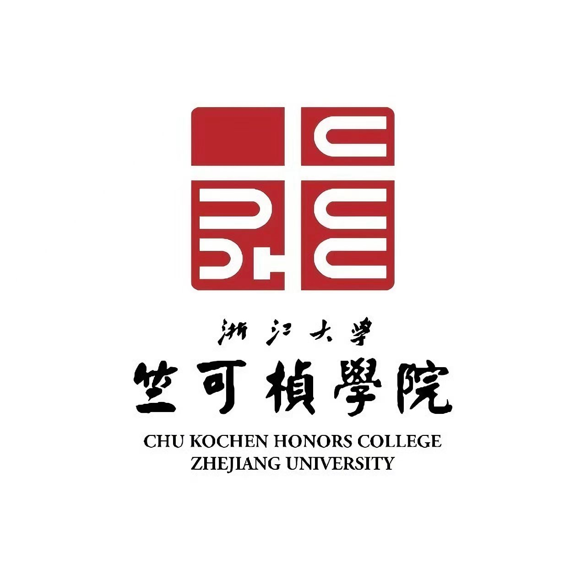

# 
《形势与政策 I》背诵版复习资料

邓欢桐 3250102223

> 整理范围：课程内容复习资料 + 时事复习资料 + 精简时事资料。  
> 使用方法：先背“0. 最高频必背清单”，再按专题背“核心概念—数字日期—答题模板—时事材料”。

---

[[toc]]

## 0. 最高频必背清单（考前先背这一章）

### 0.1 一句话总纲

1. **浙大精神传统**：校训是“求是创新”，浙大精神是“海纳江河、启真厚德、开物前民、树我邦国”，传统是“爱国奉献、百折不挠、改革创新、服务人民、追求卓越”。
2. **国际关系核心**：国家利益是国际关系的核心，国家共同利益是合作基础，利益对立是分歧、摩擦乃至冲突的根源。
3. **中国特色大国外交**：根本遵循是习近平外交思想，战略引领是元首外交，鲜明旗帜是构建人类命运共同体，根本保障是党的领导；方针原则是“自信自立、开放包容、公道正义、合作共赢”。
4. **科技强国**：科技自立自强是国家强盛之基、安全之要；科技创新是发展新质生产力的核心要素；科技强国要具备“五个强大”。
5. **海洋强国**：走“依海富国、以海强国、人海和谐、合作共赢”的发展道路，主要内容可背为“意识、统筹、科技、生态、海军、经济”。
6. **人类命运共同体**：面对和平、发展、安全、治理赤字，中国主张建设持久和平、普遍安全、共同繁荣、开放包容、清洁美丽的世界。
7. **四大全球倡议**：全球发展倡议、全球安全倡议、全球文明倡议、全球治理倡议。
8. **全面从严治党**：破解大党独有难题的第二个答案是党的自我革命；反腐败基本方针是“不敢腐、不能腐、不想腐”一体推进。
9. **中国经济**：“十四五”时期经济实力、科技实力、综合国力跃上新台阶；“十五五”时期是基本实现社会主义现代化夯实基础、全面发力的关键时期。
10. **总体国家安全观**：以人民安全为宗旨、以政治安全为根本、以经济安全为基础、以军事科技文化社会安全为保障、以促进国际安全为依托。
11. **国之大者**：关乎党和国家前途、民族命运的大使命、大方向、大格局、大利益、大战略；新时代最核心的是以中国式现代化全面推进中华民族伟大复兴。

### 0.2 选择题/填空题高频数字与日期

| 内容 | 必背点 |
|:---:|:---:|
| 浙大 | 1897 求是书院；1938 确定“求是”为校训、校歌；1988 确定“求是创新”；1998 新浙江大学；2015.11.5 确定浙大精神内涵 |
| 国际关系 | 一超多强：一超是美国；多强常指中国、欧盟、俄罗斯、日本；世界格局走向多极化 |
| 联合国 | 1945.6.26 签署《联合国宪章》；1946.1.10 第一届联合国大会第一阶段会议召开 |
| 北约 | 1949.4.4 成立，总部布鲁塞尔，材料中为 32 个成员国 |
| 上合组织 | 2001 年成立；材料中截至 2025.9.1 有 10 个正式成员国、2 个观察员国、15 个对话伙伴 |
| 海洋权益 | 《联合国海洋法公约》1982 年通过，中国 1996.5.15 批准加入；我国 1958 年宣布领海宽度 12 海里；7.11 为中国航海日 |
| 人类命运共同体 | 2012 年党的十八大提出倡导“人类命运共同体”意识；2013.3.23 在莫斯科国际关系学院首次向国际社会提出 |
| 国家安全 | 2014.4 首次正式提出总体国家安全观；2015.7 《国家安全法》通过；每年 4.15 为全民国家安全教育日 |
| 时事 | 2025.10.20—23 党的二十届四中全会；2026 年全国两会为十四届四次；10.25 设立为台湾光复纪念日 |
| 2026 发展目标 | GDP 增长 4.5%—5%；城镇调查失业率 5.5%左右；居民消费价格涨幅 2%左右；粮食产量 1.4 万亿斤左右；城镇新增就业 1200 万人以上；单位 GDP 二氧化碳排放降低 3.8%左右 |

### 0.3 最容易出大题的“背诵模板”

#### 模板 A：为什么说国家利益是国际关系的核心？

国家利益是主权国家制定和实施对外政策的基本依据，是国家对外活动的主要目的。国家对外政策的实施，本质上是国家利益的实现、维护和扩大过程。共同利益是国家合作的基础，利益对立是国家间分歧、摩擦乃至冲突的根源。因此，分析国际关系要坚持利益分析法。新时代中国外交坚持维护国家主权、安全、发展利益，同时通过构建人类命运共同体、推动合作共赢，扩大共同利益基础。

#### 模板 B：大学生如何维护国家利益/国家安全？

第一，树立正确国家观，坚持国家利益高于一切，理性爱国，不被错误思潮和网络情绪带偏。第二，学懂我国外交方针政策和国家安全法律法规，增强保密意识、网络安全意识、总体国家安全观。第三，练就过硬本领，服务强国建设、民族复兴，在科研、学习、国际交流中讲好中国故事。第四，从日常做起，不泄密、不传谣、不参与危害国家安全活动，发现线索及时报告。

#### 模板 C：大学生如何服务“国之大者”？

要把个人理想融入党和国家事业之中，心怀“国之大者”，面向世界科技前沿、经济主战场、国家重大需求、人民生命健康。具体而言，要向书本学习、向实践学习、向榜样学习，练就过硬本领；主动参与科创实践和社会实践；在重点领域、重点区域、科技前沿和各行各业中担当使命，把青春奋斗写在中国式现代化进程中。

---

# 第一部分 课程内容背诵版

## 第一讲 浙大的精神传统与使命责任

### 1. 必背关键词

- **历史主线**：求是书院 → 浙江大学堂 → 浙江高等学堂 → 国立第三中山大学 → 国立浙江大学 → 西迁办学 → 新浙江大学 → “双一流”建设。
- **初心使命**：图治、育才、实学。
- **校训**：1938 年“求是”；1988 年“求是创新”。
- **求是精神**：排万难冒百死以求真知；首先是科学精神，同时也是牺牲精神、奋斗精神、革命精神。
- **求是精神的新发展**：追求本质本分、坚持长期主义、超越功利之上、追寻心中的光。
- **浙大精神**：海纳江河、启真厚德、开物前民、树我邦国。
- **浙大传统**：爱国奉献、百折不挠、改革创新、服务人民、追求卓越。

### 2. 重点解释

#### 2.1 浙大的初心使命

1897 年求是书院的办学宗旨强调“图治、育才、实学”。可以概括为：以国家治理和社会进步为目标，以培养人才为根本，以讲求实学为路径。

#### 2.2 求是精神怎么背？

一句话：**求是就是以严格科学态度追求真知，并把这种追求落实为诚与勤。**  
展开可背三点：

1. 不盲从、不附和，只问是非，不计利害。
2. 虚怀若谷，不武断、不蛮横。
3. 专心一致、实事求是、严谨整饬、毫不苟且。

#### 2.3 浙大精神四句话

| 内涵 | 速记 | 解释 |
|:---:|:---:|:---:|
| 海纳江河 | 胸怀格局 | 有宽广视野、胸怀和格局，广纳天下英才和文明成果 |
| 启真厚德 | 真善统一 | 探索真理、尊重规律，同时培育德性、厚实德行 |
| 开物前民 | 实践创新 | 接触实际、勇于实践、启发民众、继往开来 |
| 树我邦国 | 家国天下 | 胸怀祖国、放眼天下，为国家繁荣昌盛和文明进步作贡献 |

### 3. 使命愿景

- **办学使命**：以天下为己任、以真理为依归，致力于知识创新和文化引领，培育担当民族复兴大任的时代新人，为中国式现代化和人类文明进步作出卓越贡献。
- **发展愿景**：建设世界一流的综合型、研究型、创新型大学，成为卓越人才培养和汇聚的战略基地、文化传承和交流的重要平台、国家战略科技力量和全球创新高地。

### 4. 可能考法

1. **填空**：浙大精神内涵是“海纳江河、启真厚德、开物前民、树我邦国”。
2. **简答**：求是精神的内涵是什么？答“科学精神 + 牺牲/奋斗/革命精神 + 诚与勤”。
3. **论述**：作为浙大学生如何传承求是创新？答“学术求真、实践创新、服务国家、担当使命”。

---

## 第二讲 当前国际格局中的国际关系与国家利益

### 1. 当前国际格局的主要特征（必背）

#### 1.1 国际格局演变

当前世界形成“一超多强”的格局，并正在走向多极化。

- **一超**：美国。
- **多强**：中国、欧盟、俄罗斯、日本等。
- **趋势**：格局不稳定，世界多极化持续推进。

#### 1.2 当前国际形势特点：三个总体、三个局部、三个继续

| 分类 | 内容 |
|:---:|:---:|
| 三个总体 | 总体和平、总体缓和、总体稳定 |
| 三个局部 | 局部战争、局部紧张、局部动荡 |
| 三个继续 | 和平发展潮流继续发展；多极化、全球化趋势继续推进；对多数国家而言机遇大于挑战态势继续存在 |

#### 1.3 国际格局五个特征

1. **时代主题明晰化**：和平与发展仍是时代主题，但大国竞争、冷战思维、强权政治与人类命运共同体理念并存。
2. **世界格局多极化**：发展中国家力量上升，权力结构多元化。
3. **经济贸易全球化**：全球化仍发展，但贸易保护主义、单边主义、逆全球化抬头。
4. **安全问题复杂化**：霸权主义、强权政治、恐怖主义、分裂主义、极端主义以及非传统安全问题交织。
5. **非国家行为体作用凸显**：国际组织、非政府组织、跨国公司等影响国际事务。

### 2. 国际关系与国家利益

#### 2.1 国际关系的定义和类型

国际关系是研究国际社会之间外交事务和关系的政治学分支。其主要包括：

1. 国家之间的关系（最主要）。
2. 国际组织之间的关系。
3. 国家与国际组织之间的关系。

#### 2.2 国际关系结构

在无政府状态不变、主权国家不变的情况下，国家之间权力分配决定国际关系结构的基本形态：**单极、两极、多极**。

国际关系样态可概括为：

| 互动方式 | 关系类型 | 关系定位 |
|:---:|:---:|:---:|
| 合作 | 合作主导型 | 盟友、伙伴 |
| 竞争 | 竞争主导型 | 竞争者 |
| 冲突/对抗 | 冲突/对抗主导型 | 对手、敌手、敌人 |

#### 2.3 国际关系行为体

- **国家行为体**：主权国家，是基本行为体。
- **非国家行为体**：政府间国际组织、非政府间国际组织、跨国公司等。

#### 2.4 重要国际组织

| 组织 | 必背点 |
|:---:|:---:|
| 联合国 | 维护世界和平的核心机制、推动共同发展的重要引擎、践行多边主义的核心平台 |
| G7/G20 | 全球经济治理的重要机制 |
| 金砖国家 | 新兴市场和发展中国家合作机制 |
| 东盟 | 东南亚国家联盟 |
| 北约 | 冷战背景下形成的军事同盟，材料中为 32 个成员国 |
| 上合组织 | 2001 年成立，创始成员包括中国、俄罗斯、哈萨克斯坦、吉尔吉斯斯坦、塔吉克斯坦、乌兹别克斯坦 |

### 3. 中美、中欧、中非关系要点

#### 3.1 中美关系

- 曾经历从对抗到合作，再到竞合的复杂历程。
- 是当今世界最重要的双边关系之一，不仅关乎两国，也关系地区和平与全球治理。
- 中美合则两利、斗则俱伤。
- 材料强调中美关系新定位：**中美建设性战略稳定关系**。
- “建设性战略稳定”应是：合作为主的积极稳定、竞争有度的良性稳定、分歧可控的常态稳定、和平可期的持久稳定。

#### 3.2 中欧关系

- 中欧是推动多极化的两大力量。
- 支持世界多极化和国际关系民主化。
- 反对阵营对抗、零和博弈。
- 2025 年是中欧建交 50 周年。
- 中欧关系未来发展三点主张：坚持相互尊重，巩固伙伴关系定位；坚持开放合作，妥善处理分歧摩擦；践行多边主义，维护国际规则秩序。

#### 3.3 中非关系

- 1971 年恢复中华人民共和国在联合国合法席位，非洲国家发挥重要作用。
- 2013 年提出对非工作“真、实、亲、诚”。
- 中非友好合作精神：真诚友好、平等相待，互利共赢、共同发展，主持公道、捍卫正义，顺应时势、开放包容。
- 2024 年中非合作论坛北京峰会是中国近年来规模最大、外国领导人出席最多的主场外交活动之一。

### 4. 国家利益（大题必背）

#### 4.1 国家利益概念

国家利益是满足或能够满足国家以生存发展为基础的各方面需要并且对国家整体有利的事物，是国家在经济、政治、军事、文化等方面的目标和抱负。

#### 4.2 国家利益的层次

| 层次 | 内容 |
|:---:|:---:|
| 主权利益 | 国家独立、生存和安全，是最根本利益 |
| 发展利益 | 发展国内经济、加强对外联系、增强竞争力 |
| 参与利益 | 塑造国家形象，提升制度性话语权和舆论性话语权 |

#### 4.3 国家利益为什么是国际关系核心？

背这段：国家利益是主权国家制定和实施对外政策的基本依据，是国家对外活动的主要目的。共同利益是国家合作的基础，利益对立是分歧、摩擦乃至冲突的根源。因此，国家利益决定外交政策方向，也决定国家间合作、竞争、冲突的基本逻辑。

### 5. 中国外交如何维护国家利益

#### 5.1 中国外交政策演变

| 阶段 | 关键词 |
|:---:|:---:|
| 新中国成立到改革开放 | 另起炉灶、打扫干净屋子再请客、一边倒、和平共处五项原则、独立自主参与国际事务 |
| 改革开放到十八大以前 | 独立自主和平外交政策、和平发展道路、融入国际体系、加入 WTO 等 |
| 中国特色社会主义新时代 | 中国特色大国外交、人类命运共同体、一带一路、积极引领全球治理 |

#### 5.2 新时代对外工作十个历史性成就（了解并会概括）

核心脉络：

1. 习近平外交思想是根本遵循。
2. 元首外交是战略引领。
3. 构建人类命运共同体是鲜明旗帜。
4. 党的领导是根本保障。

#### 5.3 中国特色大国外交方针原则（必背）

| 方针原则 | 解释 |
|:---:|:---:|
| 自信自立 | 坚定道路、理论、制度、文化自信，坚持人类命运共同体追求 |
| 开放包容 | 统筹国内国际两个大局，坚持对外开放，推动开放型世界经济 |
| 公道正义 | 根据事情本身是非曲直决定立场，维护国际关系基本准则 |
| 合作共赢 | 寻找利益汇合点，开展互利合作，实现彼此成就 |

### 6. 大学生怎样维护国家利益

1. 全面正确理解我国外交方针政策。
2. 树立正确国家观，抵御错误思潮。
3. 认识国力壮大是维护国家利益的根本保证。
4. 理性爱国，冷静看待涉外事件。
5. 学好本领，提升国际视野和文化自信。
6. 在国际交流中讲好中国故事。

### 7. 本讲思考题答案框架

#### Q1：举例分析为什么国家利益是处理国际关系的核心？

答题框架：定义国家利益 → 说明国家利益决定外交政策 → 共同利益促合作、利益对立导致冲突 → 举中美/中欧/中非例子 → 总结中国坚持维护主权、安全、发展利益并扩大共同利益。

#### Q2：新时代中国特色大国外交的方针原则是什么？

答：自信自立、开放包容、公道正义、合作共赢。

#### Q3：大学生怎样有效维护国家利益？

答：认知上树立国家利益高于一切；能力上学好本领、提升国际视野；行动上理性爱国、讲好中国故事；底线上遵守国家安全和涉外法律法规。

---

## 第三讲 科技创新 强国有我

### 1. 为什么建设科技强国（必背）

1. 科技革命深刻改变人类社会发展和世界格局。
2. 新科技革命发生地往往成为世界强国，科技落后是近代中国落后挨打的重要原因之一。
3. 世界进入以科技为核心的战略竞争时代。
4. 跨越中等收入阶段、实现第二个百年奋斗目标，关键在创新。
5. 高质量发展要求从要素驱动转向创新驱动。
6. 加快实现高水平科技自立自强是实现高质量发展的必由之路。

### 2. 三大战略、三个第一、三个强国

| 类别 | 内容 |
|:---:|:---:|
| 三大战略 | 科教兴国战略、人才强国战略、创新驱动发展战略 |
| 三个第一 | 科技第一生产力、人才第一资源、创新第一动力 |
| 三个强国 | 教育强国、科技强国、人才强国 |

### 3. 什么是科技强国：五个强大（必背）

1. 强大的基础研究和原始创新能力。
2. 强大的关键核心技术攻关能力。
3. 强大的国际影响力和引领力。
4. 强大的高水平科技人才培养和集聚能力。
5. 强大的科技治理体系和治理能力。

一句话总结：科技不仅要自身强，更要支撑引领国家强，还要造福人类、推动全球发展。

### 4. 科技强国面临的形势与挑战

- 机遇：新一轮科技革命和产业变革加速演进，学科交叉融合，基础研究不断深入，原创成果涌现。
- 挑战：围绕科技制高点的竞争空前激烈，外部科技遏制和极限施压增强。
- 结论：建设科技强国是夺取战略主动、实现民族复兴的必然选择。

### 5. 怎样建设科技强国

可按“五个抓手”背：

1. 加强原始创新和基础研究。
2. 加强关键核心技术攻关。
3. 推动科技创新和产业创新深度融合，发展新质生产力。
4. 一体推进教育、科技、人才发展。
5. 健全科技治理体系，形成良好创新生态。

### 6. 大学生怎么做

1. 树立科技报国、知识报国理想。
2. 打牢专业基础，培养交叉学科能力。
3. 主动参与科研训练、创新创业和社会实践。
4. 善用 AI 等工具，但坚持学术诚信和原创精神。
5. 面向国家重大需求，把个人发展融入科技强国建设。

### 7. 思考题答案框架

#### Q1：什么是科技强国，为什么要建设科技强国？

定义“五个强大”；原因从历史教训、国际竞争、高质量发展、科技自立自强、民族复兴五方面答。

#### Q2：党的十八大以来我国科技发展取得哪些成就？

答：科技创新被摆在现代化建设核心位置；科教兴国、人才强国、创新驱动发展战略深入实施；科技自立自强成为国家强盛之基、安全之要；数字经济、人工智能、装备制造、高技术制造等新质生产力发展。

#### Q3：新时代大学生如何做？

答：立志报国、打牢基础、交叉融合、实践创新、学术诚信、服务国家需求。

---

## 第四讲 海洋强国战略

### 1. 为什么建设海洋强国（必背）

1. **历史视角**：近代中国积弱，遭遇海上坚船利炮，说明海权薄弱会导致国家安全受威胁。
2. **地理视角**：中国是陆海兼备的大国，海域辽阔，必须坚持陆海统筹。
3. **全球视角**：大国强国离不开强大海上力量，海洋是贸易通道、资源宝库和战略空间。
4. **发展视角**：海洋是高质量发展的战略要地，发展海洋经济、海洋科技、海洋生态是现代化建设需要。
5. **安全视角**：维护海洋权益关系国家主权、安全、发展利益。

### 2. 海洋强国战略的提出

- 2003 年《全国海洋经济发展规划纲要》提出逐步把我国建设成为海洋强国。
- 2012 年党的十八大报告首次完整提出海洋强国战略基本内容：提高海洋资源开发能力、发展海洋经济、保护海洋生态环境、坚决维护国家海洋权益。
- 2017 年党的十九大报告提出“坚持陆海统筹，加快建设海洋强国”。
- 2022 年党的二十大报告提出发展海洋经济、保护海洋生态环境、加快建设海洋强国。

### 3. 海洋强国战略主要内容（六点必背）

| 内容 | 关键词 | 背诵解释 |
|:---:|:---:|:---:|
| 提高海洋意识 | 知海、爱海、护海、经略海洋 | 陆海统筹意识、海洋经济意识、海洋环保意识、海洋权益意识、海洋合作意识 |
| 坚持陆海统筹 | 战略、规划、项目 | 从国家战略全局统筹陆地与海洋发展，推动陆海空天一体化 |
| 发展海洋科技 | 深海进入、深海探测、深海开发 | 推动海洋科技高水平自立自强，把装备制造牢牢抓在自己手里 |
| 保护海洋生态 | 人海和谐 | 加强海洋污染防治、生物多样性保护、生态修复和绿色低碳发展 |
| 建设强大海军 | 从黄水到深蓝 | 人民海军经历近岸防御、近海防御、远海防卫，进入“三航母时代” |
| 发展海洋经济 | 蓝色经济 | 海洋渔业、交通运输、油气、滨海旅游、船舶工业、海盐化工、海水利用、生物医药等 |

### 4. 海洋权益常考点

- 海洋权益是国家依据《联合国海洋法公约》在海洋上享有的权益及利益的总称。
- 《联合国海洋法公约》1982 年通过，中国 1996 年批准加入。
- 1958 年我国宣布领海宽度为 12 海里。
- 7 月 11 日是中国航海日和中国的世界海事日。
- 维护海洋权益包括钓鱼岛主权、南海诸岛主权等。

### 5. 大学生能做什么

1. 增强海洋国土意识、海洋权益意识和海洋生态意识。
2. 关注海洋科技、海洋经济、海洋安全相关知识。
3. 专业学习中服务海洋强国，如海洋工程、信息技术、材料、能源、生态、法律、管理等。
4. 参与科普宣传和社会实践，讲好中国海洋故事。

### 6. 思考题答案框架

#### Q1：我国为什么要建设海洋强国？

答：历史教训 + 陆海兼备国情 + 海洋资源与贸易通道 + 维护主权安全发展利益 + 高质量发展和民族复兴需要。

#### Q2：海洋强国战略主要包括哪些方面？

答：提高海洋意识、坚持陆海统筹、发展海洋科技、保护海洋生态、建设强大海军、发展海洋经济。

#### Q3：大学生能做什么？

答：树立海洋意识、学好专业本领、投身海洋科技与生态保护、维护海洋权益、传播海洋强国理念。

---

## 第五讲 人类命运共同体

### 1. 为什么提出人类命运共同体

#### 1.1 现实背景

人类面临全球性危机和全球化问题，全球治理受到挑战，大国关系变化冲击世界格局，国际冲突带来严重伤害。最根本现实是：地球是人类赖以生存的唯一家园。

#### 1.2 四大赤字（必背）

1. 和平赤字。
2. 发展赤字。
3. 安全赤字。
4. 治理赤字。

#### 1.3 三个判断

1. 相互依存是历史大势。
2. 全球性挑战需要全球应对。
3. 新时代呼唤新理念。

### 2. 提出和发展历程

- 2012 年 11 月，党的十八大提出倡导“人类命运共同体”意识。
- 2013 年 3 月 23 日，习近平主席在莫斯科国际关系学院演讲，首次在国际社会提出人类命运共同体理念。
- 党的二十大报告强调推动构建人类命运共同体，坚定维护国际公平正义。

### 3. 理念特征（五点必背）

开放包容、公平正义、和谐共处、多元互鉴、团结协作。

### 4. 目标要求（五个世界必背）

| 领域 | 目标 |
|:---:|:---:|
| 政治 | 建设持久和平的世界 |
| 安全 | 建设普遍安全的世界 |
| 经济 | 建设共同繁荣的世界 |
| 文明 | 建设开放包容的世界 |
| 生态 | 建设清洁美丽的世界 |

### 5. 如何构建人类命运共同体（五个坚持 + 五种格局）

| 坚持 | 对应格局 |
|:---:|:---:|
| 坚持对话协商 | 平等相待、互商互谅的伙伴关系格局 |
| 坚持共建共享 | 公道正义、共建共享的安全格局 |
| 坚持合作共赢 | 开放创新、包容互惠的发展格局 |
| 坚持交流互鉴 | 和而不同、兼收并蓄的文明交流格局 |
| 坚持绿色低碳 | 尊崇自然、绿色发展的生态格局 |

### 6. 思想来源

#### 6.1 中华优秀传统文化

可背关键词：和合理念、以和为贵、和而不同、美美与共、天下大同、天下一家、协和万邦、义利并举、以义为先、天人合一。

#### 6.2 马克思主义哲学

人类命运共同体秉承马克思的“类哲学”思想，追求真正共同体，即人与自然、人与社会、人与人之间高度和谐。

#### 6.3 中国共产党的世界眼光

坚持胸怀天下，是党百年奋斗的重要历史经验。中国共产党不仅发展自己，也兼济天下、造福世界。

### 7. 中国实践：四大全球倡议（必背）

| 倡议 | 核心内容 |
|:---:|:---:|
| 全球安全倡议 | 走对话而不对抗、结伴而不结盟、共赢而非零和的新型安全之路 |
| 全球发展倡议 | 加快落实联合国 2030 年可持续发展议程，坚持以人民为中心，构建全球发展共同体 |
| 全球文明倡议 | 尊重文明多样性，弘扬全人类共同价值，重视文明传承创新，加强国际人文交流合作 |
| 全球治理倡议 | 奉行主权平等、遵守国际法治、践行多边主义、倡导以人为本、注重行动导向 |

### 8. “一带一路”与人类命运共同体

- “一带一路”：丝绸之路经济带 + 21 世纪海上丝绸之路。
- 原则：共商、共建、共享。
- 五通：政策沟通、设施联通、贸易畅通、资金融通、民心相通。
- 三同：利益共同体、命运共同体、责任共同体。

### 9. 思考题答案框架

#### Q1：建设人类命运共同体对我国高质量发展有什么意义？

答：有利于拓展和平稳定外部环境；促进开放合作和高质量共建“一带一路”；推动全球治理改革；扩大共同利益；提升中国国际话语权和制度性影响力。

#### Q2：对全世界有什么价值？

答：回应和平、发展、安全、治理赤字；提供超越零和博弈的新方案；推动多边主义和国际公平正义；促进不同文明互鉴；为全球共同发展和生态安全提供中国方案。

#### Q3：大学生从身边做起能做什么？

答：树立全球视野和文明互鉴意识；学好专业服务全球问题解决；参与国际交流讲好中国故事；尊重多元文化；践行绿色低碳和公益责任。

---

## 第六讲 影视课《速写林俊徳》

材料中第六讲仅列出影视课题目，可从“精神品质类”准备：

1. **爱国奉献**：把个人选择融入国家需要。
2. **科技报国**：面向国家重大需求，长期坚守科研一线。
3. **使命担当**：在艰苦环境中服务国防事业。
4. **求是精神**：严谨、实干、长期主义。

答题时可联系浙大传统、科技强国、国之大者三个主题。

---

## 第七讲 全面从严治党与反腐败

### 1. 腐败概念与腐败行为认定

腐败是具有特定含义的政治术语。材料中腐败行为认定可背“五要素”：

| 要素 | 内容 |
|:---:|:---:|
| 主体 | 公职人员、行使公权力人员 |
| 动机/目的 | 追逐私人利益 |
| 手段 | 凭借机构或职务便利 |
| 方式 | 非规范地运用或滥用公共权力 |
| 后果 | 公共利益或公民权利受到侵害 |

### 2. 党历来重视纪律建设和腐败治理

纪律建设是党创建、发展、壮大的根本保障，是党区别于其他政党和组织的独特优势和“政治基因”。

### 3. 四大考验、四大危险（必背）

| 四大考验 | 四大危险 |
|:---:|:---:|
| 长期执政考验 | 精神懈怠危险 |
| 改革开放考验 | 能力不足危险 |
| 市场经济考验 | 脱离群众危险 |
| 外部环境考验 | 消极腐败危险 |

### 4. 破解历史周期率的两个答案

1. 第一个答案：让人民来监督政府。
2. 第二个答案：不断推进党的自我革命。

### 5. 自我革命“九个以”（了解重点）

可背核心逻辑：以党中央集中统一领导为根本保证，以引领伟大社会革命为根本目的，以新时代中国特色社会主义思想为根本遵循，以跳出历史周期率为战略目标，以解决大党独有难题为主攻方向，以健全全面从严治党体系为有效途径，以组织和队伍建设为着力点，以正风肃纪反腐为抓手，以自我监督和人民监督相结合为动力。

### 6. 全面从严治党的内涵

| 关键词 | 解释 |
|:---:|:---:|
| 全面 | 内容覆盖党的建设各领域，主体覆盖中央到地方各级和干部党员，任务统筹兼顾、标本兼治 |
| 从严 | 思想从严、治吏从严、管党从严、作风从严、执纪从严、反腐从严 |
| 治党 | 问题导向、制度规矩、监督执纪相结合 |

### 7. 健全全面从严治党体系的五个体系

1. 组织体系。
2. 教育体系。
3. 监管体系。
4. 制度体系。
5. 责任体系。

### 8. 反腐败基本方针：三不腐一体推进（必背）

| 内容 | 含义 |
|:---:|:---:|
| 不敢腐 | 保持高压震慑，让腐败代价极高 |
| 不能腐 | 加强制度约束，把权力关进制度笼子 |
| 不想腐 | 加强廉洁教育和理想信念教育，筑牢思想防线 |

### 9. 十八大以来腐败治理新特点

1. 坚持不敢腐、不能腐、不想腐一体推进。
2. 无禁区、全覆盖、零容忍。
3. 保持反腐高压态势。
4. 系统发力遏制腐败势头。
5. 聚焦重点领域和群众身边腐败。
6. 强化对“关键少数”的监督。
7. 以案促改、以案促治。
8. 持之以恒正风肃纪。
9. 扎紧制度笼子。
10. 锻造过硬纪检监察队伍。

### 10. 反腐败斗争成效

1. 构建起党全面领导的反腐败工作格局。
2. 形成一体推进“三不腐”的方针方略。
3. 以零容忍态度惩治腐败。
4. 扎紧防治腐败制度笼子。
5. 构筑拒腐防变思想堤坝。
6. 加强对权力运行的制约和监督。

### 11. 大学生如何践行廉洁意识（大题重点）

#### 11.1 学习科研中的廉洁

- 做真实学问，不造假。
- 写自己作业，不抄袭。
- 用他人成果，必注明。
- 守考试纪律，不作弊。

#### 11.2 社会工作与人际交往中的廉洁

- 学生组织工作公正透明。
- 奖助学金评选公平诚信。
- 校园资源使用合理合规。
- 不拉帮结派，不请托送礼。
- 网络行为守法守纪，不传谣、不泄密。

#### 11.3 日常生活中的廉洁

- 量入为出，适度消费。
- 警惕校园贷、套路贷、电信诈骗。
- 节约公共资源。
- 培养勤俭节约、诚实守信的生活态度。

### 12. 思考题答案框架

#### Q1：如何认识腐败问题？

答：腐败是世界级难题，本质是公权力被非规范运用或滥用，以谋取私人利益，侵害公共利益和公民权利。腐败破坏公平正义、损害党和政府公信力、影响经济社会健康发展，必须长期治理、系统治理。

#### Q2：新时代以来腐败治理新特点和成效？

答：特点从“三不腐一体推进、无禁区全覆盖零容忍、高压态势、重点领域、制度笼子、教育监督”展开；成效从反腐败工作格局、制度体系、思想堤坝、权力监督、零容忍惩治等展开。

#### Q3：大学生如何践行清廉人生？

答：学习科研诚信、社会工作公正透明、人际交往清朗、日常消费理性、职业规划知敬畏守初心，做廉洁文化的践行者、监督者、传播者。

---

## 第八讲 当前中国经济形势与发展

### 1. 基本概念

| 概念 | 解释 |
|:---:|:---:|
| 经济 | 在中国语境中含有经邦、经国、济世、济民之意 |
| 经济学 | 研究经济活动、经济关系及其运行发展规律的学科 |
| 宏观经济 | 国民经济总体活动，如 GDP、物价、就业、货币、进出口等 |
| 中观经济 | 区域、城市、部门、行业经济 |
| 微观经济 | 单个经济单位的经济活动，如价格、市场、企业经营 |
| 经济形势 | 国家宏观经济运行状况和走向，实质是对未来经济增长的预期 |
| 经济发展 | 在经济增长基础上，经济结构和社会结构持续高级化的创新过程 |

### 2. 经济发展的三层含义

1. 经济量的增长。
2. 经济结构的改进和优化。
3. 经济质量的改善和提高。

### 3. “十四五”时期中国经济社会发展成绩（必背）

| 方面 | 重点 |
|:---:|:---:|
| 经济发展新跨越 | 年均增长 5.4%，经济总量突破 140 万亿元，人均 GDP 连续 3 年超过 1.3 万美元 |
| 创新发展新突破 | 全社会研发经费投入年均增长 10%，基础研究经费占比创历史新高，数字经济和新质生产力发展 |
| 改革开放新步伐 | 全国统一大市场建设推进，营商环境优化，高水平对外开放扩大，共建“一带一路”走深走实 |
| 绿色转型新面貌 | 全球最大、发展最快的可再生能源体系，非化石能源消费占比提高，新能源产业链完善 |
| 民生改善新成效 | 居民收入与经济同步增长，就业总体稳定，教育、医疗、社保体系持续巩固 |

### 4. 当前经济领域困难挑战

#### 4.1 外部环境挑战

1. 地缘政治冲突加剧，影响产业链供应链稳定。
2. 单边主义、保护主义抬头，冲击外贸产业。
3. 全球经济动能不足，外需增长乏力。
4. 大国博弈升级，科技、金融、规则领域竞争加剧。

#### 4.2 内部结构性矛盾

1. 内需不足，消费率偏低。
2. 房地产与出口双动力减弱。
3. 新旧动能转换不畅。
4. 青年就业压力和结构性失业问题突出。

### 5. “十五五”时期重要机遇

1. 科技革命与产业变革机遇，尤其是数字革命和人工智能。
2. 市场优势转化机遇，超大规模市场潜力有待释放。
3. 绿色转型机遇，中国已在新能源、绿色产业等领域取得先机。

### 6. “十五五”时期必须遵循的原则（必背）

1. 坚持党的全面领导。
2. 坚持人民至上。
3. 坚持高质量发展。
4. 坚持全面深化改革。
5. 坚持有效市场和有为政府相结合。
6. 坚持统筹发展和安全。

### 7. “十五五”时期经济社会发展七个主要目标（必背）

1. 高质量发展取得显著成效。
2. 科技自立自强水平大幅提高。
3. 进一步全面深化改革取得新突破。
4. 社会文明程度明显提升。
5. 人民生活品质不断提高。
6. 美丽中国建设取得新的重大进展。
7. 国家安全屏障更加巩固。

### 8. “十五五”战略任务和重大举措（12 项，理解背）

1. 建设现代化产业体系，巩固壮大实体经济根基。
2. 加快高水平科技自立自强，引领发展新质生产力。
3. 建设强大国内市场，加快构建新发展格局。
4. 加快构建高水平社会主义市场经济体制。
5. 扩大高水平对外开放。
6. 加快农业农村现代化，推进乡村全面振兴。
7. 优化区域经济布局，促进区域协调发展。
8. 激发全民族文化创新创造活力。
9. 加大保障和改善民生力度，推进共同富裕。
10. 加快经济社会发展全面绿色转型。
11. 推进国家安全体系和能力现代化。
12. 如期实现建军一百年奋斗目标，推进国防和军队现代化。

### 9. 2026 年经济社会发展预期目标

- 国内生产总值增长 4.5%—5%。
- 城镇调查失业率 5.5%左右。
- 居民消费价格涨幅 2%左右。
- 国际收支基本平衡。
- 粮食产量 1.4 万亿斤左右。
- 城镇新增就业 1200 万人以上。
- 居民收入增长和经济增长同步。
- 单位 GDP 二氧化碳排放降低 3.8%左右。

### 10. 大学生如何适应经济变局

1. **看懂变局**：理解新质生产力、数字经济、绿色低碳、人口结构变化。
2. **重塑知识**：构建 T 型能力，一专多能，培养批判性思维和终身学习能力。
3. **技能升级**：拥抱 AI 工具和数据分析，同时提升创意、共情、协作等人文能力。
4. **提前实践**：通过实习、科研、社会实践理解行业痛点，关注新兴职业。
5. **调整心态**：保持长期主义、韧性和全球视野。

### 11. 思考题答案框架

#### Q1：十四五期间中国经济取得哪些成就？

答：经济总量和人均水平提升、创新发展突破、改革开放深化、绿色转型加快、民生改善增强。

#### Q2：十五五时期中国经济有哪些战略布局？

答：围绕高质量发展、科技自立自强、强大国内市场、高水平开放、乡村振兴、区域协调、文化繁荣、共同富裕、绿色转型、安全体系、国防现代化等 12 项任务展开。

#### Q3：大学生如何处理学科专业和未来职业发展关系？

答：一专多能、交叉融合、数字能力、人文能力、实践导向、长期主义，把专业发展与新质生产力和国家需要结合。

---

## 第九讲 坚持总体国家安全观 共同维护国家安全

### 1. 国家安全概念（必背）

国家安全是指国家政权、主权、统一和领土完整、人民福祉、经济社会可持续发展和国家其他重大利益相对处于没有危险和不受内外威胁的状态，以及保障持续安全状态的能力。

### 2. 国家安全为什么重要

1. 国家安全是民族复兴的根基。
2. 社会稳定是国家强盛的前提。
3. 国家安全是改革发展的前提。
4. 居安思危是治党治国的重大原则。
5. 当前国家安全面临复杂风险挑战。

### 3. 国家安全观百年演进

| 时期 | 安全观 |
|:---:|:---:|
| 新民主主义革命时期 | 以主权安全为中心 |
| 社会主义革命和建设时期 | 以军事安全为根本 |
| 改革开放和社会主义现代化新时期 | 以综合安全为基础 |
| 中国特色社会主义新时代 | 总体国家安全观 |

### 4. 总体国家安全观基本内涵（必背）

《国家安全法》明确：国家安全工作应当坚持总体国家安全观，走中国特色国家安全道路。

#### 4.1 五大要素

1. 以人民安全为宗旨。
2. 以政治安全为根本。
3. 以经济安全为基础。
4. 以军事、科技、文化、社会安全为保障。
5. 以促进国际安全为依托。

#### 4.2 五个统筹

1. 统筹外部安全和内部安全。
2. 统筹国土安全和国民安全。
3. 统筹传统安全和非传统安全。
4. 统筹自身安全和共同安全。
5. 统筹维护和塑造国家安全。

#### 4.3 十个坚持

1. 坚持党对国家安全工作的绝对领导。
2. 坚持中国特色国家安全道路。
3. 坚持以人民安全为宗旨。
4. 坚持统筹发展和安全。
5. 坚持把政治安全放在首要位置。
6. 坚持统筹推进各领域安全。
7. 坚持把防范化解国家安全风险摆在突出位置。
8. 坚持推进国际共同安全。
9. 坚持推进国家安全体系和能力现代化。
10. 坚持加强国家安全干部队伍建设。

### 5. 总体国家安全观涵盖 20 个领域

政治安全、国土安全、军事安全、经济安全、金融安全、文化安全、社会安全、科技安全、网络安全、粮食安全、生态安全、资源安全、核安全、海外利益安全、生物安全、太空安全、深海安全、极地安全、人工智能安全、数据安全。

### 6. 国际环境趋势：四个格局、四个时期

| 格局 | 时期 |
|:---:|:---:|
| 力量格局 | 多极化关键期 |
| 安全格局 | 风险活跃期 |
| 发展格局 | 激烈竞争期 |
| 治理格局 | 加速重构期 |

### 7. 国家安全全体系构建

可背“五全”：全体系构建、全领域防控、全方位统筹、全手段运用、全社会动员。

### 8. 大学生如何维护国家安全（大题必背）

1. 坚定国家利益高于一切的观念。
2. 关注国际和国家大局变化。
3. 掌握国家安全法律法规。
4. 学好本领，树立知识报国、科技报国理想。
5. 履行公民义务，发现危害国家安全线索及时报告。
6. 保守国家秘密，不泄密、不传谣、不非法拍摄军事禁区。
7. 在科研、军事爱好、网络活动、论坛兼职、国际交流、特殊行业就业等场景中保持安全意识。

### 9. 公民维护国家安全义务（《国家安全法》第 77 条要点）

1. 遵守宪法、法律法规关于国家安全的规定。
2. 及时报告危害国家安全活动线索。
3. 如实提供证据。
4. 为国家安全工作提供便利和协助。
5. 向国家安全机关、公安机关、军事机关提供必要支持。
6. 保守所知悉的国家秘密。
7. 履行法律法规规定的其他义务。

### 10. 大学生保密知识应知应会

- 不该说的不说，不该问的不问，不该看的不看，不该记的不记。
- 不在公开刊物发表涉密学术成果。
- 不在联网电脑和手机存储、处理、传输涉密信息。
- 不在微信、QQ、微博等社交媒体发布或转发涉密资料。
- 不私自复印、翻拍、携带涉密文件。
- 不在军事禁区或军事管理区非法拍摄。

### 11. 思考题答案框架

#### Q1：总体国家安全观核心要义和内涵要求？

答：五大要素 + 五个统筹 + 十个坚持 + 大安全理念 + 20 个领域 + 统筹发展和安全。

#### Q2：大学生应该如何维护国家安全？

答：意识上树立总体国家安全观；学习上练就报国本领；法律上履行公民义务；行动上保密、防泄密、防诈骗、防渗透；交流中维护国家形象和利益。

---

## 第十讲 读懂“国之大者”的深刻内涵

### 1. 什么是“国之大者”

“国之大者”是指国家或影响国家的最大事情、最重要问题。进一步说，它是关乎党和国家前途、民族命运的大使命、大方向、大格局、大利益、大战略，是党和政府关注的最核心、最关键、最迫切的问题。

### 2. 从历史发展看“国之大者”

| 历史时期 | 最根本的“国之大者” |
|:---:|:---:|
| 新民主主义革命时期 | 推翻三座大山，实现民族独立和人民解放，建立中华人民共和国 |
| 社会主义革命和建设时期 | 确立社会主义基本制度，推进社会主义建设 |
| 改革开放和社会主义现代化建设新时期 | 推进改革开放，开创和发展中国特色社会主义，实现从温饱不足到总体小康、全面小康的跨越 |
| 中国特色社会主义新时代 | 统揽“四个伟大”，统筹“五位一体”，协调“四个全面”，实现中华民族伟大复兴 |

### 3. “国之大者”的三个层面

| 层面 | 内容 |
|:---:|:---:|
| 价值层面 | 以人民为中心 |
| 理论层面 | 理论之树常青，坚持理论创新 |
| 实践层面 | 行胜于言，实干兴邦 |

### 4. 新时代“国之大者”

- 国际背景：当今世界百年未有之大变局。
- 国内背景：实现中华民族伟大复兴战略全局。
- 新时代重点方向：面向世界科技前沿、面向经济主战场、面向国家重大需求、面向人民生命健康。

### 5. 教育与“国之大者”

高等教育要立足中华民族伟大复兴战略全局和世界百年未有之大变局，心怀“国之大者”，为国家富强、民族复兴、人民幸福贡献力量。浙江大学要加快建设世界一流大学和优秀学科，为中国式现代化全面推进民族复兴作出贡献。

### 6. 浙大学生如何服务“国之大者”（必背）

1. 以高远使命升华青春梦想。
2. 练就过硬本领：向书本学习、向实践学习、向榜样学习。
3. 勇于担当使命：参与创新实践、服务重点领域区域、投身科技前沿和经济主战场。
4. 把个人专业、职业规划与国家重大需求结合。

### 7. 思考题答案框架

#### Q1：新时代“国之大者”的内涵是什么？

答：关乎党和国家前途、民族命运的大使命、大方向、大格局、大利益、大战略。新时代最根本的是在百年变局和民族复兴战略全局中，以中国式现代化全面推进中华民族伟大复兴。

#### Q2：教育与“国之大者”的关系是什么？

答：教育是国之大计、党之大计，是培养担当民族复兴大任时代新人的根本工程。高等教育要服务国家战略、科技创新、人才培养和文化传承，为强国建设提供人才和智力支撑。

#### Q3：结合专业谈浙大学生如何服务“国之大者”？

答：结合自己的学科，说明如何面向科技前沿、经济主战场、国家重大需求、人民生命健康，做到学好专业、参与实践、创新攻关、服务社会。

---

# 第二部分 时事复习资料背诵版

## 一、国际新闻重点

### 1. 联合国发布《2025 年可持续发展目标报告》

**必背数据：**

- 仅有 **35%** 的可持续发展目标按计划推进或取得适度进展。
- 近一半目标进展缓慢，**18%** 出现倒退。
- 全球近 **11 人中有 1 人** 面临饥饿。
- **22 亿人** 缺乏安全饮用水，**34 亿人** 缺乏安全卫生设施。
- 2024 年成为有记录以来最热一年，全球平均气温较工业化前高出 **1.55°C**。
- 低收入和中等收入国家债务偿还成本创 **1.4 万亿美元** 历史新高。

**可联系考点：**人类命运共同体、全球发展倡议、可持续发展、全球治理赤字。

### 2. 联合国启动“可持续交通十年行动”

- 时间：2025 年 12 月 10 日。
- 行动周期：2026—2035 年。
- 目标：推动全球交通体系向安全、包容、有韧性、可持续转型。
- 方式：统筹政策规划、资金配置、技术创新与数据支撑。
- 承诺：发布 83 项具体承诺，涉及数百亿美元。
- 重点：清洁公平出行、步行骑行、零排放道路交通、交通数据系统等。

**联系考点：**可持续发展、绿色低碳、人类命运共同体。

### 3. 联合国环境规划署公布 2025 年“地球卫士奖”名单

- “地球卫士奖”是联合国最高级别环境奖项。
- 获奖者包括：太平洋岛国应对气候变化学生组织、印度官员苏普里娅·萨胡、建筑师玛丽亚姆·伊素福、亚马孙人与环境研究所、已故专家曼弗雷迪·卡尔塔吉罗内。

**联系考点：**生态文明、清洁美丽世界、全球气候治理。

### 4. 美国新版国家安全战略

**关键词：**美国优先、西半球优先、反移民、反全球化、经济安全、门罗主义的“特朗普推论”。

**总结背诵：**美国新版国家安全战略以美国战略利益和经济安全为核心，以西半球为战略支点，通过关税推动本土工业发展，对盟友明码标价，最终服务于维持美国霸权。

**联系考点：**霸权主义、强权政治、国际格局多极化、中美关系、国家利益。

### 5. 世界经济论坛 2026 年年会

- 地点：瑞士达沃斯。
- 主题重点：对话与合作。
- 背景：地缘政治复杂、碎片化加剧、新技术快速发展。
- 关键议题：竞争加剧中如何合作、如何释放新增长动力、如何推动创新技术规模化应用。

**联系考点：**多边主义、全球治理、合作共赢。

### 6. 联大通过人工智能国际独立科学小组任命名单

- 意义：全球人工智能科学认知迈出基础性步伐。
- 成员：从 2600 多名候选人中遴选，地域广泛、性别均衡。
- 中国科学家：宋海涛、王坚。

**联系考点：**人工智能安全、科技强国、全球治理。

### 7. 博鳌亚洲论坛 2026 年年会

- 2026 年是博鳌亚洲论坛成立 25 周年，也是海南自贸港全岛封关运作后举行的首次年会。
- 主题：“塑造共同未来：新形势、新机遇、新合作”。
- 数据：亚洲经济体 GDP 占世界经济比重预计由 2025 年的 **49.2%** 上升至 2026 年的 **49.7%**。
- 议题：加强区域组织合作、完善全球经济治理、为不确定世界注入确定性。

**联系考点：**亚洲增长、开放合作、海南自贸港、全球治理。

### 8. 盖洛普民调：全球对中国认可度超过美国

- 2025 年中国全球认可度超过美国。
- 中国领导力支持率中位数 **36%**，领先美国 **5 个百分点**。
- 是近 20 年来中国领先美国幅度最大的一次。

**联系考点：**中国国际影响力、全球南方、制度性话语权。

### 9. 欧洲官员认为北约正在“走向分裂”

- 特朗普政府批评削弱北约，欧洲官员认为北约“瘫痪”并走向分裂。
- 欧洲国家开始防范美国可能退出北约的风险。

**联系考点：**国际安全格局变化、多极化、联盟体系裂痕。

### 10. 美“阿耳忒弥斯 2 号”载人绕月任务

- 打破 1970 年阿波罗 13 号创造的人类距离地球最远飞行纪录。
- 任务为期 10 天。
- 总飞行距离约 695081 英里，即约 1118624 公里。

**联系考点：**科技竞争、航天科技。

### 11. 国际能源署：光伏发电领跑全球能源供应增长

- 2025 年全球太阳能光伏发电量新增 **600 太瓦时**。
- 占全球能源供应增量超过 **25%**。
- 全球销售电动汽车超过 **2000 万辆**，增速超 **20%**。
- 现代可再生能源首次引领全球能源供应增长。

**联系考点：**绿色转型、能源安全、新质生产力。

### 12. 中欧班列开行突破 13 万列

- 时间：2026 年 5 月 9 日。
- 历年累计开行突破 **13 万列**。
- 发送货值超 **5200 亿美元**。
- 通达欧洲 **26 国 235 城**，以及 **11 个亚洲国家 100 多个城市**。

**联系考点：**一带一路、设施联通、陆海统筹、开放型世界经济。

### 13. 全球南方卓然壮大

- “全球南方”媒体智库高端论坛中阿伙伴大会在开罗举行。
- 主题：“聚媒智 启新程——携手构建中阿命运共同体”。
- 意义：中阿媒体智库拓宽合作的新起点，也是全球南方国家增进沟通、凝聚共识的重要平台。

**联系考点：**全球南方、文明互鉴、人类命运共同体。

---

## 二、国内新闻重点

### 1. 纪念中国人民抗日战争暨世界反法西斯战争胜利 80 周年大会

- 时间：9 月 3 日。
- 讲话重点：中国人民抗日战争是艰苦卓绝的伟大战争，中国人民以巨大的民族牺牲为保卫世界和平作出重大贡献。
- 价值：人类命运休戚与共，各国各民族只有平等相待、和睦相处、守望相助，才能维护共同安全。

**联系考点：**人类命运共同体、和平发展、历史记忆、爱国主义。

### 2. 高标准建设海南自由贸易港

- 建设海南自贸港是新时代全面深化改革开放的重大决策。
- 战略目标：打造成为引领我国新时代对外开放的重要门户。
- 要求：锚定战略目标，分步骤构建政策制度体系。

**联系考点：**高水平开放、制度型开放、海南自贸港。

### 3. 福建舰入列

- 福建舰舷号 **18**。
- 我国第三艘航母，第一艘电磁弹射型航空母舰。
- 2022 年 6 月下水命名。
- 完全自主设计建造，电磁弹射技术处于世界先进水平。

**联系考点：**国防现代化、海洋强国、科技自立自强。

### 4. 中央经济工作会议部署 2026 年经济任务

八项重点任务：

1. 坚持内需主导，建设强大国内市场。
2. 坚持创新驱动，加紧培育壮大新动能。
3. 坚持改革攻坚，增强高质量发展动力活力。
4. 坚持对外开放，推动多领域合作共赢。
5. 坚持协调发展，促进城乡融合和区域联动。
6. 坚持“双碳”引领，推动全面绿色转型。
7. 坚持民生为大，努力为人民群众多办实事。
8. 坚持守牢底线，积极稳妥化解重点领域风险。

**联系考点：**十五五、高质量发展、内需、新质生产力、绿色转型、民生。

### 5. 习近平同美国总统特朗普会谈

- 中美关系新定位：中美建设性战略稳定关系。
- 目标：推动两国关系稳定、健康、可持续发展。

**联系考点：**中美关系、国家利益、大国关系。

### 6. 10 月 25 日设立为台湾光复纪念日

- 法律形式：十四届全国人大常委会第十八次会议表决通过。
- 意义：台湾光复是中国人民抗日战争胜利的重要成果，是中国政府恢复对台湾行使主权的重要铁证，是台湾作为中国一部分的历史事实和法理链条重要一环。

**联系考点：**国家统一、主权安全、国家利益、历史记忆。

### 7. 我国能源与动力领域重大突破

- 清洁氢项目投资额占全球比重 **30%**，居全球首位。
- 绿氢产能超过每年 **22 万吨**，占全球 **50% 以上**。
- 建成加氢站超过 **540 座**，占全球 **40%**。
- “十五五”期间力争可再生能源制氢装机达到 **100GW**。
- 国家能源集团浙江安吉电厂 1 号机组投产；我国首次展示无油飞机发动机。

**联系考点：**能源强国、绿色转型、新质生产力。

### 8. 加强数据要素学科专业建设和数字人才队伍建设

- 目的：激活数据要素赋能新质生产力。
- 方向：促进数据领域教育链、人才链与产业链、创新链融合发展。
- 任务：健全数据要素学科专业、推进数据行业职业教育、繁荣数据领域学术研究、促进产学研用协同。

**联系考点：**数字中国、数据安全、科技强国、人才强国。

### 9. 2026 年中央一号文件：乡村全面振兴

- 主题：锚定农业农村现代化，扎实推进乡村全面振兴。
- 六部分：提升农业综合生产能力和质量效益、常态化精准帮扶、促进农民稳定增收、推进宜居宜业和美乡村建设、强化体制机制创新、加强党对“三农”工作的全面领导。
- 做法：以推进乡村全面振兴为总抓手，以学习运用“千万工程”经验为引领，以改革创新为根本动力。

**联系考点：**乡村振兴、共同富裕、农业强国。

### 10. 陆海空间要素支撑“十五五”重大工程建设

- 自然资源部出台通知，优化国土空间布局。
- 目标：保障“十五五”重大工程早落地、早开工。

**联系考点：**陆海统筹、区域协调、海洋强国、十五五。

### 11. 香港从“融入”到“服务”国家发展大局

- “十五五”定位在“融入”基础上增加“服务”。
- 香港优势：金融、航运、贸易、创新科技。

**联系考点：**一国两制、国家发展大局、高水平开放。

### 12. 全球首个全景式碳排放核算系统

- 系统：“磐石·禹衡碳核算大模型”1.0。
- 牵头：中国科学院上海高等研究院。
- 特点：覆盖生产端、消费端及自然源，通过生成式 AI 动态刻画全球碳流动。

**联系考点：**双碳、绿色治理、AI+生态、全球气候治理。

### 13. 2026 世界数字教育大会在杭州开幕

- 主题：“人工智能+教育：变革 发展 治理”。
- 展示智能技术在教学模式、学校治理、创新应用方面的实践。
- 将发布《中国智慧教育发展报告（2025—2026）》等成果。

**联系考点：**教育强国、数字教育、人工智能。

---

## 三、校内新闻重点

### 1. 省委常委会会议专题研究浙江大学工作

- 时间背景：2005 年 9 月 23 日，习近平在浙江工作时曾在浙大主持召开省委常委会会议；2025 年 9 月 23 日，在 20 周年时间节点，省委再次在浙大召开会议。
- 会议强调：做强浙江大学，就是做强浙江的战略竞争力、关键驱动力、核心软实力。
- 要求：支持浙大就是支持浙江高质量发展，省委省政府支持只会加强、不会减弱。

**联系考点：**浙大使命愿景、科技创新、服务国之大者。

### 2. 浙大新增院士

- 中国科学院院士：申有青、蔡秀军、胡海岚。
- 中国工程院外籍院士：丸山茂夫、李尔平。

**联系考点：**人才强国、科技强国、浙大服务国家战略。

---

## 四、党的二十届四中全会重点

### 1. 会议概况

- 时间：2025 年 10 月 20 日至 23 日。
- 地点：北京。
- 核心内容：审议通过《中共中央关于制定国民经济和社会发展第十五个五年规划的建议》。

### 2. 核心判断

- “十四五”时期我国发展取得历史性成就，经济实力、科技实力、综合国力跃上新台阶。
- “十五五”时期是基本实现社会主义现代化夯实基础、全面发力的关键时期。

### 3. 发展原则（必背）

坚持党的全面领导、坚持人民至上、坚持高质量发展、坚持全面深化改革、坚持有效市场和有为政府相结合、坚持统筹发展和安全。

### 4. 目标号召

为到 2035 年基本实现社会主义现代化夯实基础，奋力开创中国式现代化建设新局面。

---

## 五、2026 年全国两会重点

### 1. 基本信息

- 十四届全国人大四次会议：3 月 5 日上午在北京开幕。
- 全国政协十四届四次会议：3 月 4 日下午在北京开幕。
- 聚焦“十五五”规划纲要制定和实施。

### 2. 今年发展的预期目标（必背）

| 指标 | 目标 |
|:---:|:---:|
| 国内生产总值增长 | 4.5%—5%，实际工作中努力争取更好结果 |
| 城镇调查失业率 | 5.5%左右 |
| 居民消费价格 | 涨幅 2%左右 |
| 国际收支 | 基本平衡 |
| 粮食产量 | 1.4 万亿斤左右 |
| 城镇新增就业 | 1200 万人以上 |
| 居民收入增长 | 和经济增长同步 |
| 单位 GDP 二氧化碳排放 | 降低 3.8%左右 |

### 3. 2026 年政府工作任务（十项）

1. 着力建设强大国内市场。
2. 加紧培育壮大新动能。
3. 加快高水平科技自立自强。
4. 持续深化重点领域改革。
5. 进一步扩大高水平对外开放。
6. 扎实推进乡村全面振兴。
7. 推动新型城镇化和区域协调发展。
8. 更大力度保障和改善民生。
9. 加快推动全面绿色转型。
10. 加强重点领域风险防范化解和安全能力建设。

### 4. 两会热词

#### 政府工作报告热词

- 继续实施更加积极的财政政策。
- 继续实施适度宽松的货币政策。
- 强化改革举措与宏观政策协同。
- 纵深推进全国统一大市场建设。
- 推进财税金融体制改革。
- 充分激发各类经营主体活力。
- 脑机接口。
- 增加普通高中学位供给。
- 扩大普惠养老服务供给。
- 实施稳岗扩容提质行动。
- 大规模职业技能提升培训。
- 推广中小学春秋假。

#### 最高法、最高检工作报告热词

- 正当防卫认定。
- 未成年人犯罪预防治理。
- 严厉打击跨境电诈犯罪。
- 依法惩治“人肉开盒”。

---

# 第三部分 考前速背问答

## 1. 浙大精神是什么？

海纳江河、启真厚德、开物前民、树我邦国。

## 2. 求是精神是什么？

排万难冒百死以求真知；首先是科学精神，同时也是牺牲精神、奋斗精神、革命精神；表现为诚与勤、实事求是、严谨整饬。

## 3. 当前国际形势“三个总体、三个局部、三个继续”是什么？

三个总体：总体和平、总体缓和、总体稳定。三个局部：局部战争、局部紧张、局部动荡。三个继续：和平发展潮流继续发展，多极化全球化趋势继续推进，对多数国家而言机遇大于挑战态势继续存在。

## 4. 国家利益从层次上怎么划分？

主权利益、发展利益、参与利益。其中主权利益是最根本利益。

## 5. 新时代中国特色大国外交方针原则是什么？

自信自立、开放包容、公道正义、合作共赢。

## 6. 科技强国“五个强大”是什么？

基础研究和原始创新能力强、关键核心技术攻关能力强、国际影响力和引领力强、科技人才培养和集聚能力强、科技治理体系和治理能力强。

## 7. 海洋强国战略主要内容是什么？

提高海洋意识、坚持陆海统筹、发展海洋科技、保护海洋生态、建设强大海军、发展海洋经济。

## 8. 人类命运共同体目标要求是什么？

建设持久和平、普遍安全、共同繁荣、开放包容、清洁美丽的世界。

## 9. 四大全球倡议是什么？

全球发展倡议、全球安全倡议、全球文明倡议、全球治理倡议。

## 10. 反腐败“三不腐”是什么？

不敢腐、不能腐、不想腐一体推进。

## 11. 破解历史周期率的第二个答案是什么？

不断推进党的自我革命。

## 12. 十五五时期必须遵循的原则是什么？

坚持党的全面领导、坚持人民至上、坚持高质量发展、坚持全面深化改革、坚持有效市场和有为政府相结合、坚持统筹发展和安全。

## 13. 总体国家安全观“五大要素”是什么？

以人民安全为宗旨，以政治安全为根本，以经济安全为基础，以军事、科技、文化、社会安全为保障，以促进国际安全为依托。

## 14. 总体国家安全观“五个统筹”是什么？

统筹外部安全和内部安全、国土安全和国民安全、传统安全和非传统安全、自身安全和共同安全、维护和塑造国家安全。

## 15. “国之大者”是什么？

关乎党和国家前途、民族命运的大使命、大方向、大格局、大利益、大战略，是最核心、最关键、最迫切的问题。

## 16. 2026 年两会经济增长目标是多少？

GDP 增长 4.5%—5%，实际工作中努力争取更好结果。

## 17. 福建舰有什么重要性？

福建舰舷号 18，是我国第三艘航母、第一艘电磁弹射型航空母舰，由我国完全自主设计建造，电磁弹射技术处于世界先进水平。

## 18. 台湾光复纪念日是哪天？

10 月 25 日。

## 19. “一带一路”五通是什么？

政策沟通、设施联通、贸易畅通、资金融通、民心相通。

## 20. 大学生维护国家安全最重要的日常底线是什么？

不泄密、不传谣、不非法拍摄敏感区域、不非法提供敏感信息，发现危害国家安全线索及时报告。

---

# 第四部分 论述题万能结构

## 1. 政治类/国际类论述题结构

1. **提出判断**：先回答题目核心概念。
2. **解释背景**：国际格局、多极化、全球治理、国家利益等。
3. **展开原因**：从历史、现实、理论、实践四方面展开。
4. **结合中国方案**：人类命运共同体、四大全球倡议、一带一路、中国特色大国外交。
5. **联系大学生**：理想信念、专业学习、实践担当、讲好中国故事。

## 2. 经济类论述题结构

1. “十四五”成绩：经济、创新、改革开放、绿色、民生。
2. 当前挑战：外部不确定性、内部结构性矛盾。
3. “十五五”布局：原则、目标、12 项任务。
4. 大学生：T 型能力、AI 工具、实践、长期主义。

## 3. 科技/国之大者类论述题结构

1. 说明科技创新对强国建设的重要性。
2. 引出科技强国“五个强大”和高水平科技自立自强。
3. 结合“国之大者”四个面向：世界科技前沿、经济主战场、国家重大需求、人民生命健康。
4. 落到大学生：专业基础、交叉能力、科研实践、使命担当。

## 4. 安全类论述题结构

1. 定义国家安全。
2. 写总体国家安全观：五大要素、五个统筹、十个坚持。
3. 写 20 个领域和“大安全”理念。
4. 写大学生责任：守法、保密、报告、学习、报国。

## 5. 廉洁类论述题结构

1. 定义腐败及危害。
2. 写全面从严治党、自我革命、三不腐。
3. 写新时代反腐特点和成效。
4. 写大学生廉洁：学习科研、社会工作、人际交往、日常消费、未来职业。

---

# 第五部分 最后 30 分钟背诵清单

1. 浙大精神：海纳江河、启真厚德、开物前民、树我邦国。
2. 浙大传统：爱国奉献、百折不挠、改革创新、服务人民、追求卓越。
3. 国际形势：三个总体、三个局部、三个继续。
4. 国际格局特征：时代主题明晰化、世界格局多极化、经济贸易全球化、安全问题复杂化、非国家行为体作用凸显。
5. 国家利益三层次：主权利益、发展利益、参与利益。
6. 中国特色大国外交方针：自信自立、开放包容、公道正义、合作共赢。
7. 科技强国五个强大。
8. 海洋强国六内容。
9. 人类命运共同体五目标、五路径、四倡议。
10. 全面从严治党：四大考验、四大危险、自我革命、三不腐。
11. 十五五：六原则、七目标、十二任务。
12. 总体国家安全观：五要素、五统筹、十坚持、20 领域。
13. 国之大者：大使命、大方向、大格局、大利益、大战略。
14. 时事数字：SDG 35%、18%；博鳌亚洲 GDP 49.2%→49.7%；盖洛普中国 36% +5；中欧班列 13 万列；福建舰 18；两会 GDP 4.5%—5%。

